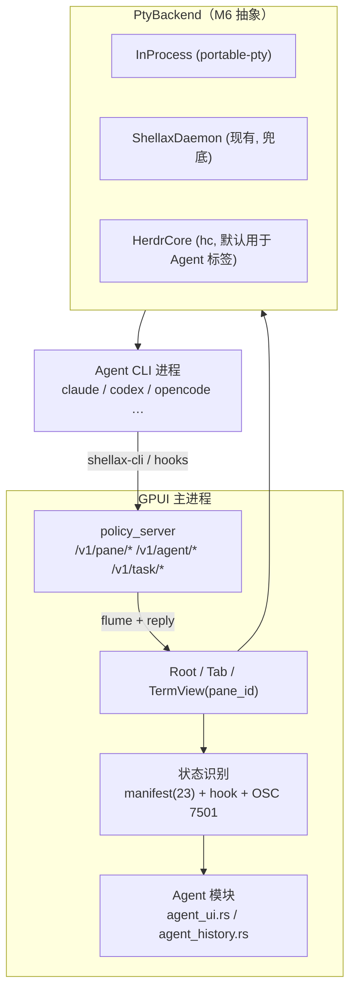
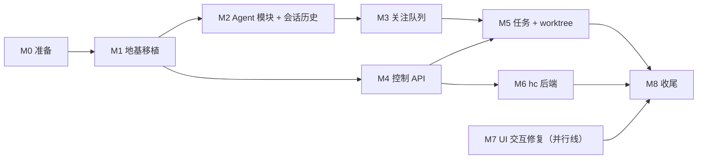

# ShellAX 多 Agent 工作台：详细实施计划

> 给执行这份计划的工程师 / AI 模型。基线：`master@9387373`（v1.3.7）。
> 参考源码：herdr `ee5bfb5`（v0.9.5）、herdr-core `c751780`（v0.1.21），都是 Apache-2.0。
> 产品目标：**Agent 是用户使用最频繁的功能**。每个里程碑都要能独立发版，并且用户能直接感到"更好用"。

---

## 0. 执行须知（每个任务都要遵守）

### 0.1 工程规范
- 每个任务开一个分支 `feat/agent-<任务号>-<slug>`，一个任务一个 PR，不要跨里程碑混改。
- 每个 PR 都必须通过：`cargo check`、`cargo clippy --all-targets`（0 警告）、`cargo test --release`、`tools/ui_lint.sh`（不能新增违例）。
- **UI 一律使用 [ui.rs](file:///Users/afeng/workspace/VibeCoding/ShellAX/src/ui.rs) 里的组件和 token**，包括 `panel_header`、`list_row`、`icon_button`、`button_sm`、`empty_state`、`notice`、`SP_*`、`R_*`、`fs_*`。不要写死颜色、字号或圆角；新增 token 先加到 `ui.rs` / `theme.rs`。
- **i18n**：用户能看到的文字都走 `t("key")`，`locales/zh-CN.toml` 和 `locales/en.toml` 要同时补。
- **动效**：使用 [motion.rs](file:///Users/afeng/workspace/VibeCoding/ShellAX/src/motion.rs) 的常量，并检查 `motion::reduced()`。
- **配置**：新字段加到 [config.rs](file:///Users/afeng/workspace/VibeCoding/ShellAX/src/config.rs) 并带 `#[serde(default)]`，保证旧配置能正常加载。
- **安全**：新增的 HTTP 端点都要经过 `policy` 判定并写审计；读取终端内容时要先脱敏（复用 AI 上下文用的脱敏函数）。
- 每个里程碑结束时，在 `CHANGELOG.md` 写条目，在 `README.md` / `README.en.md` 同步功能说明。

### 0.2 移植 herdr 代码的许可要求
1. 拷贝的源文件头部保留 `// Copyright (c) herdr contributors. Licensed under the Apache License, Version 2.0.`。改动过的标 `modified`，函数或段落用 `[3p]` 标记（沿用 [agent.rs](file:///Users/afeng/workspace/VibeCoding/ShellAX/src/agent.rs) 的做法）。
2. 在 [THIRD_PARTY_NOTICES.md](file:///Users/afeng/workspace/VibeCoding/ShellAX/THIRD_PARTY_NOTICES.md) 第 1 节的表格里逐行登记文件、来源、"modified/unmodified"。
3. 许可证文本已经有了：`licenses/herdr-LICENSE-Apache-2.0.txt`。
4. herdr-core 的 `hc` 只作为**外部程序**调用，不链接、不拷代码。如果随包分发 `hc`，就把它的 LICENSE 和 `hc --licenses` 的输出放进 `licenses/`。

### 0.3 关键架构约束
- `Root`（[main.rs](file:///Users/afeng/workspace/VibeCoding/ShellAX/src/main.rs)）、`TermView` 是 GPUI Entity，**只能在 UI 线程访问**。后台线程（策略服务每个请求一个线程）必须通过 `flume` channel 发命令，并带上 `reply: flume::Sender<..>` 回到 UI 线程，参照 `OPEN_TX` / `ap_rx` 的写法（[main.rs#L6236-L6262](file:///Users/afeng/workspace/VibeCoding/ShellAX/src/main.rs#L6236-L6262)）。
- `term::Session.term` 放在 `Arc<Mutex<Term>>` 里，可以在任意线程读 `screen_text()`。
- 模块（左侧功能条）机制在 [activity.rs](file:///Users/afeng/workspace/VibeCoding/ShellAX/src/activity.rs) 和 [workspace.rs](file:///Users/afeng/workspace/VibeCoding/ShellAX/src/workspace.rs)。**新增模块请以 Homebrew 模块为模板**：`Tool::Brew`、`brew_ui.rs` 负责左侧面板，`brew_view.rs` 负责主区域。
- 多窗口是多进程（`secondary()`），**只有主窗口运行策略服务**。Agent API 只管主窗口里的 pane。

---

## 1. 总体设计

### 1.1 新的 "Agent" 模块（用户提出的界面入口）

在左侧功能条新增 **Agent** 模块：`Tool::Agents`，排在"主机/终端"之后的第 2 位，图标用 `Bot`，默认快捷键 `alt-9`，执行者需检查有无冲突。

点击后，**左侧工具窗口整块用来放 Agent 内容**，也就是主机/终端模块里显示主机树和路径的那块区域。主区域显示 Agent 标签页。

> 理解说明：这里把"原本放路径的内容区域"理解为左侧工具窗口（主机/终端模块下显示主机树和路径的区域）。如果你指的是底部路径栏，请告诉我，只需调整 M2 的 T2.2。

```
┌─功能条─┬──────── 左侧工具窗口（Agent） ────────┬────────────── 主区域 ──────────────┐
│ 🖥 主机 │ Agent                 [+ 新建任务] [⚙] │ [claude · feat-login ●] [codex ◐] [+] │
│ 🤖 Agent│ 🔍 搜索会话 / 项目 / 提示词            │                                      │
│ 📁 SFTP │ ▾ 需要处理 (2)                         │   Agent 终端（实时）                  │
│ 🗄 数据库│   ⛔ claude  feat-login  等待审批 2m   │                                      │
│  …      │   ✅ codex   fix-cache   已完成·未读   │                                      │
│         │ ▾ 运行中 (3)                 按项目 ▾  │                                      │
│         │   ShellAX                              │                                      │
│         │     ◐ claude  重构 sidebar   ctx 62%   │                                      │
│         │ ▾ 历史会话                全部 Agent ▾ │                                      │
│         │   ShellAX                              │                                      │
│         │     claude  修复 SFTP 断点续传  master │                                      │
│         │             昨天 18:20 · 42 条         │                                      │
│         │     codex   增加 IP 延迟测试    feat/x │                                      │
│         │   DXAiFlow                             │                                      │
│         │     …（虚拟列表，可滚动）               │                                      │
│         ├────────────────────────────────────────┤──────────────────────────────────────┤
│         │ ● 2 等待 · 3 运行 · 今日 1.2M tokens   │ 状态栏：agent · 分支/worktree · ctx    │
└─────────┴────────────────────────────────────────┴──────────────────────────────────────┘
```

#### 左侧工具窗口的四个区块
1. **顶部栏**：标题；"新建任务"（M5 前先打开 Quick Start / 快速启动菜单）；设置入口；搜索框，可搜标题、首条或末条提示词、项目、分支。
2. **需要处理**：Blocked 和 Done 未读的会话，按等待时间倒序，有内容时固定在最上方。
3. **运行中**：当前所有 agent pane，按项目（git 根目录或 cwd）分组。每行显示状态图标、agent、标题、上下文占用。
4. **历史会话**：本机 Claude Code / Codex 等的会话历史，按项目分组，用虚拟列表。
   - 单击：在新的 Agent 标签里**恢复会话**。
   - 右键：在新 worktree 中恢复、复制会话 ID、打开 transcript 文件、在终端模块打开项目目录。

#### 主区域
- 有 Agent 标签时显示标签内容。
- 没有标签时显示空状态：快速启动卡片（Claude / Codex / … 加最近项目）、"新建任务"、最近 5 条历史会话。

#### 底部状态栏（仅 Agent 模块）
等待数和运行数；当前焦点 agent 的分支或 worktree、上下文占用、token。

#### 体验原则
- **零配置可用**：首次进入自动扫描本地会话历史并检测已安装的 agent CLI。
- **键盘优先**：`alt-9` 进入模块；`ctrl-shift-j` 跳到下一个需要处理的 agent；在列表里用 ↑↓ 选择、Enter 恢复、`/` 聚焦搜索。
- **快**：会话索引在后台线程构建并缓存，打开模块时 **< 100ms** 出首屏（先显示缓存，再增量刷新）。

### 1.2 运行时分层



### 1.3 里程碑与依赖



| 里程碑 | 工期估计 | 可发版 | 用户能感知到的变化 |
|---|---|---|---|
| M0 | 0.5 天 | — | — |
| M1 | 4–5 天 | v1.4.0 | 支持 23 种 agent；mac 识别准确；新增"已完成"状态 |
| M2 | 5–6 天 | v1.5.0 | **新增 Agent 模块，会话历史一键恢复** |
| M3 | 3–4 天 | v1.5.x | 一眼看出谁在等我，一键跳转 |
| M4 | 5–6 天 | v1.6.0 | agent 能编排 agent |
| M5 | 5–6 天 | v1.7.0 | 按任务开 worktree，多个 agent 并行互不干扰 |
| M6 | 7–10 天 | v1.8.0 | 关闭窗口后 agent 继续运行，状态不丢 |
| M7 | 与上面并行，约 6 天 | 随各版本 | 交互更顺手 |
| M8 | 2–3 天 | — | 文档、截图、回归 |

---

## M0 准备（0.5 天）

**T0.1 固定参考源码**
- 把 herdr `ee5bfb5` 和 herdr-core `c751780` 浅克隆到仓库外（例如 `../_ref/`），**不要提交进本仓库**。
- 在 `docs/AGENT_PLAN.md` 记录参考 commit。可以直接把本计划存进这个文件。

**T0.2 基线**
- 跑一遍 `cargo test --release` 和 `tools/ui_lint.sh`，把当前失败项记为基线（已知 `ui_lint.sh` 有 15 处误报和 2 处圆角违例），后续 PR 不能新增。

---

## M1 地基移植（4–5 天）

### T1.1 同步 23 个 agent 识别规则，并补引擎版本校验
- **来源**：herdr `src/detect/manifests/*.toml`（23 个）和 `src/detect/manifest.rs`。
- **改动**：
  1. 把 `agents/*.toml` 替换或新增为 herdr 最新版：amp、antigravity、claude、cline、codex、cursor、devin、droid、gemini、github-copilot、grok、hermes、kilo、kimi、kiro、letta、maki、muse、opencode、pi、qodercli、qwen 等，以 herdr 目录实际内容为准。
  2. [agent.rs#L213](file:///Users/afeng/workspace/VibeCoding/ShellAX/src/agent.rs#L213) 的 `bundled()` 改为 `include_str!` 全部文件。建议用 `build.rs` 生成列表，或者写一个静态数组。
  3. 新增 `const MANIFEST_ENGINE_VERSION: u32 = 3;`。加载时 `min_engine_version > ENGINE` 的规则**跳过并在日志警告**，不要 panic。
  4. 对比 herdr `manifest.rs` 里的 region 和门控语法，补齐 ShellAX 规则引擎缺的部分（重点看 engine 3 的特性，比如 `top_non_empty_lines`，ShellAX 已有，需逐项确认）。
  5. 配置项：`detect_claude/detect_codex/detect_grok` 三个布尔改成 `agents.detect: BTreeMap<String,bool>`（默认全开）。旧字段要兼容迁移。设置页"外部 Agent"改为列表开关。
- **验收**：用 herdr 的 manifest 测试样例（`src/detect` 里的 fixtures，如果有）跑 ShellAX 引擎，结果一致；23 个规则全部加载成功。
- **测试**：每个 agent 至少一条 working、一条 blocked 的屏幕文本快照用例。

### T1.2 规则在线更新（可选开关，默认开）
- **来源**：herdr `src/detect/manifest_update.rs` 和 `distribution/agent-detection/index.toml`。
- **实现**：
  - 启动后 30 秒、之后每 24 小时，通过 `proxy::ureq_builder` 拉取 index。
  - 校验 sha256 和 `min_engine_version` 后写到 `<数据目录>/agent-detection/`。
  - 加载优先级：用户目录 > 下载目录 > 内置。
  - 设置项 `agents.manifest_update: bool`。
  - 更新源 URL 可配置，默认 herdr 官方的 raw 地址。
- **验收**：断网时不报错；拉到坏文件时回退到内置规则。

### T1.3 macOS 前台进程与 cwd 探测
- **来源**：herdr `src/platform/macos.rs` 的 `foreground_job`、`foreground_process_group_id`、`KERN_PROCARGS2` 解析（L435-L640）。
- **改动**：
  - 新建 `src/proc_info.rs`，提供跨平台的 `fg_process(pgid) -> Option<(name, argv)>` 和 `cwd(pid) -> Option<PathBuf>`。Linux 保留 `/proc`，macOS 用 `proc_pidinfo(PROC_PIDVNODEPATHINFO)` 和 `sysctl(KERN_PROCARGS2)`。
  - 替换 [local.rs#L318-L335](file:///Users/afeng/workspace/VibeCoding/ShellAX/src/local.rs#L318-L335)，以及 `daemon.rs` 里所有 `/proc` 调用（L115、L362、L376）。
  - 保留 node/bun/python 场景下取 argv[1] 的逻辑。
- **验收**：在 mac 上运行 `claude`、`codex`（node 程序）时，`identify()` 通过前台进程识别出来，而不是靠标题；本地终端的路径栏 cwd 正确。
- **测试**：`#[cfg(target_os="macos")]` 单测，spawn `sleep` 后探测到的进程名为 `sleep`。

### T1.4 稳定的 pane ID 与环境变量注入
- **改动**：
  - `TermView` 增加 `pub pane_id: String`（复用 `session_store::uuid_like`），持久化到 `PaneSave`，恢复布局时保持不变。
  - `local::spawn_local_in`、`daemon::spawn`、SSH 通道（[ssh.rs#L1238](file:///Users/afeng/workspace/VibeCoding/ShellAX/src/ssh.rs#L1238) 附近的 `set_env`）注入：
    - `SHELLAX_PANE=<pane_id>`
    - `SHELLAX_URL`、`SHELLAX_TOKEN`（本地直接给；远端沿用现有反向转发的 endpoint 文件机制）
  - 在 `Root` 上增加 `fn pane_by_id(&self, id:&str, cx) -> Option<(tab_idx, Entity<TermView>)>`。
- **验收**：在本地和 SSH pane 里执行 `echo $SHELLAX_PANE` 都有值；重启应用、恢复布局后 ID 不变。

### T1.5 "已完成（Done）"状态
- **改动**：
  - `AgentState` 增加 `Done`（[agent.rs#L10-L16](file:///Users/afeng/workspace/VibeCoding/ShellAX/src/agent.rs#L10-L16)）。
  - `TermView` 增加 `agent_unread: bool`。状态从 Working 变为 Idle 时，如果 pane 当前不可见或没有焦点，置为 Done 并标记未读；用户聚焦该 pane 后清除，回到 Idle。
  - 通知（[main.rs#L1127-L1145](file:///Users/afeng/workspace/VibeCoding/ShellAX/src/main.rs#L1127-L1145)）、标签徽标（[main.rs#L4200](file:///Users/afeng/workspace/VibeCoding/ShellAX/src/main.rs#L4200)）和侧栏 Dock 同步支持 Done。图标用 ✅，颜色用 success 色。
- **验收**：在后台标签运行 agent，任务结束后标签显示 ✅ 并发通知；切换过去后 ✅ 消失。

### T1.6 会话恢复命令表，替换死代码
- **来源**：herdr `src/agent_resume.rs`，包括 `plan()` 和 `validate_resume_argv()`。
- **改动**：
  - 新建 `src/agent_resume.rs`（标 `[3p]`），覆盖 claude、codex、copilot、devin、droid、opencode、gemini 等。
  - 删除 [agent_desk.rs](file:///Users/afeng/workspace/VibeCoding/ShellAX/src/agent_desk.rs) 里与之重复的 `enter_argv`；`list_argv`/`parse_list` 如果 M2 用不到也一并删除，并移除 `lib.rs:4` 的导出。
  - `TermView.resume_offer` 改用新表生成。
- **验收**：单测覆盖每种 agent 生成的 argv；非法 ID（含控制字符、引号、路径）会被拒绝。

### T1.7 hook 上报会话身份
- **来源**：herdr `src/integration/assets/{claude,codex,opencode}/herdr-agent-state.*`。只借鉴逻辑，脚本要重写成 ShellAX 版本。
- **改动**：
  - [hooks.rs#L259](file:///Users/afeng/workspace/VibeCoding/ShellAX/src/hooks.rs#L259) 安装 Claude 的 `SessionStart`、`UserPromptSubmit`、`Notification`、`Stop` 四个 hook，命令为 `shellax-cli hook claude <event>`（复用现有子命令）。Codex 和 OpenCode 按各自配置格式参照 herdr 的 `integration/codex*`、`opencode_config.rs`。
  - `shellax-cli hook` 读 stdin 的 JSON，带上 `SHELLAX_PANE` POST 到 `/v1/hook/<agent>/<event>`。**网络失败时静默退出 0，绝不能阻塞 agent。**
  - 策略服务把收到的数据转成 `PaneCmd::ReportAgent{pane_id, agent, event, session_id, transcript_path}` 发到 UI 线程，更新 `TermView`：
    - `agent_session: Option<AgentSessionRef>`
    - hook 带来的状态（UserPromptSubmit 对应 Working，Notification 对应 Blocked，Stop 对应 Done）。
  - **优先级**：hook 状态比屏幕规则更可靠。hook 状态 10 秒内有效，过期后回退到屏幕规则判定。
- **验收**：Claude 会话开始后，pane 的 `agent_session.id` 等于 Claude 的 sessionId；Stop 后 1 秒内显示 Done。
- **测试**：扩展 `tools/e2e_hooks.sh` 和 `tools/mock_agent_llm.py`。

---

## M2 Agent 模块 + 会话历史（5–6 天）⭐ 用户核心诉求

### T2.1 注册 `Tool::Agents` 模块
- **改动**：
  - [activity.rs](file:///Users/afeng/workspace/VibeCoding/ShellAX/src/activity.rs)：
    - `enum Tool` 增加 `Agents`；
    - `strip()` 把它插在 `Hosts` 后面；
    - `id()` 为 `"agents"`；`label()` 为 `t("tool.agents")`；`icon()` 为 `IconName::Bot`；`action()` 为 `Action::ToolAgents`；
    - `tool_panel()` 增加分支，调用 `self.agents_panel(window, cx)`，外面用 `sb_frame` 包住，加上 resize handle。
  - [actions.rs](file:///Users/afeng/workspace/VibeCoding/ShellAX/src/actions.rs)：增加 `Action::ToolAgents`，默认 `"alt-9"`，归入 `tool.group`。
  - [workspace.rs](file:///Users/afeng/workspace/VibeCoding/ShellAX/src/workspace.rs)：
    - `pane_module`：`v.ws == Some(Tool::Agents)`，或者 `v.agent.is_some() && v.launched_as_agent` 时归属 Agents；
    - `new_module_tab` 在 Agents 模块下打开"快速启动菜单"；
    - 空状态的文案和图标。
  - **归属规则**：从 Agent 模块启动或恢复的 pane 一律设 `ws = Some(Tool::Agents)`。用户在普通终端里手动运行的 agent **不移动**，留在终端模块，但会出现在"运行中"列表里，点击时跳回终端模块对应的 pane。
- **验收**：`alt-9` 切换到 Agent 模块；再次点击图标收起工具窗口；切走再切回时恢复上次的 Agent 标签。

### T2.2 左侧面板骨架 `agent_ui.rs`
- 新建 `src/agent_ui.rs`，写 `impl Root { fn agents_panel(...) }`。结构参照 `brew_ui.rs`，全部用 ui.rs 组件拼：
  1. `ui::panel_header_with`：标题 "Agent"，右侧放 `icon_button`（新建任务、刷新、设置）。
  2. 搜索框：用 gpui-component Input；输入经过 150ms 防抖。
  3. 三个可折叠 `section_header`："需要处理"、"运行中"、"历史会话"，折叠状态存进 `config.agents.ui.collapsed`。
  4. 区块内的行用 `ui::list_row`。**历史会话必须用 `uniform_list`**（M7 的 T7.3 会提供通用 `virtual_list`；如果 M7 还没做，这里先直接用 `gpui::uniform_list`），固定行高为两行文本的高度。
  5. 底部摘要栏：等待数和运行数，今日 token（M3 再补）。
- **行内容**：
  - 第一行：agent 图标（每个 agent 一个色块加首字母，或 lucide 图标）、标题（截断）、右侧状态 chip。
  - 第二行：分支、相对时间、条数或上下文占用。
  - 匹配搜索的文字高亮，复用 DB 树的高亮函数。

### T2.3 会话历史索引 `agent_history.rs`
- **数据源（Provider trait）**：

```rust
pub trait HistoryProvider: Send + Sync {
    fn agent(&self) -> &'static str;               // "claude"
    fn roots(&self) -> Vec<PathBuf>;               // 扫描目录
    fn scan(&self, since: SystemTime) -> Vec<SessionMeta>; // 增量
}
pub struct SessionMeta {
    pub agent: &'static str, pub id: String, pub path: PathBuf,
    pub cwd: Option<String>, pub project: String, pub branch: Option<String>,
    pub title: Option<String>, pub first_prompt: Option<String>, pub last_prompt: Option<String>,
    pub started: i64, pub updated: i64, pub messages: u32,
}
```

- **Claude Code**：路径 `~/.claude/projects/<cwd 里的 / 换成 ->/<sessionId>.jsonl`（尊重 `CLAUDE_CONFIG_DIR`）。已经在本机确认，记录行的 `type` 包括：
  - `user` / `assistant`：带 `cwd`、`gitBranch`、`timestamp`、`sessionId`、`isSidechain`；
  - `ai-title`：`aiTitle`；
  - `last-prompt`：`lastPrompt`；
  - `agent-name`。
  - **读取策略**：从文件头读到第一条 `user` 记录，取 cwd、branch、started、first_prompt；从文件尾读最后 128KB，取最后一个 `ai-title`、`last-prompt` 和 updated；`messages` 只数 `user` 和 `assistant`，可以按"文件大小 / 平均行长"估算，标为近似值。**不要整文件解析**（单个文件可能有几十 MB）。跳过 `isSidechain=true` 的子 agent 会话。
- **Codex**：`~/.codex/sessions/YYYY/MM/DD/rollout-*.jsonl`。首行 `session_meta` 里有 id、cwd、git 信息。标题取第一条用户消息。**执行者需要用本机或官方样例确认字段名。**
- **其他 agent**（Gemini CLI、OpenCode 等）：先留接口。一期只做 Claude 和 Codex，**并保证新增 Provider 时不用改 UI 代码**。
- **索引缓存**：
  - 存在 `<数据目录>/agent-history.json`，按 path 记录 `(mtime, size)` 做增量。
  - 后台线程扫描（`std::thread` 或 tokio blocking），结果通过 channel 回到 UI。
  - 打开模块时先渲染缓存。
  - 用 `notify` crate 或每 10 秒轮询目录 mtime 来刷新，选成本低的那种。项目已经依赖 tokio，优先轮询，避免增加依赖。
- **项目分组**：`project` 取 cwd 所在的 git 根目录名；找不到时用 cwd 最后一段。同名项目用完整路径区分，tooltip 显示完整路径。
- **性能指标**：1000 个会话文件首次全量扫描 < 2 秒（后台进行），增量 < 100ms；UI 首屏 < 100ms。
- **测试**：在 `tests/fixtures/agent_history/` 放脱敏后的样例 jsonl（Claude 和 Codex 各 3 个），测试头尾解析、sidechain 过滤、大文件只读头尾。

### T2.4 恢复会话与新建 Agent 标签
- **单击历史行**：
  1. 打开一个新 Agent 标签：本地 pane，`cwd = meta.cwd`，`ws = Agents`。
  2. 按 `agent_resume::plan(agent, id)` 生成命令。
  3. 命令写入时机：**等到 shell 提示符就绪**，不要用固定的 400ms。可以复用命令建议功能里的提示符检测，或者等第一次 OSC 133;A 或 OSC 7；超时 3 秒后兜底直接写。
- **cwd 不存在**：用 notice 提示，让用户选择"在主目录恢复"或取消。
- **会话已经在某个 pane 里运行**（通过 T1.7 的 `agent_session.id` 匹配）：直接 `focus_leaf` 跳过去，不要重复打开。
- **快速启动菜单**（"+" 或空状态卡片）：
  - 列出 `quick_launch` 加上自动检测到的已安装 agent（在 PATH 里找 23 种 agent 对应的命令）。
  - 选择后弹出"选择目录"，默认最近项目，最近项目来自历史索引。
- **验收**：从历史恢复 Claude 和 Codex 会话都成功；同一会话重复点击只会跳转，不会重复打开。

### T2.5 "运行中"区块与现有 Agent Dock 合并
- 把 [sidebar.rs#L36](file:///Users/afeng/workspace/VibeCoding/ShellAX/src/sidebar.rs#L36) 的 `agent_groups` 抽到 `agent_ui.rs` 复用。
- 主机侧栏里原来的 Agent Dock 改为**默认关闭并提示"已移到 Agent 模块"**，保留 `agents.show_panel` 设置以兼容旧用户。
- 每行右键菜单：聚焦、重命名、中断（发 Esc / Ctrl+C）、关闭 pane、复制会话 ID。

### T2.6 Agent 模块的底部状态栏
- 在 Agent 模块里，状态栏把"路径和本机状态"换成：焦点 agent 名、状态、分支或 worktree、上下文环、token。
- 复用 `agent.rs` 的 `last_context_used` 和 `context_usage`。

---

## M3 关注队列（3–4 天）

### T3.1 统一的关注队列模型
- 新建 `src/attention.rs`：

```rust
pub enum AttentionKind { Approval(ApprovalId), Blocked, DoneUnread, Error }
pub struct AttentionItem { kind, pane_id: Option<String>, since: Instant, title, agent }
```

- 数据来源：`Root.approvals`（审批卡）和所有 pane 的 Blocked / Done 未读状态。
- **排序**：Approval > Blocked > Error > DoneUnread；同一类按 `since` 从早到晚。
- 只在状态变化时重算（订阅 `TermEvent::Agent` 和审批变化），**不要每帧重算**。

### T3.2 UI
- Agent 面板的"需要处理"区块直接渲染这个队列。
- 审批项在行内放"允许 / 拒绝 / 查看"按钮，复用审批卡的逻辑，**不要另写一套判定**。
- 功能条的 Agent 图标加角标：数字表示需要处理的数量，红色代表有审批，蓝色代表只有 Done。
- 标题栏和标签栏：Done 未读的标签显示小圆点。

### T3.3 跳转快捷键
- 新增 `Action::AgentNextAttention`，默认 `ctrl-shift-j`（执行者检查冲突）：跳到队列第一项，切模块、切标签、聚焦 pane；连续按就依次往下走。
- 新增 `Action::AgentPrevAttention`。
- 两个动作都加进命令面板。

### T3.4 macOS Dock 徽标与通知增强
- macOS 用 `objc` 设置 `NSApp.dockTile.badgeLabel` 为需要处理的数量；Windows 在任务栏 overlay icon 上显示（如果难度大可以延后）。
- 点击桌面通知后聚焦对应 pane。先确认 `notify-rust` 在 mac 上能否拿到点击回调，拿不到就降级：点击只激活应用，激活后自动跳到对应 pane。
- 设置项：哪些状态发通知、是否响铃、勿扰时段（可选）。

---

## M4 Agent 可调用的控制 API（5–6 天）

### T4.1 Pane 命令通道
- 在 [policy_server.rs](file:///Users/afeng/workspace/VibeCoding/ShellAX/src/policy_server.rs) 增加 `static PANE_TX: OnceLock<flume::Sender<PaneCmd>>`：

```rust
pub enum PaneCmd {
    List{ reply },
    Split{ from: Option<String>, dir: Dir, cmd: Option<String>, cwd: Option<String>, focus: bool, reply },
    Send{ pane: String, text: String, enter: bool, caller: Caller, reply },
    Keys{ pane: String, keys: Vec<String>, caller, reply },
    Read{ pane: String, lines: usize, reply },
    AgentStart{ agent: String, cwd: String, prompt: Option<String>, task: Option<String>, parent: Option<String>, reply },
    Wait{ pane: String, until: Vec<AgentState>, timeout: Duration, reply },
    Close{ pane: String, caller, reply },
    ReportAgent{ .. },   // T1.7
}
```

- 在 [main.rs#L6236](file:///Users/afeng/workspace/VibeCoding/ShellAX/src/main.rs#L6236) 附近用 `cx.spawn` 接收，调用 `Root` 的方法。**`Wait` 不能占住 UI 线程**：在 `Root.waiters: Vec<(pane_id, until, reply, deadline)>` 里登记，在 `TermEvent::Agent` 订阅处检查并回复，再用定时器处理超时。

### T4.2 HTTP 端点（命名对齐 herdr，降低 agent 的学习成本）

| 方法 | 端点 | 说明 |
|---|---|---|
| GET | `/v1/pane/list` | 返回 `[{pane_id, tab, title, cwd, agent, state, session_id, parent, task}]` |
| POST | `/v1/pane/split` | 返回新的 `pane_id` |
| POST | `/v1/pane/send_text` | `{pane_id, text, enter}` |
| POST | `/v1/pane/send_keys` | `{pane_id, keys:["enter","esc","ctrl+c"]}` |
| GET | `/v1/pane/read` | `?pane_id&lines=200`，返回**脱敏后**的文本 |
| POST | `/v1/pane/close` | — |
| POST | `/v1/agent/start` | `{agent, cwd, prompt?, task?}`：建 pane、启动 agent、等就绪后发送 prompt |
| GET | `/v1/agent/wait` | `?pane_id&until=done,blocked&timeout=600`，长轮询 |
| POST | `/v1/agent/prompt` | 等价于 send_text 加回车，但会先等 agent 进入 Idle |

- **就绪判定**（`agent/start` 和 `agent/prompt` 发 prompt 前）：状态变为 Idle；或者收到 hook `SessionStart`；超时 30 秒仍未就绪时返回 `sent:false`，并提示可能有信任对话框，让调用方先 `read` 看屏幕。思路来自 hc 模板的 `ready` 机制。

### T4.3 权限与安全（必须实现）
- **Caller 识别**：请求带 `X-Shellax-Pane`（由 CLI 从 `SHELLAX_PANE` 读取）。
- **默认策略**：
  - `list`、`read`、`wait`：允许，需要 token。
  - `split`、`agent/start`：按 `agents.api_spawn = ask|allow|deny` 判定，默认 `allow`，**只能在调用方 pane 所在的标签或任务内创建**。
  - `send_text`、`send_keys`、`close`：**只能操作调用方自己创建的子 pane**（记录 `parent`）；操作其他 pane 时按 `agents.write_to_pty` 判定，默认 `ask`，走现有审批卡。
  - 来自远端反向转发（带 `X-Shellax-Host`）的请求：默认禁止 `split`、`start`、`send`、`close`，参照 [policy_server.rs#L362](file:///Users/afeng/workspace/VibeCoding/ShellAX/src/policy_server.rs#L362) `/v1/open` 的做法。
- 所有写操作都写审计：caller、目标、动作、内容摘要（内容只记 sha256 和前 80 个字符，并脱敏）。
- 托管策略文件 `managed-policy.yaml` 可以强制关闭这些 API。

### T4.4 CLI 子命令
- 在 [shellax-cli.rs#L76](file:///Users/afeng/workspace/VibeCoding/ShellAX/src/bin/shellax-cli.rs#L76) 增加：

```
shellax-cli pane list [--json]
shellax-cli pane split [--from <id>] [--dir right|down] [--cwd D] [-- cmd...]
shellax-cli pane send <id> <text> [--enter]
shellax-cli pane keys <id> <key>...
shellax-cli pane read <id> [--lines N]
shellax-cli pane close <id>
shellax-cli agent start <agent> [--cwd D] [--prompt P] [--task T]
shellax-cli agent wait <id> [--until done,blocked] [--timeout 600]
shellax-cli agent prompt <id> <text>
shellax-cli skill            # 打印给 agent 读的使用说明
```

- **输出格式**：默认输出人类可读文本；`--json` 输出稳定的 JSON。退出码：0 成功，1 超时，2 被拒绝，3 找不到对象。

### T4.5 Agent 技能文档
- 新建 `assets/skills/shellax/SKILL.md`，结构参照 herdr 的 `skills/herdr/SKILL.md`，由 `shellax-cli skill` 输出。内容包括：
  - 怎么派生子 agent、发任务、等待、读结果、清理；
  - 权限边界说明；
  - 3 个示例：并行评审、测试 + 修复循环、交给另一个 agent 复核。
- 在 Agent 设置页提供"复制到项目 AGENTS.md / CLAUDE.md"按钮。

### T4.6 测试
- 集成测试 `tests/pane_api.rs`：启动无界面的策略服务和一个 mock Root。如果 Root 难以 mock，就把 `PaneCmd` 的处理逻辑抽成纯函数，在 `Node<PaneStub>` 上测。
- 覆盖：split/send/read/wait 的完整流程；权限拒绝；超时；远程请求被拒绝。

---

## M5 任务 workspace + git worktree（5–6 天）

### T5.1 worktree 工具层
- **来源**：herdr `src/worktree.rs`，包括 `generated_branch_slug`、`branch_to_path_slug`、`default_checkout_path`、`build_worktree_add_*`、`checkout_has_dirty_files`、`run_worktree_remove_command_with_recovery`。
- 新建 `src/worktree.rs`，标 `[3p]` 和 modified，只保留纯函数和 git 命令构造部分。
- **路径策略**：默认 `~/.shellax/worktrees/<repo>/<slug>`，不污染仓库。设置项 `agents.worktree_root` 可改，比如改成 `<repo>/.worktrees`；放在仓库内时提醒用户加 `.gitignore`。

### T5.2 任务模型
- 新增：

```rust
pub struct TaskMeta {
    pub id: String, pub name: String, pub repo: PathBuf,
    pub worktree: Option<PathBuf>, pub branch: Option<String>, pub base: Option<String>,
    pub agent: String, pub created: i64, pub state: TaskState,
}
```

- `Tab` 增加 `task: Option<TaskMeta>`，持久化到 `LayoutSave`；任务列表另存一份到 `<数据目录>/tasks.json`。
- 任务里的 pane 继承 task id；API 返回的数据里带 `task` 字段。

### T5.3 "新建 Agent 任务"对话框
- 用 `ui::modal`，M7 完成后改成 OverlayHost。字段：
  1. 仓库：默认当前 pane 所在的 git 根目录，或最近项目。
  2. 任务名：自动生成分支 `agent/<slug>`，可以修改。
  3. 是否新建 worktree：默认是；基于哪个分支：默认当前 HEAD。
  4. Agent：从已安装的里面选，可多选，用于扇出。
  5. 初始 prompt：多行输入。
  6. 布局：单 agent / agent + 终端 / agent + 测试监视（自定义命令）。
- **提交后**：创建 worktree，打开 Agent 标签（标签名为任务名，带分支 chip），启动 agent，就绪后发送 prompt。
- **失败处理**：分支已存在时给出"复用已有分支"的选项；git 不可用或不是仓库时，退化为"不使用 worktree，直接用目录"。

### T5.4 任务收尾
- 在标签或 Agent 面板的任务行右键，选"完成任务"，弹出面板：
  - `git status` 和 `git diff --stat`；"在终端模块查看完整 diff"会新开一个 pane 跑 `git diff`。
  - 可选操作：提交（让 agent 写提交信息，或手动填）；推送并显示创建 PR 的链接；合并回基础分支；放弃。
  - 移除 worktree：有未提交改动时阻止，并提示用 `checkout_has_dirty_files` 检查；移除时用 herdr 的带恢复删除逻辑。
- 每一步都写入执行日志（`activity::log_push`）。

### T5.5 扇出比较
- 对话框里多选 N 个 agent 时：创建 N 个 worktree（分支 `agent/<slug>-<agent>`），放在同一个任务标签里平铺（复用 `grid4` 布局逻辑）。
- 全部 Done 后，"需要处理"区块提示"扇出完成"；点击后打开对比面板：每个分支的 diff 统计和测试命令结果（如果配置了测试命令），可以选一个合并，其余清理。

---

## M6 herdr-core（hc）后端（7–10 天）

> 目标：关闭 ShellAX 后 agent 继续运行，重开后状态完整恢复；Windows 也能用。

### T6.1 抽象 `PtyBackend`
- 从 `local.rs`、`daemon.rs` 抽出 trait：

```rust
pub trait PtyBackend {
    fn spawn(&self, spec: SpawnSpec) -> Result<BackendPane>;   // argv, cwd, env, size, labels
    fn attach(&self, id: &str) -> Result<BackendPane>;          // 返回字节流读写端 + resize
    fn list(&self) -> Result<Vec<BackendInfo>>;
    fn kill(&self, id: &str) -> Result<()>;
}
```

- 现有本地 PTY 包成 `InProcess`，现有 daemon 包成 `ShellaxDaemon`，行为保持不变。`Session` 只看到字节流，**alacritty 渲染完全不改**。

### T6.2 hc 的发现、安装与会话隔离
- **查找顺序**：
  1. 设置项 `agents.hc_path`；
  2. `PATH` 里的 `hc`；
  3. `<数据目录>/bin/hc`。
- **找不到时**：在 Agent 设置页提供"一键安装"按钮，从 `releases.herdr.dev/core/` 下载对应平台的二进制，校验 sha256 后放到 `<数据目录>/bin/`。**不自动静默安装。**
- **会话隔离**：所有调用都带 `HC_SESSION=shellax`，避免和用户自己的 herdr 混在一起。
- **版本检查**：`hello` 握手时检查协议 generation 是否为 1，以及 features；版本不兼容时降级到 `ShellaxDaemon`，并在设置页提示。

### T6.3 hc 客户端 `src/hc_client.rs`
- **连接**：Unix socket（Windows 用 named pipe）。路径用 `HC_SOCKET`，或者调用 `hc` 的发现规则；也可以直接 spawn `hc connect`，走 stdin/stdout，**推荐这种方式，跨平台最简单**。
- **plain 模式**（每行一个 JSON-RPC）：调用 `terminal.run`（argv、cwd、labels 加上 `shellax.pane=<id>`、`shellax.task=<id>`）、`terminal.list`、`terminal.get`、`terminal.kill`、`terminal.read`。
- **framed 模式**（发送 `hello{framed:true}` 后切换）：
  - `terminal.attach` 拿到一个 channel；DATA 帧送进 alacritty；键盘输入作为 DATA 发出去；RESIZE、FOCUS 帧照协议发送。
  - 终端自动回复的查询（DA、颜色查询等）用 kind 6 `AUTOMATIC_INPUT` 发送，**前提是**握手的 features 和 attach 的返回都确认支持，否则按 DATA 发。
  - 实现 CREDIT 流控。
- **事件**：`events.subscribe` 订阅 created、finished、lost、restarted、status、title、foreground、size 等事件，按 `seq` 去重；收到 `missed` 时重新拉快照。
- 协议细节严格按 herdr-core 的 `schema/README.md` 和 `hc.openrpc.json` 实现，并以 `rpc.discover` 的返回为准。

### T6.4 状态融合
- hc 的状态来自程序通过 OSC 7501 主动上报（idle/working/done/blocked/error），**不会根据屏幕猜**。融合优先级：hook（T1.7）> OSC 7501 > 屏幕规则。
- 屏幕规则继续在 ShellAX 这边跑，输入是 attach 流解析出来的屏幕。
- hc 推送的 `foreground` 事件（pid、name、argv、cwd）直接替代 T1.3 的探测。

### T6.5 默认策略与迁移
- 设置项 `agents.backend = auto|hc|daemon|inprocess`，默认 `auto`：**有 hc 时，Agent 模块的标签用 hc**；普通终端标签保持原样，用户可以改。
- 重开 ShellAX 时，按 label `shellax.pane` 把 hc 里的终端和布局对应起来，重新 attach。布局里没有记录的 hc 终端（例如 GUI 关闭期间 agent 自己派生的子 agent）放进"运行中"列表的"孤儿"分组，点击即可 attach。
- **父子 agent**：agent 通过 `shellax-cli agent start` 派生的子 agent，在 hc 层用 `terminal.run` 并把 parent 标在 label 上，保证父子关系在 GUI 关闭后仍然存在。

### T6.6 安全边界（必须写进文档）
- hc 的安全文档写明："*It is not a sandbox or a permission broker*"，同一用户下的所有进程都能控制它。
- ShellAX 的管控靠这几点保证：
  1. agent 执行命令要经过 PreToolUse 等 hook 和策略判定，这与用哪个后端无关；
  2. ShellAX 不向 agent 提供 `hc --skill`，只提供 `shellax-cli skill`；
  3. 使用独立的 `HC_SESSION`。
- 在 README 的"AI 与 Agent 管控"一节如实写明：hc 的 socket 属于同一用户的信任边界。

### T6.7 测试
- `tests/hc_backend.rs`：没有 hc 时跳过（`#[ignore]` 或检测 PATH）。覆盖 spawn → attach → 写入 → 读取 → 断开 → 重新 attach，以及状态事件。
- 手动回归：运行 agent、退出 ShellAX、5 分钟后重开，会话仍在，状态正确，可以继续交互。

---

## M7 UI 交互修复（并行线，与 M1–M6 交错进行）

> 先修和 Agent 体验直接相关的项。证据见前一份分析报告 `shellax_ui_and_multi_agent_analysis.md`。

| 任务 | 内容 | 依赖它的里程碑 | 验收 |
|---|---|---|---|
| T7.1 Toast 队列 | `ToastKind{Info,Success,Warn,Error}`，最多 3 条；Error 常驻并可带操作按钮；悬停时暂停计时（[main.rs#L655-L698](file:///Users/afeng/workspace/VibeCoding/ShellAX/src/main.rs#L655-L698)） | M3、M5 | 错误提示不会自动消失；可以手动关闭 |
| T7.2 命令面板 bug | 改用 `uniform_list` + `scroll_to_item`；缓存筛选结果；hover 不再和选中同色（[palette.rs#L108](file:///Users/afeng/workspace/VibeCoding/ShellAX/src/palette.rs#L108)、[#L205-L210](file:///Users/afeng/workspace/VibeCoding/ShellAX/src/palette.rs#L205-L210)） | — | 键盘选中的项始终可见 |
| T7.3 `ui::virtual_list` | 把 `uniform_list` 和 `list_row` 封装成通用组件，再迁移 SFTP、历史命令、Agent 历史 | **M2** | 1 万行滚动流畅 |
| T7.4 焦点 pane 指示 | 焦点 pane 加 1px inset 强调描边，非焦点 pane 可选轻微压暗；pane 头按钮改为 `on_click`，关闭按钮用 danger 样式（[termview.rs#L809-L819](file:///Users/afeng/workspace/VibeCoding/ShellAX/src/termview.rs#L809-L819)、[tabs_ui.rs#L704-L733](file:///Users/afeng/workspace/VibeCoding/ShellAX/src/tabs_ui.rs#L704-L733)） | M5 扇出 | 多 pane 时一眼能看出焦点在哪 |
| T7.5 OverlayHost | 把 overlay、modal、sb_modal、各种菜单合并成一个浮层栈：Esc 关闭、焦点进出、进出场动画 | M5 对话框 | 所有弹窗都能用 Esc 关闭，关闭后焦点回到原处 |
| T7.6 键位 context | 用 `key_context` 和 `KeyBinding` 支持列表 / 菜单的 ↑↓、Enter、Esc，先覆盖 Agent 面板、命令面板、右键菜单 | M2 键盘流 | Agent 面板完全可以用键盘操作 |
| T7.7 `ui::splitter` | 统一 7 处分隔条的样式，支持双击复位，拖动时保持高亮 | — | 样式一致 |
| T7.8 按钮状态 | 按按钮类型给出明确的 hover/press 颜色，加 focus ring token（[ui.rs#L587-L588](file:///Users/afeng/workspace/VibeCoding/ShellAX/src/ui.rs#L587-L588)） | — | hover 时不再像禁用 |
| T7.9 拖放修复 | 去掉无效落点；按半屏预览分屏位置；标签栏内可拖动排序；主机拖放改用绝对定位插入线 | — | 拖放时没有误导提示 |
| T7.10 骨架屏 | `ui::skeleton_rows(n)`，延迟 300ms 再显示；DB/KV/Agent 历史首次加载时使用 | M2 | 不再显示纯文字的"加载中" |
| T7.11 拆 Root（逐步进行） | 先把 Agent 面板做成独立 Entity：`AgentPanel`，通过 observe 订阅 Root 的 agent 事件，避免整窗重渲染；之后再推广到 Sidebar、TabStrip、StatusBar | M2、M3 | 打字或状态变化时只重绘局部 |
| T7.12 动效统一 | chat_view / setup_view 写死的时长改用 motion 常量，并检查 `reduced()` | — | 开启"减少动态效果"后全部生效 |

---

## M8 收尾（2–3 天）
- **文档**：README 中英文新增"Agent 工作台"章节；`docs/AGENT_API.md`（端点、CLI、权限）；`docs/AGENT_PLAN.md` 更新完成状态。
- **截图**：用 `tools/gui_final.sh` 重拍 Agent 模块，亮色和暗色主题各一套，包括历史、需要处理、扇出、任务收尾；替换 `docs/screenshots` 里旧的 AgentShell 截图。
- **回归清单**：见第 3 节。
- **发版**：按 [DEVELOPMENT.md](file:///Users/afeng/workspace/VibeCoding/ShellAX/docs/DEVELOPMENT.md) 的发版流程，三处版本号保持一致。

---

## 2. "Agent 好用"的体验指标（每个里程碑都要自测）

| 场景 | 指标 |
|---|---|
| 打开 Agent 模块 | 首屏 < 100ms（缓存）；1000 个历史会话滚动时不掉帧 |
| 恢复历史会话 | 从点击到 agent 可以输入 < 3 秒（不含 agent 自身启动时间）；同一会话不会重复打开 |
| 状态识别 | Claude/Codex 的 Blocked 识别延迟 < 1 秒（有 hook 时）；屏幕规则 < 1.5 秒；误报率在日常使用一周内 < 1 次/天 |
| 谁在等我 | 任意位置按 `ctrl-shift-j` 一步跳到；后台完成必有通知；Dock 有角标 |
| 并行任务 | 新建一个带 worktree 的任务 ≤ 3 次操作（快捷键 → 填任务名和 prompt → 回车） |
| 持久化（M6 起） | 关闭 ShellAX 后 agent 不中断，重开后自动 attach |
| 键盘 | Agent 面板所有操作都能用键盘完成 |

## 3. 回归清单
- [ ] 旧配置文件（v1.3.7）启动正常，`detect_*` 字段迁移正确
- [ ] 终端模块原有功能不受影响：分屏、广播、录制、命令建议、布局恢复
- [ ] Windows：Agent 模块、历史（路径用 `%USERPROFILE%\.claude`）、hooks；hc 后端在 Windows 上可用或能正确降级
- [ ] SSH pane 里运行的 agent 能识别，会话上报正确；远程请求的 API 权限被拒绝
- [ ] 审批卡和"需要处理"队列中的审批数据一致，不会重复处理
- [ ] 断网时：规则更新和 hc 下载失败都不影响使用
- [ ] `ui_lint.sh` 不新增违例；clippy 0 警告

## 4. 风险与对策

| 风险 | 对策 |
|---|---|
| Claude / Codex 会话文件格式变化 | Provider 解析容错，不认识的字段直接忽略；fixtures 测试；解析失败时只隐藏这一条，不影响整体 |
| herdr 规则版本超前（engine > 3） | T1.1 的版本校验会跳过这些规则；T1.2 的在线更新也按引擎版本过滤 |
| hc 协议变动（preview 0.x） | `hello` 握手时检查 generation 和 features；不兼容时降级到 ShellaxDaemon；固定测试过的版本范围 |
| hc 不是权限边界 | 见 T6.6；如实写进文档；ShellAX 的管控靠 hook 和策略判定，与后端无关 |
| `Root` 过大导致改动冲突 | Agent 相关 UI 全部放进新文件（`agent_ui.rs`、`agent_history.rs`、`attention.rs`）；T7.11 让 AgentPanel 先成为独立 Entity |
| 提示符就绪检测不可靠 | 依次尝试 OSC 133、OSC 7、提示符正则，3 秒超时兜底 |

## 5. 建议的 PR 顺序（给执行模型）
1. T0.1 → T0.2
2. T1.3（mac 进程探测）→ T1.4（pane_id）→ T1.5（Done）→ T1.1 / T1.2（规则）→ T1.6（resume）→ T1.7（hook）
3. T7.3（virtual_list）→ T7.6（键位 context，先覆盖列表）→ T2.1 → T2.2 → T2.3 → T2.4 → T2.5 → T2.6 → T7.11（独立出 AgentPanel）
4. T7.1（Toast）→ T3.1 → T3.2 → T3.3 → T3.4
5. T4.1 → T4.2 → T4.3 → T4.4 → T4.5 → T4.6
6. T7.5（OverlayHost）→ T5.1 → T5.2 → T5.3 → T5.4 → T5.5
7. T6.1 → T6.2 → T6.3 → T6.4 → T6.5 → T6.6 → T6.7
8. 剩下的 M7 任务穿插进行 → M8
