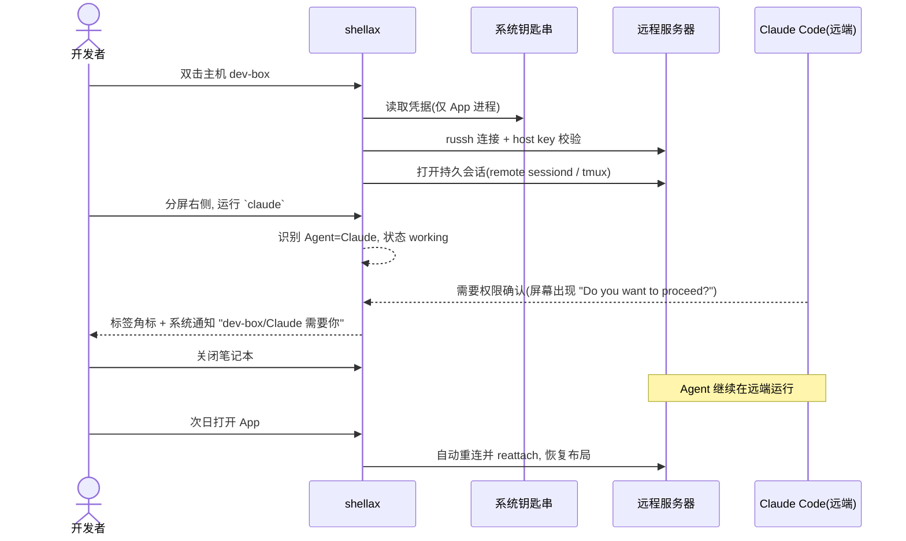
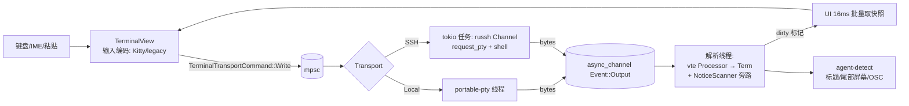
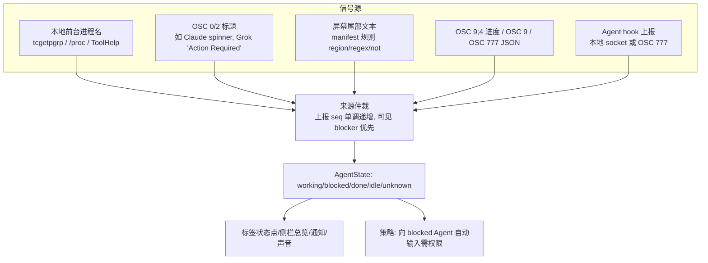
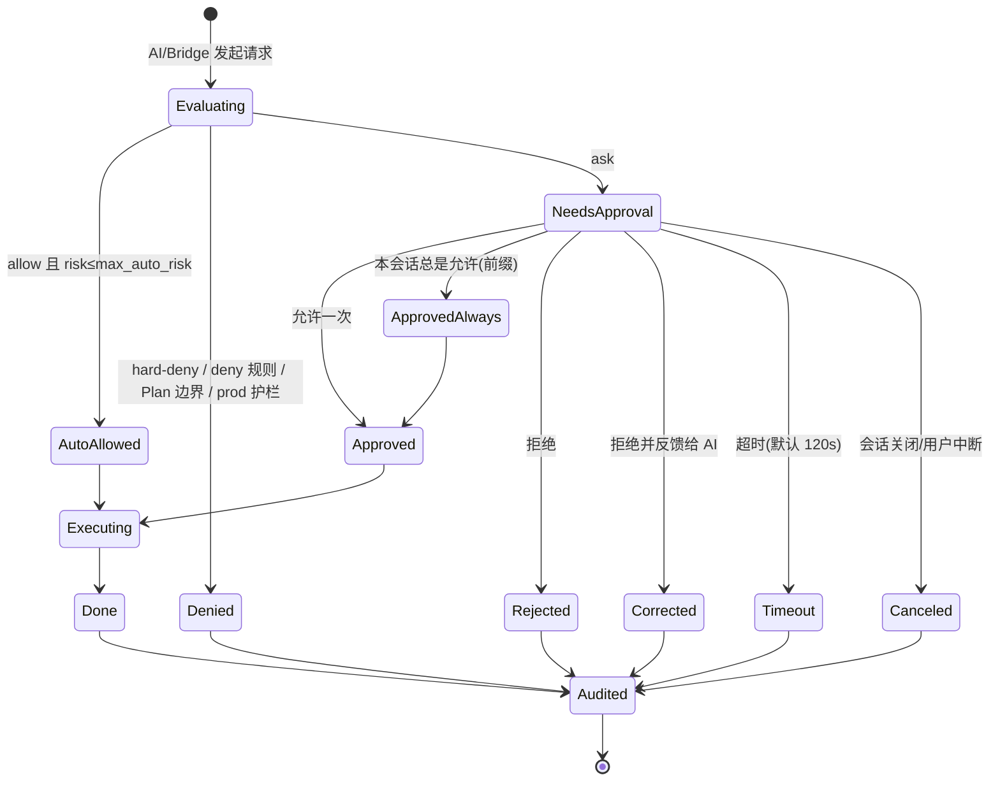
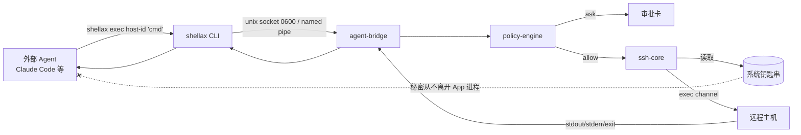
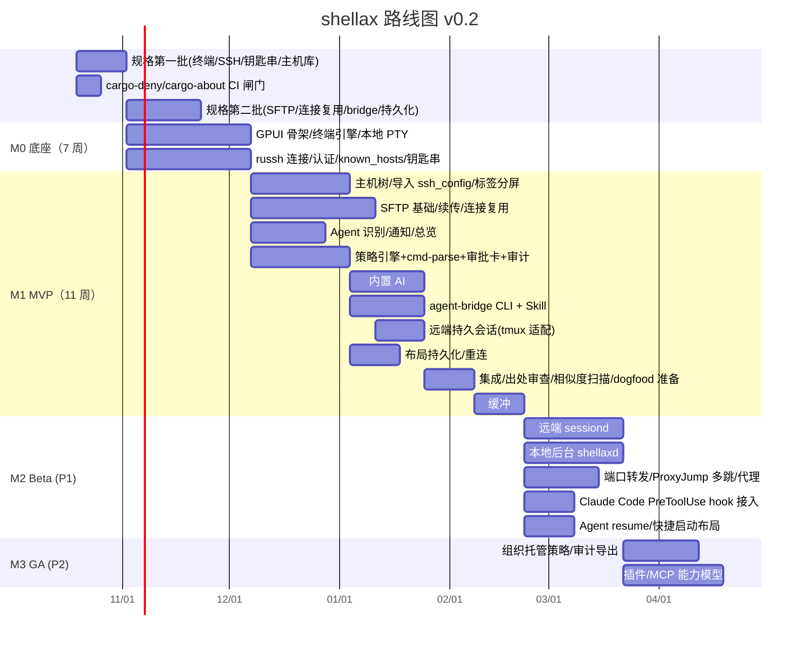

# PRD：带 Agent 能力的原生桌面 SSH 客户端 + 终端（暂名 **ShellAX**）

| 项 | 内容 |
|---|---|
| 文档版本 | v1.4 |
| 日期 | 2026-10-14 |
| 作者 | 产品 / 架构 |
| 技术基线 | Rust + GPUI + `alacritty_terminal` + `russh` + `portable-pty` |

---

## 1. 产品概述与目标用户

### 1.1 一句话定位
一个**原生、GPU 渲染的 SSH 客户端兼终端**。它让开发者在同一个窗口里管理远程服务器、运行 Claude Code / Codex / Grok CLI 等外部 Agent，并使用内置 AI。所有 AI 发起的动作都经过**可审计、可配置、默认安全**的权限系统。

### 1.2 要解决的问题
| 痛点 | 现状 |
|---|---|
| 传统 SSH 客户端不懂 Agent | 外部 CLI 往往只有一个全局开关，没有逐命令审批、风险分级和审计 |
| Agent 运行时不是 GUI SSH 客户端 | TUI 形态依赖系统 `ssh`，没有 SFTP、主机管理和钥匙串 |
| AI 终端的 SSH 管理弱 | 远端能力依赖注入脚本或云账号，缺少主机树与 SFTP |
| 基于 Web 技术的终端开销大 | 内存和启动开销大，AI 命令执行缺少审批 |
| 纯终端 + tmux | 持久化最强，但没有 Agent 状态、审批、凭据隔离，也没有 GUI SFTP |

### 1.3 目标用户
| 画像 | 描述 | 核心诉求 |
|---|---|---|
| P1 远程开发者（主） | 日常 SSH 到开发机/云主机，在远端跑 Claude Code / Codex 做开发 | 多标签/分屏、Agent 状态一眼可见、断线不丢、通知 |
| P2 运维 / SRE | 管理几十到上百台主机，跳板机、转发、SFTP | 主机树、凭据集中、危险命令拦截、审计 |
| P3 AI 重度用户 | 同时跑多个 Agent（本地 + 多台远程） | Agent 总览、阻塞提醒、Agent 不接触明文密码 |
| P4 团队管理员（P2 阶段） | 需要统一策略 | 组织级 deny 规则不可绕过、审计导出 |

### 1.4 产品目标与成功指标
| 目标 | 指标（GA 前） |
|---|---|
| 可替代日常 SSH 客户端 | 冷启动 < 400ms（M1 / 中端 Win 机）；单标签空闲内存 < 80MB；输入延迟 P95 < 10ms（本地） |
| Agent 体验 | Claude Code / Codex / Grok CLI 在本地和 SSH 内的状态识别准确率 ≥ 95%（working/blocked/idle） |
| 安全 | 内置 AI 执行的命令 100% 经过策略引擎，100% 写入审计；危险命令自动执行率为 0 |
| 可靠 | 开启持久会话后，网络中断 / 关闭应用后远端 Agent 继续运行，重连恢复率 ≥ 99% |

### 1.5 非目标（v1）
- 不做云账号 / 云同步。
- 不自研 Coding Agent 来替代 Claude Code 等。内置 AI 定位是「终端助手」。
- 不做 RDP/VNC/串口。

---

## 2. 核心场景与用户故事

### 2.1 主场景：远程开发 + Agent


### 2.2 用户故事（INVEST 格式，带验收标准）

| ID | 角色 | 故事 | 验收标准 | 优先级 |
|---|---|---|---|---|
| US-01 | 开发者 | 导入 `~/.ssh/config`，以分组树管理主机 | 支持 Host/HostName/User/Port/IdentityFile/ProxyJump；导入后可编辑；数据库不出现明文秘密 | P0 |
| US-02 | 开发者 | 首次连接时确认 host key，key 变更时被强警告 | 未知 key 显示 SHA256 指纹并确认；变更 key 默认拒绝，需二次确认替换 | P0 |
| US-03 | 开发者 | 在多个标签和分屏里同时开本地和远程终端 | 拖拽标签到边缘可分屏；vim/htop/tmux 正常；⌘T/⌘D | P0 |
| US-04 | 开发者 | 在远程终端里运行 `claude` / `codex` / `grok`，App 自动识别并显示状态 | 侧栏 Agent 列表显示 主机/面板/Agent/状态；blocked 时通知 | P0 |
| US-05 | 开发者 | 关闭 App 后，远端 Agent 继续运行，再打开能接回 | 开启「持久会话」的面板在 App 退出、网络断开后进程不中断；重开 App 自动 reattach | P0（远端）/P1（本地） |
| US-06 | 开发者 | 按 ⌘K 用自然语言描述需求，得到命令建议 | 显示命令 + 解释 + 风险等级；默认只填入输入行，不执行 | P0 |
| US-07 | 开发者 | 命令失败后点「解释错误」 | 用最近一个命令块的输出（脱敏后）生成解释和修复建议 | P0 |
| US-08 | 开发者 | 让内置 AI 执行命令排查问题 | 每条命令经过策略引擎；只读命令在 Auto 模式自动执行，其他需确认；全部写审计 | P0 |
| US-09 | 运维 | 生产主机上的 AI 不能执行破坏性命令 | 主机打标签 `env=prod` 后，R3 及以上一律拒绝（不可通过 always 放开） | P0 |
| US-10 | 开发者 | 外部 Agent（Claude Code）能在保存的主机上执行命令，但拿不到密码 | `shellax exec <host> "cmd"`，凭据只在 App 进程内；请求经策略引擎，必要时弹审批卡 | P0 |
| US-11 | 开发者 | 查看「AI 今天在哪些主机执行了什么」 | 审计面板可按主机/会话/决策过滤，可导出 JSONL | P0 |
| US-12 | 开发者 | SFTP 双栏拖拽传输，断点续传 | 传输队列；断线重试；与终端共享认证 | P0 |
| US-13 | 开发者 | 配置本地/远程/动态端口转发 | -L/-R/-D；规则图示；随 App 启动 | P1 |
| US-14 | 开发者 | 多台机器的 Agent 汇总到一个列表 | 「Agent 总览」按状态排序，点击跳转到面板 | P1 |
| US-15 | 管理员 | 下发组织级 deny 规则，用户本地不可覆盖 | 托管策略文件（只读）优先级最高 | P2 |

---

## 3. 功能需求

> 优先级：**P0 = MVP 必须**，**P1 = GA 前**，**P2 = GA 后**。

### 3.1 SSH 基础

| 功能 | 描述 | P |
|---|---|---|
| 主机管理 | 分组任意嵌套、搜索、拖拽、标签（env/role）、OS 识别徽章 | P0 |
| `~/.ssh/config` 导入 | 解析 Host/Match 子集、ProxyJump、IdentityFile | P0 |
| 认证 | none → agent → publickey → password → keyboard-interactive（2FA） | P0 |
| Host key 验证 | 独立 known_hosts（不改 `~/.ssh/known_hosts`），可选只读引用系统 known_hosts | P0 |
| 跳板/代理 | ProxyJump 多跳（每跳独立认证）、HTTP/SOCKS5 代理 | P0（ProxyJump）/P1（代理） |
| 连接复用 | 同一主机的终端/SFTP/转发/AI exec 共享一条物理连接、多 channel；可按主机关闭复用（堡垒机单 channel） | P0 |
| SFTP | 双栏、队列、断点续传（`.filepart` + 重试 1/3/10s）、内置编辑 | P0（基础）/P1（编辑、同步） |
| 端口转发 | -L/-R/-D（SOCKS4/5），图示，自动重连 | P1 |
| 钥匙串凭据 | macOS Keychain / Windows Credential Manager / Secret Service；可共享凭据 | P0 |
| SSH Agent 转发 | 默认关闭，按主机开启；拒绝未请求的 agent channel | P1 |
| 堡垒机拉起 | `ssh://` / `sftp://` 链接、`-url` 参数兼容 | P2 |
| 主机侧栏工具 | 监控/进程/服务/Docker | P2 |

### 3.2 终端

| 功能 | 描述 | P |
|---|---|---|
| 终端仿真 | `alacritty_terminal` 的 `Term` + `vte::ansi::Processor`；256 色/真彩、鼠标、bracketed paste、备用屏、OSC 8 链接、OSC 52 | P0 |
| 本地 Shell | `portable-pty`（Windows ConPTY），可选 zsh/bash/fish/pwsh/WSL | P0 |
| 多标签 / 分屏 | 标签可拖到上/下/左/右分屏；⌘D/⌘⇧D；面板缩放；面板聚焦导航 | P0 |
| 搜索 / 选择 / 复制 | 正则搜索（smart case）、矩形选择、URL 识别 | P0 |
| 命令块（Shell Integration） | OSC 133（A/B/C/D）标记 prompt/命令/输出/退出码，给「解释错误」和审计用；远端需注入 shell 集成脚本（可选） | P0（本地+远程自动注入为可选项） |
| 通知 | OSC 9 / OSC 777 / BEL → 应用内 toast + 系统通知 | P0 |
| 字体 | 可配置字体族/字号/行高/回退链；默认关闭连字；CJK/emoji 按 2 格绘制；Nerd Font/Powerline 图标（详见 5.10） | P0 |
| 主题 | UI token + 终端 16 色 + 前景/背景/光标/选中；TOML 主题文件；内置明暗主题；跟随系统、热切换；导入 Alacritty（P0）/iTerm2（P1）配色（详见 5.11） | P0 |
| 命令历史自动建议 | 光标后灰色显示历史建议，→ / Tab 接受；本地与 SSH 都可用；备用屏/密码输入/敏感命令禁用；AI 建议复用同一 UI（详见 5.12） | P0（历史）/P1（AI） |
| 关键字高亮 | 正则规则着色/通知（ERROR、Traceback） | P1 |
| 图形协议 | Sixel / Kitty graphics | P2 |
| 录制回放 | asciicast v2 | P2 |
| 广播输入 | 一次输入发往多个面板（需二次确认，算高风险交互） | P2 |


### 3.3 外部 Agent

| 功能 | 描述 | P |
|---|---|---|
| 无缝运行 | Agent 在普通 PTY 里运行，不包装也不替换；保证 Kitty keyboard protocol、bracketed paste、真彩、OSC 0 标题、OSC 9;4 进度、IME 正常 | P0 |
| Agent 识别 | 三层：①前台进程名（本地）；②屏幕 manifest 规则（本地+远端）；③Agent 主动上报（hook → OSC 777 / 本地 socket） | P0（①②）/P1（③） |
| 状态 | `working` / `blocked` / `done`（完成且未查看）/ `idle` / `unknown` | P0 |
| 增强 UI | 标签/面板标题显示 Agent 图标和状态点；侧栏「Agent 总览」跨主机汇总；blocked 时标签角标 + 声音 + 系统通知；通知点击跳转面板；当前可见面板不弹通知 | P0 |
| 快捷启动 | 「在此主机启动 Agent」菜单：选 Agent + 目录 + 布局（例如左侧 Agent、右侧 shell 并 `tail -f` 日志） | P1 |
| 会话恢复 | 记录 Agent 上报的 resume 命令（如 `claude --resume <id>`、`codex resume <id>`、`grok --resume <id>`），进程丢失后在原目录一键恢复 | P1 |
| 凭据桥（Agent CLI） | `shellax` CLI + Agent Skill：`hosts list / exec / upload / download`，**每个请求都经过权限引擎** | P0 |
| 外部 Agent 权限钩子 | 为 Claude Code / Codex / Grok Build 安装 `PreToolUse` hook，把工具调用交给本产品策略引擎判定；按各家能力降级（Claude：allow/deny/ask；Codex：deny/改写，ask 由我们弹窗后返回；Grok：deny，ask 需核实），详见 6.9 | P1（v0.3 已核实可行） |
| Agent 输入注入 | 内置 AI 或其他 Agent 向某个 Agent 面板写入（prompt 互传）属于 `write_to_pty` 权限，默认 ask | P1 |

### 3.4 内置 AI

| 功能 | 交互 | 默认权限 | P |
|---|---|---|---|
| 命令建议（inline） | 输入行灰字补全（基于历史 + 上下文 + 模型）；Tab 接受 | 只填入，不执行 | P1 |
| 自然语言转命令 | 在输入行开头输入 `#` 或按 ⌘K：「找出占用 8080 端口的进程」→ 卡片显示命令、逐段解释、风险等级、目标主机；按钮：**插入** / **执行** / **复制** | 默认「插入」；「执行」走策略引擎 | P0 |
| 执行命令（Agentic） | 右侧 AI 面板多轮对话，AI 提出工具调用 `run_command(host, cmd)`，逐条显示审批卡 | 由模式与规则决定 | P0 |
| 错误解释 | 非零退出码的命令块出现「解释」按钮；输入是命令 + 尾部 200 行输出（脱敏） | 只读，无需审批 | P0 |
| 上下文 | 当前主机 OS/shell/cwd（来自 OSC 7/133）、最近 N 个命令块、选中文本；**发送前统一脱敏** | — | P0 |
| 模型 | BYOK：OpenAI / Anthropic / Gemini / Ollama / OpenAI 兼容；API Key 存钥匙串 | — | P0 |
| 隐私 | 首次发送远端输出前提示；可按主机设置「禁止 AI 读取输出」 | — | P0 |

**交互原则**
1. **AI 生成 ≠ 执行**：默认只插入输入行，用户回车才执行（等于人工确认）。
2. **审批卡**同时显示：完整命令（不截断，多行展开）、目标主机与 env 标签、风险等级与原因（命中哪条规则）、AI 给出的意图说明，以及四个按钮：「允许一次 / 本会话总是允许此前缀 / 拒绝 / 拒绝并告诉 AI 原因」。
3. **AI 执行的命令在终端中可见**：在独立的「AI 执行」通道（exec channel）中运行，输出回填 AI 面板。用户也可以选择「在当前终端中执行」（写入 PTY，可见但风险更高，权限更严）。

### 3.5 权限控制（概要，详细设计见第 6 章）

| 功能 | P |
|---|---|
| 三种模式：**Ask**（默认）/ **Plan（只读）** / **Auto（仅安全只读自动执行）**，每个 AI 会话可切换，状态栏常驻显示 | P0 |
| 规则：`allow / ask / deny`，作用于动作 × 资源（命令、路径、主机），分层合并 | P0 |
| 风险分级 R0–R4 + 不可覆盖的硬拒绝（hard-deny）清单 | P0 |
| 主机环境标签（prod/staging/dev）参与规则匹配 | P0 |
| 审批卡、超时自动拒绝、批量审批禁止跨风险级 | P0 |
| 审计日志：追加写 JSONL + 哈希链 + 脱敏 + 查询/导出 | P0 |
| 托管（组织）策略，最高优先级、只读 | P2 |

### 3.6 会话与布局

| 功能 | 描述 | P |
|---|---|---|
| Workspace / Tab / Pane | 三级结构；一个 workspace 可混合多台主机 | P0 |
| 布局持久化 | 退出时保存：标签、分屏树、每个面板的主机、cwd、Agent resume 引用；启动时恢复 | P0 |
| 远端持久会话 | 面板可标记为「持久」：远端进程独立于 App 存活，App 断开时远端缓冲输出，重连后 reattach | P0 |
| 本地持久会话 | 本地 PTY 由后台 `shellaxd` 持有，关闭窗口不杀 Agent | P1 |
| 多机 | 同一窗口多主机；每台主机独立重连，一台掉线不影响其他 | P0 |
| 断线重连 | 指数退避；Grace Period 内透明恢复 | P0 |
| 布局快照 | 保留最近 N 份布局快照，可手动回滚 | P2 |

**「关闭应用后 Agent 是否继续运行」的产品决策**（核心问题）：

| 场景 | 默认行为 | 依据 |
|---|---|---|
| 远程面板，「持久」关闭 | ❌ SSH channel 关闭，远端进程收到 SIGHUP 后退出；关闭前提示「此面板有运行中的 Agent」 | 普通 SSH 语义 |

---

### 3.7 设置项全表（v0.7 更新）

设置页为模态窗口：左侧分类可搜索（按名称、说明、配置键匹配），右侧表单。所有设置存放在 `~/.config/shellax/config.toml`（环境变量 `SHELLAX_CONFIG` 可覆盖路径），修改后立即整文件写回（先写临时文件再 rename）。v0.5 的顶层键 `theme` / `known_hosts` / `ssh_config` 仍可读取，读取后归入对应分节。API Key 等机密只进系统钥匙串（不可用时进本地加密文件，见 5.15），从不写入 config.toml、日志或审计。

“原型 v8 状态”（v1.0）：所有设置项都已有实际效果，界面上不再有“即将支持”。下表最后一列按 v8 更新。原 v6 状态的含义：**立即生效**＝改完马上影响界面或正在运行的终端；**新会话/新连接生效**＝影响之后打开的标签或 SSH 连接；**仅保存，即将支持**＝界面可改且会写入文件，但目前没有后端实现，界面上带“即将支持”标记。

| 分类 | 设置项 | config.toml 键 | 默认值 | 原型 v8 状态 |
|---|---|---|---|---|
| 通用 | 界面语言（跟随系统 / 简体中文 / English） | `general.language` | system | 立即生效（v6：locales/zh-CN.toml、en.toml，缺键回退英文；已打开标签的标题要新开标签才换语言） |
| 通用 | 启动时 | `general.startup` | local（本地终端 / 恢复布局 / 空白） | 下次启动生效（v8：恢复布局可用） |
| 通用 | 自动检查更新 / 更新通道 | `general.check_updates / update_channel` | true / stable | 生效（v8：启动后台检查 + “立即检查”，只提示不自动安装；`general.update_url` 可覆盖清单地址） |
| 通用 | 配置文件路径 | —（SHELLAX_CONFIG 可覆盖） | ~/.config/shellax/config.toml | 只读信息或操作 |
| 外观 | 主题（含“跟随系统”） | `appearance.theme` | system | 立即生效 |
| 外观 | 浅色 / 深色主题（跟随系统时） | `appearance.light_theme / dark_theme` | Catppuccin Latte / Mocha | 立即生效 |
| 外观 | 终端字体 / 回退字体链 | `font.family / font.fallbacks` | 平台默认 | 立即生效 |
| 外观 | 字号 / 行高 / 连字 | `font.size / line_height / ligatures` | 13.5 / 1.4 / false | 立即生效 |
| 外观 | 窗口透明度 / 界面字号 | `appearance.opacity / ui_font_size` | 1.0 / 13 | 立即生效（v8：透明度=窗口透明背景+终端区 alpha，llvmpipe 下看不到效果需真机复测；界面字号作用于 gpui-component 控件和未指定字号的文本） |
| 终端 | 默认 Shell | `terminal.shell` | 空=$SHELL | 新会话/新连接生效 |
| 终端 | 回滚行数 | `terminal.scrollback` | 10000 | 新会话/新连接生效 |
| 终端 | 光标样式 / 闪烁 | `terminal.cursor_style / cursor_blink` | block / true | 立即生效 |
| 终端 | 响铃 | `terminal.bell` | visual / sound / none | 立即生效（v8：sound 用 canberra/paplay/afplay） |
| 终端 | 选中即复制 | `terminal.copy_on_select` | false | 立即生效 |
| 终端 | 多行粘贴确认 | `terminal.paste_confirm` | true | 立即生效 |
| 终端 | 鼠标上报 | `terminal.mouse_reporting` | true | 立即生效 |
| 终端 | Shell 集成（OSC 133 注入） | `terminal.shell_integration` | auto | 新会话/新连接生效 |
| 命令建议 | 启用 / 接受按键 | `suggest.enabled / suggest.accept` | true / both | 立即生效 |
| 命令建议 | 本地历史 / 远程历史 | `suggest.local_history / remote_history` | true / true | 新会话/新连接生效 |
| 命令建议 | 敏感命令过滤规则（正则） | `suggest.filter_patterns` | ["(?i)vault +login"] | 立即生效 |
| 命令建议 | 清空历史 | —（按钮 + 命令面板） | — | 只读信息或操作 |
| SSH | 默认用户 / 默认端口 | `ssh.default_user / default_port` | 空 / 22 | 立即生效（主机列表） |
| SSH | 保活间隔 / 连接超时 | `ssh.keepalive_secs / connect_timeout_secs` | 30 / 15 | 新会话/新连接生效 |
| SSH | known_hosts 文件 / 未知主机密钥策略 | `ssh.known_hosts / host_key_policy` | ~/.ssh/known_hosts / ask | 新会话/新连接生效 |
| SSH | 读取 ~/.ssh/config / 路径 | `ssh.read_ssh_config / ssh_config` | true / ~/.ssh/config | 立即生效 |
| SSH | 默认跳板机 / 加密算法偏好 / Agent 转发 | `ssh.jump_host / ciphers / agent_forwarding` | 空 / chacha20… / false | 新连接生效（v8） |
| 凭据与密钥 | 系统钥匙串 / ssh-agent / 额外私钥 | `credentials.use_keychain / use_ssh_agent / extra_keys` | true / true / [] | 新连接生效（v8） |
| 凭据与密钥 | 本机私钥列表（指纹）、ssh-agent 状态 | — | — | 只读信息或操作 |
| 凭据与密钥 | 生成 / 导入密钥 | — | — | 可用（v8：Ed25519，可设口令） |
| AI | 启用内置 AI | `ai.enabled` | true | 立即生效（v6） |
| AI | 服务商列表（名称、类型 OpenAI 兼容 / Anthropic、Base URL、模型、超时、温度、最大 tokens）、默认服务商 | `[[ai.providers]] id/name/kind/base_url/model/fast_model/preset/timeout_secs/temperature/max_tokens`、`ai.default_provider` | 空 | 立即生效（v6；v7 用真实 OpenRouter 公开接口和本地 mock 验证了模型列表，聊天请求仍只用本地 mock 测过 OpenAI 兼容接口，Anthropic 只有单元测试，没有用真实服务测过） |
| AI | 服务商模板（OpenAI、Anthropic、OpenRouter、DeepSeek、通义 DashScope、Kimi、智谱、Ollama、LM Studio、自定义），选中后填类型和 Base URL | `[[ai.providers]] preset` | custom | 立即生效（v7） |
| AI | 模型列表：下拉可搜索 + “刷新模型”，显示加载中/数量/错误；保存 Key 或改 URL 后自动拉取；可手填任意模型名 | 缓存文件 `<data>/shellax/models-cache.json` | — | 立即生效（v7） |
| AI | 只显示聊天模型（按 id 启发式过滤 embedding/whisper/tts/图像/审核） | `ai.chat_models_only` | true | 立即生效（v7） |
| AI | 模型列表缓存时长（小时） | `ai.models_cache_hours` | 24 | 立即生效（v7） |
| AI | 命令模型（“# …”生成命令用的快/便宜模型，空=同主模型） | `[[ai.providers]] fast_model` | 空 | 立即生效（v7，mock 日志确认请求用了该模型） |
| AI | API Key（界面只显示后 4 位） | —（系统钥匙串，账户 `ai-provider:<id>`，服务 `shellax`；不可用时 `<数据目录>/shellax/secrets.enc`，权限 0600） | — | 立即生效（v6） |
| AI | 测试连接（真实最小请求，显示延迟/错误） | — | — | 可用（v6） |
| AI | 发送前脱敏 / 上下文范围（不发送 / 最近命令 / 选中 / 当前屏幕）/ 屏幕行数 / 允许发送输出 | `ai.redact / context / context_lines / send_output` | true / screen / 40 / false | 立即生效（v6；关闭“允许发送输出”时，选中和屏幕内容都不发送，只发最近命令） |
| AI | 自然语言前缀 | `ai.nl_prefix` | "#" | 立即生效（v6） |
| 外部 Agent | 识别 Claude / Codex / Grok | `agents.detect_claude / detect_codex / detect_grok` | true | 立即生效 |
| 外部 Agent | 状态变化通知 / 审批超时 / 超时处理 | `agents.notify_state / approval_timeout_secs / on_timeout` | true / 120 / deny | 立即生效（v8） |
| 外部 Agent | Hook 安装状态（只读检测）/ 一键安装 | — | — | R / S |
| 权限与安全 | 默认模式 Ask / Plan / Auto | `permissions.mode` | ask | 立即生效（v11：内置 AI、外部 Agent hook、ShellAX exec/upload/download、主机工具写操作都按此判定） |
| 权限与安全 | Auto 最高自动风险 | `permissions.max_auto_risk` | R1 | 立即生效（测试器 + 内置 AI 执行） |
| 权限与安全 | 高危命令二次确认 | `permissions.dangerous_confirm` | true | 立即生效（测试器 + 内置 AI 执行） |
| 权限与安全 | 生产主机写操作确认 | `permissions.prod_confirm` | true | 立即生效（v8：生产主机 Auto 只放行 R0，R2+ 允许规则改为询问） |
| 权限与安全 | 规则编辑器（allow/ask/deny，最后匹配生效）+ 规则测试器 | `[[permissions.rules]]` | 4 条示例 | 立即生效（v11：内置 AI、外部 Agent hook、ShellAX CLI、主机工具均已接入；组织策略优先于用户规则） |
| 审计 | 日志目录 | `audit.dir` | ~/.local/share/shellax/audit | 下次启动生效 |
| 审计 | 保留天数 / 记录手动命令 | `audit.retention_days / log_commands` | 90 / false | 立即生效（v8：剪除后用锚点保持哈希链可校验） |
| 审计 | 查看器 / 校验哈希链 / 导出 | — | — | 只读信息或操作 |
| 会话与布局 | 持久会话 tmux / 恢复布局 / 关闭确认 / 自动重连 | `session.persistent / restore_layout / confirm_close / auto_reconnect` | off / true / true / true | 新会话生效（v8） |
| 快捷键 | 应用快捷键列表与改绑（冲突提示） | `[keys] 动作 id = "ctrl-shift-x"` | 见快捷键页 | 立即生效 |
| 通知 | 桌面通知 / Agent 等待通知 / 长命令阈值 / 提示音 | `notify.desktop / agent_blocked / long_command_secs / sound` | true / true / 10 / false | 立即生效（v8） |
| 关于 | 版本、快速上手、第三方许可证 | — | — | 只读信息或操作 |
| 主机 | 名称/地址/端口/用户/私钥/分组/生产标记 | `[[hosts]] name/host/port/user/identity_file/group/production` | — | 立即生效 |
| 主机 | 认证方式 / 跳板机 | `[[hosts]] auth / jump` | auto / 空 | 新连接生效（v8：auto/agent/key/password/kbd，ProxyJump 多级） |
| 通用 | 托盘图标（Agent 数、显示/新建/退出） | `general.tray` | true | 立即生效（v11：Linux StatusNotifierItem；macOS/Windows 未实现） |
| SSH | 出站代理 / 不走代理的主机 | `ssh.proxy / ssh.no_proxy` | 空 | 新连接生效（v11：SSH 首跳、AI 请求、更新检查都走代理） |
| 终端 | 关键字高亮开关 / 规则 | `terminal.keyword_highlight / [[terminal.highlights]]` | true / error·warn·OK 三组 | 立即生效（v12：着色；通知见 `[[notify.keywords]]`） |
| 通知 | 关键字触发通知 | `[[notify.keywords]]`（pattern / title） | 构建/部署结果、OOM/段错误/kernel panic | 新面板生效；每规则 10 秒限流，审计脱敏 |
| 录制 | asciicast 录制脱敏 / 目录 | `recording.redact / recording.dir` | true / 数据目录 recordings | 立即生效 |
| 终端 | OSC 52 剪贴板写 / 读 | `terminal.osc52_write / osc52_read` | ask / false | 立即生效（v10） |
| 外部 Agent | AI 向 Agent 面板输入 | `agents.write_to_pty` | ask | 立即生效（v11：ask / ask_first / allow / deny） |
| 外部 Agent | 快速启动列表 | `[[agents.quick_launch]] name/command` | Claude Code / Codex / Grok | 立即生效（v11） |
| AI | 首次发送提示已确认 / 禁止读取输出的主机 / 执行结果回传 | `ai.first_send_ack / no_output_hosts / feed_back_results` | false / 空 / true | 立即生效（v10–v11） |
| 组织策略 | 托管策略文件（只读，最高优先级） | `/etc/shellax/managed-policy.yaml`（SHELLAX_MANAGED_POLICY） | 无 | 启动时加载（v11：解析失败按失败关闭） |

### 3.8 功能入口（v0.7 更新）

| 位置 | 入口 | 原型 v6 状态 |
|---|---|---|
| 侧栏顶部 | 主机搜索（名称/地址过滤）、新建主机按钮、分组（config.toml 的 `group`，~/.ssh/config 单独一组，可折叠）、悬停显示编辑按钮、生产主机红色标记 | 可用 |
| 侧栏左下功能区 | SFTP 文件 | 可用（v8：双栏、队列、断点续传、拖放、权限、删除确认） |
| | 端口转发 | 可用（v8：-L/-R/-D、启停、计数、按主机保存、连接时自动启动） |
| | AI / Agent | 外部 Agent 实时状态、快速启动（Ctrl+Alt+1/2/3）；内置 AI 对话、逐条审批执行并回传结果 |
| 终端内 | 输入 `# 自然语言` 回车，或 Ctrl+Shift+G（命令面板“AI：自然语言生成命令”） | 可用（v6）：卡片显示命令；插入（→）只写入不回车；执行…由权限引擎判定（允许直接运行 / 询问弹确认 / 拒绝显示原因），请求、响应、插入、判定、执行都记审计 |
| | 审计日志 | 可用：列表、校验哈希链、导出 |
| | 命令面板（Ctrl+Shift+P） | 可用：模糊搜索全部动作和主机 |
| | 设置（Ctrl+,） | 可用 |
| | 帮助与关于（F1，含第三方许可证） | 可用 |
| 状态栏 | 权限模式按钮（点击 Ask → Plan → Auto 循环，写入配置并记审计）、主题按钮 | 可用（v6：模式用于内置 AI 执行判定） |
| 新建/编辑主机对话框 | 名称、地址、端口、用户、认证方式、私钥、分组、跳板机、生产标记；校验必填/端口/重名；可删除 | 可用（v8：认证方式与跳板机均生效） |

## 4. 非功能需求

| 类别 | 要求 |
|---|---|
| 性能 |
| 资源 |
| 可靠性 |
| 安全 |
| 隐私 |
| 跨平台 |
| 可访问性 |
| 国际化 |
| 可测试性 |
| 兼容性 |

---

## 5. 技术架构建议

### 5.1 总体架构
```mermaid
flowchart TB
  subgraph UI["GPUI 进程 (shellax)"]
    WS[Workspace 壳<br/>Tab/Pane/Dock] --> TV[TerminalView<br/>网格渲染/输入编码]
    WS --> HP[主机树/凭据/SFTP/转发 面板]
    WS --> AIP[AI 面板 / 审批卡 / 审计查看器]
    WS --> AO[Agent 总览侧栏 / 通知]
  end
  subgraph CORE["核心 crates (无 UI 依赖)"]
    TE[term-engine<br/>alacritty_terminal Term+Processor<br/>+ 旁路 OSC 扫描器]
    SC[session-core<br/>统一 Session 契约]
    SSH[ssh-core<br/>russh 连接注册表/认证/known_hosts]
    PTY[local-pty<br/>portable-pty]
    SFTP[sftp-core<br/>russh-sftp]
    FWD[forward-core]
    AD[agent-detect<br/>进程名+manifest+上报]
    POL[policy-engine<br/>模式/规则/风险/硬拒绝]
    AUD[audit-log<br/>JSONL+哈希链+脱敏]
    AI[ai-core<br/>provider/上下文/工具调用]
    SEC[secrets<br/>keyring + zeroize]
    STORE[store<br/>SQLite 主机/规则/布局]
    BR[agent-bridge<br/>本地 socket + CLI + hook 端点]
  end
  subgraph DAEMON["shellaxd (P1, 本地后台)"]
    LP[持有本地 PTY / 会话]
  end
  subgraph REMOTE["远端主机"]
    SH[login shell]
    SD[shellax-sessiond (可选)<br/>或 tmux 适配]
    EXT[Claude Code / Codex / Grok CLI]
  end
  TV <--> TE
  TE <--> SC
  SC --> SSH
  SC --> PTY
  SC -.P1.-> LP
  SSH <-->|channel: shell/exec/sftp/direct-tcpip| SH
  SSH <--> SD
  SD --> EXT
  AI --> POL --> AUD
  BR --> POL
  POL --> SC
  SSH --> SEC
  TE --> AD --> AO
  HP --> STORE
```

### 5.2 模块划分（Cargo workspace）


| crate | 职责 |
|---|---|
| `term-engine` | 包装 `alacritty_terminal::Term<Listener>`；解析线程；快照；搜索/选择；旁路 OSC 扫描（OSC 9/777/133/7/自定义） |
| `session-core` | **统一会话契约**：`write_input / resize / shutdown / title / lifecycle / process_state / snapshot`，本地、SSH、远端 durable 三种实现 |
| `ssh-core` | russh 客户端、**连接注册表**（一个 key 对应一条物理连接、多个 channel 消费者）、认证链、known_hosts、ProxyJump、keepalive/延迟测量、重连 |
| `local-pty` | portable-pty 封装（专用线程），Windows ConPTY |
| `sftp-core` / `forward-core` | SFTP 队列/续传；转发 worker |
| `secrets` | `SecretStore` trait（Keychain/InMemory/NoSecret），秘密只在后台线程读取 |
| `store` | SQLite（rusqlite bundled），`PRAGMA user_version` 迁移，内存为准、写穿 |
| `agent-detect` | 进程名识别 + TOML manifest 规则 + 上报合并（来源仲裁） |
| `policy-engine` | 第 6 章全部逻辑；纯函数 `evaluate(request, ctx) -> Decision` |
| `cmd-parse` | tree-sitter-bash 拆分复合命令、识别重定向/子 shell/管道、提取「命令前缀」（arity 表） |
| `audit-log` | 追加写、哈希链、脱敏、查询 |
| `ai-core` | Provider 适配、SSE 流、工具协议、上下文构建、**脱敏** |
| `agent-bridge` | `shellax` CLI ↔ App 的本地 socket（帧协议）；hook 端点；Agent Skill 安装 |
| `shellax-sessiond`（远端，可选） | 远端持有 PTY、环形缓冲、reattach；通过 SSH exec channel 走 stdio 协议 |
| `app`（GPUI） | 窗口、Dock、动作、面板 |

### 5.3 本地 + SSH 终端数据流（GPUI 中）

要点：
- **SSH 输出必须经过 Term**。
- **resize** 按面板实际边界计算，并去抖；连接建立后补发一次 resize。
- **AI exec 不占用户 shell**：在同一连接上另开 `exec` channel。堡垒机只允许单 channel 时，退化为「写入终端 + OSC 标记读回结果」。这种退化路径**风险更高**：会打断前台程序，所以权限默认 ask 且必须明确提示。

### 5.4 Agent 识别架构

  - **零安装路径**：只依赖经 PTY 流回来的信号：OSC 标题、屏幕 manifest、OSC 9/777。所有 Agent 识别规则都要能在「只有字节流」的前提下工作。manifest 正是按这个思路设计的，例如 `grok.toml` 的注释写着 Grok 会发 OSC 0 标题、权限提示时加「⚠ Action Required」、OSC 9;4 进度。
  - **sessiond 路径**：装了远端 sessiond 时，它能读远端前台进程组，准确率最高。
- **manifest 规则格式**：建议采用 TOML（`id/version/min_engine_version/[[rules]] state/priority/region/regex/not`），规则可以热更新。

### 5.5 选型

| 方面 | 选择 | 理由 / 备选 |
|---|---|---|
| 终端仿真 | **`alacritty_terminal` 0.26**（crates.io 标 Apache-2.0） |
| SSH | **russh 0.64.1**（Apache-2.0，MSRV 1.89），**加密后端 `aws-lc-rs`**：`russh = { version = "0.64.1", default-features = false, features = ["aws-lc-rs", "flate2", "rsa"] }`（与默认 feature 相同，显式写出防止误改）。**v0.3 已核实** |
| 本地 PTY | `portable-pty` 0.9（MIT） |
| 存储 | SQLite（rusqlite bundled，MIT；SQLite 公有领域） |
| 钥匙串 | `keyring` 4（MIT OR Apache-2.0） |
| 命令解析 | `tree-sitter` + `tree-sitter-bash`（MIT） |
| 策略配置 | TOML（用户）+ JSON Schema 校验 |

### 5.6 第三方组件

第三方组件及其许可证见仓库根目录 `THIRD_PARTY_NOTICES.md` 与 `licenses/`。

### 5.9 最小原型（v0.3 新增）

位置：仓库根目录（详见 README）。一个 GPUI 窗口，左右分屏：左边 portable-pty 本地 shell，右边 russh SSH 会话，都用 `alacritty_terminal` 0.26 解析，字符网格渲染自己写。
- **已验证（Linux，X11 + Mesa 软件 Vulkan）**：`cargo build` 通过；无界面测试 2 个通过（本地 PTY 和 SSH 到本机 sshd，alacritty 网格中都出现 `ls` 输出，SSH 侧 `stty size` 证明 `window_change` 生效）；界面上两个终端都能输入 `ls` 并看到输出（截图 `screenshot.png`），调整窗口高度后远端 `stty size` 跟着变。
- **未验证**：macOS、Windows、Wayland、真 GPU、IME/CJK 宽字符、大输出性能。
- **v3（2026-10-13）**：增加字体回退链、关闭连字、宽字符、4 个主题和切换、命令历史自动建议，结论见 5.10–5.12。
- **v4（2026-10-13）**：性能改为事件驱动，补齐滚动回看、剪贴板、鼠标上报、分屏、known_hosts、Agent 识别等，结论和前后数据见 5.13。
- **原型取舍**：~~host key 全部接受~~（v4 已做 known_hosts 校验和首次确认）；渲染已在 v2 改为自定义 canvas，v4 再拆成可缓存的网格层和光标层。

### 5.10 字体与字形回退（v0.4）

**结论**
- **GPUI 原生支持回退链**：`gpui::Font { family, features, fallbacks: Option<FontFallbacks>, … }`。gpui-pre 0.3.9 三个平台的文字后端都实现了 fallbacks：Linux 用 cosmic-text（`gpui-pre-wgpu/src/cosmic_text_system.rs`）、macOS 用 CoreText（`gpui-pre-apple`）、Windows 用 DirectWrite（`gpui-pre-windows/src/direct_write.rs`）。回退字体不会再递归加载它自己的回退。原型里已在 Linux 上验证：主字体 JetBrains Mono → Noto Sans Mono CJK SC → Symbols Nerd Font Mono → Noto Color Emoji 生效。
- **关闭连字**：`FontFeatures` 设 `calt=0, liga=0, dlig=0`（gpui 也提供 `FontFeatures::disable_ligatures()`，但它只关 `calt`）。默认关闭，配置项 `font.ligatures = true` 可开启。原型截图中 `->`、`=>`、`!=` 已按原字符显示。
- **双宽字符**：以 alacritty 的 cell 标志为准，不自己算宽度：`WIDE_CHAR` 的 cell 在 2 格槽位内居中单独绘制，`WIDE_CHAR_SPACER` 跳过，零宽字符（如 VS16）拼进同一个字形串。其余窄字符整行一次排版，并强制每字一格宽（`force_width`），保证网格对齐。光标落在宽字符上时画 2 格宽。
- **Nerd Font / Powerline**：私有区（PUA）字符经回退链交给 Symbols Nerd Font Mono 绘制，原型已验证。产品还应**自绘** Powerline 分隔符（U+E0B0–E0B3）和制表符/块元素（U+2500–259F），因为字体自带的这类字形常有缝隙或高度不齐。这是终端的常见做法，自行实现即可。
- **配置**：`~/.config/shellax/config.toml` 的 `[font] family / fallbacks / size / line_height / ligatures`（原型已实现，另支持环境变量 `TERM_FONT`、`TERM_FONT_SIZE`）。产品需要提供设置界面和字体枚举（GPUI 有 `all_font_names`），并标出哪些是等宽字体。

**各平台默认值（建议）**

| 平台 | 主字体 | 回退链 | 说明 |
|---|---|---|---|
| macOS | Menlo（系统自带）；装了 SF Mono 时优先用它 | PingFang SC → Symbols Nerd Font Mono → Apple Color Emoji | SF Mono 随 Xcode/Terminal 提供，许可只允许用于 Apple 平台，**不能打包**，只在本机检测到时使用 |
| Windows | Cascadia Mono（Win11 自带，OFL） | Microsoft YaHei UI → Symbols Nerd Font Mono → Segoe UI Emoji → Segoe UI Symbol | Win10 旧版可能没有 Cascadia，退回 Consolas |
| Linux | JetBrains Mono / DejaVu Sans Mono | Noto Sans Mono CJK SC → Symbols Nerd Font Mono → Noto Color Emoji | 通过 fontconfig 检测；没有 CJK 字体时提示安装 |

**是否内置字体（建议）**
- 内置 **JetBrains Mono**（OFL-1.1）作为跨平台一致的默认等宽字体，体积约 2–4 MB。OFL 允许随软件打包，条件是附带许可文本、不单独售卖字体、修改后改名。
- CJK **不内置**（Noto Sans CJK / Sarasa Gothic 都是 OFL-1.1，但单个字体 15–20 MB，全套更大），用系统字体，在设置里提示可选下载 Sarasa Mono SC（严格 2:1 中英宽度）。
- **Nerd Font 符号字体不建议原样内置**：Symbols Nerd Font 本身是 MIT，但它合并了多套图标，其中 Font Awesome、Codicons 是 CC BY 4.0（需要署名），Font Logos 标为 "unlicensed"（依据其 README 的图标来源表）。建议：Powerline 和制表符自绘；其他图标靠用户已安装的 Nerd Font（检测到就加入回退链），首次遇到 PUA 字符时提示安装。
- emoji 用系统字体（Apple Color Emoji / Segoe UI Emoji / Noto Color Emoji），不内置。

**原型状态与限制（v3，Linux X11 实测）**：中文、日文、韩文、emoji、Nerd 图标、Powerline、关闭连字都正确显示（`screenshot-v3-fonts.png`）。未做：Powerline/制表符自绘（目前框线字符有细小缝隙）；字体枚举 UI；macOS/Windows 实测；emoji 在 `force_width` 外单独排版，个别组合 emoji（ZWJ 序列）alacritty 可能拆成多个 cell，未测。

### 5.11 主题系统（v0.4）

**数据模型**：一个主题 = UI 色 token（`crust/mantle/base/surface0-2/overlay0-1/text/subtext/accent/success/error/warning/info`）+ 终端色（`foreground/background/cursor/cursor_text/selection/suggestion` + `ansi[16]`）+ `appearance = dark|light`。256 色中 16–255 按 xterm 标准计算，不进主题；真彩色直接显示。

**文件格式（TOML，原型已实现）**：
```toml
name = "Catppuccin Mocha"
appearance = "dark"
[ui]
base = "#1e1e2e"   # …其余 token
accent = "#cba6f7"
[terminal]
foreground = "#cdd6f4"
background = "#1e1e2e"
cursor = "#f5e0dc"
selection = "#585b70"
suggestion = "#6c7086"   # 历史/AI 建议的灰字颜色
ansi = ["#45475a", "…16 个…"]
```
内置主题打包进二进制；用户主题放 `~/.config/shellax/themes/*.toml`，启动时加载。产品应监听该目录，改动后热重载。

**内置主题（原型已带 4 个）**

| 主题 | 明暗 | 许可 |
|---|---|---|
| Catppuccin Mocha | 暗 | MIT（https://github.com/catppuccin/catppuccin），发布时署名 |
| Catppuccin Latte | 亮 | MIT（同上） |
| ShellAX Midnight | 暗 | 自有（本项目原创配色） |
| ShellAX Daylight | 亮 | 自有（本项目原创配色） |

后续可加 One Dark（Atom，MIT）、Solarized（MIT）、Dracula（MIT）、Nord（MIT）、Gruvbox（MIT）；加入前逐个核对仓库 LICENSE 并写入 THIRD_PARTY_NOTICES。

**切换**：`theme = "system"` 时跟随系统明暗（GPUI 的 `window.appearance()` + `observe_window_appearance`，运行时切换不需要重启），选第一个与系统明暗一致的主题，产品应允许分别指定「亮色用哪个、暗色用哪个」。原型提供 Ctrl+Shift+T 循环切换、状态栏主题名点击切换、「系统」按钮恢复跟随系统。

**导入外部主题**
- **Alacritty**（TOML，`[colors.primary] / [colors.normal] / [colors.bright] / [colors.cursor] / [colors.selection]`）：**原型已实现导入并有单元测试**，UI token 由前景/背景插值得到。放进 themes 目录的 Alacritty 文件会被自动识别。
- **iTerm2**（`.itermcolors`，XML plist，`Ansi 0-15 Color`、`Background Color` 等字段，分量是 0–1 浮点，可能带 `Color Space`）：建议 P1，用 `plist` crate（MIT）解析，需要处理 sRGB / P3 / Calibrated 色彩空间转换。**原型未实现**。
- 其他常见格式结构相近，按需加。导入的主题来自用户，不随产品分发，不涉及我们的许可责任。

**原型状态**：4 个内置主题、TOML 加载、Alacritty 导入、Ctrl+Shift+T / 状态栏切换、跟随系统都已实现（亮色截图 `screenshot-v3-theme-light.png`）。在 Xvfb 环境里无法改系统明暗，**跟随系统的运行时切换未实测**，只验证了启动时按 appearance 选主题的代码路径会执行。

### 5.12 命令历史自动建议（v0.4）

**目标**：在提示符后输入时，光标后用灰色显示历史中最近一条以当前输入为前缀的命令，→ 或 Tab 接受（把剩余字符写入 pty / SSH channel）。

**1. 识别提示符与当前输入（两条路径并用）**
- **OSC 133（首选）**：shell 集成在提示符前发 `133;A`、提示符结束（输入开始）发 `133;B`、命令开始执行发 `133;C`、结束发 `133;D;<exit>`。`alacritty_terminal` 不处理这些序列，需要在解析线程里旁路扫描字节流，在 `B` 出现的那一刻记下光标位置。之后当前输入 = 从该位置到光标的屏幕文本（软换行的多行要拼起来）。这条路径能正确处理 ↑ 调出历史、Ctrl-R、shell 自带 Tab 补全之后的输入。原型给本地 bash 注入了 `--rcfile`（先 source 用户 `~/.bashrc`，再在 PS1 前后包 133;A/B、PS0 加 133;C），有 headless 测试验证。zsh 用 `precmd`/`preexec`，fish 用 `fish_prompt`/`fish_preexec` 事件，同理。
- **按键缓冲 + 屏幕回显校验（兜底，不需要远端安装）**：自己记录用户在本面板的按键（可打印字符追加，Backspace 删一个，Ctrl-C/Ctrl-U 清空，Enter 提交）；遇到无法建模的按键（方向键、Ctrl-R、没有建议时的 Tab 等）就标记「未知」，直到下一次 Enter。只有当光标左侧的屏幕文本**以缓冲内容结尾**时才认为可信，并显示建议。这样 SSH 远端不用装任何东西也能用，而且密码等不回显的输入天然不会触发建议。
- **SSH 远端的 OSC 133**：可选「远端 shell 集成」，连接时询问用户是否注入（方式：sessiond，或在交互 shell 启动后发送一条 `source` 命令并在屏幕上隐藏）。默认不注入，以免改动用户环境。没有集成时走兜底路径。

**2. 历史来源**
- 本产品记录的命令：Enter 时取当前输入，按「主机」分别存储（本地一份，每个 `user@host:port` 一份），去重、保留最近 5000 条。产品应加密落盘（与审计库同一个 SQLite），并提供清空入口。
- 本地 `~/.bash_history`（`~/.zsh_history` 需要解析 `: <ts>:0;cmd` 格式，fish 是 YAML 风格）。
- 远端 `~/.bash_history`：连接后在**独立 exec channel** 上 `cat ~/.bash_history | tail -n 2000`（只读，不打扰交互 shell）。原型已实现并在 SSH 侧显示了来自远端历史的建议。这一步应受权限引擎约束（动作 `file.read`，默认允许、可按主机关闭），读取失败静默忽略。
- 排序：前缀匹配后取最新的一条。后续可按「当前目录、上一条命令、使用频率」加权（类似 zsh-autosuggestions 的 `match_prev_cmd` 策略的公开描述）。

**3. Tab / → 与 shell 自带补全的冲突**
- 规则（原型已实现）：**有可见建议时**，→ 和 Tab 都用于接受建议，不发给 shell；**没有建议时**原样透传，Tab 仍是 shell 补全，→ 仍是光标右移。
- 权衡：fish 只用 → / End 接受，Tab 永远是补全，更可预测；把 Tab 也用作接受，对习惯「Tab 补全」的用户可能意外。建议默认 **→ 和 End 接受、Tab 透传**，Tab 接受作为设置项（用户本次要求的 Tab 接受在原型里打开）。另外提供 Alt+→ / Ctrl+→ 只接受一个词。
- 光标不在行尾时不显示建议（与 fish 一致）。

**4. 禁用与安全**
- 备用屏（`TermMode::ALT_SCREEN`，vim/htop/less）里不显示也不记录（原型已实现）。
- 密码输入：兜底路径要求屏幕回显，所以 `sudo`、`ssh` 密码提示不会被记录；OSC 133 路径下，提示符标记不在当前行（密码提示在后面的行）时自动退回兜底路径。Enter 时若回显还没到（快速输入 + 网络延迟），只要屏幕已显示至少一半输入就记录（单元测试覆盖），完全不回显则不记录。
- 敏感命令过滤（原型已实现，单元测试覆盖）：以空格开头的命令（bash `HISTCONTROL=ignorespace` 习惯）；含 `password / secret / token / api_key / authorization: / bearer / sshpass / aws_secret` 等；`mysql -p<密码>`；`curl -u user:pass`；URL 内嵌凭据；`*_KEY= / *_PASS=` 赋值。被过滤的命令既不存储也不会被建议。产品还应允许用户自定义正则，并在权限引擎的「脱敏器」里复用同一套规则。
- 历史可能包含敏感信息，**默认只在本地使用，不发往任何模型**（见 Q10）。

**5. AI 命令建议接入同一套 UI**
- 抽象一个 `SuggestionProvider` 接口：输入 `{host, cwd, 当前输入, 最近 N 条命令和输出摘要}`，输出候选列表 `{text, source: history|ai, confidence}`。历史 provider 同步返回；AI provider 异步返回（防抖 300ms，超时丢弃）。
- 渲染：同一灰字位置。AI 结果用不同颜色或在状态栏/行尾显示小标「AI」；历史结果优先，AI 只在没有历史匹配，或用户按快捷键（如 Ctrl+Space）时出现。
- 接受 AI 建议后插入但不执行；即使用户随后按 Enter，命令也是用户自己执行的。若 AI 是「代为执行」，则走 6 章权限引擎（`builtin_ai` 主体）。
- 隐私：发给模型的上下文要经过脱敏器，按主机可关闭；默认关闭，首次开启时确认（Q10）。

**原型状态**：建议引擎（`src/suggest.rs`）、OSC 133 本地 bash 集成、按键+回显兜底、远端 bash_history 读取、→/Tab 接受、备用屏禁用、敏感过滤都已实现。单元测试 7 个、headless 测试 3 个通过。本地和 SSH 两侧的灰字建议见 `screenshot-v3-suggest.png`，接受后两侧都正确执行了补全的命令（手动截图验证）。**限制**：建议超过行尾时被截断，不折行；OSC 133 标记遇到滚屏会失效（退回兜底）；zsh/fish 集成未做；历史只在内存中，未落盘。

### 5.13 原型 v4：性能与能力补齐（v0.5）

测试环境：Linux，Xvfb + Mesa 软件 Vulkan（llvmpipe），8 核，release 构建，窗口 1440×860，左右两个终端（本地 bash + SSH 到本机 sshd）。数据是同一脚本（xdotool 输入 + `pidstat`）各跑两遍的结果；软件渲染下的绝对值不代表真 GPU。

**性能（前 = v3，后 = v4）**

| 指标 | v3 | v4 | 说明 |
|---|---|---|---|
| 空闲 CPU（窗口聚焦、10 s 无输入后） | 17.6% / 17.9% | **0.2% / 0.2%** | 去掉 16 ms 轮询；光标停止闪烁后没有任何帧 |
| 光标闪烁期间 CPU | 17.4% / 19.1% | 17.1% / 18.3% | 基本没变：网格层确实走了缓存（`grid_paints/s = 0`），但 GPUI 每帧仍要整窗重绘，在 llvmpipe 上每帧约 80 ms CPU。真 GPU 上应会明显下降（**未验证**） |
| `seq 1 2000000` 墙钟 | 0.91 / 1.10 s | 0.97 / 1.08 s | 持平；瓶颈是 alacritty 解析和 pty 回压，不在渲染 |
| `cat` 38 MB 文件 | 2.56 / 2.58 s | 2.77 / 2.72 s | 持平，误差范围内略慢（解析每 256 KB 释放一次锁，让 UI 能插帧） |
| 大量输出时网格帧率 | 未测（v3 没有计数器，上限是 60 Hz 轮询） | 约 31–35 帧/s，每帧重建约 37 行 | 帧率受软件光栅化限制；事件合并上限约 120 Hz |
| 单键输入的重排行数 | 每帧整屏 | 每帧 1–2 行 | 来自 alacritty damage |

实现要点：
- 解析线程每批处理完后，用 `bounded(1)` 通道唤醒 UI，天然合并通知。UI 两次刷新至少间隔 8 ms。
- 网格层是可缓存的 GPUI 实体（`Entity::cached`），按 alacritty 的行级 damage 只重排变化的行，已排版的行缓存起来。
- 光标和建议灰字在独立的层；闪烁只通知这一层。失焦、窗口不活动或 10 s 无活动时停止闪烁。
- 解析每 256 KB 释放一次锁。

**能力补齐（除标注外均在 DISPLAY=:2 实跑过；zsh 只有无界面测试）**

| 能力 | 状态 | 说明 |
|---|---|---|
| 滚动回看 | ✅ | 1 万行。滚轮、Shift+PgUp/PgDn、右侧滚动条（实现了点击/拖动和 Shift+PgUp/PgDn，实测只验证了滚轮）。备用屏下滚轮按 alternate scroll 转为方向键 |
| 复制粘贴 | ✅ | Ctrl+Shift+C/V、Shift+Insert、中键粘贴、选中即写入 X11 PRIMARY、双击选整行。bracketed paste 会剔除粘贴内容里的 ESC，防止提前结束括号（单测覆盖）。已实测 bash 收到多行粘贴后没有执行 |
| 下划线 / 删除线 / OSC 8 | ✅ | 单线、双线、波浪线、删除线，支持下划线颜色。OSC 8 链接有淡下划线，Ctrl+悬停加深，Ctrl+点击打开。打开链接**未实测** |
| 鼠标上报 | ✅ | X10 和 SGR 编码，支持按键、拖动、移动、滚轮和修饰键；按住 Shift 走本地选择。实测 htop 点表头排序、点行选中，vim `mouse=a` 点击定位、滚轮滚动 |
| 自绘框线和 Powerline | ✅ | U+2500–257F、2580–259F、E0B0–E0BF 改为按像素栅格化画矩形，相邻单元格无缝。缺点：圆角暂画成直角，双线交叉处有 1 px 毛刺，斜线（2571–2573）仍用字体 |
| 建议折行 | ✅ | 灰字到行尾后接着画到下一行 |
| 历史落盘 | ✅ | `~/.local/share/shellax/history/<主机>.txt`，权限 0600，只追加，加载时去重，超过 1 万行时压缩。敏感命令不落盘 |
| zsh 支持 | ✅（本地） | 用临时 ZDOTDIR 先加载用户的 `.zshenv`/`.zshrc`，再挂 precmd/preexec 输出 OSC 133，有无界面测试。支持 zsh 扩展历史格式；远端会同时读取 `~/.zsh_history` |
| 分屏 | ✅ | 二叉树布局；Ctrl+Shift+D 按长边自动选方向，标签栏有「左右 / 上下 / 关闭分屏」按钮，Ctrl+Shift+W 关闭。比例拖拽未做 |
| 主机列表 | ✅ | 合并 `config.toml` 的 `[[hosts]]` 和 `~/.ssh/config`（自写解析器：Host / HostName / User / Port / IdentityFile，通配块作为默认值，忽略 Match / Include） |
| known_hosts | ✅ | 默认 `~/.ssh/known_hosts`，可配置。未知主机弹窗显示 SHA256 指纹，可选「接受并保存 / 仅本次 / 拒绝」；密钥变更直接拒绝并提示行号（无界面测试覆盖三种情况）。SSH 连接改为异步，不再阻塞 UI |
| Agent 识别 | ✅（模拟） | 实现 manifest 引擎和 claude/codex/grok 规则。本地用前台进程名（tcgetpgrp + /proc），SSH 用最近提交命令的首词或 OSC 标题识别；面板头和标签上显示「运行中 / 需要确认 / 等待输入」，标签取最紧急的状态。**截图里的三个 Agent 是模拟脚本**（只模仿标题和提示文字），没有跑真的 Claude Code / Codex / Grok |

**未完成或已知问题**：
- 光标闪烁在软件渲染下仍占约 17% CPU；产品应在真 GPU 上复测，必要时默认关闭闪烁或降低频率。
- 大输出时帧率受软件光栅化限制；吞吐和 v3 持平，没有提升。
- 分屏比例不能拖拽；不会自动聚焦到 Agent 面板。
- SSH 侧识别依赖用户在本面板输入的命令；通过别名或脚本间接启动时识别不到。远端前台进程要靠远端 helper（P1）。
- 只验证了 Linux X11 软件渲染；macOS、Windows、Wayland 未测。IME 预编辑仍未实现。

### 5.14 原型 v5：设置与功能入口（v0.6）

- **组件库**：接入 `gpui-component 0.7.3`（Apache-2.0，依赖 `gpui-pre =0.3.9`，与本项目同版本，直接编译通过），用它的 `Input`（文本框、搜索框，含 Tab 切换焦点）和 `Switch`；分段选择、按钮、标签、快捷键标记用 GPUI div 自绘。图标用 `gpui-kit-assets` 内置的 Lucide SVG（ISC）。窗口根视图包一层 `gpui_component::Root`，并把我们的主题颜色同步到组件主题（`Theme::update`）。
- **设置读写模型**：`Settings` 结构体按 3.7 分节，全部字段 `#[serde(default)]`。设置页按点分路径（如 `terminal.copy_on_select`）读写：先转成 `toml::Value`，改一个键，再反序列化回结构体。数字和列表字段从文本框字符串按原类型解析，解析失败就在该行显示错误、不写入。进程内用 `RwLock<Arc<Settings>>` 保存当前设置并带一个代数计数；网格缓存键里加了代数，所以字体变化会整屏重绘。会话级设置（回滚行数、keepalive、连接超时、主机密钥策略、Shell 集成、过滤正则）通过库里的原子变量传给新建会话。
- **快捷键**：动作表（28 个动作）同时供命令面板、快捷键设置页和全局按键分发使用。改绑必须包含 Ctrl/Alt/Cmd 或是 F 键，防止抢走普通输入；有冲突时提示。
- **权限**：`policy.rs` 实现了模式、R0–R4/HARD 启发式分级、glob 规则（最后匹配生效）和 `decide()`。设置页的规则编辑器可以增删、上移、改效果，规则测试器实时显示命中哪一条和最终决定。**目前没有任何执行路径调用它**（内置 AI 和 agent bridge 还没做），所以模式切换只是记录和显示。
- **审计**：`audit.rs` 写追加式 JSONL（权限 0600），每条带 `prev` 和 `hash`，`hash = sha256(长度前缀拼接 prev, seq, ts, kind, actor, detail)`；校验时重算整条链，改动或删除记录都能定位到行号（有单元测试）。目前记录这些事件：SSH 连接、主机密钥接受/拒绝、权限模式变化、主机新增/修改/删除、设置变更（关闭设置页时合并成一条，只记键名）。
- **已知限制**：~~设置写回会丢掉手写的注释~~（v1.0 已修：toml_edit 合并写回）；多行粘贴确认只在程序没开括号粘贴时触发（bash/zsh 的 readline 会开括号粘贴，所以在提示符下不会弹）；“即将支持”的项写进文件但没有效果。

### 5.15 原型 v6：多语言与内置 AI（v0.7）

- **i18n**：自写约 80 行的模块（`src/i18n.rs`），没有引入 Fluent / rust-i18n。`locales/en.toml`、`locales/zh-CN.toml` 是扁平的 `"key" = "文本"`，编译时 `include_str!` 嵌入；`{name}` 占位符。查找顺序：当前语言 → 英文 → key 本身。“跟随系统”按 LC_ALL → LC_MESSAGES → LANG 判断，以 `zh` 开头为中文，其余为英文。测试：两份文件键集合一致、占位符一致；扫描 `src/*.rs` 中所有 `t("…")`/`tf("…")` 字面量，必须在 en.toml 中存在。切换语言时，各视图每次渲染都重新取文本，长期存在的输入框占位符在渲染时检测语言变化后更新。未覆盖：已打开标签的标题（创建时生成）、用户数据（分组名、规则原因）、日志/审计里已写入的文本。
- **API Key 存储**：`keyring` 3.6（MIT/Apache-2.0；Linux 用 `async-secret-service` + `crypto-rust`，纯 Rust zbus，不依赖 libdbus）。写入后立即读回校验。失败时退回 ChaCha20-Poly1305 加密文件 `secrets.enc`，随机 32 字节密钥在同目录 `secrets.key`，两者权限 0600。**这个回退只防误泄露（备份、误拷贝、截图），不防同用户的其他进程**，界面明确显示当前存储位置和钥匙串失败原因。Key 只在 HTTP 头里出现（OpenAI `Authorization: Bearer`，Anthropic `x-api-key`），错误信息里出现 Key 时替换成 `[key]`。
- **脱敏**：私钥块、Authorization 头、`sk-`/`ghp_`/`xox?-`/AWS AKIA/JWT、`*PASSWORD*=`/`*TOKEN*=` 一类赋值、`--password=` 参数、URL 中的 `user:pass@`。屏幕上下文按逻辑行（合并软换行）处理，避免折行把密钥切成两半漏掉。
- **自然语言→命令**：在提示符输入以 `ai.nl_prefix` 开头的一行回车时不提交给 shell，而是发 Ctrl-U 清行再请求默认服务商；系统提示要求返回 `{"command","explanation"}` JSON，解析失败退回到代码块 / 首行。“执行”调用 `policy::decide(mode, max_auto_risk, rules, "ai", "exec", cmd, dangerous_confirm)`。已知不足：`classify` 是基于命令前缀的粗分类，`find … -exec …` 被判为 R0，在 Ask 模式下会直接放行；生产主机加严（`prod_confirm`）还没接入。
- **测试方式**：没有使用任何真实模型。单元测试用进程内一次性 HTTP 服务；界面测试用本地 Python mock（OpenAI 兼容，127.0.0.1:18080，按关键词返回固定命令）。

### 5.16 原型 v7：模型发现与选择（v0.8）


**实现**（`src/models.rs`、`src/settings_view.rs`）：
- OpenAI 兼容：`GET {base}/models`（Bearer），解析 `data[].id`，也接受 `models[]` 和裸数组；Base URL 规范化（有无 `/v1`、末尾斜杠、误填 `/chat/completions`）。OpenRouter 解析 `context_length`、`pricing`（换算为每百万 tokens）。
- Ollama：先试 `/v1/models`，404 时退回 `/api/tags`。LM Studio、DeepSeek、通义、Kimi、智谱走 OpenAI 兼容路径。
- Anthropic：`GET /v1/models`，带 `x-api-key` 和 `anthropic-version`，按 `has_more` / `last_id` 翻页（最多 20 页）。
- 错误：401/403/404 给出中英文提示，错误文本里清除 Key。
- 缓存：按服务商 id + base_url 存 `models-cache.json`，记录拉取时间，超过 `ai.models_cache_hours` 才自动重新拉。
- models.dev：运行时拉取并缓存 24 小时，用于补充上下文和价格；按裸模型 id 匹配，可能配错。数据不打包进产品。

**验证**：真实请求 OpenRouter 公开 `/api/v1/models`（459 个，过滤后 446 个聊天模型）和 models.dev；OpenAI 兼容与 Anthropic 翻页用本地 `tools/mock_ai.py`。没有用真实的付费服务商 Key 测过；Ollama / LM Studio / 国内服务商只有 URL 单元测试和 mock。

### 5.17 原型 v8：PRD 补齐与整体测试（v1.0）

**完成**：权限引擎真拦截（tree-sitter-bash 分段风险、生产主机加严、本地策略服务 + `shellax` CLI、Claude Code / Codex / Grok hook 一键安装、界面审批卡与超时、远端 hook 经反向转发回传）；SSH 认证链 agent → 私钥（口令）→ 密码（钥匙串）→ keyboard-interactive（先 none 探测服务器提供的方式，2FA 回答不保存）、生成/导入密钥、ProxyJump 多级、算法偏好、Agent 转发、keepalive / 重连 / 连接复用；SFTP 双栏与断点续传；端口转发 -L/-R/-D；会话持久化（布局恢复、tmux 远端持久、本地 daemon、Agent resume）；内置 AI 对话面板、失败命令解释、AI 灰字建议；桌面通知与提示音、IME 预编辑、分屏拖拽、标题随语言切换、iTerm2 主题导入、更新检查、审计保留期与记录命令；配置写回保留注释（toml_edit）；软件渲染下光标常亮；清除全部“即将支持”。

**整体测试**：release 构建与 `cargo clippy --all-targets` 均 0 警告；`cargo test --release` 94 个全部通过、无跳过（本地 sshd 2222 / 2223 / 2224，`testenv/test.env`）；外部 Agent hook 端到端 7/7。逐项对照：通过 55（含部分通过 6）、失败 12、未能验证 7。失败项均为本表之外尚未实现的 PRD 条目，见 9.2 Q19–Q23。

**第三方**：新增 `toml_edit 0.22`（MIT OR Apache-2.0），已登记 THIRD_PARTY_NOTICES.md。

### 5.18 原型第 10–11 轮：P0/P1/P2 补齐与收尾（v1.0 同步）

**完成**：审计按主机/会话/决策过滤；`shellax hosts/exec/upload/download`；内置 AI 逐条审批执行并回传结果；AI 首次发送提示与按主机禁读；HTTP/SOCKS5 出站代理（SSH、AI、更新检查）；审批卡调用方断开自动撤销（不执行、写审计）；关键字高亮；write_to_pty 权限；Agent 快速启动；SFTP 内置编辑（冲突检测）；托盘（StatusNotifierItem）；组织托管策略；ssh:// sftp:// 链接与单实例转交；主机侧工具；主机分组任意嵌套（`a/b/c`）、拖主机进组、OS 徽章；拖标签到面板边缘分屏。

**整体测试**：release / dist 构建与 clippy --all-targets 0 警告；`cargo test --release` 123 个连续 3 轮全部通过、无跳过；外部 Agent hook 端到端 7/7。逐项对照 86 行：通过 75、失败 7、未验证 4（IME、透明度、空闲内存、跨平台）。失败项见 Q23。

### 5.19 原型第 12 轮结论（2026-10-13）
**完成**：SFTP 目录同步（差异预览、单向/双向较新者胜、删除需开关+二次确认、保留 mtime 使再次同步幂等）；端口转发规则图示；关键字触发通知（正则、限流、跳过命令回显、审计脱敏）；Sixel / Kitty 图形（自写解码，按输出位置显示并预留行）；asciicast v2 录制回放（默认脱敏、按行缓冲防分片泄露、`shellax play`）；广播输入（醒目红框红条、生产主机确认、审计）；布局快照（最近 10 份、回滚前自动快照）；快速启动选目录 + 预设布局（含左 Agent、右 `tail -F` 日志）。另修：审计默认目录遵守 XDG_DATA_HOME（GUI 与策略服务一致）；OS 徽章按主机条目缓存；GUI 实测审批撤销后迟到的“允许”不执行（测试钩子保留卡片，审计 late-answer-ignored）。

**整体测试**：release / dist（46.0MB）与 clippy --all-targets 0 警告；`cargo test --release` 135 个连续 3 轮全部通过、无跳过；外部 Agent hook 端到端 7/7。逐项对照 86 行：通过 82、失败 0、未验证 4（IME、透明度、空闲内存、跨平台，均为本机硬件/平台限制）。

### 5.20 右键上下文菜单（v1.1 新增）

**目标**：在文件面板与终端输出上右键，按对象类型给出“可预览、可编辑、走权限引擎”的命令菜单，替代手敲 `tar -xzf …` 之类的常用命令。

**5.20.1 右键对象**
| 对象 | 触发位置 | 说明 |
|---|---|---|
| 文件 / 目录 | SFTP 双栏的本地栏、远端栏条目 | 支持 Ctrl/Shift 多选；多选时只显示适用于全部条目的通用项（复制/移动/删除/chmod/压缩/下载上传/复制路径） |
| 路径 | 终端输出中的绝对路径、`~/` 路径、`./` `../` 相对路径、带扩展名的文件名，可带 `:行号` | 相对路径用 shell 集成上报的 cwd（OSC 7；本地面板另可用 /proc 探测）解析为绝对路径；拿不到 cwd 时保留相对路径原样（命令插入到同一 shell，仍在当前目录生效）并在菜单头注明“未知 cwd” |
| URL | `http(s)://`、`ftp://`、`ssh://`、`sftp://` | 打开浏览器、复制、`curl -I` |
| IP / 主机:端口 | IPv4、IPv4:端口、`[IPv6]:端口`、`localhost:端口` | 复制、`ping -c 4`、`nc -zv`、`ssh`、`curl -I http://…` |
| 选中文本 | 终端里已有选区时右键 | 复制、在终端中搜索、发给 AI 解释、粘贴到输入行（不回车） |

**5.20.2 按类型的菜单项**（全部显示精确命令预览，路径做 POSIX 单引号转义：空格、引号、中文、Unicode 均安全；以 `-` 开头的文件名前加 `--`）
| 类型 | 判定 | 菜单项（命令模板示例） |
|---|---|---|
| 压缩包 | `.zip .tar .tar.gz/.tgz .tar.xz/.txz .tar.bz2/.tbz2 .7z .rar .gz` | 解压到此处（`unzip -o 'a.zip' -d 'dir'` / `tar -xzf 'a.tgz' -C 'dir'` / `7z x 'a.7z' -o'dir'` / `unrar x 'a.rar' 'dir/'` / `gunzip -k 'a.gz'`）、解压到同名目录（`mkdir -p 'dir/a' && …`）、列出内容（`unzip -l` / `tar -tzf` / `7z l` / `unrar l` / `gzip -l`） |
| 目录 | is_dir | 压缩为 zip（`cd 'parent' && zip -qr 'd.zip' 'd'`）、压缩为 tar.gz（`tar -czf 'parent/d.tar.gz' -C 'parent' 'd'`）、在新标签中 cd、占用空间（`du -sh -- 'd'`） |
| 文本/配置 | .txt .md .conf .cfg .ini .toml .yaml .yml .json .xml .env .csv 等 | 在内置编辑器打开（远端经 SFTP 编辑器）、`tail -f`、`less`、`diff -u`（多选两项时两者对比） |
| 脚本/可执行 | .sh .bash .zsh .py .pl .rb .js 或带 x 权限 | 运行（`bash 'x.sh'` / `python3 'x.py'` / `'./x'`）、`chmod +x` |
| 日志 | .log、`*.log.N`、名字含 log 的 .out/.txt | `tail -f`、`grep -n -- 'PATTERN' 'f'` |
| 通用 | 所有文件 | 复制（`cp -r -- 'a' 'a.copy'`）、移动（`mv -- 'a' 'dir/'`）、重命名（`mv -- 'a' 'a'`）、删除（`rm -r -- 'a'`）、`chmod 644`、`chown $USER:`、下载/上传（SFTP 队列）、复制路径 |

**5.20.3 行为（用户决定）**
- 命令类菜单项：点击后把命令**插入终端输入行，不发送回车**；用户可编辑后自行回车。回车执行时与手输命令完全相同，照常经过权限引擎（风险分级、生产主机加严、审计 `ctxmenu.insert` + 原有命令审计）。插入前若输入行已有内容，先发送 Ctrl+U 清空当前行（不执行任何命令）。
- 文件面板中的条目：插入到“该主机”的活动会话——远端栏 → 同一主机（pool_key 相同）的 SSH 面板，本地栏 → 本地面板；没有则新开标签，shell 就绪后插入。
- 非命令类菜单项直接执行：复制路径/文本、打开内置编辑器、下载/上传、打开 URL、在终端中搜索、发给 AI 解释（打开对话面板并带上选中文本，仍遵守首次发送提示与脱敏）、新标签 cd（新开标签后插入 `cd -- 'd'`，同样不回车）。

**5.20.4 工具探测**
- 首次右键时对该主机执行只读探测（`command -v unzip tar 7z 7za unrar gzip xz bzip2 zip less tail du python3 …` + `/etc/os-release` ID + `uname -s`），结果按主机缓存（本地为 `local`，SSH 为 pool_key），10 分钟过期，设置页可清空。
- 缺工具的菜单项置灰不可点，菜单内提示“缺少 unrar · 安装：`sudo apt install unrar`”；安装命令按探测到的系统给出：debian/ubuntu → apt、rhel/centos/fedora/rocky/alma → dnf/yum、alpine → apk、arch → pacman、opensuse → zypper、Darwin → brew。探测未完成时菜单项可用并标“检测中”。

**5.20.5 自定义菜单**
- 配置文件 `context_menu.toml`（与 config.toml 同目录），示例：
```toml
[[item]]
label = "用 jq 美化"          # 必填
label_en = "Pretty-print with jq"
command = "jq . {path} | less" # 必填；占位符 {path} {name} {dir} {stem} {ext} {host}，展开时自动单引号转义（{host} 与 {ext} 也转义）
extensions = ["json"]           # 可选：扩展名（不带点，大小写不敏感，支持 tar.gz 这类复合扩展名）
glob = ["*.json.bak"]           # 可选：文件名通配
types = ["text"]                # 可选：archive / dir / text / script / executable / log / file / url / ip / selection
hosts = ["prod-*", "local"]     # 可选：主机通配（local = 本地）
tools = ["jq"]                  # 可选：所需工具，缺失则置灰并提示安装
```
- 匹配规则：各条件之间为“与”，同一条件内为“或”；未写的条件视为匹配。未知占位符、空 label/command、未知 type 报校验错误（设置页与菜单头显示，错误项跳过、其它项照常生效）。
- 热加载：文件 mtime 变化后下次打开菜单即重新加载；设置 →“右键菜单”分区可直接编辑全文、校验并保存、清空工具缓存。
- 内置菜单项文字走 i18n（zh-CN / en）。

**5.20.6 验收**
- 单元测试：类型判定、终端输出路径/URL/IP 检测、引号转义（空格、单双引号、中文、emoji）、模板展开、工具探测解析与安装提示、TOML 解析与校验。
- 集成测试（sshd）：插入命令后不产生副作用（远端文件未生成），发送回车后 zip 真实解压成功。
- 截图：文件面板 zip 右键菜单、终端输出路径右键、缺工具提示、自定义菜单项、命令已插入输入行。


### 5.21 SFTP 显示模式（v1.2 新增）

**背景**：原先 SFTP 只能以模态弹窗打开，挡住终端，无法一边看终端一边管理文件，也无法同时开多个。

**四种显示模式**

| 模式 | 说明 | 典型用途 |
|---|---|---|
| 弹窗（popup） | 保留原模态弹窗，按主机复用同一个视图 | 临时传一两个文件 |
| 标签页（tab） | 主标签栏中独立标签，标题 `SFTP · user@host:port`，带文件夹图标；本地/远端双栏；同一主机可开多个 SFTP 标签 | 长时间整理文件 |
| 分屏（split） | 作为布局树中的一个面板贴在终端旁（终端宽时左右分，窄而高时上下分）；可选“跟随终端目录” | 边执行命令边看目录 |
| 独立窗口（window） | 分离到单独的系统窗口，窗口标题同标签标题 | 多显示器 |

**模式切换**
- 每个 SFTP 视图标题栏都有模式切换按钮：弹窗 / 标签页 / 分屏 / 独立窗口。切换只移动同一个视图对象，不重建，所以本地目录、远端目录、选中项（含多选）、传输队列（进行中的任务继续）、编辑器和同步面板状态都保留。
- 独立窗口点“标签页”或直接关闭窗口，都会作为标签页重新挂回主窗口（关窗不丢队列）。
- 从弹窗切走后，弹窗的按主机缓存不再指向该视图，下次打开弹窗会新建一个，避免同一视图出现在两处。

**跟随终端目录（分屏）**
- 分屏时记录相邻终端（优先同主机的终端，没有就新开一个）；终端是本地时跟随本地栏，是 SSH 时跟随远端栏。
- 目录来源与 5.20 一致：OSC 7 → 本地 cwd 探测 → 提示符解析（`user@host:~/dir$`），`~` 用远端 home 展开并规范化。
- 只在**终端的目录变化时**跳转；用户在 SFTP 里手动浏览别处后，终端不 cd 就不会被拉回。可用标题栏开关随时关闭。默认值见设置 `session.sftp_follow_cwd`（默认开）。
- 远端 shell 默认不发 OSC 7，此时靠提示符解析；自定义提示符不含路径时无法跟随。

**入口**
- 设置 → 会话：`session.sftp_mode` 默认打开方式（popup / tab / split / window，默认 popup），`session.sftp_follow_cwd`。
- 侧边栏“SFTP 文件”和命令面板“SFTP 文件”按默认方式打开；命令面板另有“在标签页 / 分屏 / 新窗口 / 弹窗中打开 SFTP”四项（可绑定快捷键）。
- 侧边栏主机右键菜单：新建终端标签页、在标签页 / 分屏 / 新窗口 / 弹窗中打开 SFTP（本地主机项置灰）。

**持久化**
- 布局保存（layout.json）与布局快照新增叶子类型 `{"kind":"sftp","target":…,"local_dir":…,"remote_dir":…,"follow":bool}`；恢复时在同一主机、同一目录重新打开，分屏中的 SFTP 若保存时开启跟随，会重新挂到同一标签里的第一个终端。
- 弹窗和独立窗口不写入布局（独立窗口在退出前请挂回标签）。

**与 5.20 的关系**：右键菜单在四种模式下行为一致；“插入命令”插入到该主机的终端（独立窗口中操作会激活主窗口），弹窗模式插入后关闭弹窗，其它模式保持打开。

**审计**：`sftp.open`（host、mode）、`sftp.mode`（from → to）。

**验收**：单元测试（模式解析、跟随路径映射、仅终端变化时跳转、布局含 SFTP 叶子的读写与旧格式兼容）；集成测试（真实 sshd：OSC 7 与提示符两种方式跟随后 SFTP 列出对应目录；保存的 SFTP 标签/分屏能在同一主机目录重新打开）；GUI 截图 tab / split / window / popup 四张，且四种模式间切换后目录、选中项和传输队列不变。

### 5.22 macOS 风格视觉打磨（v1.3 新增）

只改外观和动画，不改功能逻辑。基线 tag 为 `pre-macos-ui`。

| 项 | 规格 | 原型实现 / 平台差异 |
|---|---|---|
| 标题栏 | 红绿灯按钮放在左上角，标签栏并入标题栏一行；空白处可拖动窗口，双击缩放 | macOS 用原生红绿灯（透明标题栏，`traffic_light_position`）；Linux/Windows 用客户端装饰，自绘 12px 红/黄/绿圆点，悬停时显示符号；四周有 5px 缩放热区。设置 `SHELLAX_SERVER_DECORATIONS=1` 可退回系统标题栏 |
| 侧边栏 | Finder 源列表风格：灰色小号大写分组标题、圆角选中胶囊、细线图标；左下角工具入口改为图标行加 tooltip（显示名称和快捷键）；宽 240 | macOS 窗口背景为 Blurred，侧边栏半透明（0.72）；其他平台用不透明 mantle 色作为降级 |
| 标签 | 扁平标签：激活标签为浅色胶囊加轻阴影，标签之间 1px 淡分隔线，关闭按钮悬停才显示 | — |
| 分屏分隔线 | 平时 1px 细线，悬停或拖动时变为 3px 强调色；命中区 5px | — |
| 字体与度量 | UI 用系统字体，回退链为 .SystemUIFont → SF Pro → PingFang SC → Segoe UI → Inter → Cantarell → Noto Sans；终端字体不变；8pt 间距网格，圆角 6（控件）/ 10（卡片、弹层），柔和的分层阴影（暗色主题加深） | 按系统已安装字体选择第一个可用项 |
| 设置窗口 | 仿 macOS 系统设置：左侧分类配彩色圆角方块图标，右侧为分组卡片，开关为胶囊 Switch | — |
| 弹层 | 弹窗、右键菜单、命令面板、主机菜单：半透明（0.94），圆角 10，细边框加柔和阴影，160ms 淡入加 6px 上浮 | GPUI div 不支持缩放变换，用淡入加位移代替 scale；`SHELLAX_NO_ANIM=1` 可关闭动画 |
| 强调色 | 跟随系统强调色，默认 macOS 蓝（浅色 #007AFF，深色 #0A84FF） | macOS 读取 `AppleAccentColor`；Linux 读取 GNOME `accent-color`（GNOME 47+）；其他情况用默认蓝；仅对 macOS 主题生效 |
| 主题 | 新增内置主题 `macOS Light` / `macOS Dark`，终端配色接近 Terminal.app；默认浅色/深色主题改为这两个，并跟随系统外观；原有主题全部保留 | 主题为原创 TOML，无第三方来源 |

验收：release、dist、clippy 均 0 警告；测试 155 项连续 3 轮全部通过；浅色和深色各有截图 `screenshot-macos-{light,dark}-{main,sidebar,settings,ctxmenu,palette,sftp-tab}.png`，另附 `screenshot-macos-before-after.png`。

### 5.23 主机管理器、颜色标签与窗口控件（v1.4 新增）

来源：Windows 实测（构建 12705a0）反馈。侧边栏把 `~/.ssh/config` 的全部主机直接列出、终端显示 `bash` 而实际是 pwsh、右上角按钮关闭的是分屏而不是窗口、侧边栏左上角有一条空白、提示符中的 Nerd Font 图标显示为方框。

| 项 | 规格 | 原型实现 / 平台差异 |
|---|---|---|
| 默认内容 | 侧边栏「本地」分区只有“本地终端”；不再自动列出 `~/.ssh/config` 的主机（仍用于解析 `HostName`/`ProxyJump` 等） | 「连接」分区为空时显示提示，引导新建或导入 |
| 导入 | “从 ~/.ssh/config 导入…”：列出尚未添加的 Host（排除通配符），逐个勾选，可指定导入到的分组 | 导入后写入 `config.toml` 的 `[[hosts]]`；已存在的同名主机不重复导入 |
| 分组树 | 用户自建分组（文件夹），可多级嵌套；连接和分组都可拖放到其他分组或同级位置重新排序；拖到「连接」标题处移到顶层；折叠状态持久化 | 分组以路径（`a/b`）保存在 `[[groups]]`，同级顺序即列表顺序；主机用 `group` 字段；折叠状态保存在 `sidebar.collapsed`；不允许把分组移入自己的子分组 |
| “+” 按钮 | 弹出菜单：新建分组 / 新建连接 / 从 ~/.ssh/config 导入 | — |
| 颜色标签 | 取代“生产环境”开关：Finder 式七色标签（红 橙 黄 绿 蓝 紫 灰），可多选，可自定义名称（设置 → 通用）；主机和分组都能打标签；列表行尾显示色点；搜索框支持 `#名称` 或 `#颜色` 过滤，侧边栏底部「标签」分区可点击过滤 | 标签保存在主机/分组的 `tags`；名称保存在 `[tags.names]` |
| 生产环境映射 | 权限引擎的“生产环境”概念保留：带“生产环境标签”（默认红色，设置 → 权限可改）的主机，或位于带该标签的分组中的主机，视为生产环境 | 旧配置中 `production = true` 的主机在加载时自动迁移为该标签；`policy_ctx` 和所有规则照常工作 |
| 连接右键菜单 | 连接、在新标签页打开、在右侧/下方分屏打开、打开 SFTP、编辑、重命名、复制、移动到分组（子菜单）、标签（勾选）、删除（确认） | 复制命名为“x copy”“x copy 2” |
| 分组右键菜单 | 在此新建连接、新建子分组、重命名、标签、全部连接、删除（确认，可选“仅删除分组，保留内容”或“删除分组及其内容”） | 保留内容时子项上移一级 |
| 空白处右键 | 新建分组、新建连接、导入 | — |
| 窗口控件 | 标题栏上的按钮作用于窗口：Windows/Linux 在右侧显示最小化、最大化/还原、关闭（Windows 字形，关闭悬停为红色 #C42B1C）；macOS 保持左侧红绿灯 | Windows 上按钮区域通过 GPUI `window_control_area`（Min/Max/Close）交给系统 `WM_NCHITTEST`，因而支持 Snap Layouts 悬停；`SHELLAX_CONTROLS=win|mac` 可强制样式（截图、测试用） |
| 标题栏空白 | 侧边栏折叠按钮、搜索、“+” 并入标题栏同一行，去掉 Windows 上侧边栏顶部的空白条 | — |
| 拖动与缩放 | 标题栏空白处拖动窗口，双击最大化/还原；四边和四角可拖动改变大小；Windows Snap（拖到边缘、Win+方向键）可用 | Windows：空白处标为 `Drag`（HTCAPTION），边框由 GPUI Windows 平台在无边框窗口上返回 HTLEFT/HTTOP… 等；Linux：客户端装饰，边缘 5px 调用 `start_window_resize`；只有空白 spacer 标为 Drag，避免盖住标签和按钮 |
| 窗格控件 | 分屏（左右/上下）和关闭窗格从标题栏移到每个窗格右上角的小工具条，鼠标悬停该窗格时显示，作用于该窗格 | — |
| 标签页右键菜单 | 重命名（就地编辑，Enter 确认、Esc/失焦取消；双击标签也可）、复制标签页、向右/向下分屏、移动到新窗口、关闭、关闭其他、关闭右侧、重新打开关闭的标签页 | 自定义名称保存在布局快照（`names`），恢复后保留；最近关闭的 10 个标签页可重新打开（重新连接/新 shell，目录相同）；“移动到新窗口”启动一个新的 ShellAX 进程，按单标签布局文件（`SHELLAX_LAYOUT_FILE`）恢复，该进程不另起权限服务、托盘和更新检查，外部 Agent 钩子仍走主窗口的权限服务 |
| Shell 名称 | 标签标题和侧边栏显示实际 shell（如 `pwsh`、`zsh`），不再写死 `bash` | 取 `terminal.shell` 或系统默认 shell 的文件名并去掉 `.exe` |
| 图标字体回退 | 内置 Symbols Nerd Font Mono（Nerd Fonts v3.4.0 Symbols Only，MIT），启动时注册，作为终端回退字体；Windows 默认回退链补充 Segoe UI Symbol、Segoe Fluent Icons、Segoe MDL2 Assets | 已登记到 `THIRD_PARTY_NOTICES.md`；字体随二进制分发（约 2.5 MB） |

验收：release、clippy 0 警告，测试全部通过；Linux 上以 `SHELLAX_CONTROLS=win` 截图 `screenshot-523-{sidebar,plus-menu,sidebar-menu,tab-menu,pane-header,window-controls}.png`；Windows x64 交叉编译 0 警告并重新生成安装包、便携 zip 与 SHA256SUMS。

## 6. 权限系统设计

### 6.1 设计原则
1. **默认安全，渐进放权**：没有规则时默认 `ask`。
2. **deny 优先于一切**：先检查是否有任意资源命中 deny，再看 allow/ask。
3. **硬边界不可被提升**：Plan 模式下任何审批或规则都不能放行写操作；组织级 deny 不可被 auto-approve 绕过。
4. **复合命令逐段判定，取最严**：`a && b | c` 拆成多段，任何一段为 ask 则整体 ask。
5. **解析不了就当高风险**：存在重定向、命令替换 `$(...)`、`eval`、heredoc、无法解析的语法时，不自动执行。
6. **Agent 永远拿不到明文秘密**：凭据在 App 进程内使用；AI 上下文发送前脱敏；Credential 类动作必须由人确认。
7. **一切可追溯**：每次判定（含自动 allow）都写审计。

### 6.2 管控对象（权限主体与动作）

| 主体（principal） | 说明 | 可管控程度 |
|---|---|---|
| `builtin_ai` | 内置 AI 的工具调用 | **完全管控**（所有动作都经过引擎） |
| `bridge:<agent>` | 外部 Agent 通过 `shellax` CLI / MCP 发起的 exec/upload/download/hosts | **完全管控** |
| `hook:<agent>` | 外部 Agent 内部工具调用经 hook 交给引擎判定（例如 Claude Code PreToolUse） | **协作管控**（依赖 Agent 遵守 hook 结果） |
| `pty:<agent>` | 外部 Agent 在自己 PTY 中直接执行的命令 | **不可拦截**：只能识别、通知、审计（基于 OSC 133 推断），由 Agent 自身权限体系负责。产品文案必须明确说明这一点 |

动作（action）与资源（resource）：

| action | resource 示例 | 说明 |
|---|---|---|
| `exec` | `host:dev-box` + `cmd:git status` | 在主机上执行命令（exec channel） |
| `pty.write` | `pane:12` | 向终端/Agent 面板写入按键 |
| `file.read` / `file.write` / `file.delete` | `host:dev-box:/etc/nginx/*` | SFTP 或工具读写 |
| `transfer.upload` / `transfer.download` | 本地路径 ↔ 远端路径 | |
| `forward.create` | `L:8080->127.0.0.1:80` | 开端口转发 |
| `host.read` / `host.write` | 主机库 | 列出/修改主机（Agent CLI） |
| `credential.*` | 凭据 | 永远不返回明文；修改需要人确认 |
| `context.read_output` | `pane:12` | AI 读取终端输出 |
| `network.fetch` | URL | AI 联网 |

### 6.3 三种模式

| 模式 | 定义 | R0 只读 | R1 低风险写 | R2 变更/执行 | R3 破坏性 | R4 凭据/提权 | hard-deny |
|---|---|---|---|---|---|---|---|
| **Ask**（默认） | 每个非只读动作都询问 | 自动（可配置为询问） | ask | ask | ask（强确认） | ask（强确认+重新输入主机名） | deny |
| **Auto（仅安全只读自动）** | 只读白名单命令自动执行，其余照常询问；**不是**「全自动 / YOLO」 | 自动 | ask | ask | ask（强确认） | ask（强确认） | deny |

说明：
- **不提供** Bypass/YOLO 模式。P2 再评估是否给 dev 环境提供「会话级 Auto-Write」，即便如此 R3/R4/hard-deny 仍不可绕过。
- 模式按 **AI 会话** 绑定，状态栏常驻显示（例如 🟢 Plan / 🟡 Ask / 🔵 Auto）；从 Plan 切到 Auto 或 Ask 需要用户操作，AI 不能自行切换模式（AI 没有 `mode.set` 工具）。

### 6.4 风险分级

| 级别 | 名称 | 判定依据（示例） | 默认处置 |
|---|---|---|---|
| **R0** | 只读 | `ls, cat, head, tail, grep, rg, find(无 -delete/-exec), stat, df, du, free, uptime, ps, top -b -n1, ss/netstat, journalctl(无 --vacuum), systemctl status, docker ps/logs/inspect, kubectl get/describe/logs, git status/log/diff/show` | Auto 模式下自动执行 |
| **R1** | 低风险写 | 写入用户目录/项目目录、`mkdir`、`touch`、`git add/commit`（本地）、`npm install`（项目内） | ask |
| **R2** | 变更/执行 | 运行脚本、`git push`、`systemctl restart`、`docker run/stop`、`kubectl apply`、包管理器安装、写 `/etc` | ask |
| **R3** | 破坏性/不可逆 | `rm -r/-f`、`git push --force`、`git reset --hard`、`git clean -fdx`、`docker rm/prune`、`kubectl delete`、`DROP/TRUNCATE`、`dd`、`chmod -R`、`truncate`、覆盖重定向 `>` 到已有文件 | 强确认（输入主机名或按住确认）；**prod 主机直接 deny** |
| **R4** | 凭据/提权/外泄 | `sudo/su/doas/pkexec`、读 `~/.ssh/*`、`*.pem`、`.env`、`/etc/shadow`、`history`、`printenv`、`curl ... \| sh`、向外部上传 | 强确认；读私钥类为 deny |
| **HARD** | 硬拒绝 | `rm -rf /`、`mkfs`、`dd of=/dev/sd*`、fork bomb、`chmod -R 777 /`、`> /dev/sda`、`shutdown/reboot/poweroff`（prod）、关闭审计 | 永远 deny，任何模式/规则/审批都不可放开（组织策略也只能加严） |

判定流程：`cmd-parse` 先拆段，每段按（内置分类表 → 用户/组织规则 → 启发式）得到风险，**整体风险取各段最大值**。以下情况一律至少 R2：`$(...)`、反引号、`eval`、`source`、`bash -c` / `sh -c`、管道到 shell、`xargs` 接写操作。


### 6.5 规则语法与评估

**评估顺序（伪代码）**
```text
decide(req, ctx):
  segs = parse(req.command)                          # tree-sitter-bash
  if parse_failed or has_unsafe_constructs(segs): floor = R2
  risk = max(classify(s) for s in segs, floor)
  rules = merge(builtin_hard_deny, org_policy, user_global, host_rules(ctx.host),
                project_rules(ctx.cwd), session_grants)   # 按层合并
  # 1. 硬拒绝
  if any(match(HARD, s)) : return DENY(hard)
  # 2. 任意段命中 deny（含组织 deny）
  if any(eval(rules, s).effect == deny for s in segs): return DENY(rule)
  # 3. 模式边界
  if ctx.mode == plan and risk > R0: return DENY(plan_mode)
  # 4. 环境护栏
  if ctx.host.env == "prod" and risk >= R3: return DENY(prod_guard)
  # 5. 规则（同层 last-match-wins；层间更具体覆盖更一般）
  effects = [eval(rules, s).effect for s in segs]   # 未匹配 → 由风险默认表决定
  if all(e == allow) and risk <= max_auto_risk(ctx.mode): return ALLOW
  return ASK(strength = strong if risk >= R3 else normal)
```
- 同一层内**最后匹配的规则胜出**，便于写「先 `*` 再特例」。
- **`allow` 规则不能把 R3/R4 自动放行**：最多降为「普通确认」（防止一条 `rm *: allow` 误开大口子）。只有 `allow_unattended = true` 并且主机 env ≠ prod 时才允许 R3 自动执行（P2）。
- 「本会话总是允许」生成的规则按**命令前缀**保存，作用域默认是「本会话 + 本主机」，不会写成全局。

**用户配置示例（`~/.config/shellax/policy.toml`）**
```toml
schema_version = 1

[defaults]
mode = "ask"                 # ask | plan | auto
approval_timeout_secs = 120  # 超时 → 自动拒绝
max_auto_risk = "R0"         # Auto 模式自动执行的最高风险级
send_output_to_ai = "ask_first_time"   # always | ask_first_time | never

# ---------- 命令规则：按 principal 分组，同组内 last-match-wins ----------
[[rules]]
id = "base-ask"
principal = "*"              # builtin_ai | bridge:* | hook:* | *
action = "exec"
command = "*"
effect = "ask"

[[rules]]
id = "readonly-allow"
principal = "*"
action = "exec"
command = ["ls *", "cat *", "grep *", "rg *", "git status*", "git log*", "git diff*",
           "docker ps*", "docker logs *", "kubectl get *", "kubectl describe *",
           "systemctl status *", "journalctl *", "df *", "free *", "uptime"]
effect = "allow"

[[rules]]
id = "no-force-push"
principal = "*"
action = "exec"
command = ["git push --force*", "git push -f*", "git push * --force*"]
effect = "deny"
reason = "强制推送一律禁止，请人工操作"

[[rules]]
id = "secrets-deny"
principal = "*"
action = ["file.read", "exec"]
path = ["~/.ssh/*", "**/*.pem", "**/.env", "**/.env.*", "/etc/shadow"]
command = ["cat ~/.ssh/*", "printenv*", "env"]
effect = "deny"

[[rules]]
id = "env-example-ok"           # 放在 secrets-deny 之后，last-match-wins
principal = "*"
action = "file.read"
path = ["**/.env.example"]
effect = "allow"

# ---------- 主机级覆盖（按标签匹配） ----------
[[host_policies]]
match = { tags = ["env:prod"] }
mode_ceiling = "ask"            # prod 上禁止 Auto
deny_risk_at_or_above = "R3"
extra_rules = [
  { action = "exec", command = ["systemctl restart *", "docker compose up*"], effect = "ask", strength = "strong" },
]

[[host_policies]]
match = { hosts = ["dev-box", "sandbox-*"] }
extra_rules = [
  { action = "exec", command = ["npm *", "cargo *", "pytest*", "make *"], effect = "allow" },
]

# ---------- 外部 Agent 通过 shellax CLI ----------
[bridge]
enabled = true
allowed_agents = ["claude", "codex", "grok"]
default_effect = "ask"
host_write = "ask"
credential_write = "deny"       # 外部 Agent 不得新建/修改凭据

# ---------- 写入 PTY（向 Agent 面板发送按键/prompt） ----------
[pty_write]
builtin_ai = "ask_on_first_write"   # always_ask | ask_on_first_write | always_allow
bridge = "always_ask"
```

**组织托管策略（只读，最高优先级）`/etc/shellax/managed-policy.yaml`（P2）**
```yaml
schema_version: 1
locked: true                 # 用户不可修改/覆盖
hard_deny:
  - "rm -rf /*"
  - "mkfs*"
  - "dd * of=/dev/*"
  - "* | sh"
  - "* | bash"
  - "curl * | *sh"
mode:
  allowed: [ask, plan]       # 组织禁用 Auto
hosts:
  - match: { tags: ["env:prod"] }
    deny_risk_at_or_above: R2
audit:
  required: true
  retention_days: 180
  export_endpoint: null      # 预留，v1 不上传
```

### 6.6 审批交互



**审批卡 UI 规范**
- 标题：`🤖 内置 AI 想在 【prod-db-01 · env:prod】 上执行`
- 主体：等宽字体完整显示命令；复合命令按段着色并分别标出风险；危险片段（`-rf`、`--force`、`>`）高亮。
- 原因行：`风险 R3 · 命中规则 builtin:rm-recursive · 主机标签 prod → 需要强确认`
- 按钮：`允许一次 (⌘↩)` / `总是允许 "git status*"（本会话）` / `拒绝 (Esc)` / `拒绝并说明…`
- **强确认（R3/R4）**：去掉「总是允许」，需输入主机名，或长按 1.5 秒确认；默认焦点在「拒绝」上；同一张卡不能用快捷键连续批准多条。
- **批量**：AI 一次提出多条命令时，只能批量批准**同一风险级且 ≤ R1** 的命令。
- 非活动窗口：审批请求进入通知中心并显示标签角标；超时自动拒绝。
- 外部 Agent 经 bridge 发起的请求，卡片注明来源：`来自 Claude Code（面板 3，PID 4321）`。

### 6.7 审计日志

**存储**：`<data_dir>/audit/YYYY-MM.jsonl`，只追加；每条记录带 `prev_hash`，形成 SHA-256 哈希链（篡改可检测）；启动时校验链尾。P1 可选再写一份到 SQLite 索引，便于查询。

**记录示例**
```json
{
  "id": "aud_01JAB3...",
  "ts": "2026-10-12T17:36:05.123+08:00",
  "principal": "builtin_ai",
  "ai_session": "ais_7f2c",
  "model": "anthropic/claude-x",
  "mode": "ask",
  "action": "exec",
  "host": { "id": 12, "name": "prod-db-01", "tags": ["env:prod"] },
  "channel": "exec",
  "command": "systemctl restart nginx",
  "segments": [{ "cmd": "systemctl restart nginx", "risk": "R2" }],
  "risk": "R2",
  "decision": "ask",
  "matched_rules": ["user:host_policies[0].extra_rules[0]"],
  "approval": { "result": "approved_once", "by": "local_user", "latency_ms": 4210 },
  "exit_code": 0,
  "duration_ms": 812,
  "output_digest": "sha256:9a1c...",
  "redactions": 0,
  "prev_hash": "sha256:41be..."
}
```
- **查询 UI**：按时间 / 主机 / principal / 决策 / 风险过滤；导出 JSONL/CSV；「重放」只显示，不重执行。
- **外部 Agent 的 PTY 内命令**（不可拦截）：如果启用 OSC 133，以 `principal=pty:<agent>`、`decision=observed` 记录（只记录命令行，不记录输出），并标明「观察到的，未经审批」。

### 6.8 凭据与 Agent 隔离（安全）

- **新增**：①每个请求经过策略引擎；②bridge 记录调用方 PID/可执行文件（macOS 用 `LOCAL_PEERPID`、Linux 用 `SO_PEERCRED`），在审批卡上显示；③**禁止**任何 API 返回明文密码、私钥或 passphrase；④AI 上下文发送前脱敏；⑤SSH agent forwarding 默认关闭，避免远端 Agent 借用本地 key。
- **Host key**：严格校验；变更时默认阻断，需要用户在独立对话框中比对旧/新 SHA256 指纹后才能替换；**AI/外部 Agent 无权接受 host key**（这类请求都属于 R4，直接 deny）。

---

### 6.9 外部 Agent 管控能力（v0.3 核实，2026-10-12）

| Agent | 机制 | PreToolUse 能做什么 | 配置位置 | 我们能管到什么程度 | 文档 |
|---|---|---|---|---|---|
| **Claude Code**（Anthropic） | hooks（command / http / mcp_tool / prompt / agent）+ 权限规则 + 托管策略 | 输入（stdin JSON）：`session_id`、`transcript_path`、`cwd`、`permission_mode`、`hook_event_name`、`tool_name`、`tool_input`（Bash 为 `{command, description, timeout, run_in_background}`）、`tool_use_id`，子代理时还有 `agent_id`/`agent_type`。输出：`hookSpecificOutput.permissionDecision` = `allow` / `deny` / `ask` / `defer`，加 `permissionDecisionReason`；可用 `updatedInput` 改写参数、`additionalContext` 加上下文；exit 2 = 阻止。另有 `PermissionRequest` 事件（`decision.behavior` allow/deny） | `~/.claude/settings.json`、`.claude/settings.json`、`.claude/settings.local.json`、托管策略（可设 `allowManagedHooksOnly`）、插件 `hooks/hooks.json` | **协作管控，能力最完整**：allow/deny/ask 都支持；可用 `type: "http"` 直接回调我们本地的策略服务；超时或脚本失败默认放行，必须设 `onFailure: "block"`（v2.1.295+）才能失败即拒绝。官方提示 `if` 过滤是尽力而为，强制规则应放在 hook 脚本 / 权限系统里 | https://docs.anthropic.com/en/docs/claude-code/hooks |
| **OpenAI Codex CLI** | `approval_policy`（`untrusted` / `on-request` / `never` / granular）+ `sandbox_mode`（`read-only` / `workspace-write` / `danger-full-access`）+ execpolicy 规则（`~/.codex/rules/*.rules`，`prefix_rule(decision = allow/prompt/forbidden)`）+ hooks（`features.hooks`） | 输入：`session_id`、`turn_id`、`cwd`、`model`、`permission_mode`、`tool_name`（`Bash`、`apply_patch`、`mcp__…`）、`tool_input`、`tool_use_id`。输出：`permissionDecision: "deny"`（或旧格式 `decision: "block"`、exit 2）可阻止；`allow` + `updatedInput` 可改写；**`ask` 已解析但「尚不支持」**，会被当作 hook 失败并继续执行。`PermissionRequest` hook 能对需要审批的请求 allow/deny | `~/.codex/hooks.json`、`~/.codex/config.toml` 的 `[hooks]`、`<repo>/.codex/…`（项目层需信任）、`requirements.toml`（托管）。非托管 hook 需在 `/hooks` 里按哈希信任后才运行 | **协作管控，只有 deny（和改写），没有 ask**：要「询问」只能由我们自己弹窗后返回 allow/deny（hook 阻塞等待用户，默认超时 600 秒）。另外沙箱和 execpolicy 是 Codex 自己的硬边界，我们可以生成 `.rules` 文件下发 | https://developers.openai.com/codex/hooks 、https://developers.openai.com/codex/config-reference 、https://developers.openai.com/codex/rules |
| **Grok CLI**：官方实现是 xAI 的 **Grok Build**（命令 `grok`，仓库 `xai-org/grok-build`）。社区早先的 `superagent-ai/grok-cli` 不是官方实现，本 PRD 以 Grok Build 为准 | 权限模式 Ask（默认）/ Auto / Always-approve；`[permission] rules`（allow/deny，deny 优先）；`--allow`/`--deny`；sandbox profile；hooks | `PreToolUse` 是唯一可阻止的事件：exit 0 放行、exit 2 拒绝；设置文件里的 command/http hook 可返回 ask/defer/additionalContext（SDK 注册的只能 allow/deny）。超时、崩溃、输出格式错误一律**放行（fail-open）**，默认超时 5 秒 | `~/.grok/hooks/*.json`、`<repo>/.grok/hooks/*.json`（需 `/hooks-trust`）、`~/.grok/config.toml`、托管 `/etc/grok/managed_config.toml` / `requirements.toml`；**也读取 Claude Code 的 `.claude/settings.json` 和 Cursor 的 hooks 文件** | **协作管控**：deny 可靠（always-approve 模式下 deny 规则和 PreToolUse 仍生效）；fail-open + 5 秒默认超时意味着我们的审批弹窗必须在 hook 里设更长 `timeout`，否则会被放行。ask 的具体 JSON 字段**本次未逐字核实** | https://docs.x.ai/build/features/hooks 、https://docs.x.ai/build/features/permissions 、https://docs.x.ai/build/settings |

**结论**：
1. 三者都只能做到「协作管控」（6.2 的 `hook:<agent>`）：判定要靠 Agent 进程自己执行 hook 并遵守结果；用户可以改配置、关闭 hook（Claude `disableAllHooks`，但无法关闭托管 hook）或用 YOLO 类模式。在 Agent 内部做强制，只能靠各自的托管策略文件（Claude managed settings、Codex `requirements.toml`、Grok `requirements.toml`），这需要机器管理员权限，v1 不做。
2. 能力排序：Claude Code（allow/deny/ask + http hook + 失败即拒绝选项）> Grok Build（deny 稳定，ask 有但 fail-open）> Codex（deny + 改写，ask 不支持）。
3. 实现建议：统一一个 `shellax hook` 小程序（或本地 http 端点），把三家的输入映射到我们的 `{principal: hook:<agent>, action: exec, resource: cmd:…}`；返回时按各家能力降级：要 ask 而对方不支持时，在我们的 UI 里阻塞弹窗，再返回 allow/deny。Claude 一律设 `onFailure: "block"`；Grok/Codex 设足够长的 `timeout`。
4. 远端主机上的 Agent：hook 跑在远端，要回到本地策略引擎，需要通过 sessiond / 反向转发的本地 socket，或 OSC 往返协议（待设计）；**这一路径本次未验证**。
5. 没装 hook 的 Agent（或其他 Agent）仍是 `pty:<agent>`：不可拦截，只能识别、通知、审计。

## 8. MVP 与迭代计划


### 8.1 为什么加回 6 周（取上限而不是 4 周）

| 增加项 | 周数 | 说明 |
|---|---|---|
| 主机库 / 钥匙串 / 终端引擎集成层 / GPUI 工程骨架 | +1 | 原本可以直接复用骨架和测试基础设施 |

### 8.2 路线图



| 里程碑 | 周期（v0.1 → v0.2） | 预计完成（起始 2026-10-19） | 范围 | 退出标准 |
|---|---|---|---|---|
| **M0 底座** | 4 → **7 周**（含 2 周规格先行） | 2026-12-07 | GPUI 窗口、TerminalView、`alacritty_terminal` 引擎、本地 PTY、russh 终端、钥匙串、known_hosts；CI 许可证闸门 | vim/htop/tmux/claude 在本地和远程都显示正确；host key 流程走通；cargo-deny 全绿 |
| **M1 MVP** | 8 → **11 周** | 2027-02-22 | 3.1–3.6 中所有 P0 | 内部 dogfood：10 名开发者连续 2 周把它当主力 SSH 客户端；策略引擎单测 ≥ 300 条（含绕过尝试）；首次相似度扫描无命中；THIRD_PARTY_NOTICES 完整 |
| **MVP 合计** | **12 → 18 周** | **2027-02-22** | | |
| **M2 Beta** | +6 周 | 约 2027-04-05 | sessiond、本地守护、转发、hook 接入、resume | 关闭 App / 断网 24 小时后，远端 Agent 恢复率 ≥ 99% |
| **M3 GA** | +6 周 | 约 2027-05-17 | 托管策略、审计导出、插件 | 外部安全评审 + 许可证合规评审通过；三平台签名发布 |

**排期说明**
- 关键路径：规格第一批（2 周）→ SSH 底座（5 周）→ SFTP/连接复用（5 周）→ tmux 持久会话（2 周）→ 集成与出处审查（2 周）→ 缓冲（2 周）= 18 周。
- **未计入节假日**：2027 年春节（2 月 6 日起）落在 M1 后段，按中国团队排期实际可能再顺延约 1 周，需要在资源规划时确认。

**MVP 明确不做**：本地后台守护（只做退出确认和 resume）、端口转发 UI、代理、堡垒机链接、侧栏监控工具、图形协议、广播输入。

**底座路线**

---

## 9. 风险与待确认问题

### 9.1 风险

| # | 风险 | 影响 | 概率 | 缓解 |
|---|---|---|---|---|
| R3 | **外部 Agent 的 PTY 内命令不可拦截** | 用户可能误以为所有 Agent 行为都受控 | 高 | 文案明确区分「受控 / 协作 / 仅观察」；提供 hook 接入；面板徽章显示「此 Agent 使用自己的权限系统」 |
| R4 | **命令风险分类可被绕过**（别名、`$IFS`、base64 解码执行、脚本文件间接执行） | 危险命令被当成低风险自动执行 | 中 | 无法解析或含动态结构时至少 R2；Auto 只放 R0 白名单；脚本执行（`./x.sh`、`python x.py`）一律 ≥ R2；对抗测试集 |
| R5 | **Agent 状态识别依赖屏幕文本**，Agent UI 升级就会失效 | 状态误判、通知漏发 | 中高 | manifest 热更新；hook/OSC 上报优先；`unknown` 态兜底 |
| R6 | **远端 sessiond 需要安装二进制** | 企业主机不允许、架构多样 | 中 | 优先 tmux 适配；sessiond 是可选项，安装前明确确认；静态 musl 构建 |
| R7 | **单 channel 堡垒机** | AI exec 只能走写入终端的退化路径，会打断前台程序 | 中 |
| R8 | **AI 上下文泄露敏感输出** | 合规风险 | 中 |
| R9 | **性能**：多面板 Agent 高频刷新（spinner） | CPU/电量 | 中 |
| R10 | Windows ConPTY 与 Kitty 键盘协议兼容性 | Agent TUI 显示/输入异常 | 中 |
| R12 | **传递依赖许可证风险**：GPUI 依赖树很大（字体、图像、`resvg/usvg`、`taffy`、wgpu/平台绑定等），russh 的加密后端 `aws-lc-sys` 是多许可证组合（ISC、Apache-2.0、MIT、BSD-3-Clause），并含源自 OpenSSL/BoringSSL 的代码；还可能间接引入 MPL-2.0、LGPL、Unicode、字体许可证（OFL）或无许可证的 crate；git 依赖不在 crates.io 元数据覆盖范围内 | 发版前才发现不合规的依赖，替换成本高；NOTICE 不全导致违反 Apache §4 | 中 |

### 9.2 待确认问题

| # | 问题 | 选项 / 建议 | 需谁决策 |
|---|---|---|---|
| Q2 | 远端持久化 P0 方案 | tmux 适配（零安装、依赖远端已有 tmux） vs 自研 sessiond（体验最好，需要安装） vs 两者都做。建议 P0 先做 tmux，P1 做 sessiond | 产品 + 架构 |
| Q3 | 本地 Agent 在关闭窗口后是否默认继续运行 | 默认否（退出确认）；P1 提供「后台保持」开关 | 产品 |
| Q4 | ~~外部 Agent 权限钩子的覆盖面~~ | ✅ **已核实（v0.3）**：Claude Code `PreToolUse` 支持 `permissionDecision` allow/deny/ask/defer；Codex hooks 支持 deny + `updatedInput` 改写，`ask` 尚不支持，另有 approval_policy / sandbox / execpolicy；Grok CLI 以 xAI 官方 Grok Build 为准，`PreToolUse` 可阻止，失败一律放行。三者都只能「协作管控」，详见 6.9。剩余：远端 Agent 的 hook 如何回到本地引擎（待设计） | 架构（已关闭） |
| Q5 | 是否提供「会话级自动写」（YOLO） | 建议 v1 不提供；P2 仅对 `env:dev` 主机开放，且 R3/R4/HARD 仍拦截 | 产品 + 安全 |
| Q6 | 内置 AI 的执行通道默认值 | 独立 exec channel（不打扰用户 shell，看不到 shell 状态） vs 写入当前终端（共享 cwd/env，风险更高）。建议默认 exec channel，并显式继承 cwd | 产品 |
| Q8 | 审计是否支持远端集中上报 | v1 只本地；P2 由托管策略配置 | 安全 / 企业 |
| Q12 | ~~GPUI 版本策略、russh 加密后端~~ | ✅ **已决策（v0.3）**：GPUI 用 `gpui-pre =0.3.9`，跟随 gpui-component 一起升级；russh 0.64.1 + `aws-lc-rs`（ring 作为备选）。详见 5.5 | 架构（已决策） |
| Q13 | 是否内置字体 | 建议内置 JetBrains Mono（OFL-1.1，附许可文本）；CJK、emoji 用系统字体；Nerd Font 不内置（含 CC BY 4.0 / 未授权图标），Powerline 与制表符自绘。见 5.10 | 产品 + 法务 |
| Q14 | Tab 是否默认接受建议 | 建议默认只用 → / End 接受，Tab 透传给 shell 补全；Tab 接受作为设置项。见 5.12 | 产品 |
| Q15 | 远端 shell 集成（OSC 133）是否自动注入 | 建议默认不注入，首次连接询问；未注入时用按键+回显兜底。见 5.12 | 产品 + 安全 |
| Q10 | AI 命令建议（inline 灰字）是否把命令历史发往云端模型 | 默认只用本地历史做补全；调用模型需要用户开启 | 产品 + 隐私 |
| Q16 | 光标闪烁默认值 | ✅ v1.0：软件渲染器（wgpu 报告 is_software_emulated）下光标常亮，实测输入后 CPU 0.4%（闪烁时约 23%）；硬件 GPU 保持“聚焦且 10 s 内有输入才闪、只重绘光标层”，待真机复测 | 产品 |
| Q19 | ~~凭据桥 `shellax exec/hosts/upload/download`（US-10）~~ | **已关闭（第 10 轮）**：复用策略服务 + App 连接池，全部过策略引擎与审计；调用方断开时撤销审批卡、不执行（第 11 轮） | 架构 |
| Q20 | ~~内置 AI Agentic 执行逐条审批、审批卡“本会话总是允许 / 拒绝并说明原因”~~ | **已关闭（第 10–11 轮）**：逐条审批、执行结果（退出码 + 脱敏输出）回传模型 | 产品 + 架构 |
| Q21 | ~~终端搜索 / 矩形选择 / URL 识别 / OSC 52 / 审计过滤 / AI 首次发送提示与按主机禁读~~ | **已关闭（第 9–10 轮）** | 产品 |
| Q22 | 透明度、空闲内存在软件渲染机上不可验证；~~包体积~~ | 包体积已关闭：dist profile（LTO + strip）45MB、gzip 18MB。透明度与内存仍需真 GPU 机器复测 | 工程 |
| Q23 | **已关闭（第 12 轮）**：SFTP 目录同步、端口转发图示、关键字触发通知、快速启动目录/预设布局、Sixel/Kitty 图形、asciicast 录制回放、广播输入、布局快照回滚均已实现并测试（原型 测试记录 82 / 失败 0 / 未验证 4）。仍待平台验证：macOS/Windows 托盘与钥匙串、IME 预编辑、真 GPU 透明度与内存 | 第 11 轮已完成：出站代理、快速启动、write_to_pty、关键字着色、托盘（Linux）、SFTP 编辑、组织策略、ssh:// 链接、主机工具、嵌套分组/拖拽/OS 徽章、拖标签分屏。剩余项按 8.2 路线图排期 | 产品 |
| Q17 | SSH 侧 Agent 识别 | 原型按「提交的命令首词 / OSC 标题」识别。建议 P1 用远端 helper 上报前台进程，或让外部 Agent 通过 OSC 777 主动上报 | 架构 |

---

