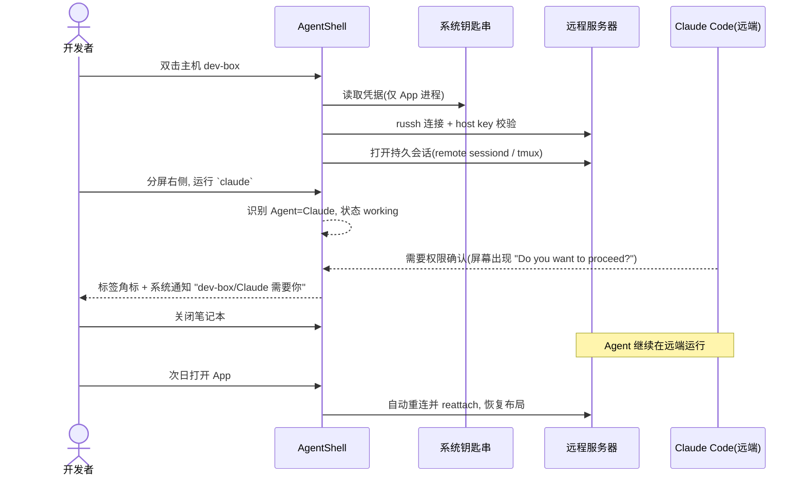
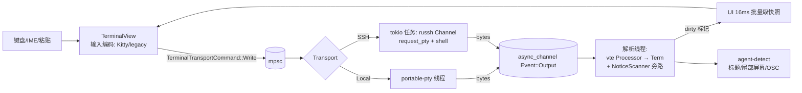
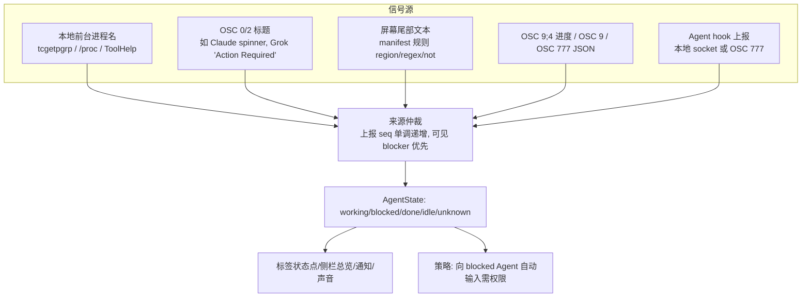
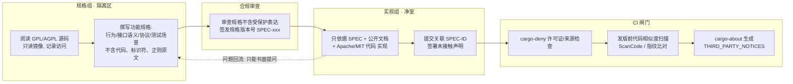
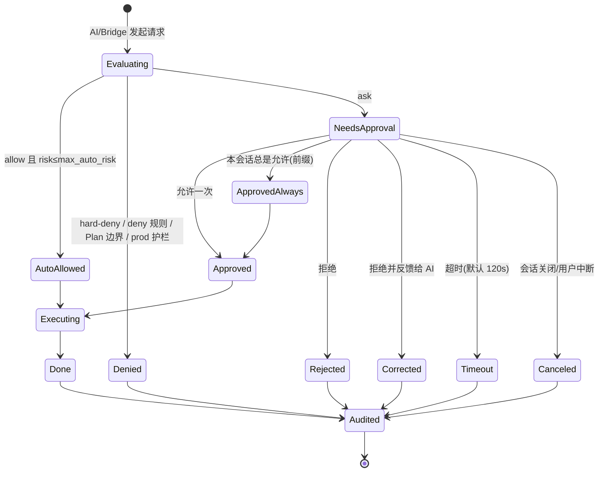
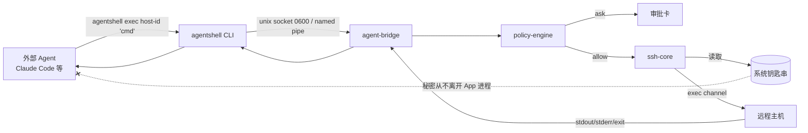
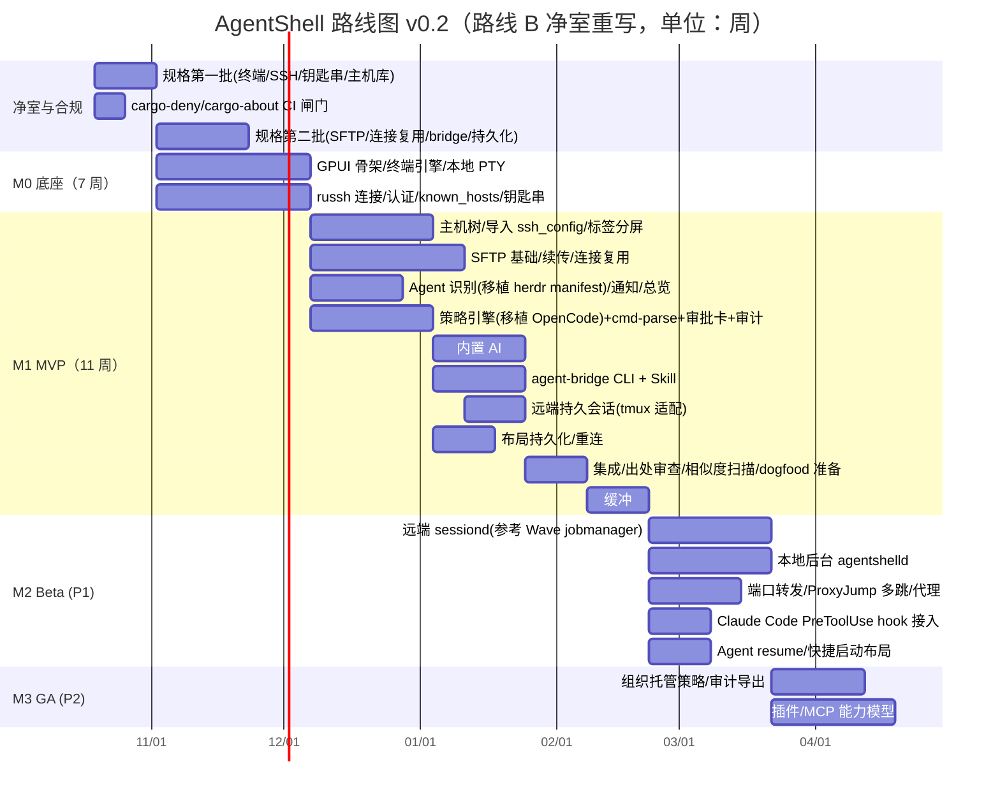

# PRD：带 Agent 能力的原生桌面 SSH 客户端 + 终端（暂名 **AgentShell**）

| 项 | 内容 |
|---|---|
| 文档版本 | v0.5（原型 v4：性能改为事件驱动、能力补齐、首批 Apache/MIT 代码移植） |
| 日期 | 2026-10-13 |
| 作者 | 产品 / 架构 |
| 技术基线 | Rust + GPUI（Zed UI 框架）+ `alacritty_terminal` + `russh` + `portable-pty` |
| 状态 | 待评审，第 9 章有待确认问题（Q1、Q4 已决策；Q11 方向已定：先闭源） |
| 变更记录 | v0.5（2026-10-13）：新增 5.13 原型 v4 结论（事件驱动渲染、行级 damage 缓存、滚动回看、剪贴板/bracketed paste、下划线/删除线/OSC 8、鼠标上报、自绘框线与 Powerline、建议折行、历史落盘、zsh、分屏、主机列表、known_hosts、Agent 识别）；5.8 增加「已移植代码登记」；5.9 补 v4 一行并更新原型取舍；9.2 Q7、Q9 更新，新增 Q16–Q18。v0.4 备份为 `PRD-v0.4.md`。<br>v0.4（2026-10-13）：3.2 增加字体/主题/自动建议三行；新增 5.10 字体与字形回退、5.11 主题系统、5.12 命令历史自动建议（含 AI 建议接入）；5.9 补充 v3 原型结论；9.2 新增 Q13–Q15。v0.3 备份为 `PRD-v0.3.md`。<br>v0.3（2026-10-12）：5.5 选型表锁定 GPUI（`gpui-pre =0.3.9`）和 russh 0.64.1 + `aws-lc-rs`；新增 5.9 最小原型结论；新增 6.9 外部 Agent 管控能力（Claude Code / Codex / Grok Build 钩子核实）；9.2 Q4 关闭，Q11 定为先闭源；R1、R12 更新。v0.2 备份为 `PRD-v0.2.md`。<br>v0.2（2026-10-12）：Q1 定为路线 B；第 5 章改为按许可证区分「仅参考设计」和「可用代码」；新增 5.7 净室重写流程和 5.8 第三方署名清单；第 8 章 MVP 加回 6 周（12→18 周）；第 9 章补充 GPUI 许可证核实结果和传递依赖风险 |

> **调研方法说明**：下文提到的设计都来自实际阅读的代码和文档。2026-10-12 把各仓库 `git clone --depth 1` 到 `/workspace/research/`，下表是各仓库的 commit。文中「文件路径」是仓库内的相对路径，可以到 `https://github.com/<owner>/<repo>/blob/<commit>/<path>` 查看。推断和建议会明确标为「推断」或「建议」。

## 0. 调研范围与结果

| 仓库 | 链接 | 克隆 commit | 结果 | 许可证 | 本 PRD 参考点（GPL/AGPL 项目只参考设计，见 5.6） |
|---|---|---|---|---|---|
| since2006/shell-rs (ShellRS) | https://github.com/since2006/shell-rs | `e3397da` (2026-10-12) | ✅ 成功 | GPL-3.0-only | GPUI + alacritty_terminal + russh 的完整 SSH 客户端；钥匙串；known_hosts；Agent CLI |
| herdrdev/herdr | https://github.com/herdrdev/herdr | `dc6b6e5` (2026-10-12) | ✅ 成功 | Apache-2.0 | Agent 状态识别（manifest）、server/client 持久化、多机、通知、Agent 会话恢复 |
| warpdotdev/warp | https://github.com/warpdotdev/warp | `25e8221` (2026-10-11) | ✅ 成功 | AGPL-3.0（`warpui*` 为 MIT） | Agent 执行权限（AgentDecides/AlwaysAsk/AlwaysAllow、allowlist/denylist）、CLI Agent 会话事件、密钥脱敏 |
| wavetermdev/waveterm | https://github.com/wavetermdev/waveterm | `9f1c967` (2026-10-05) | ✅ 成功 | Apache-2.0 | 远程 durable session（远端 job manager）、AI 工具审批状态机、Claude Code badge |
| anomalyco/opencode | https://github.com/anomalyco/opencode | `25053bb` (2026-10-12) | ✅ 成功 | MIT | allow/ask/deny 规则引擎、Build/Plan 模式、once/always/reject、bash 解析与 arity |
| zellij-org/zellij | https://github.com/zellij-org/zellij | `a6c3dba` (2026-10-12) | ✅ 成功 | MIT | 会话序列化/恢复（`start_suspended`）、插件权限枚举 |
| alacritty/alacritty（`alacritty_terminal`） | https://github.com/alacritty/alacritty | `29dc553` (2026-10-05) | ✅ 成功 | Apache-2.0 / MIT | 终端状态机（Term/Grid/vte）、EventListener |
| OxideTerm | https://github.com/AnalyseDeCircuit/oxideterm | `4992922` (2026-10-11) | ✅ 成功（任务没给仓库地址，通过搜索找到 `AnalyseDeCircuit/oxideterm`） | GPL-3.0 | GPUI 原生 SSH 工作台；AI 策略（风险分级、ReadOnly 硬边界、危险命令正则）；审计；连接复用；上下文脱敏 |
| russh | https://github.com/Eugeny/russh | `e5d80a0` (2026-10-05) | ✅ 成功 | Apache-2.0 | 纯 Rust SSH2 客户端（channel、PTY、转发、agent、known_hosts） |
| 补充：zed-industries/zed `crates/gpui`、`crates/terminal` | https://github.com/zed-industries/zed | 用 curl 读了各 crate 的 `Cargo.toml`（v0.2 复核） | ⚠️ 部分核验 | `gpui` 及其平台/工具 crate 为 **Apache-2.0**；`terminal`、`terminal_view`、`editor` 为 **GPL-3.0-or-later** | 确认 Zed 终端基于 `alacritty_terminal` + `gpui`；**Zed 终端集成代码属于 GPL，只能参考设计**（详见 9.1 R11） |

> **产品许可（v0.3）**：产品先以闭源方式开发和发布，后续再决定是否开源。
>
> **许可证路线（v0.2 已定）**：采用**路线 B：闭源/宽松许可 + 净室重写**。下文凡是引用 ShellRS、OxideTerm、Warp（以及 Zed 的 GPL crate）的地方，都**只是设计参考，不复制代码**；引用 herdr、Wave、russh、alacritty_terminal、OpenCode、zellij 的地方，代码可以按许可证使用，署名要求见 5.8。本 PRD 含 GPL/AGPL 源码的路径和细节，属于净室流程中的**规格组材料**，不能原样交给实现组（见 5.7）。

**所有仓库都访问成功，没有无法访问的。** 唯一的偏差是 OxideTerm 没有给出 owner，通过 Web 搜索确认为 `AnalyseDeCircuit/oxideterm`。另外，该仓库 GitHub 页面的旧缓存描述它是 Tauri 2 + React，而当前 main 的 README 和 `Cargo.toml` 显示它已迁到 GPUI（vendored 了 `crates/gpui-ce` 和 `crates/alacritty-terminal`）。本 PRD 以 clone 下来的当前代码为准。

---

## 1. 产品概述与目标用户

### 1.1 一句话定位
一个**原生、GPU 渲染的 SSH 客户端兼终端**。它让开发者在同一个窗口里管理远程服务器、运行 Claude Code / Codex / Grok CLI 等外部 Agent，并使用内置 AI。所有 AI 发起的动作都经过**可审计、可配置、默认安全**的权限系统。

### 1.2 要解决的问题（来自竞品调研的空白）
| 痛点 | 现状 |
|---|---|
| SSH 客户端（Xshell/Termius/ShellRS）不懂 Agent | ShellRS 已有 `shellrs exec` 给 Agent 用，但权限只有「启用外部 CLI」这一个全局开关（`src/cli/server.rs` 中 `enabled: AtomicBool`），没有逐命令审批、风险分级和审计 |
| Agent 运行时（herdr）不是 GUI SSH 客户端 | herdr 是跑在已有终端里的 TUI（ratatui + crossterm），依赖系统 `ssh`（`src/remote/attach.rs` 中 `Command::new("ssh")`），没有 SFTP、主机管理和钥匙串 |
| Warp 的 Agent 强但 SSH 管理弱 | Warp 通过 warpify 往远端注入 bootstrap，远端能力依赖它自己的 remote server（`crates/remote_server/`，通过系统 ssh ControlMaster）；没有 Xshell 式主机树/SFTP，核心 AI 依赖云账号 |
| Wave 是 Electron + Go | 内存和启动开销大；AI 命令执行在 README 中仍写着「Coming Soon: Command execution (with approval)」 |
| 纯终端 + tmux | 持久化最强，但没有 Agent 状态、审批、凭据隔离，也没有 GUI SFTP |

### 1.3 目标用户
| 画像 | 描述 | 核心诉求 |
|---|---|---|
| P1 远程开发者（主） | 日常 SSH 到开发机/云主机，在远端跑 Claude Code / Codex 做开发 | 多标签/分屏、Agent 状态一眼可见、断线不丢、通知 |
| P2 运维 / SRE | 管理几十到上百台主机，跳板机、转发、SFTP | 主机树、凭据集中、危险命令拦截、审计 |
| P3 AI 重度用户 | 同时跑多个 Agent（本地 + 多台远程） | Agent 总览、阻塞提醒、Agent 不接触明文密码 |
| P4 团队管理员（P2 阶段） | 需要统一策略 | 组织级 deny 规则不可绕过、审计导出 |

### 1.4 产品目标与成功指标
| 目标 | 指标（GA 前） |
|---|---|
| 可替代日常 SSH 客户端 | 冷启动 < 400ms（M1 / 中端 Win 机）；单标签空闲内存 < 80MB；输入延迟 P95 < 10ms（本地） |
| Agent 体验 | Claude Code / Codex / Grok CLI / OpenCode 在本地和 SSH 内的状态识别准确率 ≥ 95%（working/blocked/idle） |
| 安全 | 内置 AI 执行的命令 100% 经过策略引擎，100% 写入审计；危险命令自动执行率为 0 |
| 可靠 | 开启持久会话后，网络中断 / 关闭应用后远端 Agent 继续运行，重连恢复率 ≥ 99% |

### 1.5 非目标（v1）
- 不做云账号 / 云同步（BYOK、本地优先，与 OxideTerm、Wave 一致）。
- 不自研 Coding Agent 来替代 Claude Code 等。内置 AI 定位是「终端助手」。
- 不做 RDP/VNC/串口（OxideTerm 有，但不是本产品场景）。

---

## 2. 核心场景与用户故事

### 2.1 主场景：远程开发 + Agent


### 2.2 用户故事（INVEST 格式，带验收标准）

| ID | 角色 | 故事 | 验收标准 | 优先级 |
|---|---|---|---|---|
| US-01 | 开发者 | 导入 `~/.ssh/config`，以分组树管理主机 | 支持 Host/HostName/User/Port/IdentityFile/ProxyJump；导入后可编辑；数据库不出现明文秘密 | P0 |
| US-02 | 开发者 | 首次连接时确认 host key，key 变更时被强警告 | 未知 key 显示 SHA256 指纹并确认；变更 key 默认拒绝，需二次确认替换 | P0 |
| US-03 | 开发者 | 在多个标签和分屏里同时开本地和远程终端 | 拖拽标签到边缘可分屏；vim/htop/tmux 正常；⌘T/⌘D | P0 |
| US-04 | 开发者 | 在远程终端里运行 `claude` / `codex` / `grok`，App 自动识别并显示状态 | 侧栏 Agent 列表显示 主机/面板/Agent/状态；blocked 时通知 | P0 |
| US-05 | 开发者 | 关闭 App 后，远端 Agent 继续运行，再打开能接回 | 开启「持久会话」的面板在 App 退出、网络断开后进程不中断；重开 App 自动 reattach | P0（远端）/P1（本地） |
| US-06 | 开发者 | 按 ⌘K 用自然语言描述需求，得到命令建议 | 显示命令 + 解释 + 风险等级；默认只填入输入行，不执行 | P0 |
| US-07 | 开发者 | 命令失败后点「解释错误」 | 用最近一个命令块的输出（脱敏后）生成解释和修复建议 | P0 |
| US-08 | 开发者 | 让内置 AI 执行命令排查问题 | 每条命令经过策略引擎；只读命令在 Auto 模式自动执行，其他需确认；全部写审计 | P0 |
| US-09 | 运维 | 生产主机上的 AI 不能执行破坏性命令 | 主机打标签 `env=prod` 后，R3 及以上一律拒绝（不可通过 always 放开） | P0 |
| US-10 | 开发者 | 外部 Agent（Claude Code）能在保存的主机上执行命令，但拿不到密码 | `agentshell exec <host> "cmd"`，凭据只在 App 进程内；请求经策略引擎，必要时弹审批卡 | P0 |
| US-11 | 开发者 | 查看「AI 今天在哪些主机执行了什么」 | 审计面板可按主机/会话/决策过滤，可导出 JSONL | P0 |
| US-12 | 开发者 | SFTP 双栏拖拽传输，断点续传 | 传输队列；断线重试；与终端共享认证 | P0 |
| US-13 | 开发者 | 配置本地/远程/动态端口转发 | -L/-R/-D；规则图示；随 App 启动 | P1 |
| US-14 | 开发者 | 多台机器的 Agent 汇总到一个列表 | 「Agent 总览」按状态排序，点击跳转到面板 | P1 |
| US-15 | 管理员 | 下发组织级 deny 规则，用户本地不可覆盖 | 托管策略文件（只读）优先级最高 | P2 |

---

## 3. 功能需求

> 优先级：**P0 = MVP 必须**，**P1 = GA 前**，**P2 = GA 后**。

### 3.1 SSH 基础

| 功能 | 描述 | P | 参考（〔设计〕= GPL/AGPL，仅参考设计；〔代码〕= Apache/MIT，可按许可证使用） |
|---|---|---|---|
| 主机管理 | 分组任意嵌套、搜索、拖拽、标签（env/role）、OS 识别徽章 | P0 | 〔设计〕ShellRS `src/host/`（`HostStore` 内存为准、写穿 SQLite；`outline.rs` 纯函数生成树）；OS 探测 `src/ssh/probe.rs` |
| `~/.ssh/config` 导入 | 解析 Host/Match 子集、ProxyJump、IdentityFile | P0 | 〔代码〕russh 仓库的 `russh-config` crate（Apache-2.0，可直接作为依赖） |
| 认证 | none → agent → publickey → password → keyboard-interactive（2FA） | P0 | 〔设计〕ShellRS `src/ssh/transport.rs` 认证链；〔设计〕OxideTerm `SYSTEM_INVARIANTS.md`「SSH keyboard-interactive prompts are modal focus owners」 |
| Host key 验证 | 独立 known_hosts（不改 `~/.ssh/known_hosts`），可选只读引用系统 known_hosts | P0 | 〔设计〕ShellRS `src/ssh/connection.rs::check_server_key`（未知/变更 key 都交给用户决定）；〔代码〕russh `Handler::check_server_key` **默认拒绝所有 key**（`russh/src/client/mod.rs`） |
| 跳板/代理 | ProxyJump 多跳（每跳独立认证）、HTTP/SOCKS5 代理 | P0（ProxyJump）/P1（代理） | 〔设计〕ShellRS `src/ssh/proxy.rs`；〔设计〕OxideTerm README「Multi-hop proxy chains with per-hop independent auth」 |
| 连接复用 | 同一主机的终端/SFTP/转发/AI exec 共享一条物理连接、多 channel；可按主机关闭复用（堡垒机单 channel） | P0 | 〔设计〕OxideTerm `crates/oxideterm-ssh/src/connection_registry.rs` + invariant「one connection key maps to one registry connection shared by many channel consumers」；ShellRS 目前是每个 SFTP 标签/转发规则各用一条连接，并有 `HostLogin::shell_only` 处理堡垒机 |
| SFTP | WinSCP 式双栏、队列、断点续传（`.filepart` + 重试 1/3/10s）、内置编辑 | P0（基础）/P1（编辑、同步） | 〔设计〕ShellRS `src/sftp/`、`src/explorer/`（russh-sftp 3.0.0） |
| 端口转发 | -L/-R/-D（SOCKS4/5），图示，自动重连 | P1 | 〔设计〕ShellRS `src/forward/`（`diagram.rs`、`worker.rs`） |
| 钥匙串凭据 | macOS Keychain / Windows Credential Manager / Secret Service；可共享凭据 | P0 | 〔设计〕ShellRS `src/secrets/keychain.rs`（`keyring` 4）、`SecretRef` 归属规则 |
| SSH Agent 转发 | 默认关闭，按主机开启；拒绝未请求的 agent channel | P1 | 〔设计〕OxideTerm invariant「agent forwarding must reject unsolicited server-opened agent channels」；〔代码〕russh `channels/mod.rs::agent_forward` |
| 堡垒机拉起 | `ssh://` / `sftp://` 链接、Xshell `-url` 兼容 | P2 | 〔设计〕ShellRS `src/host/ssh_link.rs`、`src/cli/link.rs` |
| 主机侧栏工具 | 监控/进程/服务/Docker | P2 | 〔设计〕ShellRS `src/monitor/` 等（在终端自己的连接上开 exec channel） |

### 3.2 终端

| 功能 | 描述 | P |
|---|---|---|
| 终端仿真 | `alacritty_terminal` 的 `Term` + `vte::ansi::Processor`；256 色/真彩、鼠标、bracketed paste、备用屏、OSC 8 链接、OSC 52 | P0 |
| 本地 Shell | `portable-pty`（Windows ConPTY），可选 zsh/bash/fish/pwsh/WSL | P0 |
| 多标签 / 分屏 | 标签可拖到上/下/左/右分屏；⌘D/⌘⇧D；面板缩放；面板聚焦导航 | P0 |
| 搜索 / 选择 / 复制 | 正则搜索（smart case）、矩形选择、URL 识别 | P0 |
| 命令块（Shell Integration） | OSC 133（A/B/C/D）标记 prompt/命令/输出/退出码，给「解释错误」和审计用；远端需注入 shell 集成脚本（可选） | P0（本地+远程自动注入为可选项） |
| 通知 | OSC 9 / OSC 777 / BEL → 应用内 toast + 系统通知 | P0 |
| 字体 | 可配置字体族/字号/行高/回退链；默认关闭连字；CJK/emoji 按 2 格绘制；Nerd Font/Powerline 图标（详见 5.10） | P0 |
| 主题 | UI token + 终端 16 色 + 前景/背景/光标/选中；TOML 主题文件；内置明暗主题；跟随系统、热切换；导入 Alacritty（P0）/iTerm2（P1）配色（详见 5.11） | P0 |
| 命令历史自动建议 | 光标后灰色显示历史建议，→ / Tab 接受；本地与 SSH 都可用；备用屏/密码输入/敏感命令禁用；AI 建议复用同一 UI（详见 5.12） | P0（历史）/P1（AI） |
| 关键字高亮 | 正则规则着色/通知（ERROR、Traceback） | P1 |
| 图形协议 | Sixel / Kitty graphics | P2 |
| 录制回放 | asciicast v2 | P2 |
| 广播输入 | 一次输入发往多个面板（需二次确认，算高风险交互） | P2 |

> 实现提醒：`alacritty_terminal` 会丢弃 OSC 9/777，需要在解析线程里旁路再扫描一遍字节流，Agent 事件（OSC 777 JSON）也走这条路径。这一做法来自 ShellRS `src/terminal/notices.rs` 的〔设计〕参考，实现时依据 vte 的 `Perform` 接口（alacritty_terminal 重导出的 `vte`，Apache-2.0/MIT）和 OSC 公开规范独立编写。

### 3.3 外部 Agent（Claude Code / Codex / Grok CLI / OpenCode …）

| 功能 | 描述 | P |
|---|---|---|
| 无缝运行 | Agent 在普通 PTY 里运行，不包装也不替换（与 herdr「herdr doesn't wrap or replace them; it owns their terminals」一致）；保证 Kitty keyboard protocol、bracketed paste、真彩、OSC 0 标题、OSC 9;4 进度、IME 正常 | P0 |
| Agent 识别 | 三层：①前台进程名（本地）；②屏幕 manifest 规则（本地+远端）；③Agent 主动上报（hook → OSC 777 / 本地 socket） | P0（①②）/P1（③） |
| 状态 | `working` / `blocked` / `done`（完成且未查看）/ `idle` / `unknown`（沿用 herdr 定义，`docs/next/website/src/content/docs/concepts.mdx`） | P0 |
| 增强 UI | 标签/面板标题显示 Agent 图标和状态点；侧栏「Agent 总览」跨主机汇总；blocked 时标签角标 + 声音 + 系统通知；通知点击跳转面板；当前可见面板不弹通知 | P0 |
| 快捷启动 | 「在此主机启动 Agent」菜单：选 Agent + 目录 + 布局（例如左侧 Agent、右侧 shell 并 `tail -f` 日志） | P1 |
| 会话恢复 | 记录 Agent 上报的 resume 命令（如 `claude --resume <id>`、`codex resume <id>`、`grok --resume <id>`），进程丢失后在原目录一键恢复 | P1 |
| 凭据桥（Agent CLI） | `agentshell` CLI + Agent Skill：`hosts list / exec / upload / download`，**每个请求都经过权限引擎**（ShellRS 只有全局开关，这里需要重新设计） | P0 |
| 外部 Agent 权限钩子 | 为 Claude Code / Codex / Grok Build 安装 `PreToolUse` hook，把工具调用交给本产品策略引擎判定；按各家能力降级（Claude：allow/deny/ask；Codex：deny/改写，ask 由我们弹窗后返回；Grok：deny，ask 需核实），详见 6.9 | P1（v0.3 已核实可行） |
| Agent 输入注入 | 内置 AI 或其他 Agent 向某个 Agent 面板写入（prompt 互传）属于 `write_to_pty` 权限，默认 ask（参考 Warp `WriteToPtyPermission::{AlwaysAsk, AskOnFirstWrite, AlwaysAllow}`） | P1 |

### 3.4 内置 AI

| 功能 | 交互 | 默认权限 | P |
|---|---|---|---|
| 命令建议（inline） | 输入行灰字补全（基于历史 + 上下文 + 模型）；Tab 接受 | 只填入，不执行 | P1 |
| 自然语言转命令 | 在输入行开头输入 `#` 或按 ⌘K：「找出占用 8080 端口的进程」→ 卡片显示命令、逐段解释、风险等级、目标主机；按钮：**插入** / **执行** / **复制** | 默认「插入」；「执行」走策略引擎 | P0 |
| 执行命令（Agentic） | 右侧 AI 面板多轮对话，AI 提出工具调用 `run_command(host, cmd)`，逐条显示审批卡 | 由模式与规则决定 | P0 |
| 错误解释 | 非零退出码的命令块出现「解释」按钮；输入是命令 + 尾部 200 行输出（脱敏） | 只读，无需审批 | P0 |
| 上下文 | 当前主机 OS/shell/cwd（来自 OSC 7/133）、最近 N 个命令块、选中文本；**发送前统一脱敏** | — | P0 |
| 模型 | BYOK：OpenAI / Anthropic / Gemini / Ollama / OpenAI 兼容；API Key 存钥匙串 | — | P0 |
| 隐私 | 首次发送远端输出前提示；可按主机设置「禁止 AI 读取输出」 | — | P0 |

**交互原则**
1. **AI 生成 ≠ 执行**：默认只插入输入行，用户回车才执行（等于人工确认）。
2. **审批卡**同时显示：完整命令（不截断，多行展开）、目标主机与 env 标签、风险等级与原因（命中哪条规则）、AI 给出的意图说明，以及四个按钮：「允许一次 / 本会话总是允许此前缀 / 拒绝 / 拒绝并告诉 AI 原因」（对应 OpenCode `once / always / reject` 和 `CorrectedError(feedback)`）。
3. **AI 执行的命令在终端中可见**：在独立的「AI 执行」通道（exec channel）中运行，输出回填 AI 面板。用户也可以选择「在当前终端中执行」（写入 PTY，可见但风险更高，权限更严）。

### 3.5 权限控制（概要，详细设计见第 6 章）

| 功能 | P |
|---|---|
| 三种模式：**Ask**（默认）/ **Plan（只读）** / **Auto（仅安全只读自动执行）**，每个 AI 会话可切换，状态栏常驻显示 | P0 |
| 规则：`allow / ask / deny`，作用于动作 × 资源（命令、路径、主机），分层合并 | P0 |
| 风险分级 R0–R4 + 不可覆盖的硬拒绝（hard-deny）清单 | P0 |
| 主机环境标签（prod/staging/dev）参与规则匹配 | P0 |
| 审批卡、超时自动拒绝、批量审批禁止跨风险级 | P0 |
| 审计日志：追加写 JSONL + 哈希链 + 脱敏 + 查询/导出 | P0 |
| 托管（组织）策略，最高优先级、只读 | P2 |

### 3.6 会话与布局

| 功能 | 描述 | P |
|---|---|---|
| Workspace / Tab / Pane | 三级结构（同 herdr `concepts.mdx`）；一个 workspace 可混合多台主机 | P0 |
| 布局持久化 | 退出时保存：标签、分屏树、每个面板的主机、cwd、Agent resume 引用；启动时恢复（不自动重跑命令，参考 zellij `start_suspended`，见 `zellij-utils/src/session_serialization.rs`） | P0 |
| 远端持久会话 | 面板可标记为「持久」：远端进程独立于 App 存活，App 断开时远端缓冲输出，重连后 reattach（参考 Wave Durable Sessions：远端 job manager，`pkg/jobmanager/`、`docs/docs/durable-sessions.mdx`） | P0 |
| 本地持久会话 | 本地 PTY 由后台 `agentshelld` 持有，关闭窗口不杀 Agent（参考 herdr server/client 架构） | P1 |
| 多机 | 同一窗口多主机；每台主机独立重连，一台掉线不影响其他（herdr `connecting-machines.mdx`） | P0 |
| 断线重连 | 指数退避；Grace Period 内透明恢复（OxideTerm README 提到「Grace Period reconnect」） | P0 |
| 布局快照 | 保留最近 N 份布局快照，可手动回滚（herdr 保留 48 份 `session-snapshots/`） | P2 |

**「关闭应用后 Agent 是否继续运行」的产品决策**（核心问题）：

| 场景 | 默认行为 | 依据 |
|---|---|---|
| 远程面板，「持久」开启（远端有 sessiond 或 tmux） | ✅ 继续运行，重开 App 自动接回，能看到期间的输出 | Wave durable session；herdr 远端 server |
| 远程面板，「持久」关闭 | ❌ SSH channel 关闭，远端进程收到 SIGHUP 后退出；关闭前提示「此面板有运行中的 Agent」 | 普通 SSH 语义 |
| 本地面板，P0 | ❌ 随 App 退出；有运行中的 Agent 时退出前确认；下次启动可用 resume 命令恢复 Agent 对话 | herdr「Native agent session restore」 |
| 本地面板，P1 启用后台守护 | ✅ 窗口关闭后 `agentshelld` 继续持有 PTY；托盘图标显示运行中的 Agent 数 | herdr「detach without stopping work」 |
| 机器重启 | 进程丢失；恢复布局，按 resume 命令恢复 Agent（需用户点击确认，避免自动跑出权限外的动作） | herdr session-state 表格；zellij `start_suspended` |

---

## 4. 非功能需求

| 类别 | 要求 |
|---|---|
| 性能 | 冷启动 < 400ms；输入到上屏 P95 < 10ms（本地）/ RTT + 5ms（远程）；`cat` 1GB 文件不卡 UI（解析线程与渲染分离，UI 批量刷新约 16ms；〔设计〕参考 ShellRS `src/terminal/engine.rs`）；20 个面板同时运行 Agent 时 CPU < 15%（空闲期） |
| 资源 | 安装包 < 60MB；单个空闲远程标签 < 15MB 增量内存 |
| 可靠性 | 关闭面板不得阻塞 UI 线程（〔设计〕参考 OxideTerm `docs/SYSTEM_INVARIANTS.md`）；PTY/SSH resize 去抖合并 |
| 安全 | 见第 6 章；SQLite 不存任何秘密（自写守护测试：schema 中不得出现秘密列；〔设计〕参考 ShellRS 同类测试）；内存中秘密用 `zeroize`；Agent CLI 的 socket 权限 0600；自动更新用 minisign 签名 + SHA-256（minisign 是公开格式，有 MIT 许可的 Rust 实现可选；〔设计〕参考 ShellRS `src/update/verify.rs`） |
| 隐私 | 无遥测或默认关闭；AI 请求只发往用户配置的 provider；审计和布局都只存在本地 |
| 跨平台 | macOS 12+（arm64/x64）、Windows 10 1809+（ConPTY）、Linux（X11/Wayland，glibc ≥ 2.35，与 ShellRS 一致） |
| 可访问性 | 全键盘可达；高对比主题；字体缩放 |
| 国际化 | 中/英起步（`rust-i18n`，MIT；中文为源语言） |
| 可测试性 | 传输层与 UI 解耦，可注入假传输（〔设计〕参考 ShellRS 的服务注入式 UI 测试）；策略引擎是纯函数，要有表驱动单测 |
| 兼容性 | 远端零依赖可用（不装任何东西也能用全部 P0 SSH 功能）；持久会话和高级 Agent 集成可选装远端 helper |

---

## 5. 技术架构建议

### 5.1 总体架构
```mermaid
flowchart TB
  subgraph UI["GPUI 进程 (agentshell)"]
    WS[Workspace 壳<br/>Tab/Pane/Dock] --> TV[TerminalView<br/>网格渲染/输入编码]
    WS --> HP[主机树/凭据/SFTP/转发 面板]
    WS --> AIP[AI 面板 / 审批卡 / 审计查看器]
    WS --> AO[Agent 总览侧栏 / 通知]
  end
  subgraph CORE["核心 crates (无 UI 依赖)"]
    TE[term-engine<br/>alacritty_terminal Term+Processor<br/>+ 旁路 OSC 扫描器]
    SC[session-core<br/>统一 Session 契约]
    SSH[ssh-core<br/>russh 连接注册表/认证/known_hosts]
    PTY[local-pty<br/>portable-pty]
    SFTP[sftp-core<br/>russh-sftp]
    FWD[forward-core]
    AD[agent-detect<br/>进程名+manifest+上报]
    POL[policy-engine<br/>模式/规则/风险/硬拒绝]
    AUD[audit-log<br/>JSONL+哈希链+脱敏]
    AI[ai-core<br/>provider/上下文/工具调用]
    SEC[secrets<br/>keyring + zeroize]
    STORE[store<br/>SQLite 主机/规则/布局]
    BR[agent-bridge<br/>本地 socket + CLI + hook 端点]
  end
  subgraph DAEMON["agentshelld (P1, 本地后台)"]
    LP[持有本地 PTY / 会话]
  end
  subgraph REMOTE["远端主机"]
    SH[login shell]
    SD[agentshell-sessiond (可选)<br/>或 tmux 适配]
    EXT[Claude Code / Codex / Grok CLI]
  end
  TV <--> TE
  TE <--> SC
  SC --> SSH
  SC --> PTY
  SC -.P1.-> LP
  SSH <-->|channel: shell/exec/sftp/direct-tcpip| SH
  SSH <--> SD
  SD --> EXT
  AI --> POL --> AUD
  BR --> POL
  POL --> SC
  SSH --> SEC
  TE --> AD --> AO
  HP --> STORE
```

### 5.2 模块划分（Cargo workspace）

> 「参考方式」一列：**〔设计〕** 表示来源是 GPL/AGPL，只能由规格组读源码、写成书面规格，实现组按规格独立编写（5.7）；**〔代码〕** 表示来源是 Apache/MIT，可以作为依赖或在保留署名的前提下复制/移植（5.8）。

| crate | 职责 | 参考方式 |
|---|---|---|
| `term-engine` | 包装 `alacritty_terminal::Term<Listener>`；解析线程；快照；搜索/选择；旁路 OSC 扫描（OSC 9/777/133/7/自定义） | 〔代码〕`alacritty_terminal`（Apache-2.0，作为依赖；`Term`、`event.rs::EventListener`、`vte`）；〔设计〕ShellRS `src/terminal/engine.rs`、`notices.rs`（解析线程 + 快照 + 旁路扫描的分层思路） |
| `session-core` | **统一会话契约**：`write_input / resize / shutdown / title / lifecycle / process_state / snapshot`，本地、SSH、远端 durable 三种实现 | 〔设计〕ShellRS `src/terminal/transport.rs`（传输 trait + 命令/事件枚举 + 工厂便于重启/注入）、OxideTerm 不变量「Local and SSH terminal sessions must expose the same session contract」。trait 名称和事件枚举要自行设计命名，不照搬 |
| `ssh-core` | russh 客户端、**连接注册表**（一个 key 对应一条物理连接、多个 channel 消费者）、认证链、known_hosts、ProxyJump、keepalive/延迟测量、重连 | 〔代码〕russh（Apache-2.0）的 `client`、`keys::known_hosts`、`russh/examples/client_exec_interactive.rs` 等示例；〔设计〕ShellRS 认证链顺序与 host key 交互、OxideTerm 连接注册表 |
| `local-pty` | portable-pty 封装（专用线程），Windows ConPTY | 〔代码〕`portable-pty`（MIT）；herdr 对 portable-pty 的 vendored 补丁（`vendor/portable-pty.patches.md`，Apache-2.0 仓库，补丁本身要单独确认许可证）可以评估使用 |
| `sftp-core` / `forward-core` | SFTP 队列/续传；转发 worker | 〔代码〕`russh-sftp`（Apache-2.0）、russh `channel_open_direct_tcpip`/`tcpip_forward`；〔设计〕ShellRS `src/sftp/`、`src/forward/`（`.filepart` + 1/3/10s 重试、转发图示），**需重写** |
| `secrets` | `SecretStore` trait（Keychain/InMemory/NoSecret），秘密只在后台线程读取 | 〔代码〕`keyring`（MIT OR Apache-2.0）、`zeroize`；〔设计〕ShellRS `src/secrets/` 的条目归属规则（按 user@host:port / 密钥路径 / 凭据 ID） |
| `store` | SQLite（rusqlite bundled），`PRAGMA user_version` 迁移，内存为准、写穿 | 〔代码〕`rusqlite`（MIT，内置 SQLite 为公有领域）；〔设计〕ShellRS `src/host/database.rs`、`store.rs` |
| `agent-detect` | 进程名识别 + TOML manifest 规则 + 上报合并（来源仲裁） | 〔代码〕herdr `src/detect/mod.rs`、`src/detect/manifests/*.toml`（Apache-2.0）：规则文件和匹配引擎可以移植，需按 5.8 署名并标注修改 |
| `policy-engine` | 第 6 章全部逻辑；纯函数 `evaluate(request, ctx) -> Decision` | 〔代码〕OpenCode `packages/core/src/permission.ts`、`packages/schema/src/permission.ts`（MIT，TS→Rust 移植属于衍生作品，保留版权声明）；〔设计〕Warp `app/src/ai/blocklist/permissions.rs`、OxideTerm `crates/oxideterm-ai/src/policy.rs` |
| `cmd-parse` | tree-sitter-bash 拆分复合命令、识别重定向/子 shell/管道、提取「命令前缀」（arity 表） | 〔代码〕`tree-sitter` + `tree-sitter-bash`（MIT）；OpenCode `packages/core/src/shell/parse.ts` 的 `ARITY` 表（MIT，可移植并署名）；〔设计〕Warp `decompose_command` |
| `audit-log` | 追加写、哈希链、脱敏、查询 | 〔设计〕OxideTerm `crates/oxideterm-audit/`（审计分类与脱敏思路）；**自行实现** |
| `ai-core` | Provider 适配、SSE 流、工具协议、上下文构建、**脱敏** | 〔代码〕Wave `pkg/aiusechat/`（Apache-2.0，Go，可参考或移植审批状态机，需带 NOTICE）；〔设计〕OxideTerm `context_sanitizer.rs`、Warp `crates/secret_redaction/`：脱敏规则由实现组依据公开的密钥格式规范（如各云厂商 key 前缀文档、gitleaks 规则（许可证待核实））独立编写 |
| `agent-bridge` | `agentshell` CLI ↔ App 的本地 socket（帧协议）；hook 端点；Agent Skill 安装 | 〔设计〕ShellRS `src/cli/`（类型 + 长度帧、socket 0600、由 App 代登录）；〔代码〕herdr socket API 文档与 `docs/next/api/herdr-api.schema.json`（Apache-2.0）可作为协议设计参考；**新增策略检查和审批** |
| `agentshell-sessiond`（远端，可选） | 远端持有 PTY、环形缓冲、reattach；通过 SSH exec channel 走 stdio 协议 | 〔代码〕Wave `pkg/jobmanager/`（Apache-2.0，`cirbuf.go` 环形缓冲、JWT 鉴权）、herdr `src/remote/host.rs`（Apache-2.0，SSH stdio bridge） |
| `app`（GPUI） | 窗口、Dock、动作、面板 | 〔代码〕`gpui`（Apache-2.0）、`gpui-component`（Apache-2.0）；〔设计〕ShellRS `src/workspace/`、`src/app/actions.rs`（「一个命令一个处理器」）；**不得参考 Zed `crates/terminal_view` 的代码（GPL-3.0-or-later）** |

### 5.3 本地 + SSH 终端数据流（GPUI 中）

要点：
- **线程模型**（〔设计〕参考）：ShellRS 给每个 SSH 传输建一个 `new_current_thread` tokio runtime，再加一条命令桥线程（`src/ssh/transport.rs::run`）。这种做法简单、隔离好，但连接一多线程也多。**建议**：全局使用一个多线程 tokio runtime，配合连接注册表；UI 只通过 channel 交互，「禁止后台线程直接唤醒 GPUI 前台任务」（ShellRS AGENTS.md 中的约定，作为设计原则采用），改由 UI 定时轮询或 GPUI executor 通知。
- **SSH 输出必须经过 Term**（〔设计〕OxideTerm 不变量「SSH output must pass through Alacritty's Term and Processor before rendering」）。
- **resize** 按面板实际边界计算，并去抖；连接建立后补发一次 resize（〔设计〕OxideTerm 不变量）。
- **AI exec 不占用户 shell**：在同一连接上另开 `exec` channel（〔设计〕参考 ShellRS `ExecRequest`）。堡垒机只允许单 channel 时，退化为「写入终端 + OSC 标记读回结果」（〔设计〕参考 ShellRS `src/terminal/run.rs` 的思路：先中断前台 → 探测 shell → 执行，用私有 OSC + 随机 nonce 标记起止和退出码。**OSC 编号、标记格式要自行选定**，不沿用 ShellRS 的 `6973`）。这种退化路径**风险更高**：会打断前台程序，所以权限默认 ask 且必须明确提示。

### 5.4 Agent 识别架构

- **远端识别的难点（推断，影响架构）**：herdr 的进程名识别和 `HERDR_SOCKET_PATH` 上报都要求 herdr 跑在 Agent 同一台机器上（它在远端装 herdr server）。我们是 SSH 客户端，Agent 跑在远端，看不到远端进程表。因此：
  - **零安装路径**：只依赖经 PTY 流回来的信号：OSC 标题、屏幕 manifest、OSC 9/777。所有 Agent 识别规则都要能在「只有字节流」的前提下工作。herdr 的 manifest 正是按这个思路设计的，例如 `grok.toml` 的注释写着 Grok 会发 OSC 0 标题、权限提示时加「⚠ Action Required」、OSC 9;4 进度。
  - **增强路径**：远端安装 hook（例如 Claude Code `~/.claude/settings.json` 的 Notification/Stop hook），由 hook **往自己的 TTY 打印 OSC 777 JSON**，事件随 PTY 字节流回到本地。这和 Warp 的 `CLIAgentEventSource::RichPlugin`（「Structured OSC 777 notification from a rich plugin」）机制一致，不需要额外端口或 socket。
  - **sessiond 路径**：装了远端 sessiond 时，它能读远端前台进程组（等价于 herdr 本机识别），准确率最高。
- **manifest 规则格式**：建议采用 herdr 风格的 TOML（`id/version/min_engine_version/[[rules]] state/priority/region/regex/not`），规则可以热更新。

### 5.5 选型

| 方面 | 选择 | 理由 / 备选 |
|---|---|---|
| UI | **GPUI：`gpui = { package = "gpui-pre", version = "=0.3.9" }` + `gpui_platform = { package = "gpui-pre-platform", version = "=0.3.9" }`**（Zed 主干 `93d7456`（2026-10-11）的 crates.io 快照，Apache-2.0）；组件库 `gpui-component` 0.7.3（Apache-2.0，它本身就 `=` 锁定 gpui-pre 0.3.9）。**v0.3 已核实** | ①crates.io `gpui` 只有 0.2.0–0.2.2（2025-10-09 至 2025-10-22），之后一年没更新，且 gpui-component 0.7.x 已不兼容它；②`gpui-pre` 每周发布一次（0.3.2→0.3.9：2026-09-03 至 2026-10-12），由 gpui-component 维护者 Jason Lee（huacnlee）发布，描述写明是 zed@<commit> 的快照，gpui-component 用精确版本锁定（其 `Cargo.toml` 注释：任何快照都可能改 API）；③直接用 Zed git 锁 commit 也可以，但 git 依赖不在 crates.io 元数据覆盖范围内、cargo-deny 要额外放行，而且得自己找能和 gpui-component 搭配的 commit；④`gpui-ce`（gpui-ce/gpui-ce）crates.io 最大版本 0.2.2（2026-08-28），落后主干，不推荐。平台：gpui-pre 包含 `gpui-pre-macos/linux/windows/wgpu/web` 平台 crate；Linux 可选 X11/Wayland。**仅在 Linux X11（Mesa lavapipe）上实测过（见 5.9），macOS/Windows 未实测**。升级策略：跟随 gpui-component 的发布一起升，每次升级都跑 cargo-deny + 原型冒烟测试。来源：https://crates.io/crates/gpui-pre 、https://crates.io/crates/gpui 、https://github.com/longbridge/gpui-component/blob/main/Cargo.toml |
| 终端仿真 | **`alacritty_terminal` 0.26**（crates.io 标 Apache-2.0） | ShellRS、OxideTerm、Zed `crates/terminal` 都用它（这三者的集成代码都是 GPL，只参考设计）。直接用 crates.io 上游版本，**不要用 OxideTerm 仓库里打过补丁的 vendored 副本**（补丁在 GPL 仓库中）。herdr 用的是 vendored libghostty-vt（`crates/ghostty-vt`），说明 ghostty-vt 也是备选，但 C 依赖更重 |
| SSH | **russh 0.64.1**（Apache-2.0，MSRV 1.89），**加密后端 `aws-lc-rs`**：`russh = { version = "0.64.1", default-features = false, features = ["aws-lc-rs", "flate2", "rsa"] }`（与默认 feature 相同，显式写出防止误改）。**v0.3 已核实** | ①选择方式：`aws-lc-rs` 和 `ring` 是两个 feature，必须至少开一个（都不开会 `compile_error!`），默认是 `aws-lc-rs`；切到 ring 要 `default-features = false` 再加 `ring`（保留 `flate2`、`rsa`）。②算法差异：russh 源码里后端只影响 AEAD 对称加密（`cipher/gcm.rs`、`cipher/chacha20poly1305.rs`）的实现；RSA（RustCrypto `rsa` 0.10.0-rc，`rsa` feature）、ed25519（`ed25519-dalek`）、ECDH（`p256` 等）、后量子混合 kex `mlkem768x25519-sha256`（RustCrypto `ml-kem`）都是纯 Rust 实现，**与后端无关**，两种后端支持的算法集合相同（依据：russh v0.64.1 源码 `russh/src/cipher/`、`kex/mod.rs`、`Cargo.toml`）。③构建依赖：aws-lc-rs 非 FIPS 构建只要 C/C++ 编译器，「CMake 从不需要，bindgen 从不需要」（官方 README）；Windows x86-64 用 `prebuilt-nasm` 才能免装 NASM，FIPS 构建需要 CMake + Go。ring 只要 C 编译器。④许可证：`aws-lc-rs` = `ISC AND (Apache-2.0 OR ISC)`；`aws-lc-sys` 0.45 = `ISC AND (Apache-2.0 OR ISC) AND Apache-2.0 AND MIT AND BSD-3-Clause AND …`，需要把 aws-lc 的 LICENSE/NOTICE 并入 THIRD_PARTY_NOTICES；`ring` 0.17 = `Apache-2.0 AND ISC`，更简单。⑤推荐理由：默认后端、上游测试最充分、有 FIPS 路线可选（企业客户）；代价是 C 代码多、许可证项多，由 cargo-about 自动生成清单。ring 作为备选（feature 切换即可）。原型实测：Linux 上未装 CMake 时的构建**未单独验证**（构建机已装 cmake，但 aws-lc-sys 走的是 cc builder）。来源：https://crates.io/crates/russh 、https://github.com/Eugeny/russh/blob/main/russh/Cargo.toml 、https://github.com/aws/aws-lc-rs/blob/main/aws-lc-rs/README.md 、https://aws.github.io/aws-lc-rs/requirements/index.html |
| 本地 PTY | `portable-pty` 0.9（MIT） | ShellRS、herdr（vendored 补丁版）都用 |
| 存储 | SQLite（rusqlite bundled，MIT；SQLite 公有领域） | ShellRS 在三平台用过（只作可行性证据） |
| 钥匙串 | `keyring` 4（MIT OR Apache-2.0） | ShellRS 在三平台用过（只作可行性证据） |
| 命令解析 | `tree-sitter` + `tree-sitter-bash`（MIT） | OpenCode 同款思路（MIT，可移植） |
| 策略配置 | TOML（用户）+ JSON Schema 校验 | 与 Rust 生态一致；OpenCode 用 JSON，Warp 用 TOML path |

### 5.6 参考边界（v0.2：按许可证区分）

**总原则**：本产品采用闭源/宽松许可证，代码走净室重写（路线 B，见 9.2 Q1）。

| 类别 | 项目（许可证） | 允许 | 禁止 |
|---|---|---|---|
| **只能参考设计** | ShellRS（GPL-3.0-only）、OxideTerm（GPL-3.0）、Warp 主体（AGPL-3.0）、Zed 的 `terminal`/`terminal_view`/`editor` 等 crate（GPL-3.0-or-later） | 规格组阅读源码，提炼**行为、接口语义、协议思路、产品决策、测试场景**，写成书面规格（5.7） | 复制、改写、逐行翻译代码；照搬标识符体系、文件/模块结构、注释、正则表达式和规则清单原文；让实现人员或 AI 编程助手在上下文里读取这些源码 |
| **代码可按许可证使用** | herdr（Apache-2.0）、Wave（Apache-2.0，带 NOTICE）、russh（Apache-2.0）、alacritty_terminal（Apache-2.0）、OpenCode（MIT）、zellij（MIT）、gpui / gpui-component（Apache-2.0） | 作为依赖；复制或移植代码（含跨语言移植）；修改 | 去掉版权/许可证声明；Apache-2.0 代码修改后不标注修改；漏带 NOTICE（见 5.8） |
| 特例 | Warp 的 `warpui_core`、`warpui`（MIT） | 理论上可按 MIT 使用，但它们是 Warp 自研 UI 框架，本产品用 GPUI，**不计划使用** | — |

**各能力的来源对照**

| 能力 | 设计参考（GPL/AGPL，只读设计） | 可用代码（Apache/MIT） | 结论 |
|---|---|---|---|
| GPUI 工程骨架、动作派发、Dock、headless UI 测试 | ShellRS `src/app/actions.rs`、`src/workspace/`、`tests/ui/` | `gpui`、`gpui-component` 自带的示例和文档 | 自写；架构原则（一个命令一个处理器、焦点规则）写进规格 |
| 终端引擎 / 会话契约 | ShellRS `src/terminal/{engine,transport,notices}.rs`；OxideTerm `SYSTEM_INVARIANTS.md` | `alacritty_terminal`（含 `vte`）；alacritty 主程序（Apache-2.0）里 `Term` 的用法 | 依赖 alacritty_terminal，集成层自写 |
| SSH 连接、认证链、host key | ShellRS `src/ssh/`；OxideTerm `crates/oxideterm-ssh/` | russh、`russh-config`、russh `examples/` | 依赖 russh，参照 russh 示例自写 |
| SFTP、续传、端口转发 | ShellRS `src/sftp/`、`src/forward/`、`src/explorer/` | `russh-sftp`、russh 转发 API | 自写（**这是路线 B 工期增加的主要来源**） |
| 钥匙串、秘密不进库 | ShellRS `src/secrets/`、`src/host/database.rs` | `keyring`、`zeroize`、`rusqlite` | 自写 |
| Agent CLI 凭据桥 | ShellRS `src/cli/` | herdr socket API（schema JSON）、herdr `src/cli/` | 协议自定；可参考 herdr 代码 |
| Agent 识别与状态 | Warp `app/src/terminal/cli_agent_sessions/` | herdr `src/detect/`（manifest + 引擎） | **可以移植 herdr**，并署名 |
| 权限引擎 | Warp `app/src/ai/blocklist/permissions.rs`；OxideTerm `crates/oxideterm-ai/src/policy.rs` | OpenCode `packages/core/src/permission.ts`、`plugin/plan.ts`、`shell/parse.ts` | **以 OpenCode 为代码基础移植**，Warp/OxideTerm 只提供设计启发（如组织策略不可绕过、ReadOnly 硬边界） |
| 危险命令清单 / 脱敏规则 | OxideTerm `policy.rs::command_deny_list()`、`context_sanitizer.rs`；Warp 默认 allow/denylist | gitleaks 规则（许可证待核实）、OpenCode 默认 `.env` 规则 | 实现组依据公开资料（man page、厂商密钥格式文档）**独立编写**，不对照 GPL 清单逐条转写 |
| 远端持久会话 | — | Wave `pkg/jobmanager/`、herdr `src/remote/`、zellij `session_serialization.rs` | 可参考或移植代码，并署名 |
| 审批状态机 | — | Wave `pkg/aiusechat/toolapproval.go`、OpenCode `permission.ts` | 可移植 |
| 审计日志 | OxideTerm `crates/oxideterm-audit/` | — | 自写 |
| 自动更新签名 | ShellRS `src/update/` | minisign 公开格式；MIT/Apache 的 Rust 实现（选型时核实） | 自写 + 依赖 |

### 5.7 净室重写流程

**目的**：让产品可以用闭源/宽松许可证发布，同时能举证实现代码与 GPL/AGPL 项目没有复制关系。

**角色分离**

| 角色 | 人员 | 可以接触 | 不能接触 / 不能做 |
|---|---|---|---|
| **规格组（Dirty team）** | 架构师 1–2 名（可以是撰写本 PRD 的人） | ShellRS、OxideTerm、Warp、Zed GPL crate 的源码；本 PRD 全文 | 不写产品代码；不向实现组口头转述代码细节 |
| **实现组（Clean team）** | 全部产品开发人员 | 书面规格（剥离版）；Apache/MIT 项目源码；公开协议文档（RFC 4251–4254、SFTP draft、xterm ctlseqs、OSC 133 等）；各 crate 官方文档 | ShellRS / OxideTerm / Warp / Zed GPL crate 的源码、diff、PR 讨论，以及本 PRD 中引用这些源码的段落 |
| **合规审查人** | 法务或指定的技术负责人（不参与编码） | 两边材料 | — |

**流程**


**规则**
1. **只用书面规格**。实现组有疑问时，通过工单书面向规格组提问，规格组书面回复，回复同样经过合规审查后归档。不开「看一下他们怎么写的」这类会议。
2. **规格的写法**：描述「做什么」和「可观察的行为」（输入→输出、状态机、错误处理、边界条件、验收用例），不描述「代码怎么写」。禁止出现源码片段、函数名/类型名照搬、模块目录照搬、正则表达式和规则清单原文。像 OSC 编号、帧格式这类可以自由选择的协议常量，由实现组自行选定。
3. **本 PRD 的处理**：本 PRD（含附录 A 中 GPL/AGPL 文件路径和代码细节）属于规格组材料。交给实现组的是**剥离版 PRD**：删掉 〔设计〕 类来源的路径、引用和代码细节，只保留需求和行为描述。`/workspace/research/` 下的 GPL/AGPL 克隆同样属于隔离材料，不能放进实现组的工作区。
4. **AI 编程助手**：实现组使用的 AI 助手不得把 GPL/AGPL 仓库加入上下文或检索索引；在仓库根的 Agent 指令文件（AGENTS.md/CLAUDE.md）中写明禁用来源。生成的代码同样走 G2 相似度扫描。
5. **记录留存**（至少保留到产品停止分发后 3 年，具体期限由法务确认）：
   - 规格组对受限仓库的访问记录（仓库、commit、日期、阅读人）；
   - 每份规格的版本、审查记录和签发人；
   - 实现组成员入组时签署的「未接触受限源码」声明，以及成员变动记录（规格组成员转入实现组前需要冷却期，并且不能负责其看过的模块）；
   - 书面问答记录；
   - 每个 PR 关联的 SPEC-ID；
   - 每次发版的 cargo-deny 报告、相似度扫描报告和 THIRD_PARTY_NOTICES 快照。
6. **依赖许可证扫描**：CI 中强制运行 `cargo deny check licenses bans sources`（cargo-deny，MIT OR Apache-2.0），失败即阻断合并；发版时用 `cargo about generate` 生成第三方许可证清单并打进安装包。

**`deny.toml` 起步配置（示例，需法务确认白名单）**
```toml
[graph]
all-features = true            # 可选特性引入的依赖也要扫描

[licenses]
confidence-threshold = 0.93
allow = [
  "MIT", "MIT-0", "Apache-2.0", "Apache-2.0 WITH LLVM-exception",
  "BSD-2-Clause", "BSD-3-Clause", "ISC", "Zlib", "Unicode-3.0",
  "CC0-1.0", "BSL-1.0", "MPL-2.0",   # MPL-2.0 是文件级 copyleft：允许依赖，禁止修改后不公开该文件
]
# 不在 allow 中的一律拒绝：GPL-*、AGPL-*、LGPL-*（Rust 静态链接，按拒绝处理）、SSPL、BUSL、CC-BY-NC 等
[[licenses.clarify]]
crate = "ring"
expression = "Apache-2.0 AND ISC"
license-files = [{ path = "LICENSE", hash = 0 }]   # hash 以实际文件为准

[bans]
multiple-versions = "warn"
deny = [
  # 防止误引入 GPL 源项目的 crate（若它们发布到 crates.io 或以 git 依赖出现）
  { name = "shellrs" },
]

[sources]
unknown-registry = "deny"
unknown-git = "deny"
allow-git = []                 # 需要锁定 GPUI git 版本时逐个加入，并单独审查该仓库许可证
```
> 说明：`[[licenses.clarify]]` 的 `hash` 要按实际 license 文件计算后填入；Warp 和 OxideTerm 仓库根目录都有 `deny.toml`，说明这是 Rust 桌面项目的常见做法，但**本配置是独立编写的**，没有参照它们的内容。

### 5.8 第三方代码署名与 NOTICE 清单（Apache/MIT 来源）

| 来源 | 许可证 | 以依赖方式使用时 | 复制/移植代码时额外要求 | 已核实的署名信息 |
|---|---|---|---|---|
| herdr | Apache-2.0 | —（不是 crate 依赖） | 在复制的文件头保留原版权说明，并写明「Derived from herdr (https://github.com/herdrdev/herdr), modified by …」（Apache §4(b)：修改的文件要有显著的修改声明）；随产品附带 Apache-2.0 全文 | 仓库**没有 NOTICE 文件**（已核实）；LICENSE 是标准 Apache-2.0 文本，没有填具体版权人，署名写「herdr contributors」并附仓库链接。`vendor/libghostty-vt`、`vendor/portable-pty` 补丁各自另有许可证，单独核实 |
| Wave Terminal | Apache-2.0 | — | 同上，另外**必须把 Wave 的 NOTICE 内容并入本产品的 NOTICE**（Apache §4(d)） | `NOTICE` 内容为「Copyright 2025, Command Line Inc.」（已核实） |
| russh / russh-sftp / russh-config | Apache-2.0 | 在 THIRD_PARTY_NOTICES 里附许可证全文（二进制分发也要求附带，§4(a)） | 复制示例代码时同 herdr 处理 | 仓库没有 NOTICE 文件 |
| alacritty_terminal | Apache-2.0（crate 声明；仓库另有 LICENSE-MIT） | 附许可证全文 | 同上 | 仓库没有 NOTICE 文件 |
| OpenCode | MIT | — | 移植的文件（TS→Rust 属于衍生作品）保留「Copyright (c) 2025 opencode」和 MIT 许可声明 | LICENSE 首行为「Copyright (c) 2025 opencode」（已核实） |
| zellij | MIT | — | 保留「Copyright (c) 2020 Zellij contributors」和 MIT 声明 | 已核实 |
| gpui / gpui-component | Apache-2.0 | 附许可证全文；GPUI 的传递依赖用 cargo-about 汇总 | — | crates.io 元数据已核实 |
| portable-pty、keyring、rusqlite、tree-sitter(-bash)、zeroize、rust-i18n | MIT 或 MIT/Apache 双许可 | 附许可证 | — | crates.io 元数据已核实 |
| ring / aws-lc-rs / aws-lc-sys | Apache-2.0 AND ISC / ISC AND (Apache-2.0 OR ISC) / 多许可证组合（含 BSD-3-Clause、MIT） | 附全部许可证；aws-lc 含源自 OpenSSL/BoringSSL 的代码，NOTICE 要求以其仓库为准 | — | crates.io 元数据已核实；aws-lc 的 NOTICE 内容**待选型时核实** |

**已移植代码登记（v0.5，原型仓库 `THIRD_PARTY_NOTICES.md` 同步维护）**：

| 原型文件 | 来源（commit / 路径） | 许可证 | 修改 |
|---|---|---|---|
| `src/agent.rs` 中标 `[herdr]` 的函数 | herdr @ dc6b6e5f `src/detect/manifest.rs` | Apache-2.0 | 保留规则/门 schema、编译与匹配、优先级选择、全部 region；删除远程更新、本地覆盖、explain、版本门控；改为字符串 id |
| `agents/{claude,codex,grok}.toml` | herdr @ dc6b6e5f `distribution/agent-detection/` | Apache-2.0 | 原样复制，仅加 3 行来源头 |
| `src/layout.rs` 的 `auto_direction` | zellij @ a6c3dba `zellij-server/src/panes/tiled_panes/tiled_pane_grid.rs` | MIT | 抽成 (rows, cols) 纯函数 |
| Wave NOTICE | waveterm @ 9f1c967 `NOTICE` | Apache-2.0 | 尚未移植 Wave 代码，NOTICE 已预先登记 |

**落地方式**：仓库根目录放 `NOTICE`（本产品版权 + 并入的 Wave NOTICE 等）和 `THIRD_PARTY_NOTICES.md`（由 `cargo about` 生成，加上手工维护的「移植代码来源表」：文件 → 来源仓库 / commit / 许可证 / 修改说明）；安装包和「关于」页面都能查看。

---

### 5.9 最小原型（v0.3 新增）

位置：`/workspace/ssh-term-proto/`（详见其中 README）。一个 GPUI 窗口，左右分屏：左边 portable-pty 本地 shell，右边 russh SSH 会话，都用 `alacritty_terminal` 0.26 解析，字符网格渲染自己写（没有参考 Zed `terminal_view`）。
- **已验证（Linux，X11 + Mesa 软件 Vulkan）**：`cargo build` 通过；无界面测试 2 个通过（本地 PTY 和 SSH 到本机 sshd，alacritty 网格中都出现 `ls` 输出，SSH 侧 `stty size` 证明 `window_change` 生效）；界面上两个终端都能输入 `ls` 并看到输出（截图 `screenshot.png`），调整窗口高度后远端 `stty size` 跟着变。
- **未验证**：macOS、Windows、Wayland、真 GPU、IME/CJK 宽字符、大输出性能。
- **v3（2026-10-13）**：增加字体回退链、关闭连字、宽字符、4 个主题和切换、命令历史自动建议，结论见 5.10–5.12。
- **v4（2026-10-13）**：性能改为事件驱动，补齐滚动回看、剪贴板、鼠标上报、分屏、known_hosts、Agent 识别等，结论和前后数据见 5.13。
- **原型取舍**：~~host key 全部接受~~（v4 已做 known_hosts 校验和首次确认）；渲染已在 v2 改为自定义 canvas，v4 再拆成可缓存的网格层和光标层。

### 5.10 字体与字形回退（v0.4）

**结论**
- **GPUI 原生支持回退链**：`gpui::Font { family, features, fallbacks: Option<FontFallbacks>, … }`。gpui-pre 0.3.9 三个平台的文字后端都实现了 fallbacks：Linux 用 cosmic-text（`gpui-pre-wgpu/src/cosmic_text_system.rs`）、macOS 用 CoreText（`gpui-pre-apple`）、Windows 用 DirectWrite（`gpui-pre-windows/src/direct_write.rs`）。回退字体不会再递归加载它自己的回退。原型里已在 Linux 上验证：主字体 JetBrains Mono → Noto Sans Mono CJK SC → Symbols Nerd Font Mono → Noto Color Emoji 生效。
- **关闭连字**：`FontFeatures` 设 `calt=0, liga=0, dlig=0`（gpui 也提供 `FontFeatures::disable_ligatures()`，但它只关 `calt`）。默认关闭，配置项 `font.ligatures = true` 可开启。原型截图中 `->`、`=>`、`!=` 已按原字符显示。
- **双宽字符**：以 alacritty 的 cell 标志为准，不自己算宽度：`WIDE_CHAR` 的 cell 在 2 格槽位内居中单独绘制，`WIDE_CHAR_SPACER` 跳过，零宽字符（如 VS16）拼进同一个字形串。其余窄字符整行一次排版，并强制每字一格宽（`force_width`），保证网格对齐。光标落在宽字符上时画 2 格宽。
- **Nerd Font / Powerline**：私有区（PUA）字符经回退链交给 Symbols Nerd Font Mono 绘制，原型已验证。产品还应**自绘** Powerline 分隔符（U+E0B0–E0B3）和制表符/块元素（U+2500–259F），因为字体自带的这类字形常有缝隙或高度不齐。这是终端的常见做法，自行实现即可。
- **配置**：`~/.config/agentshell/config.toml` 的 `[font] family / fallbacks / size / line_height / ligatures`（原型已实现，另支持环境变量 `TERM_FONT`、`TERM_FONT_SIZE`）。产品需要提供设置界面和字体枚举（GPUI 有 `all_font_names`），并标出哪些是等宽字体。

**各平台默认值（建议）**

| 平台 | 主字体 | 回退链 | 说明 |
|---|---|---|---|
| macOS | Menlo（系统自带）；装了 SF Mono 时优先用它 | PingFang SC → Symbols Nerd Font Mono → Apple Color Emoji | SF Mono 随 Xcode/Terminal 提供，许可只允许用于 Apple 平台，**不能打包**，只在本机检测到时使用 |
| Windows | Cascadia Mono（Win11 自带，OFL） | Microsoft YaHei UI → Symbols Nerd Font Mono → Segoe UI Emoji → Segoe UI Symbol | Win10 旧版可能没有 Cascadia，退回 Consolas |
| Linux | JetBrains Mono / DejaVu Sans Mono | Noto Sans Mono CJK SC → Symbols Nerd Font Mono → Noto Color Emoji | 通过 fontconfig 检测；没有 CJK 字体时提示安装 |

**是否内置字体（建议）**
- 内置 **JetBrains Mono**（OFL-1.1）作为跨平台一致的默认等宽字体，体积约 2–4 MB。OFL 允许随软件打包，条件是附带许可文本、不单独售卖字体、修改后改名。
- CJK **不内置**（Noto Sans CJK / Sarasa Gothic 都是 OFL-1.1，但单个字体 15–20 MB，全套更大），用系统字体，在设置里提示可选下载 Sarasa Mono SC（严格 2:1 中英宽度）。
- **Nerd Font 符号字体不建议原样内置**：Symbols Nerd Font 本身是 MIT，但它合并了多套图标，其中 Font Awesome、Codicons 是 CC BY 4.0（需要署名），Font Logos 标为 "unlicensed"（依据其 README 的图标来源表）。建议：Powerline 和制表符自绘；其他图标靠用户已安装的 Nerd Font（检测到就加入回退链），首次遇到 PUA 字符时提示安装。
- emoji 用系统字体（Apple Color Emoji / Segoe UI Emoji / Noto Color Emoji），不内置。

**原型状态与限制（v3，Linux X11 实测）**：中文、日文、韩文、emoji、Nerd 图标、Powerline、关闭连字都正确显示（`screenshot-v3-fonts.png`）。未做：Powerline/制表符自绘（目前框线字符有细小缝隙）；字体枚举 UI；macOS/Windows 实测；emoji 在 `force_width` 外单独排版，个别组合 emoji（ZWJ 序列）alacritty 可能拆成多个 cell，未测。

### 5.11 主题系统（v0.4）

**数据模型**：一个主题 = UI 色 token（`crust/mantle/base/surface0-2/overlay0-1/text/subtext/accent/success/error/warning/info`）+ 终端色（`foreground/background/cursor/cursor_text/selection/suggestion` + `ansi[16]`）+ `appearance = dark|light`。256 色中 16–255 按 xterm 标准计算，不进主题；真彩色直接显示。

**文件格式（TOML，原型已实现）**：
```toml
name = "Catppuccin Mocha"
appearance = "dark"
[ui]
base = "#1e1e2e"   # …其余 token
accent = "#cba6f7"
[terminal]
foreground = "#cdd6f4"
background = "#1e1e2e"
cursor = "#f5e0dc"
selection = "#585b70"
suggestion = "#6c7086"   # 历史/AI 建议的灰字颜色
ansi = ["#45475a", "…16 个…"]
```
内置主题打包进二进制；用户主题放 `~/.config/agentshell/themes/*.toml`，启动时加载。产品应监听该目录，改动后热重载。

**内置主题（原型已带 4 个）**

| 主题 | 明暗 | 许可 |
|---|---|---|
| Catppuccin Mocha | 暗 | MIT（https://github.com/catppuccin/catppuccin），发布时署名 |
| Catppuccin Latte | 亮 | MIT（同上） |
| AgentShell Midnight | 暗 | 自有（本项目原创配色） |
| AgentShell Daylight | 亮 | 自有（本项目原创配色） |

后续可加 One Dark（Atom，MIT）、Solarized（MIT）、Dracula（MIT）、Nord（MIT）、Gruvbox（MIT）；加入前逐个核对仓库 LICENSE 并写入 THIRD_PARTY_NOTICES。

**切换**：`theme = "system"` 时跟随系统明暗（GPUI 的 `window.appearance()` + `observe_window_appearance`，运行时切换不需要重启），选第一个与系统明暗一致的主题，产品应允许分别指定「亮色用哪个、暗色用哪个」。原型提供 Ctrl+Shift+T 循环切换、状态栏主题名点击切换、「系统」按钮恢复跟随系统。

**导入外部主题**
- **Alacritty**（TOML，`[colors.primary] / [colors.normal] / [colors.bright] / [colors.cursor] / [colors.selection]`）：**原型已实现导入并有单元测试**，UI token 由前景/背景插值得到。放进 themes 目录的 Alacritty 文件会被自动识别。
- **iTerm2**（`.itermcolors`，XML plist，`Ansi 0-15 Color`、`Background Color` 等字段，分量是 0–1 浮点，可能带 `Color Space`）：建议 P1，用 `plist` crate（MIT）解析，需要处理 sRGB / P3 / Calibrated 色彩空间转换。**原型未实现**。
- 其他常见格式（Windows Terminal JSON、Ghostty、kitty）结构相近，按需加。导入的主题来自用户，不随产品分发，不涉及我们的许可责任。

**原型状态**：4 个内置主题、TOML 加载、Alacritty 导入、Ctrl+Shift+T / 状态栏切换、跟随系统都已实现（亮色截图 `screenshot-v3-theme-light.png`）。在 Xvfb 环境里无法改系统明暗，**跟随系统的运行时切换未实测**，只验证了启动时按 appearance 选主题的代码路径会执行。

### 5.12 命令历史自动建议（v0.4）

**目标**：在提示符后输入时，光标后用灰色显示历史中最近一条以当前输入为前缀的命令，→ 或 Tab 接受（把剩余字符写入 pty / SSH channel）。参考 fish 和 zsh-autosuggestions 的**公开行为**（没有读它们的源码）。

**1. 识别提示符与当前输入（两条路径并用）**
- **OSC 133（首选）**：shell 集成在提示符前发 `133;A`、提示符结束（输入开始）发 `133;B`、命令开始执行发 `133;C`、结束发 `133;D;<exit>`。`alacritty_terminal` 不处理这些序列，需要在解析线程里旁路扫描字节流，在 `B` 出现的那一刻记下光标位置。之后当前输入 = 从该位置到光标的屏幕文本（软换行的多行要拼起来）。这条路径能正确处理 ↑ 调出历史、Ctrl-R、shell 自带 Tab 补全之后的输入。原型给本地 bash 注入了 `--rcfile`（先 source 用户 `~/.bashrc`，再在 PS1 前后包 133;A/B、PS0 加 133;C），有 headless 测试验证。zsh 用 `precmd`/`preexec`，fish 用 `fish_prompt`/`fish_preexec` 事件，同理。
- **按键缓冲 + 屏幕回显校验（兜底，不需要远端安装）**：自己记录用户在本面板的按键（可打印字符追加，Backspace 删一个，Ctrl-C/Ctrl-U 清空，Enter 提交）；遇到无法建模的按键（方向键、Ctrl-R、没有建议时的 Tab 等）就标记「未知」，直到下一次 Enter。只有当光标左侧的屏幕文本**以缓冲内容结尾**时才认为可信，并显示建议。这样 SSH 远端不用装任何东西也能用，而且密码等不回显的输入天然不会触发建议。
- **SSH 远端的 OSC 133**：可选「远端 shell 集成」，连接时询问用户是否注入（方式：sessiond，或在交互 shell 启动后发送一条 `source` 命令并在屏幕上隐藏）。默认不注入，以免改动用户环境。没有集成时走兜底路径。

**2. 历史来源**
- 本产品记录的命令：Enter 时取当前输入，按「主机」分别存储（本地一份，每个 `user@host:port` 一份），去重、保留最近 5000 条。产品应加密落盘（与审计库同一个 SQLite），并提供清空入口。
- 本地 `~/.bash_history`（`~/.zsh_history` 需要解析 `: <ts>:0;cmd` 格式，fish 是 YAML 风格）。
- 远端 `~/.bash_history`：连接后在**独立 exec channel** 上 `cat ~/.bash_history | tail -n 2000`（只读，不打扰交互 shell）。原型已实现并在 SSH 侧显示了来自远端历史的建议。这一步应受权限引擎约束（动作 `file.read`，默认允许、可按主机关闭），读取失败静默忽略。
- 排序：前缀匹配后取最新的一条。后续可按「当前目录、上一条命令、使用频率」加权（类似 zsh-autosuggestions 的 `match_prev_cmd` 策略的公开描述）。

**3. Tab / → 与 shell 自带补全的冲突**
- 规则（原型已实现）：**有可见建议时**，→ 和 Tab 都用于接受建议，不发给 shell；**没有建议时**原样透传，Tab 仍是 shell 补全，→ 仍是光标右移。
- 权衡：fish 只用 → / End 接受，Tab 永远是补全，更可预测；把 Tab 也用作接受，对习惯「Tab 补全」的用户可能意外。建议默认 **→ 和 End 接受、Tab 透传**，Tab 接受作为设置项（用户本次要求的 Tab 接受在原型里打开）。另外提供 Alt+→ / Ctrl+→ 只接受一个词。
- 光标不在行尾时不显示建议（与 fish 一致）。

**4. 禁用与安全**
- 备用屏（`TermMode::ALT_SCREEN`，vim/htop/less）里不显示也不记录（原型已实现）。
- 密码输入：兜底路径要求屏幕回显，所以 `sudo`、`ssh` 密码提示不会被记录；OSC 133 路径下，提示符标记不在当前行（密码提示在后面的行）时自动退回兜底路径。Enter 时若回显还没到（快速输入 + 网络延迟），只要屏幕已显示至少一半输入就记录（单元测试覆盖），完全不回显则不记录。
- 敏感命令过滤（原型已实现，单元测试覆盖）：以空格开头的命令（bash `HISTCONTROL=ignorespace` 习惯）；含 `password / secret / token / api_key / authorization: / bearer / sshpass / aws_secret` 等；`mysql -p<密码>`；`curl -u user:pass`；URL 内嵌凭据；`*_KEY= / *_PASS=` 赋值。被过滤的命令既不存储也不会被建议。产品还应允许用户自定义正则，并在权限引擎的「脱敏器」里复用同一套规则。
- 历史可能包含敏感信息，**默认只在本地使用，不发往任何模型**（见 Q10）。

**5. AI 命令建议接入同一套 UI**
- 抽象一个 `SuggestionProvider` 接口：输入 `{host, cwd, 当前输入, 最近 N 条命令和输出摘要}`，输出候选列表 `{text, source: history|ai, confidence}`。历史 provider 同步返回；AI provider 异步返回（防抖 300ms，超时丢弃）。
- 渲染：同一灰字位置。AI 结果用不同颜色或在状态栏/行尾显示小标「AI」；历史结果优先，AI 只在没有历史匹配，或用户按快捷键（如 Ctrl+Space）时出现。
- 接受 AI 建议后插入但不执行；即使用户随后按 Enter，命令也是用户自己执行的。若 AI 是「代为执行」，则走 6 章权限引擎（`builtin_ai` 主体）。
- 隐私：发给模型的上下文要经过脱敏器，按主机可关闭；默认关闭，首次开启时确认（Q10）。

**原型状态**：建议引擎（`src/suggest.rs`）、OSC 133 本地 bash 集成、按键+回显兜底、远端 bash_history 读取、→/Tab 接受、备用屏禁用、敏感过滤都已实现。单元测试 7 个、headless 测试 3 个通过。本地和 SSH 两侧的灰字建议见 `screenshot-v3-suggest.png`，接受后两侧都正确执行了补全的命令（手动截图验证）。**限制**：建议超过行尾时被截断，不折行；OSC 133 标记遇到滚屏会失效（退回兜底）；zsh/fish 集成未做；历史只在内存中，未落盘。

### 5.13 原型 v4：性能与能力补齐（v0.5）

测试环境：Linux，Xvfb + Mesa 软件 Vulkan（llvmpipe），8 核，release 构建，窗口 1440×860，左右两个终端（本地 bash + SSH 到本机 sshd）。数据是同一脚本（xdotool 输入 + `pidstat`）各跑两遍的结果；软件渲染下的绝对值不代表真 GPU。

**性能（前 = v3，后 = v4）**

| 指标 | v3 | v4 | 说明 |
|---|---|---|---|
| 空闲 CPU（窗口聚焦、10 s 无输入后） | 17.6% / 17.9% | **0.2% / 0.2%** | 去掉 16 ms 轮询；光标停止闪烁后没有任何帧 |
| 光标闪烁期间 CPU | 17.4% / 19.1% | 17.1% / 18.3% | 基本没变：网格层确实走了缓存（`grid_paints/s = 0`），但 GPUI 每帧仍要整窗重绘，在 llvmpipe 上每帧约 80 ms CPU。真 GPU 上应会明显下降（**未验证**） |
| `seq 1 2000000` 墙钟 | 0.91 / 1.10 s | 0.97 / 1.08 s | 持平；瓶颈是 alacritty 解析和 pty 回压，不在渲染 |
| `cat` 38 MB 文件 | 2.56 / 2.58 s | 2.77 / 2.72 s | 持平，误差范围内略慢（解析每 256 KB 释放一次锁，让 UI 能插帧） |
| 大量输出时网格帧率 | 未测（v3 没有计数器，上限是 60 Hz 轮询） | 约 31–35 帧/s，每帧重建约 37 行 | 帧率受软件光栅化限制；事件合并上限约 120 Hz |
| 单键输入的重排行数 | 每帧整屏 | 每帧 1–2 行 | 来自 alacritty damage |

实现要点：
- 解析线程每批处理完后，用 `bounded(1)` 通道唤醒 UI，天然合并通知。UI 两次刷新至少间隔 8 ms。
- 网格层是可缓存的 GPUI 实体（`Entity::cached`），按 alacritty 的行级 damage 只重排变化的行，已排版的行缓存起来。
- 光标和建议灰字在独立的层；闪烁只通知这一层。失焦、窗口不活动或 10 s 无活动时停止闪烁。
- 解析每 256 KB 释放一次锁。

**能力补齐（除标注外均在 DISPLAY=:2 实跑过；zsh 只有无界面测试）**

| 能力 | 状态 | 说明 |
|---|---|---|
| 滚动回看 | ✅ | 1 万行。滚轮、Shift+PgUp/PgDn、右侧滚动条（实现了点击/拖动和 Shift+PgUp/PgDn，实测只验证了滚轮）。备用屏下滚轮按 alternate scroll 转为方向键 |
| 复制粘贴 | ✅ | Ctrl+Shift+C/V、Shift+Insert、中键粘贴、选中即写入 X11 PRIMARY、双击选整行。bracketed paste 会剔除粘贴内容里的 ESC，防止提前结束括号（单测覆盖）。已实测 bash 收到多行粘贴后没有执行 |
| 下划线 / 删除线 / OSC 8 | ✅ | 单线、双线、波浪线、删除线，支持下划线颜色。OSC 8 链接有淡下划线，Ctrl+悬停加深，Ctrl+点击打开。打开链接**未实测** |
| 鼠标上报 | ✅ | X10 和 SGR 编码，支持按键、拖动、移动、滚轮和修饰键；按住 Shift 走本地选择。实测 htop 点表头排序、点行选中，vim `mouse=a` 点击定位、滚轮滚动 |
| 自绘框线和 Powerline | ✅ | U+2500–257F、2580–259F、E0B0–E0BF 改为按像素栅格化画矩形，相邻单元格无缝。缺点：圆角暂画成直角，双线交叉处有 1 px 毛刺，斜线（2571–2573）仍用字体 |
| 建议折行 | ✅ | 灰字到行尾后接着画到下一行 |
| 历史落盘 | ✅ | `~/.local/share/agentshell/history/<主机>.txt`，权限 0600，只追加，加载时去重，超过 1 万行时压缩。敏感命令不落盘 |
| zsh 支持 | ✅（本地） | 用临时 ZDOTDIR 先加载用户的 `.zshenv`/`.zshrc`，再挂 precmd/preexec 输出 OSC 133，有无界面测试。支持 zsh 扩展历史格式；远端会同时读取 `~/.zsh_history` |
| 分屏 | ✅ | 二叉树布局；Ctrl+Shift+D 按 zellij 规则自动选方向，标签栏有「左右 / 上下 / 关闭分屏」按钮，Ctrl+Shift+W 关闭。比例拖拽未做 |
| 主机列表 | ✅ | 合并 `config.toml` 的 `[[hosts]]` 和 `~/.ssh/config`（自写解析器：Host / HostName / User / Port / IdentityFile，通配块作为默认值，忽略 Match / Include） |
| known_hosts | ✅ | 默认 `~/.ssh/known_hosts`，可配置。未知主机弹窗显示 SHA256 指纹，可选「接受并保存 / 仅本次 / 拒绝」；密钥变更直接拒绝并提示行号（无界面测试覆盖三种情况）。SSH 连接改为异步，不再阻塞 UI |
| Agent 识别 | ✅（模拟） | 移植 herdr 的 manifest 引擎和 claude/codex/grok 规则。本地用前台进程名（tcgetpgrp + /proc），SSH 用最近提交命令的首词或 OSC 标题识别；面板头和标签上显示「运行中 / 需要确认 / 等待输入」，标签取最紧急的状态。**截图里的三个 Agent 是模拟脚本**（只模仿标题和提示文字），没有跑真的 Claude Code / Codex / Grok |

**未完成或已知问题**：
- 光标闪烁在软件渲染下仍占约 17% CPU；产品应在真 GPU 上复测，必要时默认关闭闪烁或降低频率。
- 大输出时帧率受软件光栅化限制；吞吐和 v3 持平，没有提升。
- 分屏比例不能拖拽；不会自动聚焦到 Agent 面板。
- SSH 侧识别依赖用户在本面板输入的命令；通过别名或脚本间接启动时识别不到。远端前台进程要靠远端 helper（P1）。
- 只验证了 Linux X11 软件渲染；macOS、Windows、Wayland 未测。IME 预编辑仍未实现。

## 6. 权限系统设计

### 6.1 设计原则
1. **默认安全，渐进放权**：没有规则时默认 `ask`（OpenCode `evaluate` 找不到匹配时返回 `{effect: "ask"}`）。
2. **deny 优先于一切**：先检查是否有任意资源命中 deny，再看 allow/ask（OpenCode `evaluateInput` 先调用 `denied()`；Warp「The denylist takes precedence over the remaining conditions」）。
3. **硬边界不可被提升**：Plan 模式下任何审批或规则都不能放行写操作（OxideTerm：「Read-only mode is a hard boundary: policy auto-approval and explicit approval cannot promote a mutating action」）；组织级 deny 不可被 auto-approve 绕过（Warp `get_org_execute_commands_denylist`「must always be enforced」）。
4. **复合命令逐段判定，取最严**：`a && b | c` 拆成多段，任何一段为 ask 则整体 ask（OpenCode `effects.includes("ask")`；Warp 要求 `commands.iter().all(allowlisted)` 才自动执行）。
5. **解析不了就当高风险**：存在重定向、命令替换 `$(...)`、`eval`、heredoc、无法解析的语法时，不自动执行（Warp `ContainsRedirection`、`Inconclusive`）。
6. **Agent 永远拿不到明文秘密**：凭据在 App 进程内使用；AI 上下文发送前脱敏；Credential 类动作必须由人确认（OxideTerm `credential_requires_user`）。
7. **一切可追溯**：每次判定（含自动 allow）都写审计。

### 6.2 管控对象（权限主体与动作）

| 主体（principal） | 说明 | 可管控程度 |
|---|---|---|
| `builtin_ai` | 内置 AI 的工具调用 | **完全管控**（所有动作都经过引擎） |
| `bridge:<agent>` | 外部 Agent 通过 `agentshell` CLI / MCP 发起的 exec/upload/download/hosts | **完全管控** |
| `hook:<agent>` | 外部 Agent 内部工具调用经 hook 交给引擎判定（例如 Claude Code PreToolUse） | **协作管控**（依赖 Agent 遵守 hook 结果） |
| `pty:<agent>` | 外部 Agent 在自己 PTY 中直接执行的命令 | **不可拦截**：只能识别、通知、审计（基于 OSC 133 推断），由 Agent 自身权限体系负责。产品文案必须明确说明这一点 |

动作（action）与资源（resource）：

| action | resource 示例 | 说明 |
|---|---|---|
| `exec` | `host:dev-box` + `cmd:git status` | 在主机上执行命令（exec channel） |
| `pty.write` | `pane:12` | 向终端/Agent 面板写入按键 |
| `file.read` / `file.write` / `file.delete` | `host:dev-box:/etc/nginx/*` | SFTP 或工具读写 |
| `transfer.upload` / `transfer.download` | 本地路径 ↔ 远端路径 | |
| `forward.create` | `L:8080->127.0.0.1:80` | 开端口转发 |
| `host.read` / `host.write` | 主机库 | 列出/修改主机（Agent CLI） |
| `credential.*` | 凭据 | 永远不返回明文；修改需要人确认 |
| `context.read_output` | `pane:12` | AI 读取终端输出 |
| `network.fetch` | URL | AI 联网 |

### 6.3 三种模式

| 模式 | 定义 | R0 只读 | R1 低风险写 | R2 变更/执行 | R3 破坏性 | R4 凭据/提权 | hard-deny |
|---|---|---|---|---|---|---|---|
| **Ask**（默认） | 每个非只读动作都询问 | 自动（可配置为询问） | ask | ask | ask（强确认） | ask（强确认+重新输入主机名） | deny |
| **Plan（只读）** | 只能观察和计划，禁止任何变更；对标 OpenCode Plan agent（`edit: deny`，只允许写计划目录）和 OxideTerm `ReadOnly` | 自动 | **deny** | **deny** | **deny** | **deny** | deny |
| **Auto（仅安全只读自动）** | 只读白名单命令自动执行，其余照常询问；**不是**「全自动 / YOLO」 | 自动 | ask | ask | ask（强确认） | ask（强确认） | deny |

说明：
- Plan 模式下 AI 仍然可以生成要执行的命令列表（计划），用户点「切换到 Ask 并逐条执行」后进入审批流程。对应 OpenCode Plan 插件的提示词：「If the user asks you to implement changes, do not do so. Tell them they need to switch agents.」
- **不提供** Bypass/YOLO 模式（OxideTerm 有 `Bypass`，Warp 有 auto-approve 且默认 `auto_approve_bypasses_command_denylist = true`）。P2 再评估是否给 dev 环境提供「会话级 Auto-Write」，即便如此 R3/R4/hard-deny 仍不可绕过。
- 模式按 **AI 会话** 绑定，状态栏常驻显示（例如 🟢 Plan / 🟡 Ask / 🔵 Auto）；从 Plan 切到 Auto 或 Ask 需要用户操作，AI 不能自行切换模式（AI 没有 `mode.set` 工具）。

### 6.4 风险分级

| 级别 | 名称 | 判定依据（示例） | 默认处置 |
|---|---|---|---|
| **R0** | 只读 | `ls, cat, head, tail, grep, rg, find(无 -delete/-exec), stat, df, du, free, uptime, ps, top -b -n1, ss/netstat, journalctl(无 --vacuum), systemctl status, docker ps/logs/inspect, kubectl get/describe/logs, git status/log/diff/show` | Auto 模式下自动执行 |
| **R1** | 低风险写 | 写入用户目录/项目目录、`mkdir`、`touch`、`git add/commit`（本地）、`npm install`（项目内） | ask |
| **R2** | 变更/执行 | 运行脚本、`git push`、`systemctl restart`、`docker run/stop`、`kubectl apply`、包管理器安装、写 `/etc` | ask |
| **R3** | 破坏性/不可逆 | `rm -r/-f`、`git push --force`、`git reset --hard`、`git clean -fdx`、`docker rm/prune`、`kubectl delete`、`DROP/TRUNCATE`、`dd`、`chmod -R`、`truncate`、覆盖重定向 `>` 到已有文件 | 强确认（输入主机名或按住确认）；**prod 主机直接 deny** |
| **R4** | 凭据/提权/外泄 | `sudo/su/doas/pkexec`、读 `~/.ssh/*`、`*.pem`、`.env`、`/etc/shadow`、`history`、`printenv`、`curl ... \| sh`、向外部上传 | 强确认；读私钥类为 deny |
| **HARD** | 硬拒绝 | `rm -rf /`、`mkfs`、`dd of=/dev/sd*`、fork bomb、`chmod -R 777 /`、`> /dev/sda`、`shutdown/reboot/poweroff`（prod）、关闭审计 | 永远 deny，任何模式/规则/审批都不可放开（组织策略也只能加严） |

判定流程：`cmd-parse` 先拆段，每段按（内置分类表 → 用户/组织规则 → 启发式）得到风险，**整体风险取各段最大值**。以下情况一律至少 R2：`$(...)`、反引号、`eval`、`source`、`bash -c` / `sh -c`（Warp 默认 denylist 把 `bash/sh/zsh/fish/pwsh/eval/exec/source/curl/wget/ssh/scp/rsync/rm` 设为需确认）、管道到 shell、`xargs` 接写操作。

> 〔设计〕参考：OxideTerm `policy.rs::command_deny_list()` 用一组正则把 `rm -rf`、`mkfs`、`dd`、`sudo`、`systemctl disable/mask`、`docker prune` 等一律拒绝。本产品改为按 R3/R4/HARD 分级处置，**不一刀切 deny**，以免误伤运维场景。**分类表由实现组依据各命令的 man page 独立编写，不对照 OxideTerm/Warp 的清单转写**（5.7 规则 2）。

### 6.5 规则语法与评估

**评估顺序（伪代码）**
```text
decide(req, ctx):
  segs = parse(req.command)                          # tree-sitter-bash
  if parse_failed or has_unsafe_constructs(segs): floor = R2
  risk = max(classify(s) for s in segs, floor)
  rules = merge(builtin_hard_deny, org_policy, user_global, host_rules(ctx.host),
                project_rules(ctx.cwd), session_grants)   # 按层合并
  # 1. 硬拒绝
  if any(match(HARD, s)) : return DENY(hard)
  # 2. 任意段命中 deny（含组织 deny）
  if any(eval(rules, s).effect == deny for s in segs): return DENY(rule)
  # 3. 模式边界
  if ctx.mode == plan and risk > R0: return DENY(plan_mode)
  # 4. 环境护栏
  if ctx.host.env == "prod" and risk >= R3: return DENY(prod_guard)
  # 5. 规则（同层 last-match-wins；层间更具体覆盖更一般）
  effects = [eval(rules, s).effect for s in segs]   # 未匹配 → 由风险默认表决定
  if all(e == allow) and risk <= max_auto_risk(ctx.mode): return ALLOW
  return ASK(strength = strong if risk >= R3 else normal)
```
- 同一层内**最后匹配的规则胜出**（与 OpenCode 文档「last matching rule wins」一致），便于写「先 `*` 再特例」。
- **`allow` 规则不能把 R3/R4 自动放行**：最多降为「普通确认」（防止一条 `rm *: allow` 误开大口子）。只有 `allow_unattended = true` 并且主机 env ≠ prod 时才允许 R3 自动执行（P2）。
- 「本会话总是允许」生成的规则按**命令前缀**保存（OpenCode 用 `ARITY` 表推导前缀，例如 `git status*`、`docker compose logs*`），作用域默认是「本会话 + 本主机」，不会写成全局。

**用户配置示例（`~/.config/agentshell/policy.toml`）**
```toml
schema_version = 1

[defaults]
mode = "ask"                 # ask | plan | auto
approval_timeout_secs = 120  # 超时 → 自动拒绝（参考 Wave ApprovalTimeout）
max_auto_risk = "R0"         # Auto 模式自动执行的最高风险级
send_output_to_ai = "ask_first_time"   # always | ask_first_time | never

# ---------- 命令规则：按 principal 分组，同组内 last-match-wins ----------
[[rules]]
id = "base-ask"
principal = "*"              # builtin_ai | bridge:* | hook:* | *
action = "exec"
command = "*"
effect = "ask"

[[rules]]
id = "readonly-allow"
principal = "*"
action = "exec"
command = ["ls *", "cat *", "grep *", "rg *", "git status*", "git log*", "git diff*",
           "docker ps*", "docker logs *", "kubectl get *", "kubectl describe *",
           "systemctl status *", "journalctl *", "df *", "free *", "uptime"]
effect = "allow"

[[rules]]
id = "no-force-push"
principal = "*"
action = "exec"
command = ["git push --force*", "git push -f*", "git push * --force*"]
effect = "deny"
reason = "强制推送一律禁止，请人工操作"

[[rules]]
id = "secrets-deny"
principal = "*"
action = ["file.read", "exec"]
path = ["~/.ssh/*", "**/*.pem", "**/.env", "**/.env.*", "/etc/shadow"]
command = ["cat ~/.ssh/*", "printenv*", "env"]
effect = "deny"

[[rules]]
id = "env-example-ok"           # 放在 secrets-deny 之后，last-match-wins
principal = "*"
action = "file.read"
path = ["**/.env.example"]
effect = "allow"

# ---------- 主机级覆盖（按标签匹配） ----------
[[host_policies]]
match = { tags = ["env:prod"] }
mode_ceiling = "ask"            # prod 上禁止 Auto
deny_risk_at_or_above = "R3"
extra_rules = [
  { action = "exec", command = ["systemctl restart *", "docker compose up*"], effect = "ask", strength = "strong" },
]

[[host_policies]]
match = { hosts = ["dev-box", "sandbox-*"] }
extra_rules = [
  { action = "exec", command = ["npm *", "cargo *", "pytest*", "make *"], effect = "allow" },
]

# ---------- 外部 Agent 通过 agentshell CLI ----------
[bridge]
enabled = true
allowed_agents = ["claude", "codex", "grok", "opencode"]
default_effect = "ask"
exec_in_open_terminal = "ask"   # shellrs exec --terminal 类的退化路径
host_write = "ask"
credential_write = "deny"       # 外部 Agent 不得新建/修改凭据

# ---------- 写入 PTY（向 Agent 面板发送按键/prompt） ----------
[pty_write]
builtin_ai = "ask_on_first_write"   # always_ask | ask_on_first_write | always_allow
bridge = "always_ask"
```

**组织托管策略（只读，最高优先级）`/etc/agentshell/managed-policy.yaml`（P2）**
```yaml
schema_version: 1
locked: true                 # 用户不可修改/覆盖
hard_deny:
  - "rm -rf /*"
  - "mkfs*"
  - "dd * of=/dev/*"
  - "* | sh"
  - "* | bash"
  - "curl * | *sh"
mode:
  allowed: [ask, plan]       # 组织禁用 Auto
hosts:
  - match: { tags: ["env:prod"] }
    deny_risk_at_or_above: R2
audit:
  required: true
  retention_days: 180
  export_endpoint: null      # 预留，v1 不上传
```

### 6.6 审批交互

（状态集合对齐 Wave `uctypes.go`：`needs-approval / user-approved / user-denied / timeout / auto-approved / canceled`，再加上 OpenCode 的 `Corrected(feedback)`。）

**审批卡 UI 规范**
- 标题：`🤖 内置 AI 想在 【prod-db-01 · env:prod】 上执行`
- 主体：等宽字体完整显示命令；复合命令按段着色并分别标出风险；危险片段（`-rf`、`--force`、`>`）高亮。
- 原因行：`风险 R3 · 命中规则 builtin:rm-recursive · 主机标签 prod → 需要强确认`
- 按钮：`允许一次 (⌘↩)` / `总是允许 "git status*"（本会话）` / `拒绝 (Esc)` / `拒绝并说明…`
- **强确认（R3/R4）**：去掉「总是允许」，需输入主机名，或长按 1.5 秒确认；默认焦点在「拒绝」上；同一张卡不能用快捷键连续批准多条。
- **批量**：AI 一次提出多条命令时，只能批量批准**同一风险级且 ≤ R1** 的命令。
- 非活动窗口：审批请求进入通知中心并显示标签角标；超时自动拒绝。
- 外部 Agent 经 bridge 发起的请求，卡片注明来源：`来自 Claude Code（面板 3，PID 4321）`。

### 6.7 审计日志

**存储**：`<data_dir>/audit/YYYY-MM.jsonl`，只追加；每条记录带 `prev_hash`，形成 SHA-256 哈希链（篡改可检测）；启动时校验链尾。P1 可选再写一份到 SQLite 索引，便于查询。

**记录示例**
```json
{
  "id": "aud_01JAB3...",
  "ts": "2026-10-12T17:36:05.123+08:00",
  "principal": "builtin_ai",
  "ai_session": "ais_7f2c",
  "model": "anthropic/claude-x",
  "mode": "ask",
  "action": "exec",
  "host": { "id": 12, "name": "prod-db-01", "tags": ["env:prod"] },
  "channel": "exec",
  "command": "systemctl restart nginx",
  "segments": [{ "cmd": "systemctl restart nginx", "risk": "R2" }],
  "risk": "R2",
  "decision": "ask",
  "matched_rules": ["user:host_policies[0].extra_rules[0]"],
  "approval": { "result": "approved_once", "by": "local_user", "latency_ms": 4210 },
  "exit_code": 0,
  "duration_ms": 812,
  "output_digest": "sha256:9a1c...",
  "redactions": 0,
  "prev_hash": "sha256:41be..."
}
```
- **脱敏**：命令和输出摘要写入前先经过脱敏器（私钥块、`export *TOKEN=`、`KEY=VALUE`、JSON 秘密字段、Authorization 头），参考 OxideTerm `context_sanitizer.rs` 与 `oxideterm-audit/src/redact.rs`、Warp `crates/secret_redaction`。审计里**不存完整输出**，只存摘要哈希和前 N 行脱敏片段（可配置）。
- **分类**：参考 OxideTerm `AuditCategory`（Connection / Command / File / Forward / Host / Configuration / Security / Automation …）。除 AI 动作外，host key 接受/替换、凭据变更、策略变更、模式切换也写审计。
- **查询 UI**：按时间 / 主机 / principal / 决策 / 风险过滤；导出 JSONL/CSV；「重放」只显示，不重执行。
- **外部 Agent 的 PTY 内命令**（不可拦截）：如果启用 OSC 133，以 `principal=pty:<agent>`、`decision=observed` 记录（只记录命令行，不记录输出），并标明「观察到的，未经审批」。

### 6.8 凭据与 Agent 隔离（安全）

- 〔设计〕参考 ShellRS：由正在运行的 App 代表 CLI 登录，CLI 本身从不读取密码或私钥。帧协议需要有单帧长度上限，socket 权限 0600。协议格式由实现组自定。
- **新增**：①每个请求经过策略引擎；②bridge 记录调用方 PID/可执行文件（macOS 用 `LOCAL_PEERPID`、Linux 用 `SO_PEERCRED`），在审批卡上显示；③**禁止**任何 API 返回明文密码、私钥或 passphrase（ShellRS 的 `credentials` 命令允许 Agent *写入*密码，本产品对外部 Agent 默认 `credential_write = deny`）；④AI 上下文发送前脱敏；⑤SSH agent forwarding 默认关闭，避免远端 Agent 借用本地 key。
- **Host key**：严格校验；变更时默认阻断，需要用户在独立对话框中比对旧/新 SHA256 指纹后才能替换；**AI/外部 Agent 无权接受 host key**（这类请求都属于 R4，直接 deny）。

---

### 6.9 外部 Agent 管控能力（v0.3 核实，2026-10-12）

| Agent | 机制 | PreToolUse 能做什么 | 配置位置 | 我们能管到什么程度 | 文档 |
|---|---|---|---|---|---|
| **Claude Code**（Anthropic） | hooks（command / http / mcp_tool / prompt / agent）+ 权限规则 + 托管策略 | 输入（stdin JSON）：`session_id`、`transcript_path`、`cwd`、`permission_mode`、`hook_event_name`、`tool_name`、`tool_input`（Bash 为 `{command, description, timeout, run_in_background}`）、`tool_use_id`，子代理时还有 `agent_id`/`agent_type`。输出：`hookSpecificOutput.permissionDecision` = `allow` / `deny` / `ask` / `defer`，加 `permissionDecisionReason`；可用 `updatedInput` 改写参数、`additionalContext` 加上下文；exit 2 = 阻止。另有 `PermissionRequest` 事件（`decision.behavior` allow/deny） | `~/.claude/settings.json`、`.claude/settings.json`、`.claude/settings.local.json`、托管策略（可设 `allowManagedHooksOnly`）、插件 `hooks/hooks.json` | **协作管控，能力最完整**：allow/deny/ask 都支持；可用 `type: "http"` 直接回调我们本地的策略服务；超时或脚本失败默认放行，必须设 `onFailure: "block"`（v2.1.295+）才能失败即拒绝。官方提示 `if` 过滤是尽力而为，强制规则应放在 hook 脚本 / 权限系统里 | https://docs.anthropic.com/en/docs/claude-code/hooks |
| **OpenAI Codex CLI** | `approval_policy`（`untrusted` / `on-request` / `never` / granular）+ `sandbox_mode`（`read-only` / `workspace-write` / `danger-full-access`）+ execpolicy 规则（`~/.codex/rules/*.rules`，`prefix_rule(decision = allow/prompt/forbidden)`）+ hooks（`features.hooks`） | 输入：`session_id`、`turn_id`、`cwd`、`model`、`permission_mode`、`tool_name`（`Bash`、`apply_patch`、`mcp__…`）、`tool_input`、`tool_use_id`。输出：`permissionDecision: "deny"`（或旧格式 `decision: "block"`、exit 2）可阻止；`allow` + `updatedInput` 可改写；**`ask` 已解析但「尚不支持」**，会被当作 hook 失败并继续执行。`PermissionRequest` hook 能对需要审批的请求 allow/deny | `~/.codex/hooks.json`、`~/.codex/config.toml` 的 `[hooks]`、`<repo>/.codex/…`（项目层需信任）、`requirements.toml`（托管）。非托管 hook 需在 `/hooks` 里按哈希信任后才运行 | **协作管控，只有 deny（和改写），没有 ask**：要「询问」只能由我们自己弹窗后返回 allow/deny（hook 阻塞等待用户，默认超时 600 秒）。另外沙箱和 execpolicy 是 Codex 自己的硬边界，我们可以生成 `.rules` 文件下发 | https://developers.openai.com/codex/hooks 、https://developers.openai.com/codex/config-reference 、https://developers.openai.com/codex/rules |
| **Grok CLI**：官方实现是 xAI 的 **Grok Build**（命令 `grok`，仓库 `xai-org/grok-build`）。社区早先的 `superagent-ai/grok-cli` 不是官方实现，本 PRD 以 Grok Build 为准 | 权限模式 Ask（默认）/ Auto / Always-approve；`[permission] rules`（allow/deny，deny 优先）；`--allow`/`--deny`；sandbox profile；hooks | `PreToolUse` 是唯一可阻止的事件：exit 0 放行、exit 2 拒绝；设置文件里的 command/http hook 可返回 ask/defer/additionalContext（SDK 注册的只能 allow/deny）。超时、崩溃、输出格式错误一律**放行（fail-open）**，默认超时 5 秒 | `~/.grok/hooks/*.json`、`<repo>/.grok/hooks/*.json`（需 `/hooks-trust`）、`~/.grok/config.toml`、托管 `/etc/grok/managed_config.toml` / `requirements.toml`；**也读取 Claude Code 的 `.claude/settings.json` 和 Cursor 的 hooks 文件** | **协作管控**：deny 可靠（always-approve 模式下 deny 规则和 PreToolUse 仍生效）；fail-open + 5 秒默认超时意味着我们的审批弹窗必须在 hook 里设更长 `timeout`，否则会被放行。ask 的具体 JSON 字段**本次未逐字核实** | https://docs.x.ai/build/features/hooks 、https://docs.x.ai/build/features/permissions 、https://docs.x.ai/build/settings |

**结论**：
1. 三者都只能做到「协作管控」（6.2 的 `hook:<agent>`）：判定要靠 Agent 进程自己执行 hook 并遵守结果；用户可以改配置、关闭 hook（Claude `disableAllHooks`，但无法关闭托管 hook）或用 YOLO 类模式。在 Agent 内部做强制，只能靠各自的托管策略文件（Claude managed settings、Codex `requirements.toml`、Grok `requirements.toml`），这需要机器管理员权限，v1 不做。
2. 能力排序：Claude Code（allow/deny/ask + http hook + 失败即拒绝选项）> Grok Build（deny 稳定，ask 有但 fail-open）> Codex（deny + 改写，ask 不支持）。
3. 实现建议：统一一个 `agentshell hook` 小程序（或本地 http 端点），把三家的输入映射到我们的 `{principal: hook:<agent>, action: exec, resource: cmd:…}`；返回时按各家能力降级：要 ask 而对方不支持时，在我们的 UI 里阻塞弹窗，再返回 allow/deny。Claude 一律设 `onFailure: "block"`；Grok/Codex 设足够长的 `timeout`。
4. 远端主机上的 Agent：hook 跑在远端，要回到本地策略引擎，需要通过 sessiond / 反向转发的本地 socket，或 OSC 往返协议（待设计）；**这一路径本次未验证**。
5. 没装 hook 的 Agent（或其他 Agent）仍是 `pty:<agent>`：不可拦截，只能识别、通知、审计。

## 7. 竞品分析

### 7.1 对比矩阵

| 维度 | **AgentShell（本产品）** | Warp | Wave | herdr | 纯终端 + tmux | ShellRS | OxideTerm |
|---|---|---|---|---|---|---|---|
| 形态 | GPUI 原生 GUI | 自研 Rust UI（warpui） | Electron + Go | TUI（ratatui），跑在任意终端里 | 任意终端 | GPUI 原生 | GPUI 原生 |
| SSH 实现 | russh 内建 | 系统 ssh + ControlMaster + remote server（`crates/remote_server/src/ssh.rs`） | Go x/crypto/ssh（`pkg/remote/sshclient.go`，skeema/knownhosts） | 系统 ssh（`src/remote/attach.rs`） | 系统 ssh | russh 0.63 | russh 0.63 |
| 主机管理 / SFTP / 转发 | ✅ / ✅ / ✅ | ❌ / ❌ / ❌ | 连接列表 / 文件预览+`wsh file` / ❌ | 保存 SSH 机器 / ❌ / ❌ | ❌ | ✅ / ✅ / ✅ | ✅ / ✅ / ✅ |
| 钥匙串 | ✅ | — | ✅ secretstore | — | — | ✅ | ✅ |
| 外部 Agent 状态识别 | ✅ manifest + OSC + hook | ✅ OSC 777 插件（Claude/Codex/Gemini/OpenCode） | 部分：Claude Code hook → `wsh badge` | ✅✅ 24 种 Agent manifest + 上报 | ❌ | ❌（仅通用 OSC 通知） | 未细查 |
| 内置 AI | ✅ BYOK | ✅（账号体系） | ✅ BYOK | ❌ | ❌ | ❌ | ✅ BYOK（OxideSens） |
| AI 执行权限 | ✅ 模式 + 规则 + 风险 + 硬拒绝 + 审计 | ✅ AgentDecides/AlwaysAsk/AlwaysAllow + allow/denylist + 组织策略 | 工具审批（读目录/文件、写文件）；命令执行「Coming Soon」 | n/a | n/a | 仅全局开关 | ✅ 风险六级 + ReadOnly/Bypass + 拒绝正则 + 审计 crate |
| Agent 凭据隔离 | ✅ bridge + 审批 | — | — | — | — | ✅ CLI 代登录（无审批） | 有 MCP/CLI，未细查 |
| 关闭应用后 Agent 继续 | 远端 ✅（sessiond/tmux），本地 P1 | 否（随应用） | 远端 ✅ durable | ✅ 本地/远端 server | ✅ | ❌ | 未细查 |
| 许可证 | 待定 | AGPL（UI MIT） | Apache-2.0 | Apache-2.0 | — | GPL-3.0 | GPL-3.0 |

### 7.2 各竞品关键启示
- **Warp**：①自动执行判定写在 `app/src/ai/blocklist/permissions.rs::can_autoexecute_command`：先 denylist（组织 denylist 不可绕过），再看 auto-approve，再按 `ActionPermission`。`AgentDecides` 下有重定向时不自动执行，全部段都在 allowlist 时自动执行，`is_read_only` 时自动执行。②默认 allowlist 只有 `cat/echo/find/grep/ls/which`，默认 denylist 有 `bash/sh/zsh/fish/pwsh/curl/wget/eval/exec/source/ssh/scp/rsync/telnet/rm/dig/nslookup/host`（`crates/cloud_object_models/src/ai_execution_profile.rs`）。注意 Warp 的「Denied」语义是「不自动执行」，也就是要求确认，不是禁止。③**反面教训**：`auto_approve_bypasses_command_denylist` 默认 `true`，本产品不采用。④CLI Agent 会话事件统一抽象为 `SessionStart/PromptSubmit/ToolComplete/Stop/PermissionRequest/QuestionAsked/NeedsInput/IdlePrompt`（`app/src/terminal/cli_agent_sessions/event/mod.rs`），本产品的 OSC 777 事件 schema 可以对齐。
- **Wave**：①Durable session 在远端起 job manager，带环形缓冲和 JWT（`pkg/jobmanager/`），设置分全局 / 连接 / 块三级（`term:durable`）；②AI 工具审批状态机（`pkg/aiusechat/toolapproval.go`）；③Claude Code hook → `wsh badge` 做标签提醒，并按优先级汇总到标签（`docs/docs/claude-code.mdx`）。
- **herdr**：①Agent 状态四态 + done；②manifest 规则引擎（region、priority、`not` 排除、`visible_blocker`）；③server/client：detach 后进程继续运行，重启后恢复布局 + resume 命令；④`report-agent --seq` 单调序号防乱序；⑤通知只在非活动标签弹出。它的不足是没有 SSH 客户端和 GUI 能力，因此是**互补**的参考对象。
- **OpenCode**：①规则 = (action, resource, effect)，通配符匹配，last-match-wins，deny 预检；②回复 `once/always/reject`，`always` 写入 `PermissionSaved` 并按项目保存；③Plan 是带 `edit: deny` 规则的 primary agent，外加系统提醒注入，并在切换时注入「NO LONGER in Plan mode」；④`doom_loop`（同一调用重复 3 次）和 `external_directory` 默认 ask，`.env` 默认 deny，这些都值得照搬进内置 AI。
- **zellij**：会话序列化成 KDL 布局，恢复时命令面板 `start_suspended`（不自动执行），本产品恢复 Agent 时采用同样策略；插件权限是枚举式能力（`RunCommands`、`WriteToStdin`、`ReadPaneContents` 等，`zellij-utils/assets/prost/api.plugin_permission.rs`），可以作为本产品插件/MCP 能力模型的参考。
- **纯终端 + tmux**：持久化和可组合性的标杆；本产品的远端持久会话应**兼容 tmux**（检测到远端有 tmux 就提供「用 tmux 持久化」选项），降低远端安装门槛。

### 7.3 差异化定位
> 「**ShellRS 级别的 SSH 完整度（净室自研）** + **herdr 的 Agent 感知** + **OpenCode/Warp 级别的权限控制** + **Wave 的远端持久化**」做成一个原生 GPUI 应用，而且 **Agent 碰不到密码**。

---

## 8. MVP 与迭代计划

> **v0.2 变更**：许可证定为路线 B（净室重写），不能 fork ShellRS。v0.1 中「fork 可节省 4–6 周」的部分要加回来。**MVP 从 12 周调整为 18 周（按 6 周上限加回）**，原因见 8.1。

### 8.1 为什么加回 6 周（取上限而不是 4 周）

| 增加项 | 周数 | 说明 |
|---|---|---|
| SSH 栈自研：russh 认证链（none/agent/key/password/KBI/2FA）、host key 交互、ProxyJump | +2 | 路线 A 可以沿用 ShellRS 现成实现；路线 B 只能参照 russh 示例和书面规格从零写 |
| SFTP 双栏 + 队列 + 断点续传 + 连接复用 | +2 | ShellRS 的 `src/sftp/`、`src/explorer/` 是工作量最大的现成模块，路线 B 要整块重写 |
| 主机库 / 钥匙串 / 终端引擎集成层 / GPUI 工程骨架 | +1 | 原本可以直接复用骨架和测试基础设施 |
| 净室流程开销：规格编写、合规审查、书面问答、CI 许可证闸门搭建 | +1 | 路线 B 特有；规格组前 2 周要先产出第一批规格，实现组才能开工 |
| **合计** | **+6** | v0.1 估计 fork 可省 4–6 周。路线 B 还多出流程开销，取下限 4 周不现实，按上限计划 |

### 8.2 路线图



| 里程碑 | 周期（v0.1 → v0.2） | 预计完成（起始 2026-10-19） | 范围 | 退出标准 |
|---|---|---|---|---|
| **M0 底座** | 4 → **7 周**（含 2 周规格先行） | 2026-12-07 | GPUI 窗口、TerminalView、`alacritty_terminal` 引擎、本地 PTY、russh 终端、钥匙串、known_hosts；CI 许可证闸门 | vim/htop/tmux/claude 在本地和远程都显示正确；host key 流程走通；cargo-deny 全绿 |
| **M1 MVP** | 8 → **11 周** | 2027-02-22 | 3.1–3.6 中所有 P0 | 内部 dogfood：10 名开发者连续 2 周把它当主力 SSH 客户端；策略引擎单测 ≥ 300 条（含绕过尝试）；首次相似度扫描无命中；THIRD_PARTY_NOTICES 完整 |
| **MVP 合计** | **12 → 18 周** | **2027-02-22** | | |
| **M2 Beta** | +6 周 | 约 2027-04-05 | sessiond、本地守护、转发、hook 接入、resume | 关闭 App / 断网 24 小时后，远端 Agent 恢复率 ≥ 99% |
| **M3 GA** | +6 周 | 约 2027-05-17 | 托管策略、审计导出、插件 | 外部安全评审 + 许可证合规评审通过；三平台签名发布 |

**排期说明**
- 关键路径：规格第一批（2 周）→ SSH 底座（5 周）→ SFTP/连接复用（5 周）→ tmux 持久会话（2 周）→ 集成与出处审查（2 周）→ 缓冲（2 周）= 18 周。
- **未计入节假日**：2027 年春节（2 月 6 日起）落在 M1 后段，按中国团队排期实际可能再顺延约 1 周，需要在资源规划时确认。
- 净室流程不能省的环节：实现组要等对应模块的规格签发后才能开工（甘特图中 M0 从 `s0` 之后开始）。

**MVP 明确不做**：本地后台守护（只做退出确认和 resume）、端口转发 UI、代理、堡垒机链接、侧栏监控工具、图形协议、广播输入。

**底座路线（已决策：路线 B）**
- ~~路线 A：fork ShellRS（GPL-3.0）~~：已否决。
- **路线 B：净室重写**（闭源/宽松许可）：基于 Apache/MIT 的 russh、alacritty_terminal、GPUI、gpui-component 自写；herdr（Agent 识别）、OpenCode（权限引擎）、Wave（远端持久化、审批状态机）、zellij（会话序列化）的代码可以按许可证移植并署名；ShellRS、OxideTerm、Warp 只参考设计，流程见 5.7。

---

## 9. 风险与待确认问题

### 9.1 风险

| # | 风险 | 影响 | 概率 | 缓解 |
|---|---|---|---|---|
| R1 | **GPUI API 不稳定**：crates.io 上已有 `gpui` 0.2.2，但仍是 0.x，Zed 内部随时改 API；ShellRS 锁 `gpui-pre 0.3.2` + Rust 1.98.1，OxideTerm 直接 vendor `gpui-ce` | 升级成本高、平台 bug 难修 | 高 | v0.3：锁 `gpui-pre =0.3.9`，跟随 gpui-component 发布节奏（约每周）一起升级，每次升级跑原型冒烟测试；必要时 vendor（保留 Apache-2.0 声明并标注修改）；UI 层与核心 crate 严格解耦（核心 crate 零 GPUI 依赖） |
| R2 | **许可证污染**：ShellRS/OxideTerm 为 GPL-3.0，Warp 为 AGPL，Zed 的终端 crate 为 GPL-3.0-or-later；任何代码片段混入都会迫使产品开源或构成侵权 | 闭源发布受阻、法律风险 | 中（已选路线 B） | 执行 5.7 净室流程；剥离版 PRD；AI 助手禁用受限来源；发版前做相似度扫描 |
| R3 | **外部 Agent 的 PTY 内命令不可拦截** | 用户可能误以为所有 Agent 行为都受控 | 高 | 文案明确区分「受控 / 协作 / 仅观察」；提供 hook 接入；面板徽章显示「此 Agent 使用自己的权限系统」 |
| R4 | **命令风险分类可被绕过**（别名、`$IFS`、base64 解码执行、脚本文件间接执行） | 危险命令被当成低风险自动执行 | 中 | 无法解析或含动态结构时至少 R2；Auto 只放 R0 白名单；脚本执行（`./x.sh`、`python x.py`）一律 ≥ R2；对抗测试集 |
| R5 | **Agent 状态识别依赖屏幕文本**，Agent UI 升级就会失效 | 状态误判、通知漏发 | 中高 | manifest 热更新（herdr 有 `manifest_update.rs`）；hook/OSC 上报优先；`unknown` 态兜底 |
| R6 | **远端 sessiond 需要安装二进制** | 企业主机不允许、架构多样 | 中 | 优先 tmux 适配；sessiond 是可选项，安装前明确确认（herdr「Interactive setup can install … after confirmation」）；静态 musl 构建 |
| R7 | **单 channel 堡垒机** | AI exec 只能走写入终端的退化路径，会打断前台程序 | 中 | 默认 ask 并显式告警；nonce 标记协议自行设计（〔设计〕参考 ShellRS `run.rs`） |
| R8 | **AI 上下文泄露敏感输出** | 合规风险 | 中 | 脱敏器、按主机禁用、首次发送确认、审计记录 redaction 次数 |
| R9 | **性能**：多面板 Agent 高频刷新（spinner） | CPU/电量 | 中 | 解析与渲染解耦、脏区渲染、后台面板降帧 |
| R10 | Windows ConPTY 与 Kitty 键盘协议兼容性 | Agent TUI 显示/输入异常 | 中 | 早期纳入 CI 和真机测试矩阵 |
| R11 | **GPUI 自身的许可证边界**（v0.2 已核实）：`gpui` 本体及其 path 依赖（`collections`、`sum_tree`、`refineable`、`scheduler`、`gpui_util`、`gpui_macros`、`gpui_shared_string`、`http_client`、`util`、`gpui_macos/linux/windows/platform/wgpu`）在 Zed main 的 `Cargo.toml` 中都声明 `Apache-2.0`，crates.io `gpui` 0.2.x 也是 Apache-2.0。但 Zed 仓库根目录同时有 `LICENSE-APACHE` 和 `LICENSE-GPL`，**`crates/terminal`、`crates/terminal_view`、`crates/editor` 是 GPL-3.0-or-later**。最常见的「GPUI + alacritty 终端」参考实现正好落在 GPL 一侧 | 开发者参考 Zed 终端代码就会造成污染；若 Zed 将来调整 gpui 的许可证，或把某个 path 依赖改为 GPL crate，升级时会悄悄引入问题 | 中 | ①Zed `terminal`/`terminal_view` 列入受限来源（5.6）；②锁定 gpui 版本，**每次升级都重跑 cargo-deny**，逐个核对 path/git 依赖的 `license` 字段；③优先用 crates.io 发布版，少用 git 依赖；④`gpui-component`（Apache-2.0）的示例可以作为 UI 参考 |
| R12 | **传递依赖许可证风险**：GPUI 依赖树很大（字体、图像、`resvg/usvg`、`taffy`、wgpu/平台绑定等），russh 的加密后端 `aws-lc-sys` 是多许可证组合（ISC、Apache-2.0、MIT、BSD-3-Clause），并含源自 OpenSSL/BoringSSL 的代码；还可能间接引入 MPL-2.0、LGPL、Unicode、字体许可证（OFL）或无许可证的 crate；git 依赖不在 crates.io 元数据覆盖范围内 | 发版前才发现不合规的依赖，替换成本高；NOTICE 不全导致违反 Apache §4 | 中 | ①M0 第 1 周就把 cargo-deny 加进 CI（`[licenses]` 白名单 + `[sources]` 禁止未知 git 源）；②`cargo about` 自动生成 THIRD_PARTY_NOTICES；③加密后端 v0.3 定为 `aws-lc-rs`（见 5.5），必须把 aws-lc 的 LICENSE/NOTICE 并入 THIRD_PARTY_NOTICES；`ring` 留作备选；④内嵌字体/图标单独登记（例如 Lucide 图标是 ISC、Simple Icons 是 CC0）；⑤每次升级依赖，在 PR 中附 cargo-deny 差异 |

### 9.2 待确认问题

| # | 问题 | 选项 / 建议 | 需谁决策 |
|---|---|---|---|
| Q1 | ~~产品许可证与底座路线~~ | ✅ **已决策（2026-10-12）：路线 B：闭源/宽松许可 + 净室重写**。影响：第 5 章按许可证区分来源（5.6），新增净室流程（5.7）和署名清单（5.8），MVP 排期 12→18 周（第 8 章）。后续待办：法务确认 cargo-deny 白名单和记录留存期限；确定规格组和实现组人员 | 负责人（已决策） |
| Q2 | 远端持久化 P0 方案 | tmux 适配（零安装、依赖远端已有 tmux） vs 自研 sessiond（体验最好，需要安装） vs 两者都做。建议 P0 先做 tmux，P1 做 sessiond | 产品 + 架构 |
| Q3 | 本地 Agent 在关闭窗口后是否默认继续运行 | 默认否（退出确认）；P1 提供「后台保持」开关 | 产品 |
| Q4 | ~~外部 Agent 权限钩子的覆盖面~~ | ✅ **已核实（v0.3）**：Claude Code `PreToolUse` 支持 `permissionDecision` allow/deny/ask/defer；Codex hooks 支持 deny + `updatedInput` 改写，`ask` 尚不支持，另有 approval_policy / sandbox / execpolicy；Grok CLI 以 xAI 官方 Grok Build 为准，`PreToolUse` 可阻止，失败一律放行。三者都只能「协作管控」，详见 6.9。剩余：远端 Agent 的 hook 如何回到本地引擎（待设计） | 架构（已关闭） |
| Q5 | 是否提供「会话级自动写」（YOLO） | 建议 v1 不提供；P2 仅对 `env:dev` 主机开放，且 R3/R4/HARD 仍拦截 | 产品 + 安全 |
| Q6 | 内置 AI 的执行通道默认值 | 独立 exec channel（不打扰用户 shell，看不到 shell 状态） vs 写入当前终端（共享 cwd/env，风险更高）。建议默认 exec channel，并显式继承 cwd | 产品 |
| Q7 | known_hosts：独立文件还是复用 `~/.ssh/known_hosts` | ShellRS 用独立文件，OxideTerm 用系统文件（均为设计参考）。建议独立文件可写 + 系统文件只读参考（命中即信任）。v0.5 原型：默认读写 `~/.ssh/known_hosts`，可用配置项 `known_hosts` 改路径；「系统文件只读参考」尚未实现 | 安全 |
| Q8 | 审计是否支持远端集中上报 | v1 只本地；P2 由托管策略配置 | 安全 / 企业 |
| Q9 | manifest 规则来源 | ✅ **原型已采用（v0.5）**：已移植 manifest 引擎和 claude/codex/grok 规则，见 5.8、5.13。原建议：直接移植 herdr manifest 格式和规则（Apache-2.0，按 5.8 署名、标注修改，并跟进上游更新） | 架构 |
| Q11 | 产品最终许可证的具体选择 | **方向已定（v0.3）：产品先闭源，后续再决定是否开源**。将来选开源（MIT/Apache-2.0）也与路线 B 兼容，移植的 Apache/MIT 代码保留原许可证即可 | 负责人 + 法务（开源与否待定） |
| Q12 | ~~GPUI 版本策略、russh 加密后端~~ | ✅ **已决策（v0.3）**：GPUI 用 `gpui-pre =0.3.9`（zed@93d7456，与 gpui-component 0.7.3 一致），跟随 gpui-component 一起升级；russh 0.64.1 + `aws-lc-rs`（ring 作为备选）。详见 5.5 | 架构（已决策） |
| Q13 | 是否内置字体 | 建议内置 JetBrains Mono（OFL-1.1，附许可文本）；CJK、emoji 用系统字体；Nerd Font 不内置（含 CC BY 4.0 / 未授权图标），Powerline 与制表符自绘。见 5.10 | 产品 + 法务 |
| Q14 | Tab 是否默认接受建议 | 建议默认只用 → / End 接受，Tab 透传给 shell 补全；Tab 接受作为设置项。见 5.12 | 产品 |
| Q15 | 远端 shell 集成（OSC 133）是否自动注入 | 建议默认不注入，首次连接询问；未注入时用按键+回显兜底。见 5.12 | 产品 + 安全 |
| Q10 | AI 命令建议（inline 灰字）是否把命令历史发往云端模型 | 默认只用本地历史做补全；调用模型需要用户开启 | 产品 + 隐私 |
| Q16 | 光标闪烁默认值 | 软件渲染下每次闪烁约占 17% CPU（整窗重绘）。建议默认闪烁 10 s 后停止（原型的做法），在真 GPU 上复测后决定是否默认不闪 | 产品 + 架构 |
| Q17 | SSH 侧 Agent 识别 | 原型按「提交的命令首词 / OSC 标题」识别。建议 P1 用远端 helper 上报前台进程，或让外部 Agent 通过 OSC 777 主动上报 | 架构 |
| Q18 | herdr 规则更新 | 规则原样复制，上游会持续更新（当前内置 claude.toml 版本 2026.09.11.1）。建议发布时内置一份，另提供签名的在线更新（herdr 有远程更新机制，原型未移植） | 架构 + 安全 |

---

## 附录 A：调研要点速查（文件路径）

> ⚠️ 标为〔设计〕的行只供规格组使用，生成剥离版 PRD 时要删除（5.7 规则 3）。

| 主题 | 仓库 / 路径 | 要点 | 用法 |
|---|---|---|---|
| 终端传输抽象 | shell-rs `src/terminal/transport.rs` | `TerminalTransportCommand{Write,Resize,PromptReply,Exec,Shutdown}`；`TerminalTransportEvent{Started,Output,Prompt,HostOsDetected,Latency,Exited,Failed}` | 〔设计〕GPL/AGPL，仅规格组 |
| 终端引擎 | shell-rs `src/terminal/engine.rs` | `Term<TerminalEventProxy>` + 解析线程 + 快照 | 〔设计〕GPL/AGPL，仅规格组 |
| OSC 通知旁路 | shell-rs `src/terminal/notices.rs` | OSC 9/777/BEL；alacritty 会丢弃这些序列 | 〔设计〕GPL/AGPL，仅规格组 |
| 在已开终端执行 | shell-rs `src/terminal/run.rs` | ^C → 探测 → 执行；OSC 6973 + nonce 标记 | 〔设计〕GPL/AGPL，仅规格组 |
| Host key | shell-rs `src/ssh/connection.rs::check_server_key` | SHA256 指纹；未知/变更 key 交给用户 | 〔设计〕GPL/AGPL，仅规格组 |
| 外部 CLI | shell-rs `src/cli/{protocol,server}.rs` | 帧协议；socket 0600；`enabled` 全局开关 | 〔设计〕GPL/AGPL，仅规格组 |
| Agent 识别 | herdr `src/detect/mod.rs`、`src/detect/manifests/{claude,codex,grok,…}.toml` | 进程名 + 屏幕规则；24 种 Agent | 〔代码〕Apache/MIT，可用并署名 |
| Agent 上报 | herdr `docs/next/website/src/content/docs/add-herdr-support.mdx` | `HERDR_*` 环境变量；`report-agent --state --seq`；resume 命令约束 | 〔代码〕Apache/MIT，可用并署名 |
| 会话恢复 | herdr `…/docs/session-state.mdx` | detach / 快照 / 屏幕历史（默认关）/ Agent resume / handoff | 〔代码〕Apache/MIT，可用并署名 |
| 执行权限 | warp `app/src/ai/blocklist/permissions.rs`、`crates/cloud_object_models/src/ai_execution_profile.rs`、`app/src/settings/ai.rs` | 自动执行判定；默认 allow/denylist；`auto_approve_bypasses_command_denylist` | 〔设计〕GPL/AGPL，仅规格组 |
| CLI Agent 事件 | warp `app/src/terminal/cli_agent_sessions/` | OSC 777 rich plugin；Codex OSC 9 fallback；Blocked 来源 | 〔设计〕GPL/AGPL，仅规格组 |
| 规则引擎 | opencode `packages/core/src/permission.ts`、`packages/schema/src/permission.ts` | `evaluate` last-match；deny 预检；`once/always/reject` | 〔代码〕Apache/MIT，可用并署名 |
| Plan 模式 | opencode `packages/core/src/plugin/plan.ts`、`packages/web/src/content/docs/agents.mdx` | `edit: deny` + 计划目录 allow + 提醒注入 | 〔代码〕Apache/MIT，可用并署名 |
| 命令解析 | opencode `packages/core/src/shell/parse.ts` | tree-sitter；`ARITY` 前缀表 | 〔代码〕Apache/MIT，可用并署名 |
| 权限文档 | opencode `packages/web/src/content/docs/permissions.mdx` | `doom_loop`、`external_directory`、`.env` 默认 deny | 〔代码〕Apache/MIT，可用并署名 |
| Durable session | wave `pkg/jobmanager/`、`docs/docs/durable-sessions.mdx` | 远端 job manager、三级配置 | 〔代码〕Apache/MIT，可用并署名 |
| 工具审批 | wave `pkg/aiusechat/toolapproval.go`、`uctypes/uctypes.go` | 审批状态集合 | 〔代码〕Apache/MIT，可用并署名 |
| 会话序列化 | zellij `zellij-utils/src/session_serialization.rs` | `start_suspended` | 〔代码〕Apache/MIT，可用并署名 |
| 插件权限 | zellij `zellij-utils/assets/prost/api.plugin_permission.rs` | 能力枚举 | 〔代码〕Apache/MIT，可用并署名 |
| AI 策略 | OxideTerm `crates/oxideterm-ai/src/policy.rs` | `AiActionRisk` 六级；ReadOnly 硬边界；拒绝正则 | 〔设计〕GPL/AGPL，仅规格组 |
| 审计 | OxideTerm `crates/oxideterm-audit/src/` | 分类、脱敏、导出 | 〔设计〕GPL/AGPL，仅规格组 |
| 上下文脱敏 | OxideTerm `crates/oxideterm-ai/src/context_sanitizer.rs` | 私钥/TOKEN/JSON 秘密正则 | 〔设计〕GPL/AGPL，仅规格组 |
| 系统不变量 | OxideTerm `docs/SYSTEM_INVARIANTS.md` | 统一会话契约、连接注册表、resize 去抖 | 〔设计〕GPL/AGPL，仅规格组 |
| SSH 库 | russh `russh/src/client/mod.rs`、`russh/src/keys/known_hosts.rs`、`russh/src/channels/mod.rs` | `check_server_key` 默认拒绝；`learn_known_hosts_path`；`request_pty`/`agent_forward`/`channel_open_direct_tcpip`/`tcpip_forward` | 〔代码〕Apache/MIT，可用并署名 |
| 终端库 | alacritty `alacritty_terminal/src/{term,event.rs,event_loop.rs,tty}` | `EventListener`、`Event::{Title,ClipboardStore,PtyWrite…}` | 〔代码〕Apache/MIT，可用并署名 |
