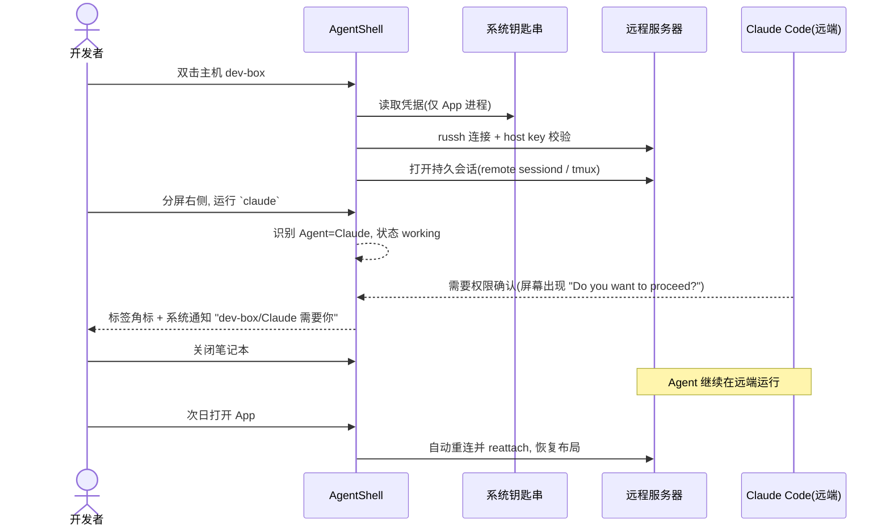
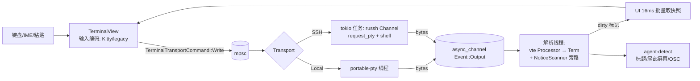
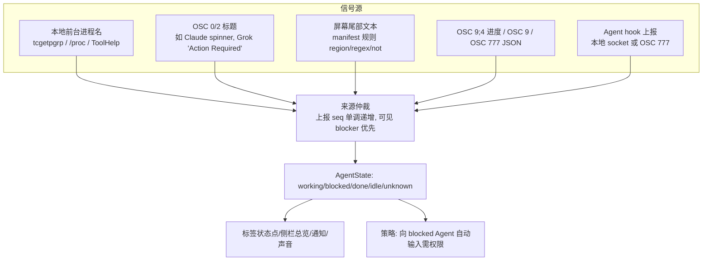
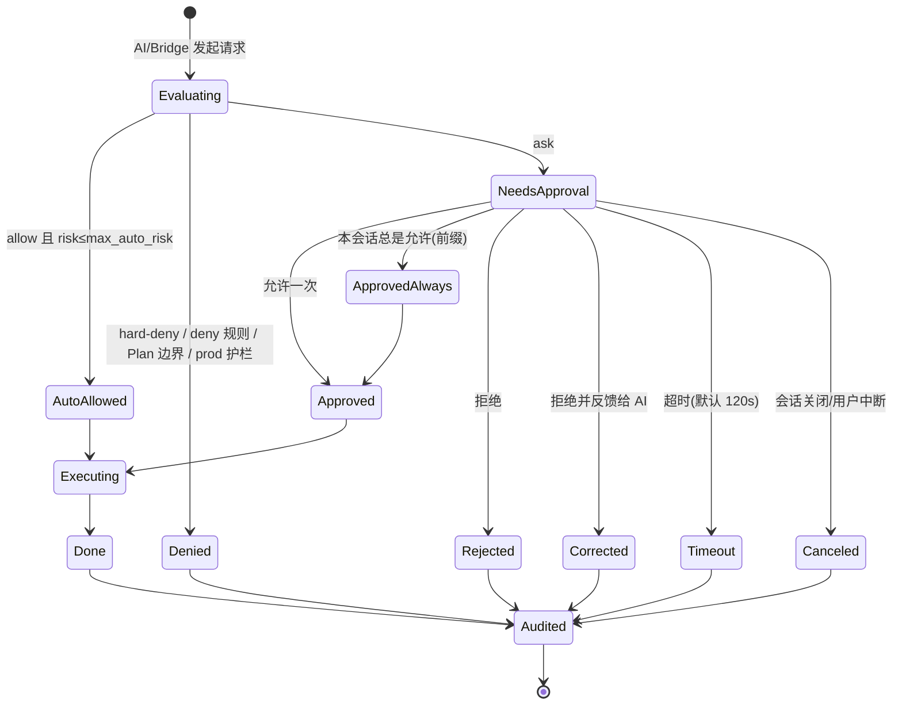
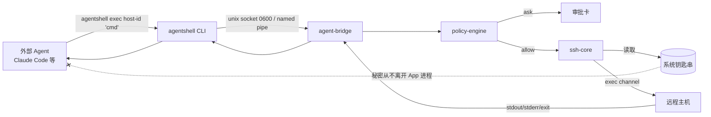
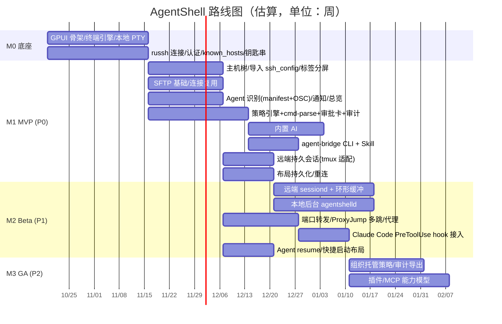

# PRD：带 Agent 能力的原生桌面 SSH 客户端 + 终端（暂名 **AgentShell**）

| 项 | 内容 |
|---|---|
| 文档版本 | v0.1（调研版草案） |
| 日期 | 2026-10-12 |
| 作者 | 产品 / 架构 |
| 技术基线 | Rust + GPUI（Zed UI 框架）+ `alacritty_terminal` + `russh` + `portable-pty` |
| 状态 | 待评审，第 9 章有待确认问题 |

> **调研方法说明**：下文提到的设计都来自实际阅读的代码和文档。2026-10-12 把各仓库 `git clone --depth 1` 到 `/workspace/research/`，下表是各仓库的 commit。文中「文件路径」是仓库内的相对路径，可以到 `https://github.com/<owner>/<repo>/blob/<commit>/<path>` 查看。推断和建议会明确标为「推断」或「建议」。

## 0. 调研范围与结果

| 仓库 | 链接 | 克隆 commit | 结果 | 许可证 | 本 PRD 主要借鉴点 |
|---|---|---|---|---|---|
| since2006/shell-rs (ShellRS) | https://github.com/since2006/shell-rs | `e3397da` (2026-10-12) | ✅ 成功 | GPL-3.0-only | GPUI + alacritty_terminal + russh 的完整 SSH 客户端；钥匙串；known_hosts；Agent CLI |
| herdrdev/herdr | https://github.com/herdrdev/herdr | `dc6b6e5` (2026-10-12) | ✅ 成功 | Apache-2.0 | Agent 状态识别（manifest）、server/client 持久化、多机、通知、Agent 会话恢复 |
| warpdotdev/warp | https://github.com/warpdotdev/warp | `25e8221` (2026-10-11) | ✅ 成功 | AGPL-3.0（`warpui*` 为 MIT） | Agent 执行权限（AgentDecides/AlwaysAsk/AlwaysAllow、allowlist/denylist）、CLI Agent 会话事件、密钥脱敏 |
| wavetermdev/waveterm | https://github.com/wavetermdev/waveterm | `9f1c967` (2026-10-05) | ✅ 成功 | Apache-2.0 | 远程 durable session（远端 job manager）、AI 工具审批状态机、Claude Code badge |
| anomalyco/opencode | https://github.com/anomalyco/opencode | `25053bb` (2026-10-12) | ✅ 成功 | MIT | allow/ask/deny 规则引擎、Build/Plan 模式、once/always/reject、bash 解析与 arity |
| zellij-org/zellij | https://github.com/zellij-org/zellij | `a6c3dba` (2026-10-12) | ✅ 成功 | MIT | 会话序列化/恢复（`start_suspended`）、插件权限枚举 |
| alacritty/alacritty（`alacritty_terminal`） | https://github.com/alacritty/alacritty | `29dc553` (2026-10-05) | ✅ 成功 | Apache-2.0 / MIT | 终端状态机（Term/Grid/vte）、EventListener |
| OxideTerm | https://github.com/AnalyseDeCircuit/oxideterm | `4992922` (2026-10-11) | ✅ 成功（任务没给仓库地址，通过搜索找到 `AnalyseDeCircuit/oxideterm`） | GPL-3.0 | GPUI 原生 SSH 工作台；AI 策略（风险分级、ReadOnly 硬边界、危险命令正则）；审计；连接复用；上下文脱敏 |
| russh | https://github.com/Eugeny/russh | `e5d80a0` (2026-10-05) | ✅ 成功 | Apache-2.0 | 纯 Rust SSH2 客户端（channel、PTY、转发、agent、known_hosts） |
| 补充：zed-industries/zed `crates/terminal` | https://github.com/zed-industries/zed/tree/main/crates/terminal | 只用 curl 读了 `Cargo.toml` | ⚠️ 部分核验 | GPUI 为 Apache-2.0 | 确认 Zed 终端同样基于 `alacritty_terminal` + `gpui`；内部代码没有细读 |

**所有仓库都访问成功，没有无法访问的。** 唯一的偏差是 OxideTerm 没有给出 owner，通过 Web 搜索确认为 `AnalyseDeCircuit/oxideterm`。另外，该仓库 GitHub 页面的旧缓存描述它是 Tauri 2 + React，而当前 main 的 README 和 `Cargo.toml` 显示它已迁到 GPUI（vendored 了 `crates/gpui-ce` 和 `crates/alacritty-terminal`）。本 PRD 以 clone 下来的当前代码为准。

---

## 1. 产品概述与目标用户

### 1.1 一句话定位
一个**原生、GPU 渲染的 SSH 客户端兼终端**。它让开发者在同一个窗口里管理远程服务器、运行 Claude Code / Codex / Grok CLI 等外部 Agent，并使用内置 AI。所有 AI 发起的动作都经过**可审计、可配置、默认安全**的权限系统。

### 1.2 要解决的问题（来自竞品调研的空白）
| 痛点 | 现状 |
|---|---|
| SSH 客户端（Xshell/Termius/ShellRS）不懂 Agent | ShellRS 已有 `shellrs exec` 给 Agent 用，但权限只有「启用外部 CLI」这一个全局开关（`src/cli/server.rs` 中 `enabled: AtomicBool`），没有逐命令审批、风险分级和审计 |
| Agent 运行时（herdr）不是 GUI SSH 客户端 | herdr 是跑在已有终端里的 TUI（ratatui + crossterm），依赖系统 `ssh`（`src/remote/attach.rs` 中 `Command::new("ssh")`），没有 SFTP、主机管理和钥匙串 |
| Warp 的 Agent 强但 SSH 管理弱 | Warp 通过 warpify 往远端注入 bootstrap，远端能力依赖它自己的 remote server（`crates/remote_server/`，通过系统 ssh ControlMaster）；没有 Xshell 式主机树/SFTP，核心 AI 依赖云账号 |
| Wave 是 Electron + Go | 内存和启动开销大；AI 命令执行在 README 中仍写着「Coming Soon: Command execution (with approval)」 |
| 纯终端 + tmux | 持久化最强，但没有 Agent 状态、审批、凭据隔离，也没有 GUI SFTP |

### 1.3 目标用户
| 画像 | 描述 | 核心诉求 |
|---|---|---|
| P1 远程开发者（主） | 日常 SSH 到开发机/云主机，在远端跑 Claude Code / Codex 做开发 | 多标签/分屏、Agent 状态一眼可见、断线不丢、通知 |
| P2 运维 / SRE | 管理几十到上百台主机，跳板机、转发、SFTP | 主机树、凭据集中、危险命令拦截、审计 |
| P3 AI 重度用户 | 同时跑多个 Agent（本地 + 多台远程） | Agent 总览、阻塞提醒、Agent 不接触明文密码 |
| P4 团队管理员（P2 阶段） | 需要统一策略 | 组织级 deny 规则不可绕过、审计导出 |

### 1.4 产品目标与成功指标
| 目标 | 指标（GA 前） |
|---|---|
| 可替代日常 SSH 客户端 | 冷启动 < 400ms（M1 / 中端 Win 机）；单标签空闲内存 < 80MB；输入延迟 P95 < 10ms（本地） |
| Agent 体验 | Claude Code / Codex / Grok CLI / OpenCode 在本地和 SSH 内的状态识别准确率 ≥ 95%（working/blocked/idle） |
| 安全 | 内置 AI 执行的命令 100% 经过策略引擎，100% 写入审计；危险命令自动执行率为 0 |
| 可靠 | 开启持久会话后，网络中断 / 关闭应用后远端 Agent 继续运行，重连恢复率 ≥ 99% |

### 1.5 非目标（v1）
- 不做云账号 / 云同步（BYOK、本地优先，与 OxideTerm、Wave 一致）。
- 不自研 Coding Agent 来替代 Claude Code 等。内置 AI 定位是「终端助手」。
- 不做 RDP/VNC/串口（OxideTerm 有，但不是本产品场景）。

---

## 2. 核心场景与用户故事

### 2.1 主场景：远程开发 + Agent


### 2.2 用户故事（INVEST 格式，带验收标准）

| ID | 角色 | 故事 | 验收标准 | 优先级 |
|---|---|---|---|---|
| US-01 | 开发者 | 导入 `~/.ssh/config`，以分组树管理主机 | 支持 Host/HostName/User/Port/IdentityFile/ProxyJump；导入后可编辑；数据库不出现明文秘密 | P0 |
| US-02 | 开发者 | 首次连接时确认 host key，key 变更时被强警告 | 未知 key 显示 SHA256 指纹并确认；变更 key 默认拒绝，需二次确认替换 | P0 |
| US-03 | 开发者 | 在多个标签和分屏里同时开本地和远程终端 | 拖拽标签到边缘可分屏；vim/htop/tmux 正常；⌘T/⌘D | P0 |
| US-04 | 开发者 | 在远程终端里运行 `claude` / `codex` / `grok`，App 自动识别并显示状态 | 侧栏 Agent 列表显示 主机/面板/Agent/状态；blocked 时通知 | P0 |
| US-05 | 开发者 | 关闭 App 后，远端 Agent 继续运行，再打开能接回 | 开启「持久会话」的面板在 App 退出、网络断开后进程不中断；重开 App 自动 reattach | P0（远端）/P1（本地） |
| US-06 | 开发者 | 按 ⌘K 用自然语言描述需求，得到命令建议 | 显示命令 + 解释 + 风险等级；默认只填入输入行，不执行 | P0 |
| US-07 | 开发者 | 命令失败后点「解释错误」 | 用最近一个命令块的输出（脱敏后）生成解释和修复建议 | P0 |
| US-08 | 开发者 | 让内置 AI 执行命令排查问题 | 每条命令经过策略引擎；只读命令在 Auto 模式自动执行，其他需确认；全部写审计 | P0 |
| US-09 | 运维 | 生产主机上的 AI 不能执行破坏性命令 | 主机打标签 `env=prod` 后，R3 及以上一律拒绝（不可通过 always 放开） | P0 |
| US-10 | 开发者 | 外部 Agent（Claude Code）能在保存的主机上执行命令，但拿不到密码 | `agentshell exec <host> "cmd"`，凭据只在 App 进程内；请求经策略引擎，必要时弹审批卡 | P0 |
| US-11 | 开发者 | 查看「AI 今天在哪些主机执行了什么」 | 审计面板可按主机/会话/决策过滤，可导出 JSONL | P0 |
| US-12 | 开发者 | SFTP 双栏拖拽传输，断点续传 | 传输队列；断线重试；与终端共享认证 | P0 |
| US-13 | 开发者 | 配置本地/远程/动态端口转发 | -L/-R/-D；规则图示；随 App 启动 | P1 |
| US-14 | 开发者 | 多台机器的 Agent 汇总到一个列表 | 「Agent 总览」按状态排序，点击跳转到面板 | P1 |
| US-15 | 管理员 | 下发组织级 deny 规则，用户本地不可覆盖 | 托管策略文件（只读）优先级最高 | P2 |

---

## 3. 功能需求

> 优先级：**P0 = MVP 必须**，**P1 = GA 前**，**P2 = GA 后**。

### 3.1 SSH 基础

| 功能 | 描述 | P | 借鉴 |
|---|---|---|---|
| 主机管理 | 分组任意嵌套、搜索、拖拽、标签（env/role）、OS 识别徽章 | P0 | ShellRS `src/host/`（`HostStore` 内存为准、写穿 SQLite；`outline.rs` 纯函数生成树）；OS 探测 `src/ssh/probe.rs` |
| `~/.ssh/config` 导入 | 解析 Host/Match 子集、ProxyJump、IdentityFile | P0 | russh 仓库自带 `russh-config` crate |
| 认证 | none → agent → publickey → password → keyboard-interactive（2FA） | P0 | ShellRS `src/ssh/transport.rs` 认证链；OxideTerm `SYSTEM_INVARIANTS.md`「SSH keyboard-interactive prompts are modal focus owners」 |
| Host key 验证 | 独立 known_hosts（不改 `~/.ssh/known_hosts`），可选只读引用系统 known_hosts | P0 | ShellRS `src/ssh/connection.rs::check_server_key`（未知/变更 key 都交给用户决定）；russh `Handler::check_server_key` **默认拒绝所有 key**（`russh/src/client/mod.rs`） |
| 跳板/代理 | ProxyJump 多跳（每跳独立认证）、HTTP/SOCKS5 代理 | P0（ProxyJump）/P1（代理） | ShellRS `src/ssh/proxy.rs`；OxideTerm README「Multi-hop proxy chains with per-hop independent auth」 |
| 连接复用 | 同一主机的终端/SFTP/转发/AI exec 共享一条物理连接、多 channel；可按主机关闭复用（堡垒机单 channel） | P0 | OxideTerm `crates/oxideterm-ssh/src/connection_registry.rs` + invariant「one connection key maps to one registry connection shared by many channel consumers」；ShellRS 目前是每个 SFTP 标签/转发规则各用一条连接，并有 `HostLogin::shell_only` 处理堡垒机 |
| SFTP | WinSCP 式双栏、队列、断点续传（`.filepart` + 重试 1/3/10s）、内置编辑 | P0（基础）/P1（编辑、同步） | ShellRS `src/sftp/`、`src/explorer/`（russh-sftp 3.0.0） |
| 端口转发 | -L/-R/-D（SOCKS4/5），图示，自动重连 | P1 | ShellRS `src/forward/`（`diagram.rs`、`worker.rs`） |
| 钥匙串凭据 | macOS Keychain / Windows Credential Manager / Secret Service；可共享凭据 | P0 | ShellRS `src/secrets/keychain.rs`（`keyring` 4）、`SecretRef` 归属规则 |
| SSH Agent 转发 | 默认关闭，按主机开启；拒绝未请求的 agent channel | P1 | OxideTerm invariant「agent forwarding must reject unsolicited server-opened agent channels」；russh `channels/mod.rs::agent_forward` |
| 堡垒机拉起 | `ssh://` / `sftp://` 链接、Xshell `-url` 兼容 | P2 | ShellRS `src/host/ssh_link.rs`、`src/cli/link.rs` |
| 主机侧栏工具 | 监控/进程/服务/Docker | P2 | ShellRS `src/monitor/` 等（在终端自己的连接上开 exec channel） |

### 3.2 终端

| 功能 | 描述 | P |
|---|---|---|
| 终端仿真 | `alacritty_terminal` 的 `Term` + `vte::ansi::Processor`；256 色/真彩、鼠标、bracketed paste、备用屏、OSC 8 链接、OSC 52 | P0 |
| 本地 Shell | `portable-pty`（Windows ConPTY），可选 zsh/bash/fish/pwsh/WSL | P0 |
| 多标签 / 分屏 | 标签可拖到上/下/左/右分屏；⌘D/⌘⇧D；面板缩放；面板聚焦导航 | P0 |
| 搜索 / 选择 / 复制 | 正则搜索（smart case）、矩形选择、URL 识别 | P0 |
| 命令块（Shell Integration） | OSC 133（A/B/C/D）标记 prompt/命令/输出/退出码，给「解释错误」和审计用；远端需注入 shell 集成脚本（可选） | P0（本地+远程自动注入为可选项） |
| 通知 | OSC 9 / OSC 777 / BEL → 应用内 toast + 系统通知 | P0 |
| 关键字高亮 | 正则规则着色/通知（ERROR、Traceback） | P1 |
| 图形协议 | Sixel / Kitty graphics | P2 |
| 录制回放 | asciicast v2 | P2 |
| 广播输入 | 一次输入发往多个面板（需二次确认，算高风险交互） | P2 |

> 实现提醒：`alacritty_terminal` 会丢弃 OSC 9/777。ShellRS 在解析线程里另跑一个 `NoticeScanner`（`src/terminal/notices.rs`），Agent 事件（OSC 777 JSON）也要走同样的旁路解析。

### 3.3 外部 Agent（Claude Code / Codex / Grok CLI / OpenCode …）

| 功能 | 描述 | P |
|---|---|---|
| 无缝运行 | Agent 在普通 PTY 里运行，不包装也不替换（与 herdr「herdr doesn't wrap or replace them; it owns their terminals」一致）；保证 Kitty keyboard protocol、bracketed paste、真彩、OSC 0 标题、OSC 9;4 进度、IME 正常 | P0 |
| Agent 识别 | 三层：①前台进程名（本地）；②屏幕 manifest 规则（本地+远端）；③Agent 主动上报（hook → OSC 777 / 本地 socket） | P0（①②）/P1（③） |
| 状态 | `working` / `blocked` / `done`（完成且未查看）/ `idle` / `unknown`（沿用 herdr 定义，`docs/next/website/src/content/docs/concepts.mdx`） | P0 |
| 增强 UI | 标签/面板标题显示 Agent 图标和状态点；侧栏「Agent 总览」跨主机汇总；blocked 时标签角标 + 声音 + 系统通知；通知点击跳转面板；当前可见面板不弹通知 | P0 |
| 快捷启动 | 「在此主机启动 Agent」菜单：选 Agent + 目录 + 布局（例如左侧 Agent、右侧 shell 并 `tail -f` 日志） | P1 |
| 会话恢复 | 记录 Agent 上报的 resume 命令（如 `claude --resume <id>`、`codex resume <id>`、`grok --resume <id>`），进程丢失后在原目录一键恢复 | P1 |
| 凭据桥（Agent CLI） | `agentshell` CLI + Agent Skill：`hosts list / exec / upload / download`，**每个请求都经过权限引擎**（ShellRS 只有全局开关，这里需要重新设计） | P0 |
| 外部 Agent 权限钩子 | 为 Claude Code 安装 `PreToolUse` hook，把 Bash 工具调用交给本产品策略引擎判定（allow/ask/deny），实现「外部 Agent 也受统一规则约束」；其他 Agent 依各自能力接入 | P1（待确认，见 9.2） |
| Agent 输入注入 | 内置 AI 或其他 Agent 向某个 Agent 面板写入（prompt 互传）属于 `write_to_pty` 权限，默认 ask（参考 Warp `WriteToPtyPermission::{AlwaysAsk, AskOnFirstWrite, AlwaysAllow}`） | P1 |

### 3.4 内置 AI

| 功能 | 交互 | 默认权限 | P |
|---|---|---|---|
| 命令建议（inline） | 输入行灰字补全（基于历史 + 上下文 + 模型）；Tab 接受 | 只填入，不执行 | P1 |
| 自然语言转命令 | 在输入行开头输入 `#` 或按 ⌘K：「找出占用 8080 端口的进程」→ 卡片显示命令、逐段解释、风险等级、目标主机；按钮：**插入** / **执行** / **复制** | 默认「插入」；「执行」走策略引擎 | P0 |
| 执行命令（Agentic） | 右侧 AI 面板多轮对话，AI 提出工具调用 `run_command(host, cmd)`，逐条显示审批卡 | 由模式与规则决定 | P0 |
| 错误解释 | 非零退出码的命令块出现「解释」按钮；输入是命令 + 尾部 200 行输出（脱敏） | 只读，无需审批 | P0 |
| 上下文 | 当前主机 OS/shell/cwd（来自 OSC 7/133）、最近 N 个命令块、选中文本；**发送前统一脱敏** | — | P0 |
| 模型 | BYOK：OpenAI / Anthropic / Gemini / Ollama / OpenAI 兼容；API Key 存钥匙串 | — | P0 |
| 隐私 | 首次发送远端输出前提示；可按主机设置「禁止 AI 读取输出」 | — | P0 |

**交互原则**
1. **AI 生成 ≠ 执行**：默认只插入输入行，用户回车才执行（等于人工确认）。
2. **审批卡**同时显示：完整命令（不截断，多行展开）、目标主机与 env 标签、风险等级与原因（命中哪条规则）、AI 给出的意图说明，以及四个按钮：「允许一次 / 本会话总是允许此前缀 / 拒绝 / 拒绝并告诉 AI 原因」（对应 OpenCode `once / always / reject` 和 `CorrectedError(feedback)`）。
3. **AI 执行的命令在终端中可见**：在独立的「AI 执行」通道（exec channel）中运行，输出回填 AI 面板。用户也可以选择「在当前终端中执行」（写入 PTY，可见但风险更高，权限更严）。

### 3.5 权限控制（概要，详细设计见第 6 章）

| 功能 | P |
|---|---|
| 三种模式：**Ask**（默认）/ **Plan（只读）** / **Auto（仅安全只读自动执行）**，每个 AI 会话可切换，状态栏常驻显示 | P0 |
| 规则：`allow / ask / deny`，作用于动作 × 资源（命令、路径、主机），分层合并 | P0 |
| 风险分级 R0–R4 + 不可覆盖的硬拒绝（hard-deny）清单 | P0 |
| 主机环境标签（prod/staging/dev）参与规则匹配 | P0 |
| 审批卡、超时自动拒绝、批量审批禁止跨风险级 | P0 |
| 审计日志：追加写 JSONL + 哈希链 + 脱敏 + 查询/导出 | P0 |
| 托管（组织）策略，最高优先级、只读 | P2 |

### 3.6 会话与布局

| 功能 | 描述 | P |
|---|---|---|
| Workspace / Tab / Pane | 三级结构（同 herdr `concepts.mdx`）；一个 workspace 可混合多台主机 | P0 |
| 布局持久化 | 退出时保存：标签、分屏树、每个面板的主机、cwd、Agent resume 引用；启动时恢复（不自动重跑命令，参考 zellij `start_suspended`，见 `zellij-utils/src/session_serialization.rs`） | P0 |
| 远端持久会话 | 面板可标记为「持久」：远端进程独立于 App 存活，App 断开时远端缓冲输出，重连后 reattach（参考 Wave Durable Sessions：远端 job manager，`pkg/jobmanager/`、`docs/docs/durable-sessions.mdx`） | P0 |
| 本地持久会话 | 本地 PTY 由后台 `agentshelld` 持有，关闭窗口不杀 Agent（参考 herdr server/client 架构） | P1 |
| 多机 | 同一窗口多主机；每台主机独立重连，一台掉线不影响其他（herdr `connecting-machines.mdx`） | P0 |
| 断线重连 | 指数退避；Grace Period 内透明恢复（OxideTerm README 提到「Grace Period reconnect」） | P0 |
| 布局快照 | 保留最近 N 份布局快照，可手动回滚（herdr 保留 48 份 `session-snapshots/`） | P2 |

**「关闭应用后 Agent 是否继续运行」的产品决策**（核心问题）：

| 场景 | 默认行为 | 依据 |
|---|---|---|
| 远程面板，「持久」开启（远端有 sessiond 或 tmux） | ✅ 继续运行，重开 App 自动接回，能看到期间的输出 | Wave durable session；herdr 远端 server |
| 远程面板，「持久」关闭 | ❌ SSH channel 关闭，远端进程收到 SIGHUP 后退出；关闭前提示「此面板有运行中的 Agent」 | 普通 SSH 语义 |
| 本地面板，P0 | ❌ 随 App 退出；有运行中的 Agent 时退出前确认；下次启动可用 resume 命令恢复 Agent 对话 | herdr「Native agent session restore」 |
| 本地面板，P1 启用后台守护 | ✅ 窗口关闭后 `agentshelld` 继续持有 PTY；托盘图标显示运行中的 Agent 数 | herdr「detach without stopping work」 |
| 机器重启 | 进程丢失；恢复布局，按 resume 命令恢复 Agent（需用户点击确认，避免自动跑出权限外的动作） | herdr session-state 表格；zellij `start_suspended` |

---

## 4. 非功能需求

| 类别 | 要求 |
|---|---|
| 性能 | 冷启动 < 400ms；输入到上屏 P95 < 10ms（本地）/ RTT + 5ms（远程）；`cat` 1GB 文件不卡 UI（解析线程与渲染分离，UI 批量刷新约 16ms，参考 ShellRS `src/terminal/engine.rs` 的「解析线程 + 16ms UI 轮询批量刷新」）；20 个面板同时运行 Agent 时 CPU < 15%（空闲期） |
| 资源 | 安装包 < 60MB；单个空闲远程标签 < 15MB 增量内存 |
| 可靠性 | 关闭面板不得阻塞 UI 线程（OxideTerm invariant「Closing a pane must not synchronously block the UI thread」）；PTY/SSH resize 去抖合并 |
| 安全 | 见第 6 章；SQLite 不存任何秘密（ShellRS 测试 `schema_never_contains_secret_columns`）；内存中秘密用 `zeroize`；Agent CLI 的 socket 权限 0600（ShellRS `src/cli/server.rs`）；自动更新用 minisign 签名 + SHA-256（ShellRS `src/update/verify.rs`） |
| 隐私 | 无遥测或默认关闭；AI 请求只发往用户配置的 provider；审计和布局都只存在本地 |
| 跨平台 | macOS 12+（arm64/x64）、Windows 10 1809+（ConPTY）、Linux（X11/Wayland，glibc ≥ 2.35，与 ShellRS 一致） |
| 可访问性 | 全键盘可达；高对比主题；字体缩放 |
| 国际化 | 中/英起步（ShellRS 用 `rust-i18n`，中文为源语言） |
| 可测试性 | 传输层与 UI 解耦，可注入假传输（ShellRS `Workspace::new_with_services`、`FixedLocalTerminalTransportProvider`）；策略引擎是纯函数，要有表驱动单测 |
| 兼容性 | 远端零依赖可用（不装任何东西也能用全部 P0 SSH 功能）；持久会话和高级 Agent 集成可选装远端 helper |

---

## 5. 技术架构建议

### 5.1 总体架构
```mermaid
flowchart TB
  subgraph UI["GPUI 进程 (agentshell)"]
    WS[Workspace 壳<br/>Tab/Pane/Dock] --> TV[TerminalView<br/>网格渲染/输入编码]
    WS --> HP[主机树/凭据/SFTP/转发 面板]
    WS --> AIP[AI 面板 / 审批卡 / 审计查看器]
    WS --> AO[Agent 总览侧栏 / 通知]
  end
  subgraph CORE["核心 crates (无 UI 依赖)"]
    TE[term-engine<br/>alacritty_terminal Term+Processor<br/>+ 旁路 OSC 扫描器]
    SC[session-core<br/>统一 Session 契约]
    SSH[ssh-core<br/>russh 连接注册表/认证/known_hosts]
    PTY[local-pty<br/>portable-pty]
    SFTP[sftp-core<br/>russh-sftp]
    FWD[forward-core]
    AD[agent-detect<br/>进程名+manifest+上报]
    POL[policy-engine<br/>模式/规则/风险/硬拒绝]
    AUD[audit-log<br/>JSONL+哈希链+脱敏]
    AI[ai-core<br/>provider/上下文/工具调用]
    SEC[secrets<br/>keyring + zeroize]
    STORE[store<br/>SQLite 主机/规则/布局]
    BR[agent-bridge<br/>本地 socket + CLI + hook 端点]
  end
  subgraph DAEMON["agentshelld (P1, 本地后台)"]
    LP[持有本地 PTY / 会话]
  end
  subgraph REMOTE["远端主机"]
    SH[login shell]
    SD[agentshell-sessiond (可选)<br/>或 tmux 适配]
    EXT[Claude Code / Codex / Grok CLI]
  end
  TV <--> TE
  TE <--> SC
  SC --> SSH
  SC --> PTY
  SC -.P1.-> LP
  SSH <-->|channel: shell/exec/sftp/direct-tcpip| SH
  SSH <--> SD
  SD --> EXT
  AI --> POL --> AUD
  BR --> POL
  POL --> SC
  SSH --> SEC
  TE --> AD --> AO
  HP --> STORE
```

### 5.2 模块划分（Cargo workspace）

| crate | 职责 | 来源/借鉴 |
|---|---|---|
| `term-engine` | 包装 `alacritty_terminal::Term<Listener>`；解析线程；快照（`TerminalSnapshot`）；搜索/选择；旁路 `NoticeScanner`（OSC 9/777/133/7/自定义） | 直接借鉴 ShellRS `src/terminal/engine.rs`、`notices.rs`；alacritty `alacritty_terminal/src/term/mod.rs`、`event.rs::EventListener` |
| `session-core` | **统一会话契约**：`write_input / resize / shutdown / title / lifecycle / process_state / snapshot`，本地、SSH、远端 durable 三种实现 | 直接借鉴 ShellRS `src/terminal/transport.rs`（`TerminalTransport` trait、`TerminalTransportCommand/Event`、`TerminalTransportFactory` 便于重启/注入）；契约清单参考 OxideTerm invariant「Local and SSH terminal sessions must expose the same session contract」 |
| `ssh-core` | russh 客户端、**连接注册表**（一个 key 对应一条物理连接、多个 channel 消费者）、认证链、known_hosts、ProxyJump、keepalive/延迟测量、重连 | ShellRS `src/ssh/`（认证链、`check_server_key`、`latency.rs`）+ OxideTerm `connection_registry.rs` / `reconnect.rs`（需重新设计为共享连接） |
| `local-pty` | portable-pty 封装（专用线程），Windows ConPTY | ShellRS `src/terminal/local_pty.rs` |
| `sftp-core` / `forward-core` | SFTP 队列/续传；转发 worker | ShellRS `src/sftp/`、`src/forward/`（可几乎原样复用） |
| `secrets` | `SecretStore` trait（Keychain/InMemory/NoSecret），秘密只在后台线程读取 | ShellRS `src/secrets/`（直接借鉴） |
| `store` | SQLite（rusqlite bundled），`PRAGMA user_version` 迁移，内存为准、写穿 | ShellRS `src/host/database.rs`、`store.rs` |
| `agent-detect` | 进程名识别 + TOML manifest 规则 + 上报合并（来源仲裁） | 参考 herdr `src/detect/mod.rs`（`AgentState`、`AgentDetection{visible_blocker…}`）与 `src/detect/manifests/*.toml`（**Apache-2.0，可借鉴规则格式**） |
| `policy-engine` | 第 6 章全部逻辑；纯函数 `evaluate(request, ctx) -> Decision` | 重新设计；参考 OpenCode `packages/core/src/permission.ts`、Warp `app/src/ai/blocklist/permissions.rs`、OxideTerm `crates/oxideterm-ai/src/policy.rs` |
| `cmd-parse` | tree-sitter-bash 拆分复合命令、识别重定向/子 shell/管道、提取「命令前缀」（arity 表） | 参考 OpenCode `packages/core/src/shell/parse.ts`（`ARITY` 表）；Warp `decompose_command`；ShellRS 已依赖 `tree-sitter-bash`（gpui-kit 特性） |
| `audit-log` | 追加写、哈希链、脱敏、查询 | 参考 OxideTerm `crates/oxideterm-audit/`（`AuditCategory`、`redact.rs`、`export.rs`） |
| `ai-core` | Provider 适配、SSE 流、工具协议、上下文构建、**脱敏** | 参考 OxideTerm `context_sanitizer.rs`、Warp `crates/secret_redaction/` |
| `agent-bridge` | `agentshell` CLI ↔ App 的本地 socket（帧协议）；hook 端点；Agent Skill 安装 | 借鉴 ShellRS `src/cli/protocol.rs`（1 字节类型 + 4 字节长度帧，`MAX_FRAME` 16MB）、`server.rs`（socket 0600）；**新增策略检查和审批** |
| `agentshell-sessiond`（远端，可选） | 远端持有 PTY、环形缓冲、reattach；通过 SSH exec channel 走 stdio 协议 | 参考 Wave `pkg/jobmanager/`（`cirbuf.go` 环形缓冲、JWT 鉴权）、herdr `src/remote/host.rs`（SSH stdio bridge） |
| `app`（GPUI） | 窗口、Dock、动作、面板 | ShellRS `src/workspace/`、`src/app/actions.rs`（「一个命令一个处理器」） |

### 5.3 本地 + SSH 终端数据流（GPUI 中）

要点：
- **线程模型**：ShellRS 给每个 SSH 传输建一个 `new_current_thread` tokio runtime，再加一条命令桥线程（`src/ssh/transport.rs::run`）。这种做法简单、隔离好，但连接一多线程也多。**建议**：全局使用一个多线程 tokio runtime，配合连接注册表；UI 只通过 channel 交互，「禁止后台线程直接唤醒 GPUI 前台任务」（ShellRS AGENTS.md 约定），改由 UI 定时轮询或 GPUI executor 通知。
- **SSH 输出必须经过 Term**（OxideTerm invariant「SSH output must pass through Alacritty's Term and Processor before rendering」）。
- **resize** 按面板实际边界计算，并去抖；连接建立后补发一次 resize（OxideTerm invariant）。
- **AI exec 不占用户 shell**：在同一连接上另开 `exec` channel（ShellRS `ExecRequest`「Run a command beside the shell」）。堡垒机只允许单 channel 时，退化为「写入终端 + OSC 标记读回结果」（ShellRS `src/terminal/run.rs`：先发 ^C → 探测 → 执行，用 OSC `6973` + nonce 标记起止和退出码）。这种退化路径**风险更高**：会打断前台程序，所以权限默认 ask 且必须明确提示。

### 5.4 Agent 识别架构

- **远端识别的难点（推断，影响架构）**：herdr 的进程名识别和 `HERDR_SOCKET_PATH` 上报都要求 herdr 跑在 Agent 同一台机器上（它在远端装 herdr server）。我们是 SSH 客户端，Agent 跑在远端，看不到远端进程表。因此：
  - **零安装路径**：只依赖经 PTY 流回来的信号：OSC 标题、屏幕 manifest、OSC 9/777。所有 Agent 识别规则都要能在「只有字节流」的前提下工作。herdr 的 manifest 正是按这个思路设计的，例如 `grok.toml` 的注释写着 Grok 会发 OSC 0 标题、权限提示时加「⚠ Action Required」、OSC 9;4 进度。
  - **增强路径**：远端安装 hook（例如 Claude Code `~/.claude/settings.json` 的 Notification/Stop hook），由 hook **往自己的 TTY 打印 OSC 777 JSON**，事件随 PTY 字节流回到本地。这和 Warp 的 `CLIAgentEventSource::RichPlugin`（「Structured OSC 777 notification from a rich plugin」）机制一致，不需要额外端口或 socket。
  - **sessiond 路径**：装了远端 sessiond 时，它能读远端前台进程组（等价于 herdr 本机识别），准确率最高。
- **manifest 规则格式**：建议采用 herdr 风格的 TOML（`id/version/min_engine_version/[[rules]] state/priority/region/regex/not`），规则可以热更新。

### 5.5 选型

| 方面 | 选择 | 理由 / 备选 |
|---|---|---|
| UI | **GPUI**（建议跟 Zed 上游，或使用 gpui-component / gpui-kit） | ShellRS 用 `gpui-kit 0.6.1`（锁定 `gpui-pre 0.3.2`、Rust 1.98.1）；OxideTerm vendor 了 `gpui-ce` 分支。**风险**：GPUI 没有稳定的 crates.io API，必须锁版本（见第 9 章） |
| 终端仿真 | **`alacritty_terminal` 0.26** | ShellRS、OxideTerm、Zed `crates/terminal` 都用它。herdr 用的是 vendored libghostty-vt（`crates/ghostty-vt`），说明 ghostty-vt 也是备选，但 C 依赖更重 |
| SSH | **russh 0.63+**（`aws-lc-rs` 或 `ring`） | 纯 Rust、async；ShellRS 用 0.63 + russh-sftp 3.0.0；OxideTerm 用 0.63 + aws-lc-rs；上游 main 已到 0.64.1。备选是调用系统 `ssh`（Warp/herdr 的做法：复用用户 ssh_config 和 ControlMaster，但拿不到细粒度 channel 控制，也难以把密码挡在 Agent 之外） |
| 本地 PTY | `portable-pty` 0.9 | ShellRS、herdr（vendored 补丁版）都用 |
| 存储 | SQLite（rusqlite bundled） | ShellRS 已验证 |
| 钥匙串 | `keyring` 4 | ShellRS 已验证三平台 |
| 命令解析 | `tree-sitter-bash` | OpenCode 同款思路 |
| 策略配置 | TOML（用户）+ JSON Schema 校验 | 与 Rust 生态一致；OpenCode 用 JSON，Warp 用 TOML path |

### 5.6 借鉴边界：直接借鉴 shell-rs vs 重新设计

| 可以直接借鉴 ShellRS（结构和代码模式） | 要参考 herdr / Warp / OpenCode / Wave / OxideTerm 重新设计 |
|---|---|
| GPUI 工程骨架：`app/actions.rs`「一个命令一个处理器」、Dock 面板、焦点规则、headless UI 测试（`tests/ui/`） | **Agent 识别与状态**（herdr manifest + 上报仲裁，Warp `cli_agent_sessions/`）。ShellRS 只有通用的 OSC 9/777/BEL 通知 |
| `TerminalTransport` trait + Factory + 事件枚举；`engine.rs` 解析线程/快照；`notices.rs` 旁路 OSC 扫描 | **权限引擎**：ShellRS 外部 CLI 只有全局开关，没有逐请求的 allow/ask/deny、风险分级、审批卡、审计 → 参考 OpenCode 规则引擎 + Warp 自动执行判定 + OxideTerm 风险/硬边界 |
| russh 认证链、keyboard-interactive prompt 管线、`check_server_key` 交互 | **连接复用**：ShellRS 的 SFTP 标签和每条转发规则各用独立连接 → 参考 OxideTerm 连接注册表 |
| 钥匙串 `SecretRef` 归属、`schema_never_contains_secret_columns` 守护测试、`zeroize` | **会话持久化**：ShellRS 不持久化 Dock 布局（AGENTS.md「暂不做…Dock 布局持久化」），也没有 detach → 参考 herdr server/client + 快照、Wave 远端 job manager、zellij `start_suspended` |
| SFTP 队列/续传/journal、端口转发 worker、堡垒机外部连接 | **内置 AI**（ShellRS 没有）→ 参考 Warp 命令块/审批、Wave 工具审批状态机（`pkg/aiusechat/toolapproval.go`：needs-approval/user-approved/user-denied/timeout/auto-approved/canceled）、OxideTerm 上下文脱敏 |
| 外部 CLI 帧协议、socket 0600、「命令本身不读密码」的凭据桥 | **多机 Agent 总览、通知路由**（herdr notifications：`herdr/terminal/system/off`，当前活动标签不弹） |
| 在已开终端里执行（`run.rs` OSC 标记协议），作为单 channel 堡垒机的退化路径 | **Shell 集成/命令块**（Warp warpify bootstrap，OSC 133） |
| 更新签名校验（minisign + SHA-256） | 多线程 runtime 与全局连接调度 |

> ⚠️ **许可证约束**：ShellRS（GPL-3.0-only）和 OxideTerm（GPL-3.0）的**代码**如果直接复制，本产品必须以 GPL-3.0 发布；Warp 主体是 AGPL-3.0（只有 `warpui_core/warpui` 是 MIT）。herdr、Wave、russh、alacritty 是 Apache-2.0，OpenCode、zellij 是 MIT，可以较自由地借鉴代码。**建议**：先定产品许可证（第 9 章 Q1）。如果选闭源或宽松许可证，ShellRS/OxideTerm/Warp 只能借鉴「设计」，需净室重写；如果选 GPL-3.0，可以考虑直接 fork ShellRS 作为底座。

---

## 6. 权限系统设计

### 6.1 设计原则
1. **默认安全，渐进放权**：没有规则时默认 `ask`（OpenCode `evaluate` 找不到匹配时返回 `{effect: "ask"}`）。
2. **deny 优先于一切**：先检查是否有任意资源命中 deny，再看 allow/ask（OpenCode `evaluateInput` 先调用 `denied()`；Warp「The denylist takes precedence over the remaining conditions」）。
3. **硬边界不可被提升**：Plan 模式下任何审批或规则都不能放行写操作（OxideTerm：「Read-only mode is a hard boundary: policy auto-approval and explicit approval cannot promote a mutating action」）；组织级 deny 不可被 auto-approve 绕过（Warp `get_org_execute_commands_denylist`「must always be enforced」）。
4. **复合命令逐段判定，取最严**：`a && b | c` 拆成多段，任何一段为 ask 则整体 ask（OpenCode `effects.includes("ask")`；Warp 要求 `commands.iter().all(allowlisted)` 才自动执行）。
5. **解析不了就当高风险**：存在重定向、命令替换 `$(...)`、`eval`、heredoc、无法解析的语法时，不自动执行（Warp `ContainsRedirection`、`Inconclusive`）。
6. **Agent 永远拿不到明文秘密**：凭据在 App 进程内使用；AI 上下文发送前脱敏；Credential 类动作必须由人确认（OxideTerm `credential_requires_user`）。
7. **一切可追溯**：每次判定（含自动 allow）都写审计。

### 6.2 管控对象（权限主体与动作）

| 主体（principal） | 说明 | 可管控程度 |
|---|---|---|
| `builtin_ai` | 内置 AI 的工具调用 | **完全管控**（所有动作都经过引擎） |
| `bridge:<agent>` | 外部 Agent 通过 `agentshell` CLI / MCP 发起的 exec/upload/download/hosts | **完全管控** |
| `hook:<agent>` | 外部 Agent 内部工具调用经 hook 交给引擎判定（例如 Claude Code PreToolUse） | **协作管控**（依赖 Agent 遵守 hook 结果） |
| `pty:<agent>` | 外部 Agent 在自己 PTY 中直接执行的命令 | **不可拦截**：只能识别、通知、审计（基于 OSC 133 推断），由 Agent 自身权限体系负责。产品文案必须明确说明这一点 |

动作（action）与资源（resource）：

| action | resource 示例 | 说明 |
|---|---|---|
| `exec` | `host:dev-box` + `cmd:git status` | 在主机上执行命令（exec channel） |
| `pty.write` | `pane:12` | 向终端/Agent 面板写入按键 |
| `file.read` / `file.write` / `file.delete` | `host:dev-box:/etc/nginx/*` | SFTP 或工具读写 |
| `transfer.upload` / `transfer.download` | 本地路径 ↔ 远端路径 | |
| `forward.create` | `L:8080->127.0.0.1:80` | 开端口转发 |
| `host.read` / `host.write` | 主机库 | 列出/修改主机（Agent CLI） |
| `credential.*` | 凭据 | 永远不返回明文；修改需要人确认 |
| `context.read_output` | `pane:12` | AI 读取终端输出 |
| `network.fetch` | URL | AI 联网 |

### 6.3 三种模式

| 模式 | 定义 | R0 只读 | R1 低风险写 | R2 变更/执行 | R3 破坏性 | R4 凭据/提权 | hard-deny |
|---|---|---|---|---|---|---|---|
| **Ask**（默认） | 每个非只读动作都询问 | 自动（可配置为询问） | ask | ask | ask（强确认） | ask（强确认+重新输入主机名） | deny |
| **Plan（只读）** | 只能观察和计划，禁止任何变更；对标 OpenCode Plan agent（`edit: deny`，只允许写计划目录）和 OxideTerm `ReadOnly` | 自动 | **deny** | **deny** | **deny** | **deny** | deny |
| **Auto（仅安全只读自动）** | 只读白名单命令自动执行，其余照常询问；**不是**「全自动 / YOLO」 | 自动 | ask | ask | ask（强确认） | ask（强确认） | deny |

说明：
- Plan 模式下 AI 仍然可以生成要执行的命令列表（计划），用户点「切换到 Ask 并逐条执行」后进入审批流程。对应 OpenCode Plan 插件的提示词：「If the user asks you to implement changes, do not do so. Tell them they need to switch agents.」
- **不提供** Bypass/YOLO 模式（OxideTerm 有 `Bypass`，Warp 有 auto-approve 且默认 `auto_approve_bypasses_command_denylist = true`）。P2 再评估是否给 dev 环境提供「会话级 Auto-Write」，即便如此 R3/R4/hard-deny 仍不可绕过。
- 模式按 **AI 会话** 绑定，状态栏常驻显示（例如 🟢 Plan / 🟡 Ask / 🔵 Auto）；从 Plan 切到 Auto 或 Ask 需要用户操作，AI 不能自行切换模式（AI 没有 `mode.set` 工具）。

### 6.4 风险分级

| 级别 | 名称 | 判定依据（示例） | 默认处置 |
|---|---|---|---|
| **R0** | 只读 | `ls, cat, head, tail, grep, rg, find(无 -delete/-exec), stat, df, du, free, uptime, ps, top -b -n1, ss/netstat, journalctl(无 --vacuum), systemctl status, docker ps/logs/inspect, kubectl get/describe/logs, git status/log/diff/show` | Auto 模式下自动执行 |
| **R1** | 低风险写 | 写入用户目录/项目目录、`mkdir`、`touch`、`git add/commit`（本地）、`npm install`（项目内） | ask |
| **R2** | 变更/执行 | 运行脚本、`git push`、`systemctl restart`、`docker run/stop`、`kubectl apply`、包管理器安装、写 `/etc` | ask |
| **R3** | 破坏性/不可逆 | `rm -r/-f`、`git push --force`、`git reset --hard`、`git clean -fdx`、`docker rm/prune`、`kubectl delete`、`DROP/TRUNCATE`、`dd`、`chmod -R`、`truncate`、覆盖重定向 `>` 到已有文件 | 强确认（输入主机名或按住确认）；**prod 主机直接 deny** |
| **R4** | 凭据/提权/外泄 | `sudo/su/doas/pkexec`、读 `~/.ssh/*`、`*.pem`、`.env`、`/etc/shadow`、`history`、`printenv`、`curl ... \| sh`、向外部上传 | 强确认；读私钥类为 deny |
| **HARD** | 硬拒绝 | `rm -rf /`、`mkfs`、`dd of=/dev/sd*`、fork bomb、`chmod -R 777 /`、`> /dev/sda`、`shutdown/reboot/poweroff`（prod）、关闭审计 | 永远 deny，任何模式/规则/审批都不可放开（组织策略也只能加严） |

判定流程：`cmd-parse` 先拆段，每段按（内置分类表 → 用户/组织规则 → 启发式）得到风险，**整体风险取各段最大值**。以下情况一律至少 R2：`$(...)`、反引号、`eval`、`source`、`bash -c` / `sh -c`（Warp 默认 denylist 把 `bash/sh/zsh/fish/pwsh/eval/exec/source/curl/wget/ssh/scp/rsync/rm` 设为需确认）、管道到 shell、`xargs` 接写操作。

> 参考 OxideTerm `policy.rs::command_deny_list()` 的正则（`\brm\s+-[^\n]*[rf]…`、`\bmkfs\b`、`\bdd\s+if=`、`\bsudo\b`、`\bsystemctl\s+(disable|mask)\b`、`docker … prune` 等），本产品把它们拆进 R3/R4/HARD，**不是全部一刀切 deny**，以免误伤运维场景。

### 6.5 规则语法与评估

**评估顺序（伪代码）**
```text
decide(req, ctx):
  segs = parse(req.command)                          # tree-sitter-bash
  if parse_failed or has_unsafe_constructs(segs): floor = R2
  risk = max(classify(s) for s in segs, floor)
  rules = merge(builtin_hard_deny, org_policy, user_global, host_rules(ctx.host),
                project_rules(ctx.cwd), session_grants)   # 按层合并
  # 1. 硬拒绝
  if any(match(HARD, s)) : return DENY(hard)
  # 2. 任意段命中 deny（含组织 deny）
  if any(eval(rules, s).effect == deny for s in segs): return DENY(rule)
  # 3. 模式边界
  if ctx.mode == plan and risk > R0: return DENY(plan_mode)
  # 4. 环境护栏
  if ctx.host.env == "prod" and risk >= R3: return DENY(prod_guard)
  # 5. 规则（同层 last-match-wins；层间更具体覆盖更一般）
  effects = [eval(rules, s).effect for s in segs]   # 未匹配 → 由风险默认表决定
  if all(e == allow) and risk <= max_auto_risk(ctx.mode): return ALLOW
  return ASK(strength = strong if risk >= R3 else normal)
```
- 同一层内**最后匹配的规则胜出**（与 OpenCode 文档「last matching rule wins」一致），便于写「先 `*` 再特例」。
- **`allow` 规则不能把 R3/R4 自动放行**：最多降为「普通确认」（防止一条 `rm *: allow` 误开大口子）。只有 `allow_unattended = true` 并且主机 env ≠ prod 时才允许 R3 自动执行（P2）。
- 「本会话总是允许」生成的规则按**命令前缀**保存（OpenCode 用 `ARITY` 表推导前缀，例如 `git status*`、`docker compose logs*`），作用域默认是「本会话 + 本主机」，不会写成全局。

**用户配置示例（`~/.config/agentshell/policy.toml`）**
```toml
schema_version = 1

[defaults]
mode = "ask"                 # ask | plan | auto
approval_timeout_secs = 120  # 超时 → 自动拒绝（参考 Wave ApprovalTimeout）
max_auto_risk = "R0"         # Auto 模式自动执行的最高风险级
send_output_to_ai = "ask_first_time"   # always | ask_first_time | never

# ---------- 命令规则：按 principal 分组，同组内 last-match-wins ----------
[[rules]]
id = "base-ask"
principal = "*"              # builtin_ai | bridge:* | hook:* | *
action = "exec"
command = "*"
effect = "ask"

[[rules]]
id = "readonly-allow"
principal = "*"
action = "exec"
command = ["ls *", "cat *", "grep *", "rg *", "git status*", "git log*", "git diff*",
           "docker ps*", "docker logs *", "kubectl get *", "kubectl describe *",
           "systemctl status *", "journalctl *", "df *", "free *", "uptime"]
effect = "allow"

[[rules]]
id = "no-force-push"
principal = "*"
action = "exec"
command = ["git push --force*", "git push -f*", "git push * --force*"]
effect = "deny"
reason = "强制推送一律禁止，请人工操作"

[[rules]]
id = "secrets-deny"
principal = "*"
action = ["file.read", "exec"]
path = ["~/.ssh/*", "**/*.pem", "**/.env", "**/.env.*", "/etc/shadow"]
command = ["cat ~/.ssh/*", "printenv*", "env"]
effect = "deny"

[[rules]]
id = "env-example-ok"           # 放在 secrets-deny 之后，last-match-wins
principal = "*"
action = "file.read"
path = ["**/.env.example"]
effect = "allow"

# ---------- 主机级覆盖（按标签匹配） ----------
[[host_policies]]
match = { tags = ["env:prod"] }
mode_ceiling = "ask"            # prod 上禁止 Auto
deny_risk_at_or_above = "R3"
extra_rules = [
  { action = "exec", command = ["systemctl restart *", "docker compose up*"], effect = "ask", strength = "strong" },
]

[[host_policies]]
match = { hosts = ["dev-box", "sandbox-*"] }
extra_rules = [
  { action = "exec", command = ["npm *", "cargo *", "pytest*", "make *"], effect = "allow" },
]

# ---------- 外部 Agent 通过 agentshell CLI ----------
[bridge]
enabled = true
allowed_agents = ["claude", "codex", "grok", "opencode"]
default_effect = "ask"
exec_in_open_terminal = "ask"   # shellrs exec --terminal 类的退化路径
host_write = "ask"
credential_write = "deny"       # 外部 Agent 不得新建/修改凭据

# ---------- 写入 PTY（向 Agent 面板发送按键/prompt） ----------
[pty_write]
builtin_ai = "ask_on_first_write"   # always_ask | ask_on_first_write | always_allow
bridge = "always_ask"
```

**组织托管策略（只读，最高优先级）`/etc/agentshell/managed-policy.yaml`（P2）**
```yaml
schema_version: 1
locked: true                 # 用户不可修改/覆盖
hard_deny:
  - "rm -rf /*"
  - "mkfs*"
  - "dd * of=/dev/*"
  - "* | sh"
  - "* | bash"
  - "curl * | *sh"
mode:
  allowed: [ask, plan]       # 组织禁用 Auto
hosts:
  - match: { tags: ["env:prod"] }
    deny_risk_at_or_above: R2
audit:
  required: true
  retention_days: 180
  export_endpoint: null      # 预留，v1 不上传
```

### 6.6 审批交互

（状态集合对齐 Wave `uctypes.go`：`needs-approval / user-approved / user-denied / timeout / auto-approved / canceled`，再加上 OpenCode 的 `Corrected(feedback)`。）

**审批卡 UI 规范**
- 标题：`🤖 内置 AI 想在 【prod-db-01 · env:prod】 上执行`
- 主体：等宽字体完整显示命令；复合命令按段着色并分别标出风险；危险片段（`-rf`、`--force`、`>`）高亮。
- 原因行：`风险 R3 · 命中规则 builtin:rm-recursive · 主机标签 prod → 需要强确认`
- 按钮：`允许一次 (⌘↩)` / `总是允许 "git status*"（本会话）` / `拒绝 (Esc)` / `拒绝并说明…`
- **强确认（R3/R4）**：去掉「总是允许」，需输入主机名，或长按 1.5 秒确认；默认焦点在「拒绝」上；同一张卡不能用快捷键连续批准多条。
- **批量**：AI 一次提出多条命令时，只能批量批准**同一风险级且 ≤ R1** 的命令。
- 非活动窗口：审批请求进入通知中心并显示标签角标；超时自动拒绝。
- 外部 Agent 经 bridge 发起的请求，卡片注明来源：`来自 Claude Code（面板 3，PID 4321）`。

### 6.7 审计日志

**存储**：`<data_dir>/audit/YYYY-MM.jsonl`，只追加；每条记录带 `prev_hash`，形成 SHA-256 哈希链（篡改可检测）；启动时校验链尾。P1 可选再写一份到 SQLite 索引，便于查询。

**记录示例**
```json
{
  "id": "aud_01JAB3...",
  "ts": "2026-10-12T17:36:05.123+08:00",
  "principal": "builtin_ai",
  "ai_session": "ais_7f2c",
  "model": "anthropic/claude-x",
  "mode": "ask",
  "action": "exec",
  "host": { "id": 12, "name": "prod-db-01", "tags": ["env:prod"] },
  "channel": "exec",
  "command": "systemctl restart nginx",
  "segments": [{ "cmd": "systemctl restart nginx", "risk": "R2" }],
  "risk": "R2",
  "decision": "ask",
  "matched_rules": ["user:host_policies[0].extra_rules[0]"],
  "approval": { "result": "approved_once", "by": "local_user", "latency_ms": 4210 },
  "exit_code": 0,
  "duration_ms": 812,
  "output_digest": "sha256:9a1c...",
  "redactions": 0,
  "prev_hash": "sha256:41be..."
}
```
- **脱敏**：命令和输出摘要写入前先经过脱敏器（私钥块、`export *TOKEN=`、`KEY=VALUE`、JSON 秘密字段、Authorization 头），参考 OxideTerm `context_sanitizer.rs` 与 `oxideterm-audit/src/redact.rs`、Warp `crates/secret_redaction`。审计里**不存完整输出**，只存摘要哈希和前 N 行脱敏片段（可配置）。
- **分类**：参考 OxideTerm `AuditCategory`（Connection / Command / File / Forward / Host / Configuration / Security / Automation …）。除 AI 动作外，host key 接受/替换、凭据变更、策略变更、模式切换也写审计。
- **查询 UI**：按时间 / 主机 / principal / 决策 / 风险过滤；导出 JSONL/CSV；「重放」只显示，不重执行。
- **外部 Agent 的 PTY 内命令**（不可拦截）：如果启用 OSC 133，以 `principal=pty:<agent>`、`decision=observed` 记录（只记录命令行，不记录输出），并标明「观察到的，未经审批」。

### 6.8 凭据与 Agent 隔离（安全）

- 借鉴 ShellRS：「The running ShellRS logs in on the command's behalf, so the command itself never reads a password or private key」。CLI 帧协议有长度上限（`MAX_FRAME`），socket 权限 0600。
- **新增**：①每个请求经过策略引擎；②bridge 记录调用方 PID/可执行文件（macOS 用 `LOCAL_PEERPID`、Linux 用 `SO_PEERCRED`），在审批卡上显示；③**禁止**任何 API 返回明文密码、私钥或 passphrase（ShellRS `credentials` 命令能*写入*密码，本产品对外部 Agent 默认 `credential_write = deny`）；④AI 上下文发送前脱敏；⑤SSH agent forwarding 默认关闭，避免远端 Agent 借用本地 key。
- **Host key**：严格校验；变更时默认阻断，需要用户在独立对话框中比对旧/新 SHA256 指纹后才能替换；**AI/外部 Agent 无权接受 host key**（这类请求都属于 R4，直接 deny）。

---

## 7. 竞品分析

### 7.1 对比矩阵

| 维度 | **AgentShell（本产品）** | Warp | Wave | herdr | 纯终端 + tmux | ShellRS | OxideTerm |
|---|---|---|---|---|---|---|---|
| 形态 | GPUI 原生 GUI | 自研 Rust UI（warpui） | Electron + Go | TUI（ratatui），跑在任意终端里 | 任意终端 | GPUI 原生 | GPUI 原生 |
| SSH 实现 | russh 内建 | 系统 ssh + ControlMaster + remote server（`crates/remote_server/src/ssh.rs`） | Go x/crypto/ssh（`pkg/remote/sshclient.go`，skeema/knownhosts） | 系统 ssh（`src/remote/attach.rs`） | 系统 ssh | russh 0.63 | russh 0.63 |
| 主机管理 / SFTP / 转发 | ✅ / ✅ / ✅ | ❌ / ❌ / ❌ | 连接列表 / 文件预览+`wsh file` / ❌ | 保存 SSH 机器 / ❌ / ❌ | ❌ | ✅ / ✅ / ✅ | ✅ / ✅ / ✅ |
| 钥匙串 | ✅ | — | ✅ secretstore | — | — | ✅ | ✅ |
| 外部 Agent 状态识别 | ✅ manifest + OSC + hook | ✅ OSC 777 插件（Claude/Codex/Gemini/OpenCode） | 部分：Claude Code hook → `wsh badge` | ✅✅ 24 种 Agent manifest + 上报 | ❌ | ❌（仅通用 OSC 通知） | 未细查 |
| 内置 AI | ✅ BYOK | ✅（账号体系） | ✅ BYOK | ❌ | ❌ | ❌ | ✅ BYOK（OxideSens） |
| AI 执行权限 | ✅ 模式 + 规则 + 风险 + 硬拒绝 + 审计 | ✅ AgentDecides/AlwaysAsk/AlwaysAllow + allow/denylist + 组织策略 | 工具审批（读目录/文件、写文件）；命令执行「Coming Soon」 | n/a | n/a | 仅全局开关 | ✅ 风险六级 + ReadOnly/Bypass + 拒绝正则 + 审计 crate |
| Agent 凭据隔离 | ✅ bridge + 审批 | — | — | — | — | ✅ CLI 代登录（无审批） | 有 MCP/CLI，未细查 |
| 关闭应用后 Agent 继续 | 远端 ✅（sessiond/tmux），本地 P1 | 否（随应用） | 远端 ✅ durable | ✅ 本地/远端 server | ✅ | ❌ | 未细查 |
| 许可证 | 待定 | AGPL（UI MIT） | Apache-2.0 | Apache-2.0 | — | GPL-3.0 | GPL-3.0 |

### 7.2 各竞品关键启示
- **Warp**：①自动执行判定写在 `app/src/ai/blocklist/permissions.rs::can_autoexecute_command`：先 denylist（组织 denylist 不可绕过），再看 auto-approve，再按 `ActionPermission`。`AgentDecides` 下有重定向时不自动执行，全部段都在 allowlist 时自动执行，`is_read_only` 时自动执行。②默认 allowlist 只有 `cat/echo/find/grep/ls/which`，默认 denylist 有 `bash/sh/zsh/fish/pwsh/curl/wget/eval/exec/source/ssh/scp/rsync/telnet/rm/dig/nslookup/host`（`crates/cloud_object_models/src/ai_execution_profile.rs`）。注意 Warp 的「Denied」语义是「不自动执行」，也就是要求确认，不是禁止。③**反面教训**：`auto_approve_bypasses_command_denylist` 默认 `true`，本产品不采用。④CLI Agent 会话事件统一抽象为 `SessionStart/PromptSubmit/ToolComplete/Stop/PermissionRequest/QuestionAsked/NeedsInput/IdlePrompt`（`app/src/terminal/cli_agent_sessions/event/mod.rs`），本产品的 OSC 777 事件 schema 可以对齐。
- **Wave**：①Durable session 在远端起 job manager，带环形缓冲和 JWT（`pkg/jobmanager/`），设置分全局 / 连接 / 块三级（`term:durable`）；②AI 工具审批状态机（`pkg/aiusechat/toolapproval.go`）；③Claude Code hook → `wsh badge` 做标签提醒，并按优先级汇总到标签（`docs/docs/claude-code.mdx`）。
- **herdr**：①Agent 状态四态 + done；②manifest 规则引擎（region、priority、`not` 排除、`visible_blocker`）；③server/client：detach 后进程继续运行，重启后恢复布局 + resume 命令；④`report-agent --seq` 单调序号防乱序；⑤通知只在非活动标签弹出。它的不足是没有 SSH 客户端和 GUI 能力，因此是**互补**的参考对象。
- **OpenCode**：①规则 = (action, resource, effect)，通配符匹配，last-match-wins，deny 预检；②回复 `once/always/reject`，`always` 写入 `PermissionSaved` 并按项目保存；③Plan 是带 `edit: deny` 规则的 primary agent，外加系统提醒注入，并在切换时注入「NO LONGER in Plan mode」；④`doom_loop`（同一调用重复 3 次）和 `external_directory` 默认 ask，`.env` 默认 deny，这些都值得照搬进内置 AI。
- **zellij**：会话序列化成 KDL 布局，恢复时命令面板 `start_suspended`（不自动执行），本产品恢复 Agent 时采用同样策略；插件权限是枚举式能力（`RunCommands`、`WriteToStdin`、`ReadPaneContents` 等，`zellij-utils/assets/prost/api.plugin_permission.rs`），可以作为本产品插件/MCP 能力模型的参考。
- **纯终端 + tmux**：持久化和可组合性的标杆；本产品的远端持久会话应**兼容 tmux**（检测到远端有 tmux 就提供「用 tmux 持久化」选项），降低远端安装门槛。

### 7.3 差异化定位
> 「**ShellRS 的 SSH 完整度** + **herdr 的 Agent 感知** + **OpenCode/Warp 级别的权限控制** + **Wave 的远端持久化**」做成一个原生 GPUI 应用，而且 **Agent 碰不到密码**。

---

## 8. MVP 与迭代计划



| 里程碑 | 范围 | 退出标准 |
|---|---|---|
| **M0 底座（4 周）** | GPUI 窗口、TerminalView、`alacritty_terminal` 引擎、本地 PTY、russh 终端、钥匙串、known_hosts | vim/htop/tmux/claude 在本地和远程都显示正确；host key 流程走通 |
| **M1 MVP（+8 周）** | 3.1–3.6 中所有 P0 | 内部 dogfood：10 名开发者连续 2 周把它当主力 SSH 客户端；策略引擎单测 ≥ 300 条用例（含绕过尝试） |
| **M2 Beta（+6 周）** | sessiond、本地守护、转发、hook 接入、resume | 关闭 App / 断网 24 小时后，远端 Agent 恢复率 ≥ 99% |
| **M3 GA（+6 周）** | 托管策略、审计导出、插件 | 外部安全评审通过；三平台签名发布 |

**MVP 明确不做**：本地后台守护（只做退出确认和 resume）、端口转发 UI、代理、堡垒机链接、侧栏监控工具、图形协议、广播输入。

**底座路线二选一（需在 M0 第 1 周决定，见 Q1）**
- **路线 A：fork ShellRS**（产品须采用 GPL-3.0）：M0 + M1 中 SSH/SFTP/钥匙串约可节省 4–6 周；需要改造的地方有连接复用、tokio 线程模型和布局持久化。
- **路线 B：净室重写**（许可证自由）：借鉴 ShellRS 的结构和设计，代码基于 Apache/MIT 的 russh、alacritty_terminal、GPUI 自写，并可以较自由地参考 herdr/Wave/OpenCode/zellij 代码。

---

## 9. 风险与待确认问题

### 9.1 风险

| # | 风险 | 影响 | 概率 | 缓解 |
|---|---|---|---|---|
| R1 | **GPUI API 不稳定**：没有稳定的 crates.io 发布；ShellRS 锁 `gpui-pre 0.3.2` + Rust 1.98.1，OxideTerm 直接 vendor `gpui-ce` | 升级成本高、平台 bug 难修 | 高 | 锁版本 + vendor；UI 层与核心 crate 严格解耦（核心 crate 零 GPUI 依赖） |
| R2 | **许可证**：ShellRS/OxideTerm 为 GPL-3.0，Warp 为 AGPL | 直接复制代码会传染产品许可证 | 高 | 先定许可证；非 GPL 路线只借鉴设计，并做代码出处审查 |
| R3 | **外部 Agent 的 PTY 内命令不可拦截** | 用户可能误以为所有 Agent 行为都受控 | 高 | 文案明确区分「受控 / 协作 / 仅观察」；提供 hook 接入；面板徽章显示「此 Agent 使用自己的权限系统」 |
| R4 | **命令风险分类可被绕过**（别名、`$IFS`、base64 解码执行、脚本文件间接执行） | 危险命令被当成低风险自动执行 | 中 | 无法解析或含动态结构时至少 R2；Auto 只放 R0 白名单；脚本执行（`./x.sh`、`python x.py`）一律 ≥ R2；对抗测试集 |
| R5 | **Agent 状态识别依赖屏幕文本**，Agent UI 升级就会失效 | 状态误判、通知漏发 | 中高 | manifest 热更新（herdr 有 `manifest_update.rs`）；hook/OSC 上报优先；`unknown` 态兜底 |
| R6 | **远端 sessiond 需要安装二进制** | 企业主机不允许、架构多样 | 中 | 优先 tmux 适配；sessiond 是可选项，安装前明确确认（herdr「Interactive setup can install … after confirmation」）；静态 musl 构建 |
| R7 | **单 channel 堡垒机** | AI exec 只能走写入终端的退化路径，会打断前台程序 | 中 | 默认 ask 并显式告警；参考 ShellRS `run.rs` 的 nonce 标记协议 |
| R8 | **AI 上下文泄露敏感输出** | 合规风险 | 中 | 脱敏器、按主机禁用、首次发送确认、审计记录 redaction 次数 |
| R9 | **性能**：多面板 Agent 高频刷新（spinner） | CPU/电量 | 中 | 解析与渲染解耦、脏区渲染、后台面板降帧 |
| R10 | Windows ConPTY 与 Kitty 键盘协议兼容性 | Agent TUI 显示/输入异常 | 中 | 早期纳入 CI 和真机测试矩阵 |

### 9.2 待确认问题

| # | 问题 | 选项 / 建议 | 需谁决策 |
|---|---|---|---|
| Q1 | 产品许可证与底座路线 | A：GPL-3.0 + fork ShellRS；B：闭源/宽松许可 + 净室重写。**建议先定**，它直接影响 M0 排期 | 负责人 |
| Q2 | 远端持久化 P0 方案 | tmux 适配（零安装、依赖远端已有 tmux） vs 自研 sessiond（体验最好，需要安装） vs 两者都做。建议 P0 先做 tmux，P1 做 sessiond | 产品 + 架构 |
| Q3 | 本地 Agent 在关闭窗口后是否默认继续运行 | 默认否（退出确认）；P1 提供「后台保持」开关 | 产品 |
| Q4 | 外部 Agent 权限钩子的覆盖面 | Claude Code `PreToolUse` hook 能返回 deny/ask（**需要按最新官方文档核实字段**）；Codex、Grok CLI 是否有等价机制**本次未核实** | 架构（需调研） |
| Q5 | 是否提供「会话级自动写」（YOLO） | 建议 v1 不提供；P2 仅对 `env:dev` 主机开放，且 R3/R4/HARD 仍拦截 | 产品 + 安全 |
| Q6 | 内置 AI 的执行通道默认值 | 独立 exec channel（不打扰用户 shell，看不到 shell 状态） vs 写入当前终端（共享 cwd/env，风险更高）。建议默认 exec channel，并显式继承 cwd | 产品 |
| Q7 | known_hosts：独立文件还是复用 `~/.ssh/known_hosts` | ShellRS 用独立文件，OxideTerm 用系统文件。建议独立文件可写 + 系统文件只读参考（命中即信任） | 安全 |
| Q8 | 审计是否支持远端集中上报 | v1 只本地；P2 由托管策略配置 | 安全 / 企业 |
| Q9 | manifest 规则来源 | 自建 vs 兼容 herdr manifest 格式（Apache-2.0，可署名复用并跟进上游） | 架构 |
| Q10 | AI 命令建议（inline 灰字）是否把命令历史发往云端模型 | 默认只用本地历史做补全；调用模型需要用户开启 | 产品 + 隐私 |

---

## 附录 A：调研要点速查（文件路径）

| 主题 | 仓库 / 路径 | 要点 |
|---|---|---|
| 终端传输抽象 | shell-rs `src/terminal/transport.rs` | `TerminalTransportCommand{Write,Resize,PromptReply,Exec,Shutdown}`；`TerminalTransportEvent{Started,Output,Prompt,HostOsDetected,Latency,Exited,Failed}` |
| 终端引擎 | shell-rs `src/terminal/engine.rs` | `Term<TerminalEventProxy>` + 解析线程 + 快照 |
| OSC 通知旁路 | shell-rs `src/terminal/notices.rs` | OSC 9/777/BEL；alacritty 会丢弃这些序列 |
| 在已开终端执行 | shell-rs `src/terminal/run.rs` | ^C → 探测 → 执行；OSC 6973 + nonce 标记 |
| Host key | shell-rs `src/ssh/connection.rs::check_server_key` | SHA256 指纹；未知/变更 key 交给用户 |
| 外部 CLI | shell-rs `src/cli/{protocol,server}.rs` | 帧协议；socket 0600；`enabled` 全局开关 |
| Agent 识别 | herdr `src/detect/mod.rs`、`src/detect/manifests/{claude,codex,grok,…}.toml` | 进程名 + 屏幕规则；24 种 Agent |
| Agent 上报 | herdr `docs/next/website/src/content/docs/add-herdr-support.mdx` | `HERDR_*` 环境变量；`report-agent --state --seq`；resume 命令约束 |
| 会话恢复 | herdr `…/docs/session-state.mdx` | detach / 快照 / 屏幕历史（默认关）/ Agent resume / handoff |
| 执行权限 | warp `app/src/ai/blocklist/permissions.rs`、`crates/cloud_object_models/src/ai_execution_profile.rs`、`app/src/settings/ai.rs` | 自动执行判定；默认 allow/denylist；`auto_approve_bypasses_command_denylist` |
| CLI Agent 事件 | warp `app/src/terminal/cli_agent_sessions/` | OSC 777 rich plugin；Codex OSC 9 fallback；Blocked 来源 |
| 规则引擎 | opencode `packages/core/src/permission.ts`、`packages/schema/src/permission.ts` | `evaluate` last-match；deny 预检；`once/always/reject` |
| Plan 模式 | opencode `packages/core/src/plugin/plan.ts`、`packages/web/src/content/docs/agents.mdx` | `edit: deny` + 计划目录 allow + 提醒注入 |
| 命令解析 | opencode `packages/core/src/shell/parse.ts` | tree-sitter；`ARITY` 前缀表 |
| 权限文档 | opencode `packages/web/src/content/docs/permissions.mdx` | `doom_loop`、`external_directory`、`.env` 默认 deny |
| Durable session | wave `pkg/jobmanager/`、`docs/docs/durable-sessions.mdx` | 远端 job manager、三级配置 |
| 工具审批 | wave `pkg/aiusechat/toolapproval.go`、`uctypes/uctypes.go` | 审批状态集合 |
| 会话序列化 | zellij `zellij-utils/src/session_serialization.rs` | `start_suspended` |
| 插件权限 | zellij `zellij-utils/assets/prost/api.plugin_permission.rs` | 能力枚举 |
| AI 策略 | OxideTerm `crates/oxideterm-ai/src/policy.rs` | `AiActionRisk` 六级；ReadOnly 硬边界；拒绝正则 |
| 审计 | OxideTerm `crates/oxideterm-audit/src/` | 分类、脱敏、导出 |
| 上下文脱敏 | OxideTerm `crates/oxideterm-ai/src/context_sanitizer.rs` | 私钥/TOKEN/JSON 秘密正则 |
| 系统不变量 | OxideTerm `docs/SYSTEM_INVARIANTS.md` | 统一会话契约、连接注册表、resize 去抖 |
| SSH 库 | russh `russh/src/client/mod.rs`、`russh/src/keys/known_hosts.rs`、`russh/src/channels/mod.rs` | `check_server_key` 默认拒绝；`learn_known_hosts_path`；`request_pty`/`agent_forward`/`channel_open_direct_tcpip`/`tcpip_forward` |
| 终端库 | alacritty `alacritty_terminal/src/{term,event.rs,event_loop.rs,tty}` | `EventListener`、`Event::{Title,ClipboardStore,PtyWrite…}` |
