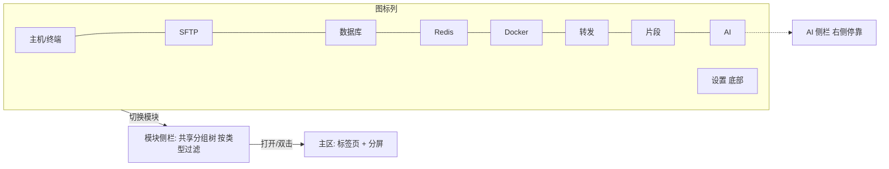
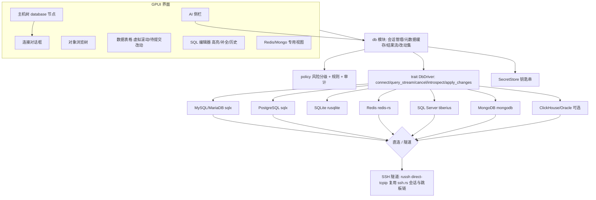

# ShellAX 数据库连接与管理 — 功能分析 / PRD 草案

> 状态：草案，待评审。版本：v0.2（2026-10-26）。本文只定义范围和深度，不包含实现代码。
>
> v0.2 已确认的决策：数据库功能**一个版本完整交付**（不分阶段对外发布）；左侧布局改为**图标列 + 模块侧栏**；功能范围按业界一体化开发运维客户端的完整水平定义（数据库、Redis、结构/数据同步、数据字典、XLSX 均在本版内）。

## 1. 背景与目标

ShellAX 现在的能力集中在 SSH 终端、SFTP 双栏、端口转发和 AI 助手。运维和开发人员登录服务器之后，下一步往往就是连数据库。本功能把「数据库连接」加入 ShellAX，目标是做成一个桌面级的数据库管理客户端，按能力分层落地：

| 能力层 | 内容 |
|---|---|
| L1 连接与浏览 | 连接管理、对象树、数据表格浏览、SQL 编辑器 |
| L2 日常开发 | 行内编辑与提交/回滚、表设计器（DDL 预览）、导入导出（CSV/JSON/SQL/XLSX）、Redis/Mongo 专用视图、AI SQL Agent |
| L3 管理与迁移 | 备份/恢复、结构与数据对比同步、数据字典导出、ER 图、用户权限管理 |

三层**在同一版本内全部交付**，内部按工作流并行开发（见第 9 节），对外只发布一次。

**差异化**：
1. 复用侧边栏中已有的 SSH 主机作为跳板，一键建立隧道连库，不需要手动配端口转发。
2. 生产色标签自动生效：危险 SQL 需要确认，可以设为只读。
3. AI 助手理解库结构，并且受同一套权限引擎约束。

## 2. 与现有代码的结合点

| 现有模块 | 用途 |
|---|---|
| `hosttree.rs` / `config.rs` 的 `groups`、`TagDef` 色标签、`is production` 判定 | 数据库连接作为新的节点类型挂在同一棵树上，共享分组、色标签和生产判定 |
| `secrets.rs` `SecretStore`（系统钥匙串，回退到 `secrets.enc`） | 存数据库密码、客户端证书私钥口令；配置文件里不出现明文 |
| `ssh.rs`（russh 0.64）、`forward.rs`（L/R/D 转发） | SSH 隧道：在 russh 会话上开 `direct-tcpip` 通道，或复用本地转发 |
| `host_dialog.rs` | 新建/编辑连接对话框，增加「数据库」类型页 |
| `tabs_ui.rs` 的「+」菜单（`NewItem`）、`layout.rs` 分屏 | 新增「新建数据库连接」和「打开查询」入口；查询标签页可以和终端分屏并排 |
| `policy.rs`（Mode/Effect/Rule/Risk，last-match-wins）、`audit.rs` | 增加 `action = "sql"`，并增加 SQL 风险分级；执行记录写入审计 |
| `ai.rs` / `agent.rs` / `chat_view.rs` | 自然语言转 SQL、解释报错，注入当前库的结构摘要 |
| `session_store.rs` | 恢复打开的查询标签、编辑器内容、当前库 |
| `highlight.rs`、`suggest.rs` | SQL 语法高亮和补全的实现位置 |
| `i18n.rs` + `locales/zh-CN.toml`、`locales/en.toml` | 所有界面文案 |

## 2.5 左侧布局改造：图标列 + 模块侧栏

功能模块已扩展到终端、SFTP、数据库、Redis 等，单一侧边栏无法承载，改为三段式：

1. **图标列**（固定宽约 48px，最左）：从上到下依次是「主机/终端」「SFTP」「数据库」「Redis」「Docker（另立 PRD）」「端口转发」「片段」「AI」；底部是「设置」。当前模块高亮；悬停显示名称和快捷键（Ctrl/Cmd+1…8）；可以在设置中隐藏不用的图标。
2. **模块侧栏**（第二列，可拖动宽度，复用 `sidebar.rs` 和 `sb_width`）：
   - 所有资产类型**共用一套分组目录**（`groups`），侧栏只显示当前模块的资产类型节点。
   - 主机/终端：现有主机树。
   - SFTP：主机树加收藏位置（`Place`）。
   - 数据库：连接 → 对象树（第 4.2 节）。
   - Redis：连接 → db → 键命名空间树。
   - 转发、片段：沿用现有面板。
   - 再次点击当前图标会折叠侧栏。
3. **主区**：标签页加分屏保持不变，不同模块的标签可以混排。切换图标只改变侧栏内容，不关闭已打开的标签。



验收：
- 图标列切换在 1 帧内完成。
- 侧栏宽度、折叠状态、当前模块会持久化，并参与会话恢复。
- 窄窗口（宽度小于 900px）下侧栏自动折叠，只保留图标列。

## 3. 支持的数据库与驱动选型

所有驱动都是纯 Rust 或者 Rust 封装，基于 tokio，与现有运行时一致。下表的版本和许可证以 crates.io 2026-10 的记录为准。

| 优先级 | 数据库 | 驱动 crate | 许可证 | 说明 |
|---|---|---|---|---|
| P0 | MySQL / MariaDB | `sqlx` 0.9（mysql） | MIT OR Apache-2.0 | 纯 Rust 协议实现，支持 TLS；MariaDB 走 MySQL 协议 |
| P0 | PostgreSQL | `sqlx` 0.9（postgres） | MIT OR Apache-2.0 | 支持取消（发送 cancel request）、TLS |
| P0 | SQLite | `rusqlite` 0.41（bundled） | MIT | 本地文件，同步 API 放在 blocking 线程。不同时启用 sqlx-sqlite，避免两份 `libsqlite3-sys` 链接冲突 |
| P0 | Redis | `redis` 1.8 | BSD-3-Clause | 支持 TLS、Cluster、Sentinel；键浏览用 SCAN，禁止使用 KEYS |
| P1 | SQL Server | `tiberius` 0.13 | MIT/Apache-2.0 | TDS 协议，纯 Rust；Windows 集成认证需要单独评估 |
| P1 | MongoDB | `mongodb` 3.9 | Apache-2.0 | 官方驱动；BSON 和 JSON 互转 |
| P1 | ClickHouse | `clickhouse` 0.15 | MIT OR Apache-2.0 | 基于 HTTP 接口，可行；结果集偏只读分析，不做行内编辑 |
| P2 | Oracle | `oracle` 0.6 | UPL-1.0/Apache-2.0 | 依赖 ODPI-C，运行时需要用户自行安装 Oracle Instant Client，不能静态打包。可行但安装成本高，建议做成可选功能（cargo feature） |
| P1 | DuckDB | `duckdb` crate（bundled） | 待核实 | 本地分析库，嵌入式 |
| P1 | MySQL 协议兼容：OceanBase（MySQL 模式）、StarRocks、TiDB、PolarDB-X | 复用 MySQL 适配器 + 方言差异表 | — | 对象树查询按方言调整 |
| P1 | PG 协议兼容：OpenGauss、人大金仓 KingbaseES（PG 模式）、PolarDB-PG | 复用 PG 适配器 + 方言差异表 | — | 认证方式（如 OpenGauss sha256）需实测 |
| P2 | 达梦 DM | ODBC 通道（`odbc-api`）或厂商驱动 | 待核实 | 无纯 Rust 驱动，需用户安装 ODBC 驱动 |
| P2 | TDengine | 官方 Rust 客户端 | 待核实 | 时序库，以查询与浏览为主 |

SQL 解析（风险分级、语句拆分、补全上下文）使用 `sqlparser` 0.63（Apache-2.0），它支持多种方言。

所有新增依赖都是宽松许可证，与现有的 Apache-2.0/MIT 依赖兼容。BSD-3-Clause 需要在第三方声明中保留版权文本。

## 4. 功能需求

### 4.1 连接管理
- 侧边栏的主机树增加节点类型 `database`。它和 SSH 主机共享分组、拖拽排序、色标签、搜索、快速连接（命令面板）。
- 图标区分库类型，节点右侧显示连接状态点。
- 连接参数：
  - 主机、端口、用户、默认库/schema、字符集。
  - 连接超时、查询超时。
  - 连接参数（key=value）。
  - SQLite 只需要文件路径。
  - Redis 有 db 序号和用户名/ACL。
  - Mongo 支持 URI 模式。
- **SSL/TLS**：
  - 模式：disable / prefer / require / verify-ca / verify-full。
  - CA 文件、客户端证书和私钥。
  - 私钥口令存入钥匙串。
- **SSH 隧道（核心卖点）**：
  - 下拉选择侧边栏中已有的 SSH 主机作为跳板，复用它的认证方式（密钥/agent/密码）以及它自己的跳板链。
  - 底层在 russh 会话上开 `direct-tcpip` 到 `db_host:db_port`，本地监听 `127.0.0.1:随机端口`，驱动连这个本地端口。
  - 如果同一个跳板已经有活动会话，就复用这条连接。
- 密码只放在 `SecretStore` 里，键名为 `db:<conn_id>:password`。配置里不出现明文。
- 「测试连接」按钮显示分步结果：SSH 隧道 → TCP → TLS → 认证 → 版本号。
- 连接属性 `read_only`：开启后客户端拒绝所有写语句，同时在会话层执行 `SET SESSION TRANSACTION READ ONLY`（MySQL/PG 支持）。
- 导入：从 URI 粘贴解析（`mysql://`、`postgres://`、`redis://`、`mongodb://`）。
- 配置示例（`hosts.toml` 新增）：
```toml
[[db]]
id = "orders-prod"
name = "订单库(生产)"
kind = "mysql"            # mysql|mariadb|postgres|sqlite|redis|sqlserver|mongodb|clickhouse|oracle
host = "10.0.3.12"
port = 3306
user = "app_ro"
database = "orders"
group = "生产/华东"
tags = ["red"]
read_only = true
ssh_via = "bastion-hz"    # 侧边栏中 SSH 主机的名字；空表示直连
[db.tls]
mode = "verify-ca"
ca = "~/.config/shellax/certs/rds-ca.pem"
```

### 4.2 对象浏览树
- 层级：连接 → 数据库 → schema（PG/SQL Server）→ 表 / 视图 / 物化视图 / 函数 / 存储过程 / 触发器 / 序列 / 事件。
- 表节点下可以展开列、索引、外键、触发器。
- 「用户与角色」节点。
- 懒加载、按名称过滤、刷新。
- 右键菜单：打开、设计表、复制名称、生成 SELECT/INSERT/DDL、清空表、删除表。清空和删除走危险确认。
- 显示行数估算（来自 information_schema 或 pg_class）和表大小。

### 4.3 数据表格
- **分页与流式**：
  - 默认每页 1000 行，可以调整。
  - 驱动以流式 fetch 读取，首屏数据到达就渲染。
  - 「全部加载」设上限（默认 100 万行），超出时提示改用导出。
- **虚拟滚动**：只渲染可见行和列（GPUI `uniform_list` 加列虚拟化），列宽可以拖动，首列冻结。
- **筛选/排序**：
  - 列头排序会生成 ORDER BY，在服务端执行。
  - 筛选面板（列、操作符、值）生成 WHERE，也可以直接手写 WHERE。
- **NULL 处理**：NULL 和空字符串在视觉上区分；编辑时可以「设为 NULL」或「设为默认值」。
- **行内编辑**：
  - 改动先进入「待提交」状态：修改的单元格高亮，新增行和删除行有标记。
  - 工具栏有「提交（N 处改动）」「回滚」「预览 SQL」三个按钮。
  - 提交在单个事务中执行，失败时整体回滚并定位出错的行。
  - 没有主键或唯一键的表禁止编辑，以只读方式展示并说明原因。
- **查看器**：
  - JSON 格式化和折叠。
  - BLOB 提供十六进制视图和图片预览，可以另存为文件。
  - 长文本弹出编辑器。
  - 时间显示带时区提示。
- **复制**：选区复制为 TSV（默认）、CSV、INSERT 语句、Markdown 表格、JSON。
- 单元格和行的详情侧栏（表单视图）。

### 4.4 SQL 编辑器
- 每个连接可以开多个查询标签，作为普通标签页，支持与终端分屏。
- 语法高亮按方言区分，提供关键字大小写格式化和美化。
- **补全**：关键字、库/表/列（来自缓存的 schema 元数据，按 FROM 子句的别名上下文补全）、函数。
- 执行方式：
  - 执行全部、执行选中、执行光标所在语句（由 sqlparser 拆分）。
  - 多条语句执行时，每条结果一个结果标签，同时有「消息」标签显示影响行数和耗时。
- **取消查询**：
  - PG 用 cancel request，MySQL 用 `KILL QUERY <id>`（另开连接发送），SQL Server 用 attention，其余驱动直接断开。
  - 按 Esc 或点停止按钮触发。
- EXPLAIN / EXPLAIN ANALYZE（ANALYZE 会真实执行，需要二次确认），结果以树形展示。
- 历史记录：按连接保存语句、时间、耗时、结果行数，可以搜索和重新打开。
- 收藏查询：命名后保存，可以分组；支持参数占位符 `:name`，执行时弹窗输入参数值。
- 事务模式：自动提交（默认）或手动提交；手动模式下标签上显示「事务进行中」，关闭前提示。

### 4.5 表设计器
- 列（名称、类型、长度、可空、默认值、自增、注释）、索引、外键、检查约束、表选项（引擎、字符集、注释）。
- **应用前必须预览**生成的 DDL（ALTER/CREATE），可以复制，确认后才执行；预览中高亮有风险的变更（删列、改类型）。
- 支持全部关系型库。SQLite 的 ALTER 能力受限，需要重建表，预览中说明这一点。

### 4.6 导入导出
- 导出：表或查询结果导出为 CSV、JSON（数组/逐行）、SQL INSERT 脚本，流式写文件，显示进度，可以取消。
- 导入：CSV/JSON 导入到表，包含列映射、类型预检、批量提交大小、遇错时跳过或停止。
- XLSX 导入导出（本版内）。
- **数据字典导出**：将库/表/列/注释/索引导出为 Markdown、HTML、XLSX。

### 4.7 备份/恢复
- 首选内置的逻辑导出：结构 DDL 加数据 INSERT，用于中小库。
- 大库可以调用本机或远端的 `mysqldump`/`pg_dump`。可以通过 SSH 主机在远端执行并用 SFTP 拉回，复用现有能力。
- 恢复：执行 SQL 文件，显示进度，遇错时停止或继续。

### 4.8 对比与同步、ER 图、用户权限
- 结构对比：两个库或 schema 做差异树，生成同步 DDL，预览后执行。
- 数据对比：按主键对比单表，生成差异 SQL。
- ER 图：根据外键自动布局，只读，可以导出 PNG/SVG。
- 用户与权限：列出用户/角色，GRANT/REVOKE 可视化编辑，同样需要预览 SQL。

### 4.9 Redis 专用视图
- 键浏览：SCAN 加模式匹配，按 `:` 分隔显示为命名空间树；每批 1000 个，可以继续加载。
- 按类型展示：
  - string：文本/JSON/十六进制视图。
  - hash、list、set、zset：表格视图，带分值。
  - stream：消息列表。
- TTL 显示和修改，键重命名和删除（删除走确认）。
- 内置命令行（复用终端风格的输入框），危险命令（FLUSHALL、FLUSHDB、KEYS *、CONFIG SET）走权限引擎。
- 服务器信息页：INFO 分节展示，内存和连接数。

### 4.10 MongoDB 专用视图
- 库 → 集合 → 索引树。
- 文档视图：JSON 树视图和表格视图可以切换；支持 filter/sort/projection 输入，以及分页。
- 单文档编辑：JSON 编辑器加 BSON 类型提示（ObjectId、Date），保存时执行 replaceOne。
- 聚合管道编辑器（逐阶段预览）。

## 5. AI 集成与权限引擎

### 5.1 AI 能力
- **自然语言转 SQL**：
  - 在 SQL 编辑器或 AI 侧栏输入需求，AI 收到当前连接的方言、版本，以及相关表的结构摘要（列名、类型、主外键）。表多时先按名称和注释做相关性筛选，控制在 token 上限内。
  - 默认**不发送表数据**；发送样例行需要用户在设置中显式开启，与现有的 `send_output_to_ai` 一致。
- **解释报错**：执行失败时出现「让 AI 解释」浮动按钮（与终端的 explain-fail 浮钮交互一致）。
- **解释和优化**：选中 SQL 可以「解释这段 SQL」，或附上 EXPLAIN 结果「给出优化建议」。
- AI 生成的 SQL **只插入编辑器，不自动执行**。由 agent 代为执行时走 5.2 的权限判定。

### 5.2 SQL 风险分级（复用 `policy::Risk`）
| 级别 | 语句 |
|---|---|
| R0 | SELECT / SHOW / DESCRIBE / EXPLAIN（不含 ANALYZE） |
| R1 | 带 WHERE 的 INSERT / UPDATE / DELETE |
| R2 | CREATE / ALTER ADD、GRANT |
| R3 | 不带 WHERE 的 UPDATE / DELETE、ALTER DROP COLUMN、REVOKE |
| R4 | DROP / TRUNCATE、Redis FLUSHALL/FLUSHDB |
| Hard | 生产连接上的 R4 |

分级由 sqlparser 解析 AST 完成，**不靠正则**；解析失败时按 R3 处理。

### 5.3 规则示例（`policy.toml`，新增 `action = "sql"`，`db_tags`/`db` 匹配条件）
```toml
# 所有主体执行 SQL，默认需要确认
[[rules]]
id = "sql-base-ask"
principal = "*"
action = "sql"
command = "*"
effect = "ask"

# 只读查询放行
[[rules]]
id = "sql-readonly-allow"
principal = "*"
action = "sql"
command = ["SELECT *", "SHOW *", "DESCRIBE *", "EXPLAIN SELECT *"]
effect = "allow"

# 禁止 AI 删表、清表
[[rules]]
id = "sql-ai-no-drop"
principal = "ai"
action = "sql"
command = ["DROP *", "TRUNCATE *"]
effect = "deny"
reason = "AI 不允许删除或清空表，请人工执行"

# 不带 WHERE 的 DELETE/UPDATE 一律确认（由风险分级 R3 识别）
[[rules]]
id = "sql-no-where-ask"
principal = "*"
action = "sql"
risk = ">=R3"
effect = "ask"
reason = "整表写操作"

# 红色（生产）标签的连接：只允许读
[[rules]]
id = "sql-prod-readonly"
principal = "*"
action = "sql"
db_tags = ["red"]
risk = ">=R1"
effect = "deny"
reason = "生产库为只读，如需写入请在连接属性中关闭只读并二次确认"
```
- 人工在编辑器中执行时，同样走 `dangerous_confirm`：R3 及以上弹出确认框，显示目标连接名、色标签、影响行数预估（先执行 `SELECT COUNT(*)` 加同一 WHERE）。生产连接上的 Hard 级需要输入库名确认。
- 每次执行都写入 `audit.rs`：时间、连接、主体（人工或 AI）、语句摘要、风险级、判定、影响行数、耗时。**不记录参数值和结果数据**。

## 6. 非功能需求
| 项 | 目标 |
|---|---|
| 首屏 | 100 万行的表，打开后首屏 1000 行在 1 秒内出现（局域网或同城 RTT ≤ 10ms，流式 fetch） |
| 渲染 | 表格滚动和列拖动保持 60fps（10 万行已加载、50 列） |
| 内存 | 每个结果集的缓存设上限（默认 200MB），超限时提示改用分页或导出 |
| 取消 | 点击停止后 2 秒内返回（驱动支持时）；不支持时断开连接 |
| 超时 | 连接超时默认 10 秒、查询超时默认不限（可配置），SSH 隧道建立超时 15 秒 |
| 并发 | 每个连接配置一个小连接池（默认 4）：元数据查询和用户查询分开，避免互相阻塞 |
| 安全 | 配置中无明文秘密；TLS 默认 prefer，生产标签默认 verify-ca 并提示；剪贴板复制大结果时提示 |
| 审计 | 见 5.3，可以导出 |
| 可用性 | 断线自动重连（只重连，不重放未提交事务，并提示事务已丢失） |
| 国际化 | 全部文案放在 `locales/zh-CN.toml` 和 `locales/en.toml` |
| 体积 | 新增驱动使安装包增量控制在 15MB 以内；Oracle 作为可选 feature，默认不编译 |

## 7. 架构

- 关系型数据库共享 `DbDriver` 接口。Redis 和 Mongo 另有 `KvDriver` 和 `DocDriver` 接口，只共享连接和隧道部分。
- 结果集统一为列式的 `ResultChunk`（列元数据加行批次），UI 只依赖这个结构。
- 所有驱动 I/O 跑在 tokio 运行时上，通过 channel 推送给 GPUI，不阻塞 UI 线程。

## 8. 不在范围内（明确不做）
- 可视化查询构建器（拖拽拼 SQL）。
- 报表、图表、BI 仪表盘。
- 数据生成或模拟数据。
- 自动化任务调度（定时备份或同步计划），后续版本再评估。
- 云厂商控制台集成（RDS 实例管理）。
- 存储过程调试器。
- NoSQL 的完整管理：Mongo 分片和副本集运维、Redis 集群重分片。
- 团队协作和云同步连接配置（另立需求）。
- 除第 3 节以外的数据库（例如 DB2、Cassandra、Elasticsearch）。
- 远程桌面（RDP/VNC）、移动端。

## 9. 交付计划（单版本，内部工作流并行）

对外只发布一个版本。内部按工作流拆分，每个工作流都有自己的验收标准，全部通过后发布。

| 工作流 | 内容 | 验收标准 | 粗略工作量 |
|---|---|---|---|
| W0 布局 | 图标列、模块侧栏、共享分组树按类型过滤、持久化 | 见第 2.5 节验收 | 1.5 周 |
| W1 连接层 | database 节点、对话框、钥匙串、TLS、SSH 隧道、连接池、取消、超时 | 1. 通过已有 SSH 主机连上内网各类库<br>2. 配置文件中无明文密码 | 2 周 |
| W2 关系型核心 | 驱动适配（MySQL/PG/SQLite/SQL Server/ClickHouse/DuckDB 及兼容库）、对象树、表格（虚拟滚动、筛选排序、查看器、复制）、行内编辑提交/回滚 | 1. 100 万行表首屏 <1 秒、60fps<br>2. 编辑 100 行后一次提交，失败时整体回滚 | 4 周 |
| W3 SQL 编辑器 | 高亮、按结构补全、多语句、执行选中、取消、EXPLAIN 树、历史、收藏、参数 | 长查询 2 秒内可以取消；补全延迟 <50ms | 2.5 周 |
| W4 设计与迁移 | 表设计器加 DDL 预览、导入导出（CSV/JSON/SQL/XLSX）、数据字典、备份恢复、结构/数据对比同步、ER 图、用户权限 | 1. 结构同步后再对比无差异<br>2. 1GB SQL 文件恢复有进度、可以中断 | 5 周 |
| W5 Redis 与 Mongo | Redis 键树、各类型、TTL、命令行、INFO；Mongo 文档视图、编辑、聚合管道 | 100 万个键的库 SCAN 浏览不卡顿 | 3 周 |
| W6 AI 与安全 | SQL Agent（自然语言转 SQL、解释、优化）、SQL 风险分级、规则、只读、审计 | 红标签连接执行写语句被拒；AI 生成的 SQL 不会自动执行 | 2 周 |
| W7 收尾 | 国产库兼容实测、i18n、性能回归、文档 | 第 6 节指标全部达标 | 2 周 |

合计约 22 周（1 名全职开发）。2 人并行（W0+W1+W2+W3 和 W4+W5+W6）约 12–14 周。

## 10. 待决策问题
1. **达梦与 Oracle**：两者都需要用户安装厂商客户端（ODBC 或 Instant Client）。是否接受做成「可选组件」？
2. **Docker 模块**：图标列已预留位置，是并入本版本，还是另立 PRD？
3. **云同步**：资产配置同步（端到端加密，WebDAV/S3/Git 等）是否纳入本版本？
4. **生产只读默认值**：红色（生产）标签的连接默认只读，还是默认「写入需确认」？
5. **AI 数据外发与 MCP**：是否允许发送样例行；是否通过 MCP 对外开放数据库能力？
6. **人力**：按 1 人约 22 周，还是 2 人约 12–14 周排期？
