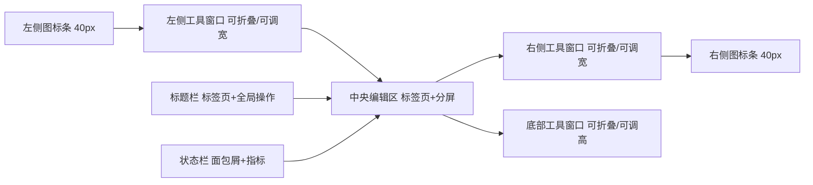
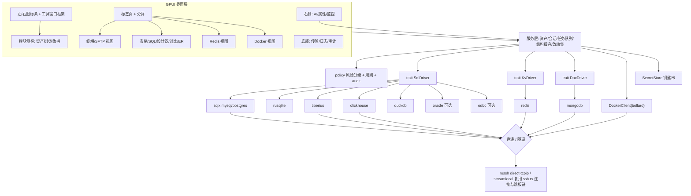

# ShellAX v0.2 功能开发文档（PRD）

> 状态：评审稿 · 版本 v0.2-draft · 日期 2026-10-26
> 适用分支：开发期间以 `main` 为准，本文件随功能落地持续更新。
> 标记约定：**【待确认】** 表示需要产品负责人拍板，括号内为推荐默认值；未拍板前按推荐默认值开发。

## 目录
1. 版本目标与范围
2. 用户与核心场景
3. 整体布局与交互规范
4. 主要界面线框图
5. 关键任务交互流程
6. 模块功能需求
   - 6.1 主机与终端（TERM）
   - 6.2 SFTP 文件（SFTP）
   - 6.3 数据库（DB）
   - 6.4 Redis（RDS）
   - 6.5 Docker（DKR）
   - 6.6 端口转发（FWD）
   - 6.7 常用命令（SNP）
   - 6.8 AI 助手（AI）
   - 6.9 传输队列、审计日志、设置（SYS）
   - 6.10 配置同步（SYNC，可选）
7. 权限引擎与安全
8. 数据模型与配置结构
9. 技术架构与依赖
10. 非功能需求
11. 开发工作流与排期
12. 不在本版范围
13. 待确认事项

---

## 1. 版本目标与范围

v0.2 把 ShellAX 从「SSH 终端 + SFTP」扩展成一个桌面端一体化开发运维工具：终端、文件、数据库、Redis、容器、端口转发、常用命令和 AI 放在同一个窗口里，共用一套资产分组、色标签、凭据和权限体系。

**本版一次性完整交付**，不拆成多个对外版本。

| 模块 | 本版交付深度 |
|---|---|
| 主机与终端 | 保持现有能力，补齐 X11 转发、ZMODEM（rz/sz）、命令广播增强、服务器监控面板 |
| SFTP | 保持双栏；补齐 sudo 提权浏览、跨服务器互传、统一传输队列 |
| 数据库 | 16 类数据库连接；对象树、数据表格编辑、SQL 编辑器、表设计器、导入导出（CSV/JSON/SQL/XLSX）、数据字典、备份恢复、结构与数据对比同步、ER 图、用户权限 |
| Redis | 单机、哨兵、集群；键树、五种基础类型和 Stream 编辑、TTL、命令行、服务器信息 |
| Docker | 本地和远程（经 SSH）；容器、镜像、网络、卷、Compose；日志、容器终端、容器文件 |
| 端口转发 | 现有 L/R/D 转发移入独立工具窗口，并作为数据库隧道的底座 |
| 常用命令 | 现有片段移入独立工具窗口，支持变量和发送到多个会话 |
| AI | 现有 AI 助手；新增 SQL 助手（自然语言转 SQL、解释报错、优化建议）；所有执行受权限引擎约束 |
| 配置同步 | 【待确认】（推荐：本版只做加密导入导出，云同步放到后续版本） |

## 2. 用户与核心场景

| 角色 | 典型场景 |
|---|---|
| 后端开发 | 经跳板机连测试库，查数据、改几行、写 SQL、导出结果给同事 |
| 运维/SRE | 多台服务器同时操作，看监控，查容器日志，进容器排查，传文件 |
| DBA/数据工程师 | 对比两套环境的表结构并生成同步脚本，备份恢复，管理账号权限 |
| 全栈/独立开发者 | 本地 SQLite/DuckDB、本地 Docker、Redis 调试，一个工具搞定 |

设计原则：
1. **资产统一**：服务器、数据库、Redis、Docker 端点都是「资产」，共用分组树、色标签、钥匙串和搜索。
2. **安全默认**：生产（红色）标签的资产，危险操作一律二次确认；所有写操作可审计。
3. **键盘优先**：每个工具窗口和常用操作都有快捷键；全局搜索可以到达任何资产、对象和命令。
4. **不打断**：长任务（查询、导出、传输、拉镜像）都在后台执行，可以取消，进度集中到底部工具窗口。

---

## 3. 整体布局与交互规范

### 3.1 布局总览

整体沿用 ShellAX 现有结构（标题栏内标签页、左侧栏、中央内容区、右侧 AI 停靠），按「工具窗口」模型重新组织为五个区域：

```
┌──────────────────────────────────────────────────────────────────────────────┐
│ ● ● ●  ShellAX  [标签1 ×][标签2 ×][标签3 ×] +                     [⚙] [– □ ×] │ ← 标题栏（标签页在标题栏内，设置在窗口按钮左侧）
├──┬──────────────────┬───────────────────────────────────────────┬─────────┬──┤
│▣ │╭ ShellAX ───────╮│╭─────────────────────────────────────────╮│╭ AI 助手╮│✦ │
│⇅ ││ ⌕ 搜索资产…    │││                                         │││       ││⌘ │
│◫ ││ ▾ 生产 ●       │││            中央编辑区（卡片）              │││ 右侧  ││◆ │
│◆ ││   ▸ web-01     │││   （终端 / 表格 / SQL / 设计器 / 文件…）   │││ 工具  ││◷ │
│▢ ││   ▸ orders-db  │││                                         │││ 窗口  ││☰ │
│⇄ ││ ▾ 测试 ●       │││                                         │││（卡片）││ⓘ │
│  ││   ▸ redis-test │││                                         │││       ││  │
│  ││  左侧工具窗口   │││                                         │││       ││⇣ │
│  ││  （卡片）       │││                                         │││       ││▤ │
│  │╰────────────────╯│╰─────────────────────────────────────────╯│╰───────╯│⌂ │
├──┴──────────────────┴───────────────────────────────────────────┴─────────┴──┤
│ orders-db › orders › t_order        UTF-8 · 1,000 / 1,204,331 行 · 128 ms  ⚠2 │ ← 状态栏
└──────────────────────────────────────────────────────────────────────────────┘
```

左侧工具窗口、中央编辑区、右侧工具窗口都是圆角卡片，卡片之间、卡片与窗口边缘之间使用统一间距；左右两条图标条宽度和按钮样式一致。



### 3.2 左侧图标条（约 40px）

| 分组 | 顺序 | 图标 | 工具窗口 | 快捷键 | 说明 |
|---|---|---|---|---|---|
| 上组 | 1 | 主机/终端 | 资产树（服务器） | Alt+1 | 默认打开；本地终端放在树顶部的「本机」节点 |
| 上组 | 2 | SFTP | 主机树 + 收藏位置 | Alt+2 | 单击主机在当前 SFTP 标签切换；双击新建 SFTP 标签 |
| 上组 | 3 | 数据库 | 连接 → 对象树 | Alt+3 | 数据库资产及其对象 |
| 上组 | 4 | Redis | 连接 → db → 键命名空间 | Alt+4 | |
| 上组 | 5 | Docker | 端点 → 容器/镜像/网络/卷/Compose | Alt+5 | 端点可以是本机或某台 SSH 主机 |
| 上组 | 6 | 端口转发 | 转发规则列表 | Alt+6 | 显示运行状态和流量 |
| 右侧工具栏 | — | 常用命令 | 按当前模块显示（终端/SQL/Redis/Docker/文件操作） | Alt+7 | 插入到当前模块的编辑器或终端 |

规则：
- **单击未激活的图标**：切换左侧工具窗口内容。**单击已激活的图标**：折叠左侧工具窗口，只留图标条；再点一次展开。
- 左侧工具窗口宽度可拖动（最小 200px，最大为窗口宽度的 45%），双击分隔线恢复默认宽度。宽度、折叠状态和当前图标会持久化，并参与会话恢复。
- 图标悬停时显示提示「名称 Alt+N」。
- 右键图标条可以隐藏不用的模块，例如不用 Docker 就隐藏。被隐藏的模块仍可以从全局搜索打开。
- 图标上的角标：传输队列显示进行中的任务数；端口转发显示运行中的规则数；审计在有拒绝事件时显示红点。
- 窗口宽度小于 900px 时，左侧工具窗口自动变为浮层：点击图标弹出，点击外部收起。

### 3.3 左侧工具窗口（模块侧栏）

- 顶部第一行固定显示应用名「ShellAX」（与现有规则一致），下面是该模块标题和操作按钮（新建、刷新、折叠全部、更多）。
- 第二行是标准尺寸的搜索框（与现有搜索框规格一致），按名称、地址和标签过滤，`/` 聚焦。
- **资产树共用一套分组**：同一个分组在各模块中都存在，每个模块只显示自己类型的资产。分组的色标签、生产判定、排序全局共享。例如在「数据库」里新建分组「华东」，切到「主机」也能看到这个分组（为空时灰显，可以通过设置隐藏空分组）。
- 资产节点显示：类型图标、名称、色标签圆点、连接状态（灰：未连接；绿：已连接；黄：连接中；红：失败）。
- 交互沿用现有规则：**单击切换（在当前标签中打开或聚焦已有标签），双击新建标签**；回车等同双击；空格预览属性（打开右侧「属性」工具窗口）。
- 支持拖拽调整分组和排序；多选（Shift/Ctrl）后可以批量连接、批量删除、批量打标签。

### 3.4 中央编辑区

- 标签页仍放在标题栏内：圆角浅色标签，背景与窗口背景同色（现有规则），右侧有「+」新建菜单。
- 「+」菜单扩展为：本地终端；按分组列出的 SSH 主机；新建 SQL 查询（选择数据库连接）；Redis 控制台；Docker 端点；新建连接…
- 标签类型和标题格式：

| 标签类型 | 标题格式 |
|---|---|
| 终端 | `主机名` |
| SFTP | `SFTP · 主机名` |
| 表数据 | `表名 · 库名` |
| SQL 查询 | `查询 3 · 连接名` |
| 表设计 | `设计 · 表名` |
| Redis | `连接名 · db0` |
| 容器日志/终端 | `容器名 · 日志` |

- 标签左侧显示资产色标签圆点。生产资产的标签底部有 2px 红色细线，始终提醒当前在操作生产环境。
- 分屏沿用现有实现，**分屏之间不画焦点边框**。终端内容保持圆角卡片样式。任意类型的标签都可以分屏并排，例如左边终端、右边 SQL。
- 有未保存或未提交改动的标签，标题前显示「●」。关闭时弹出确认：提交、丢弃、取消。

### 3.5 右侧工具窗口与右侧图标条

右侧图标条约 40px，与左侧图标条同宽同样式。从上到下依次是：AI 助手、常用命令、主机工具、历史、命令面板、关于；底部一组是传输队列（有进行中任务时显示角标）、审计日志、保存位置。设置不在图标条上，改为标题栏右侧的齿轮按钮。

| 顺序 | 工具窗口 | 快捷键 | 内容 |
|---|---|---|---|
| 1 | AI 助手 | Ctrl/Cmd+Shift+A | 按当前模块带上下文，见 3.5.1 |
| 2 | 属性/DDL | Ctrl/Cmd+Shift+I | 当前选中对象的属性：主机信息、表 DDL、列详情、Redis 键元数据、容器详情 |
| 3 | 服务器监控 | Ctrl/Cmd+Shift+M | 当前终端所在主机的 CPU、内存、磁盘、网络、负载、进程前 10，每 2 秒刷新 |

- 右侧同一时间只展开一个工具窗口，行为与左侧一致：点击已激活的图标会折叠，宽度可调并持久化。
- 右侧整体（含图标条）可以在设置中隐藏。

#### 3.5.1 AI 助手的模块上下文

AI 助手跟随当前聚焦的面板切换上下文，上下文开关和脱敏规则对所有模块生效。AI 生成的 SQL、命令和配置**只插入、不执行**，由用户确认后自行运行；生产资产仍按权限引擎和生产标记处理。

| 模块 | 默认上下文 | 快捷分析 | 插入位置 |
|---|---|---|---|
| 终端 | 屏幕、选中内容或最近命令（现有逻辑） | 多步计划（逐步确认） | 当前终端输入行 |
| 数据库 | 当前库的表和列（截断） | 生成增删改查；性能分析：EXPLAIN（不带 ANALYZE）、相关表索引、慢查询统计（MySQL 摘要表 / PostgreSQL pg_stat_statements），给出索引和改写建议 | SQL 编辑器光标处 |
| Redis | INFO 摘要、键数量、SCAN 抽样键及类型 | 键分析：抽样键内存占用、访问频率、慢日志，找出大 key / 热 key | 内置命令行（不回车） |
| Docker | 容器列表与状态、Compose 归属 | 故障诊断：资源采样、异常或重启容器的最近日志；生成 compose 文件 | 复制到剪贴板 |

AI 停靠栏顶部的智能体状态条和快速启动只在终端模块显示。

### 3.6 底部工具窗口

用「底部标签条」切换，高度可调（最小 120px），可以折叠：

| 工具窗口 | 内容 |
|---|---|
| 传输队列 | SFTP 上传下载、跨服务器互传、导入导出、备份恢复、镜像拉取，统一显示进度、速度、剩余时间，可暂停、取消、重试 |
| 执行日志 | SQL 执行记录（语句摘要、耗时、影响行数、错误），Redis 命令，Docker 操作结果 |
| 审计 | 权限引擎判定记录（主体、资产、动作、风险级、允许/确认/拒绝、原因），可筛选、可导出 |

SQL 查询结果**不**放在底部全局工具窗口，而是放在 SQL 标签内部的下半区（见 4.3），以免多个查询互相覆盖。

### 3.7 状态栏

从左到右依次是：
- **面包屑**：
  - 终端：`主机 › 当前目录`
  - SFTP：`主机 › 路径`
  - 数据库：`连接 › 库 › schema › 表`
  - Redis：`连接 › db › 键`
  - Docker：`端点 › 容器`
  - 每一段都可以点击，跳转到侧栏对应节点。
- **右侧指标**：
  - 终端：编码 · 尺寸（列×行）· 延迟
  - 表格：已加载行数/总行数估算 · 选中格数 · 耗时
  - SQL：光标位置（行:列）· 事务状态（自动提交/手动提交）· 耗时
  - SFTP：选中项数和大小
- **最右侧**：后台任务指示（旋转图标加数量，点击打开传输队列）和告警数。

### 3.8 标题栏

保留现有的「标签页在标题栏内」。右侧在窗口按钮之前放设置齿轮。
- 在设置标签页之外，隐藏标签页里的分屏、关闭分屏、广播、录制、清空历史、启动智能体等快捷键不生效，避免操作到看不见的面板。

### 3.9 全局搜索与快捷键

- **全局搜索**：双击 Shift 或 Ctrl/Cmd+K 打开。
  - 一个输入框同时搜索资产、数据库对象（表、视图）、Redis 键前缀、容器、常用命令和动作（命令面板）。
  - 前缀限定范围：`>` 只搜动作，`@` 只搜资产，`#` 只搜表，`!` 只搜常用命令。
  - 结果按类型分组，回车打开，Ctrl+回车在新标签中打开。
- 快捷键总表：

| 操作 | 快捷键 |
|---|---|
| 切换左侧工具窗口 | Alt+1…6（常用命令工具窗口 Alt+7） |
| AI / 传输 / 审计 | Alt+8 / 9 / 0 |
| 隐藏所有工具窗口（专注模式） | Ctrl/Cmd+Shift+F12 |
| 焦点回到编辑区 | Esc（在工具窗口中按） |
| 新建标签菜单 | Ctrl/Cmd+T |
| 关闭标签 | Ctrl/Cmd+W |
| 执行 SQL（光标所在语句或选中内容） | Ctrl/Cmd+Enter |
| 执行全部 SQL | Ctrl/Cmd+Shift+Enter |
| 取消执行 | Ctrl/Cmd+.（编辑器中也可以按 Esc） |
| 提交表格改动 | Ctrl/Cmd+S |
| 回滚表格改动 | Ctrl/Cmd+Z（整批）/ 单元格右键「还原」 |
| 格式化 SQL | Ctrl/Cmd+Alt+L |

- 所有快捷键可以在「设置 › 快捷键」中修改（沿用现有 `keys` 配置）。

### 3.10 视觉与文案一致性规则

- 标签：圆角浅色，背景与窗口同色；当前标签用轻微提亮表示，不加粗边框。
- 终端和数据表格的内容区都使用圆角卡片；分屏之间没有焦点边框。
- 搜索框统一使用标准尺寸，所有工具窗口一致。
- 色标签：使用现有的色标签和自定义名称；生产色（默认红）的语义全局一致。
- 图标：使用现有 `ui::IconName` 体系，新增图标保持线性风格、16px。
- 文案：所有界面字符串放在 `locales/zh-CN.toml` 和 `locales/en.toml`。**界面文案中不出现具体操作系统名称**，快捷键提示按平台显示 Ctrl 或 ⌘ 符号。
- 危险操作按钮使用红色文本按钮，不使用整块红底。
- 动效沿用 `motion.rs` 的时长，工具窗口展开和收起不超过 150ms。

### 3.11 通用状态规范

| 状态 | 表现 |
|---|---|
| 空状态 | 工具窗口居中显示插图图标、一句说明、主按钮。例如「还没有数据库连接」+「新建连接」+ 次级链接「从 URI 导入」 |
| 加载 | 300ms 内不显示任何东西（避免闪烁）；超过 300ms 显示骨架行；超过 3 秒显示「仍在加载…取消」 |
| 错误 | 在原位置显示内联错误卡片：标题 + 一句人话原因 + 「重试」「复制详情」「让 AI 解释」。不弹模态框 |
| 断线 | 标签顶部出现黄色细条「连接已断开 · 重新连接」，内容保留只读 |
| 危险确认 | 模态框，标题写明动作和对象；正文写资产名和色标签、影响范围（行数、文件数、容器数）以及预览（SQL/命令）。生产资产需要输入对象名才能确认；默认焦点在「取消」 |
| 成功提示 | 右下角轻提示 3 秒自动消失；可撤销的操作提供「撤销」按钮 |

### 3.12 键盘导航

- 树：上下键移动，左右键折叠或展开，回车打开，F2 重命名，Delete 删除（会确认），输入字母时类型前缀跳转。
- 表格：方向键移动单元格；回车或 F2 编辑；Esc 取消编辑；Tab 移到下一格；Ctrl/Cmd+C 复制；Ctrl/Cmd+Shift+C 打开「复制为…」菜单；Ctrl/Cmd+F 打开表格内查找。
- Tab 键在侧栏、编辑区、底部和右侧工具窗口之间循环焦点（Ctrl+Tab 仍用于切换标签）。

---

## 4. 主要界面线框图

### 4.1 数据库：对象树 + 表数据

```
┌──┬───────────────────────┬──────────────────────────────────────────────────────┬──┐
│▣ │ ShellAX               │ [t_order · orders ●]                                 │✦ │
│⇅ │ 数据库   ＋ ⟳ ⋯       │ ┌ 工具栏 ───────────────────────────────────────────┐ │▤ │
│◫●│ ⌕ 搜索…               │ │ ⟳ 刷新 │ ＋行 −行 │ 提交(3) 回滚 预览SQL │ 导出▾ │ ⋯ │ │◔ │
│◆ │ ▾ 生产 ●              │ ├ 筛选: [status = 'PAID'   ] [排序: id DESC ] [应用]┤ │  │
│▢ │  ▾ orders-db 🟢       │ │ #  │ id ▾   │ user_id │ amount │ status │ memo    │ │  │
│⇄ │   ▾ orders            │ │ 1  │ 10023  │ 77      │ 12.50  │ PAID   │ (NULL)  │ │  │
│❯ │    ▾ 表 (42)          │ │ 2  │ 10022 │ 81      │ *99.00*│ PAID   │ 退款中   │ │  │← 改动单元格高亮
│  │      ▸ t_order        │ │ 3+ │ (新)   │         │        │        │         │ │  │← 新增行
│  │      ▸ t_user         │ │ 4− │ ~~10020~~ … 待删除                           │ │  │← 删除行
│  │    ▸ 视图 (3)         │ │ …  虚拟滚动                                       │ │  │
│  │    ▸ 函数 (5)         │ └───────────────────────────────────────────────────┘ │  │
│  │    ▸ 触发器 (2)       │ ◀ 1/1205 ▶  每页 1000 ▾        [网格|表单|JSON] 视图    │  │
│✦ │    ▸ 用户与权限        │                                                      │  │
│⇣ │  ▸ analytics-ch ⚪    │                                                      │  │
│☰ │ ▾ 测试 ●              │                                                      │  │
│⚙ │  ▸ local.sqlite       │                                                      │  │
├──┴───────────────────────┴──────────────────────────────────────────────────────┴──┤
│ orders-db › orders › t_order   1,000 / ≈1,204,331 行 · 选中 1 格 · 86 ms   提交待定 3│
└──────────────────────────────────────────────────────────────────────────────────────┘
```

### 4.2 表设计器

```
┌ [设计 · t_order ●] ─────────────────────────────────────────────────────────────┐
│ [列] [索引] [外键] [检查] [触发器] [选项] [注释]          [预览 DDL] [应用] [还原] │
│ ┌──────────┬──────────────┬──────┬────┬──────────┬──────┬──────────────────────┐ │
│ │ 名称     │ 类型          │ 长度 │ 空 │ 默认值    │ 主键 │ 注释                  │ │
│ │ id       │ BIGINT       │      │ ☐  │ AUTO     │ ●    │ 订单号                │ │
│ │ amount   │ DECIMAL      │ 12,2 │ ☐  │ 0        │      │ 金额                  │ │
│ │ + coupon │ VARCHAR      │ 32   │ ☑  │ NULL     │      │ 新增列（绿色）          │ │
│ └──────────┴──────────────┴──────┴────┴──────────┴──────┴──────────────────────┘ │
│ ┌ DDL 预览（只读，可复制）──────────────────────────────────────────────────────┐ │
│ │ ALTER TABLE `t_order` ADD COLUMN `coupon` VARCHAR(32) NULL COMMENT '...';    │ │
│ │ ⚠ 该表约 120 万行，加列可能锁表（引擎：InnoDB，支持在线 DDL）                    │ │
│ └──────────────────────────────────────────────────────────────────────────────┘ │
└──────────────────────────────────────────────────────────────────────────────────┘
```

### 4.3 SQL 编辑器 + 结果区

编辑器和结果区是上下两张圆角卡片，中间 6px 可拖动分隔；有结果时始终显示结果标签行，右侧带「清空结果」。

```
┌ [查询 3 · orders-db ●] ──────────────────────────────────────────────────────────┐
│ 连接[orders-db ▾] 库[orders ▾] │ ▶执行 ▶选中 ■停止 │ 解释 │ 格式化 │ 事务:自动 ▾ │ ✦AI │
│ ┌───────────────────────────────────────────────────────────────────────────────┐ │
│ │ 1  SELECT o.id, o.amount, u.name                                              │ │
│ │ 2  FROM t_order o JOIN t_user u ON u.id = o.user_id                           │ │
│ │ 3  WHERE o.st|                                                                 │ │
│ │              ┌──────────────────────┐                                          │ │
│ │              │ status   VARCHAR(16) │ ← 补全：别名 o → t_order 的列               │ │
│ │              │ store_id BIGINT      │                                          │ │
│ │              └──────────────────────┘                                          │ │
│ ├═══════════════════════ 可拖动分隔 ════════════════════════════════════════════┤ │
│ │ [结果 1 (1000)] [结果 2 (12)] [消息] [执行计划]                                  │ │
│ │ id     │ amount │ name                                                        │ │
│ │ 10023  │ 12.50  │ 张三                                                         │ │
│ └───────────────────────────────────────────────────────────────────────────────┘ │
└───────────────────────────────────────────────────────────────────────────────────┘
状态栏: orders-db › orders   行 3:14 · 自动提交 · 第 1 条 86 ms / 共 2 条
```

### 4.4 Redis 键浏览

```
┌──┬────────────────────────┬────────────────────────────────────────────────────┬──┐
│  │ Redis    ＋ ⟳ ⋯        │ [redis-test · db0]                                  │  │
│  │ ⌕ user:*  [类型▾]       │ 键: user:1001:profile   [hash]  TTL: 3600s [编辑]   │  │
│◆●│ ▾ redis-test 🟢        │ 大小 312B · 编码 listpack       [重命名][删除][刷新] │  │
│  │  ▾ db0 (12,031)        │ ┌ ⌕ 字段过滤 ───────────────────────────────────┐   │  │
│  │   ▾ user: (8,200)      │ │ field     │ value                 │ 操作       │   │  │
│  │     ▸ 1001:            │ │ name      │ 张三                  │ ✎ ⧉ 🗑    │   │  │
│  │       • profile  hash  │ │ settings  │ {"theme":"dark"} JSON │ ✎ ⧉ 🗑    │   │  │
│  │   ▸ session: (3,800)   │ └───────────────────────────────────────────────┘   │  │
│  │   … 加载更多 (SCAN)     │ 值视图: [文本|JSON|十六进制|二进制]   ＋ 新增字段        │  │
│  │  ▸ db1                 ├────────────────────────────────────────────────────┤  │
│  │                        │ > HGETALL user:1001:profile        (内置命令行)      │  │
└──┴────────────────────────┴────────────────────────────────────────────────────┴──┘
```

### 4.5 Docker 容器

```
┌──┬────────────────────────┬────────────────────────────────────────────────────┐
│  │ Docker   ＋ ⟳ ⋯        │ [web-01 · 容器]                                     │
│  │ ⌕ 搜索…                │ 名称        镜像           状态     CPU  内存  端口   │
│▢●│ ▾ web-01 (SSH) 🟢      │ ● api       app/api:1.4    运行 2h  3%   210M 8080 │
│  │   ▸ 容器 (12)          │ ● nginx     nginx:1.27     运行 9d  0%   12M  80,443│
│  │   ▸ 镜像 (20)          │ ○ worker    app/wk:1.4     退出(1)  -    -    -    │
│  │   ▸ 网络 (4)           │ [启动][停止][重启][日志][终端][文件][删除]  ☐ 显示已停止│
│  │   ▸ 卷 (6)             ├────────────────────────────────────────────────────┤
│  │   ▸ Compose (2)        │ [api · 日志]  跟随 ☑ 时间戳 ☑ ⌕ ERROR   [下载]        │
│  │ ▸ 本机                 │ 2026-10-26 14:02:11 ERROR db timeout …             │
└──┴────────────────────────┴────────────────────────────────────────────────────┘
```

### 4.6 SFTP 双栏

SFTP 只以标签页方式打开，不再提供弹窗、分屏和独立窗口模式。

```
┌ [SFTP · web-01] ─────────────────────────────────────────────────────────────────┐
│ 左: [本机 ▾] ~/deploy        ⌕   │ 右: [web-01 ▾] /var/www  ⌕   [sudo ☐] [⋯]    │
│ ┌───────────────────────────────┐ │ ┌─────────────────────────────────────────┐  │
│ │ 名称        大小   修改时间    │ │ │ 名称        大小   权限       修改时间  │  │
│ │ dist/       -      10-26 13:50│→│ │ html/        -      rwxr-xr-x  10-20    │  │
│ │ app.tar.gz  42 MB  10-26 13:51│ │ │ logs/        -      rwxr-x---  10-26    │  │
│ └───────────────────────────────┘ │ └─────────────────────────────────────────┘  │
│ 左右两侧都可以切到任意主机 → 跨服务器互传（服务器之间直接传，不经本机落盘）           │
└───────────────────────────────────────────────────────────────────────────────────┘
底部 传输队列: app.tar.gz → web-01:/var/www  ███████░░ 72% 18 MB/s 剩余 1s [暂停][取消]
```

---

## 5. 关键任务交互流程

### 5.1 通过 SSH 跳板新建数据库连接
1. Alt+3 打开数据库侧栏，点「＋」（空状态时点主按钮「新建连接」）。
2. 在类型网格中选择数据库类型（16 种，带图标和搜索）。也可以点「从 URI 导入」，粘贴 `mysql://user@10.0.3.12:3306/orders`，自动填充表单。
3. 「常规」页填写：名称、主机、端口（按类型预填默认端口）、用户、密码（勾选「保存到钥匙串」，默认勾选）、默认库、分组、色标签。
4. 「SSH 隧道」页：打开开关后，从下拉框选择已有的 SSH 主机（按分组列出，显示色标签），认证方式自动继承该主机，无需再填。也可以选「自定义」，手填跳板信息。
5. 「SSL」页按需配置；生产色标签的连接默认建议 `verify-ca`，以黄色提示显示。
6. 点「测试连接」，分步显示：SSH 跳板 ✓ → 隧道 ✓ → TCP ✓ → TLS ✓ → 认证 ✓ → 服务器版本 MySQL 8.0.36。任一步失败就停在该步，显示原因并提供「让 AI 解释」。
7. 点「保存并连接」。侧栏节点变绿并自动展开到默认库；状态栏面包屑更新。

### 5.2 打开表、筛选、编辑、提交
1. 在对象树中单击 `t_order`，当前表数据标签切换为这张表（双击则新开标签）。首屏 1000 行在 1 秒内出现，状态栏显示「1,000 / ≈1,204,331 行」。
2. 在筛选栏输入 `status = 'PAID'`（支持补全列名），或者点列头「⋯ › 按此值筛选」，回车应用。
3. 点列头可以排序（服务端 ORDER BY），Shift+点击可以多列排序。
4. 双击单元格进入编辑，修改 `amount`。单元格变为高亮，标签标题出现「●」，工具栏显示「提交(1)」。
5. 「＋行」新增行，「−行」把行标记为删除（删除线）。
6. 点「预览 SQL」，右侧属性窗口显示将执行的 UPDATE/INSERT/DELETE 语句（带主键条件）。
7. Ctrl/Cmd+S 提交，经权限引擎判定：
   - 测试环境直接在单个事务里执行。
   - 生产环境弹出确认框，列出 3 条语句和影响行数。
8. 成功：高亮消失，显示轻提示「已提交 3 处改动」。失败：整个事务回滚，出错的行标红并给出原因，其他改动保持待提交状态。
9. 没有主键的表：工具栏显示「只读：该表没有主键或唯一键」，编辑入口禁用。

### 5.3 写 SQL：补全、执行选中、取消
1. 在表上右键「新建查询」，或按 Ctrl/Cmd+T 选「SQL 查询」，连接和库已预选。
2. 输入 `SELECT * FROM t_o`，补全弹出表名；输入别名后的 `o.` 时补全列名。补全来自本地结构缓存，50ms 内出现。
3. 选中一段 SQL 后按 Ctrl/Cmd+Enter 只执行选中部分；不选时执行光标所在语句；Ctrl/Cmd+Shift+Enter 执行全部，每条语句的结果放在独立的结果标签里。
4. 长查询执行时，工具栏「■停止」高亮，状态栏计时。按 Esc 或 Ctrl/Cmd+. 取消，2 秒内返回「已取消」。
5. 执行出错时，错误位置在编辑器中以红色波浪线标出，「消息」标签显示错误并提供「让 AI 解释」。
6. 执行记录自动进入历史（底部「执行日志」也有一份），可以搜索并重新打开。

### 5.4 导出
1. 在结果区或表上右键「导出…」，或用工具栏「导出▾」。
2. 选择格式（CSV/JSON/SQL INSERT/XLSX/Markdown）、范围（当前页、全部结果、选中行）、编码、分隔符、是否带表头、NULL 的表示方式。
3. 选择保存位置，点「开始」。任务进入底部「传输队列」，显示行数进度和速度，可以取消；界面不卡顿。
4. 完成后提示「已导出 1,204,331 行」，并提供「打开所在文件夹」。

### 5.5 Redis：编辑值和 TTL
1. Alt+4，展开连接 → db0；在搜索框输入 `user:*` 按 SCAN 分批加载，「加载更多」继续。
2. 单击键，右侧显示其类型视图；点 TTL 旁的「编辑」，输入秒数或选「永久」，确认后执行 EXPIRE 或 PERSIST。
3. hash 字段点「✎」行内编辑，JSON 值自动格式化，保存时执行 HSET。
4. 删除键会弹出确认框；生产连接需要输入键名确认。批量删除（按模式）显示预计匹配数，并分批执行。

### 5.6 Docker：查看日志与进入容器
1. Alt+5，展开 `web-01 (SSH)`（经该主机的 SSH 连接访问 Docker），展开「容器」。
2. 单击 `api`，主区显示容器详情；点「日志」，底部打开日志面板（跟随模式、按关键字过滤、显示时间戳、下载）。
3. 点「终端」，新标签以 `docker exec -it api sh` 进入（自动探测 bash/sh），标签标题为「api · 终端」。
4. 点「文件」，用 SFTP 风格的双栏浏览容器文件系统，支持上传下载。
5. 重启或停止容器会经过权限引擎；生产主机上需要确认。

---
## 6. 模块功能需求

优先级说明：**P0** 是本版必须交付的；**P1** 本版交付，可以在发布前一周降级；**P2** 本版尽量交付，没完成就挪到下一版。

### 6.1 主机与终端（TERM）

| 编号 | 需求 | 优先级 |
|---|---|---|
| TERM-001 | 左侧「主机/终端」工具窗口承载现有主机树（分组、色标签、搜索、拖拽），行为保持不变 | P0 |
| TERM-002 | 树顶部固定显示「本机」节点：单击在当前标签打开本地终端，双击新开标签 | P0 |
| TERM-003 | X11 转发：主机属性中开关，按需启动本地 X 服务器检测；未检测到 X 服务器时给出提示 | P1 |
| TERM-004 | ZMODEM：在终端中执行 `rz`/`sz` 时自动弹出文件选择或保存对话框，进度进入传输队列 | P1 |
| TERM-005 | 命令广播：在现有广播基础上，可以按分组或色标签选择目标会话；广播状态在标签上显示图标 | P0 |
| TERM-006 | 服务器监控工具窗口（右侧）：CPU、内存、磁盘、网络、负载、进程前 10，复用 `hosttools` 的采集逻辑 | P0 |
| TERM-007 | 终端右键菜单新增「在 SFTP 中打开当前目录」「复制当前路径」「从这里新建 Docker 视图」 | P1 |

验收：
- 现有终端功能零回归，包括会话恢复、分屏、录制、AI 解释失败命令。
- 在服务器上执行 `sz file` 能下载到本机，传输队列显示进度。

### 6.2 SFTP 文件（SFTP）

| 编号 | 需求 | 优先级 |
|---|---|---|
| SFTP-001 | 左侧「SFTP」工具窗口：主机树 + 收藏位置（`Place`）；单击切换、双击新建 SFTP 标签 | P0 |
| SFTP-002 | 双栏的任意一侧都可以切换为本机或任一主机 | P0 |
| SFTP-003 | 跨服务器互传：两侧都是远程主机时，服务器之间直接传（优先在源端用 `scp`/`rsync` 推送；不可行时由本机做中转流），不落盘 | P1 |
| SFTP-004 | sudo 提权浏览：开启后通过 `sudo -S` 启动 sftp-server 子系统；密码从钥匙串读取或即时询问 | P1 |
| SFTP-005 | 所有传输进入统一传输队列：显示并发数、限速、暂停/继续、失败重试、断点续传（远端支持时） | P0 |
| SFTP-006 | 远程文件双击用内置编辑器打开，保存后自动回传；也可以用外部编辑器打开，检测到改动后回传 | P1 |

验收：在两台远程主机之间传输 1GB 文件，本机内存占用不超过 200MB，传输可以中途取消。

### 6.3 数据库（DB）

#### 6.3.1 支持矩阵

| 数据库 | 驱动方式 | 协议 | 优先级 | 备注 |
|---|---|---|---|---|
| MySQL | `sqlx`（mysql） | MySQL | P0 | 5.7、8.x |
| MariaDB | `sqlx`（mysql） | MySQL | P0 | 10.x、11.x |
| PostgreSQL | `sqlx`（postgres） | PG | P0 | 12+ |
| SQLite | `rusqlite`（bundled） | 文件 | P0 | |
| SQL Server | `tiberius` | TDS | P0 | 2016+；SQL 认证；Windows 集成认证【待确认】 |
| Oracle | `oracle`（ODPI-C） | OCI | P1 | **可选组件**，需要用户安装 Oracle Instant Client【待确认（推荐：可选组件）】 |
| ClickHouse | `clickhouse`（HTTP） | HTTP | P0 | 以查询分析为主，表格只读 |
| MongoDB | `mongodb` | Mongo | P0 | 4.4+ |
| Redis | `redis` | RESP | P0 | 见 6.4 |
| DuckDB | `duckdb`（bundled） | 文件 | P1 | 本地分析 |
| StarRocks | MySQL 适配器 + 方言 | MySQL | P1 | |
| OceanBase | MySQL 适配器 + 方言（MySQL 模式） | MySQL | P1 | Oracle 模式不在本版 |
| OpenGauss | PG 适配器 + 方言 | PG | P1 | 需要支持 sha256 认证 |
| 人大金仓 KingbaseES | PG 适配器 + 方言 | PG | P1 | |
| 达梦 DM | ODBC（`odbc-api`） | ODBC | P2 | **可选组件**，需要用户安装达梦 ODBC 驱动【待确认（推荐：可选组件）】 |
| TDengine | `taos` 客户端 crate | WebSocket/原生 | P2 | 时序库，查询与浏览 |

方言差异（元数据查询、分页语法、标识符引用、取消方式）集中放在 `db/dialect/*.rs` 的方言表中维护。

#### 6.3.2 连接管理

| 编号 | 需求 | 优先级 |
|---|---|---|
| DB-001 | 新建、编辑、复制、删除连接；按类型预填默认端口；支持从 URI 导入 | P0 |
| DB-002 | 密码、私钥口令、令牌存入 `SecretStore`（系统钥匙串，必要时回退到加密文件），配置中只存引用 | P0 |
| DB-003 | SSL/TLS：disable/prefer/require/verify-ca/verify-full；CA、客户端证书和私钥 | P0 |
| DB-004 | SSH 隧道：选择已有 SSH 主机作为跳板（继承认证方式和多级跳板），基于 russh `direct-tcpip`；同一跳板复用一条 SSH 连接 | P0 |
| DB-005 | 分步测试连接（跳板 → 隧道 → TCP → TLS → 认证 → 版本） | P0 |
| DB-006 | 连接属性：默认库、字符集、时区、连接超时、查询超时、只读开关、自动提交默认值、额外参数 | P0 |
| DB-007 | 连接池：每个连接分出元数据通道 1 个 + 查询通道 N 个（默认 3），空闲 10 分钟自动断开 | P0 |
| DB-008 | 断线自动重连；若有未提交事务，明确提示「事务已丢失」 | P0 |

#### 6.3.3 对象浏览

| 编号 | 需求 | 优先级 |
|---|---|---|
| DB-010 | 树层级：连接 › 库 › schema（如有）› 表、视图、物化视图、函数、存储过程、触发器、序列、事件；表下展开列、索引、外键、触发器 | P0 |
| DB-011 | 懒加载 + 结构缓存（按连接持久化，可手动刷新）；显示行数估算和表大小 | P0 |
| DB-012 | 对象搜索：侧栏过滤 + 全局搜索 `#表名` | P0 |
| DB-013 | 「用户与权限」节点：列出用户和角色 | P1 |

各对象的右键菜单：

| 对象 | 菜单项 |
|---|---|
| 连接 | 连接/断开、新建查询、新建库、刷新、编辑连接、复制连接、数据字典导出、备份、恢复、结构对比…、断开所有会话、删除连接 |
| 库/schema | 新建查询、新建表、导入、导出、数据字典、备份、结构对比、ER 图、刷新、删除库 |
| 表 | 打开数据、设计表、新建查询（SELECT 模板）、复制名称、复制 DDL、生成 SQL（SELECT/INSERT/UPDATE/DELETE 模板）、导入、导出、数据对比、清空表、删除表、重命名、属性 |
| 视图 | 打开数据、编辑定义、复制 DDL、导出、删除 |
| 函数/过程 | 编辑定义、执行（带参数对话框）、复制 DDL、删除 |
| 列 | 复制名称、按此列筛选、修改列（打开设计器并定位） |
| 用户 | 编辑权限、修改密码、复制 CREATE USER/GRANT、删除 |

#### 6.3.4 数据表格

| 编号 | 需求 | 优先级 |
|---|---|---|
| DB-020 | 分页（默认每页 1000 行，可配置）+ 流式拉取；首屏数据到达即渲染 | P0 |
| DB-021 | 行和列都虚拟化渲染，首列冻结，列宽可拖动，双击列边自动适配宽度 | P0 |
| DB-022 | 服务端排序（多列）和筛选（筛选构建器 + 直接写 WHERE，带补全） | P0 |
| DB-023 | 区分 NULL、空字符串和默认值；编辑时可以「设为 NULL」或「设为默认值」 | P0 |
| DB-024 | 行内编辑、新增、删除进入待提交改动集；预览 SQL；单个事务提交；失败时整体回滚并定位到出错行 | P0 |
| DB-025 | 没有主键或唯一键的表只读，并说明原因 | P0 |
| DB-026 | 值查看器：JSON（格式化、折叠）、BLOB（十六进制、图片预览、另存为）、长文本、日期时间（带时区提示） | P0 |
| DB-027 | 复制为 TSV/CSV/INSERT/UPDATE/Markdown/JSON；从剪贴板粘贴多行 TSV 到表格（生成待提交的新增行） | P0 |
| DB-028 | 三种视图：网格、表单（单行）、JSON | P1 |
| DB-029 | 表格内查找（Ctrl/Cmd+F，高亮匹配）；列显示/隐藏；列固定 | P1 |
| DB-030 | 外键单元格悬停可以跳转到被引用的行 | P2 |

#### 6.3.5 SQL 编辑器

| 编号 | 需求 | 优先级 |
|---|---|---|
| DB-040 | 按方言做语法高亮；格式化；注释切换；多光标；括号匹配 | P0 |
| DB-041 | 补全：关键字、库、表、列（按 FROM/JOIN 别名上下文）、函数、片段；数据来自结构缓存；50ms 内响应 | P0 |
| DB-042 | 执行当前语句、执行选中、执行全部；每条结果一个结果标签，另有「消息」标签 | P0 |
| DB-043 | 取消执行：PG 发送 cancel request，MySQL 执行 `KILL QUERY`，SQL Server 发送 attention，其余驱动断开当前通道 | P0 |
| DB-044 | EXPLAIN 树形展示；EXPLAIN ANALYZE 需要确认（会真实执行） | P1 |
| DB-045 | 历史记录（按连接，可搜索，带耗时和行数）；收藏查询（分组，`:param` 参数） | P0 |
| DB-046 | 事务模式：自动提交（默认）或手动；手动模式下标签显示「事务中」，关闭标签时询问提交或回滚 | P0 |
| DB-047 | 执行错误定位到行列（驱动返回位置时） | P1 |
| DB-048 | 编辑器内容参与会话恢复；未保存的查询在崩溃后可以恢复 | P0 |

#### 6.3.6 表设计器

| 编号 | 需求 | 优先级 |
|---|---|---|
| DB-060 | 列、索引、外键、检查约束、触发器、表选项（引擎、字符集、分区【P2】）、注释 | P0 |
| DB-061 | 所有修改先生成 DDL 预览，确认后才执行；对高风险变更（删列、缩短类型、改主键）加警告 | P0 |
| DB-062 | 大表提示：行数超过 100 万时提示锁表风险（按引擎和版本判断是否支持在线 DDL） | P1 |
| DB-063 | SQLite 不支持的 ALTER 自动生成「重建表」脚本，在预览中说明 | P1 |
| DB-064 | 新建表向导（模板：自增主键 + 创建/更新时间） | P1 |

#### 6.3.7 导入导出、数据字典、备份恢复

| 编号 | 需求 | 优先级 |
|---|---|---|
| DB-070 | 导出：CSV、JSON、SQL INSERT、XLSX、Markdown；范围为表、查询结果或选中内容；流式写入，可取消 | P0 |
| DB-071 | 导入：CSV、JSON、XLSX、SQL 文件；包括列映射、类型预检、批大小、遇错时跳过或停止、导入前预览前 100 行 | P0 |
| DB-072 | 数据字典：库或选中的表 → Markdown、HTML、XLSX（表名、注释、列、类型、可空、默认值、注释、索引） | P0 |
| DB-073 | 备份：内置逻辑备份（结构 + 数据，按表选择，可压缩）；可以选择调用本机或远端的 `mysqldump`/`pg_dump`（远端执行后通过 SFTP 拉回） | P1 |
| DB-074 | 恢复：执行 SQL 文件或备份包，显示进度，遇错时停止或继续，可以中断 | P1 |

#### 6.3.8 对比与同步、ER 图、用户权限

| 编号 | 需求 | 优先级 |
|---|---|---|
| DB-080 | 结构对比：源和目标（连接 › 库），差异树（新增、删除、修改，按对象类型分组），逐项勾选，生成同步 DDL，预览后执行 | P0 |
| DB-081 | 数据对比：按主键对比单表或多表，显示行级差异，生成 INSERT/UPDATE/DELETE 同步脚本 | P1 |
| DB-082 | ER 图：根据外键自动布局；拖动节点后布局会保存；导出 PNG/SVG | P1 |
| DB-083 | 用户与权限：查看用户和角色；授予或回收权限的可视化编辑，生成 GRANT/REVOKE 预览后执行；修改密码 | P1 |
| DB-084 | 跨库类型对比仅限同一协议族（MySQL 族对 MySQL 族，PG 族对 PG 族） | P0 |

#### 6.3.9 MongoDB 专属

| 编号 | 需求 | 优先级 |
|---|---|---|
| DB-090 | 树层级：库 › 集合 › 索引；显示文档数估算和大小 | P0 |
| DB-091 | 文档视图：JSON 树和表格两种视图切换；filter/sort/projection 输入框；分页 | P0 |
| DB-092 | 单文档编辑（JSON 编辑器 + BSON 类型提示）后执行 replaceOne；新增、删除文档 | P0 |
| DB-093 | 聚合管道编辑器：按阶段编辑，并预览每个阶段的输出 | P1 |
| DB-094 | 索引管理：创建、删除 | P1 |

**数据库模块验收**：
1. 通过已有 SSH 主机连上内网的 MySQL、PG、SQL Server、MongoDB 和 ClickHouse。
2. 100 万行的表首屏在 1 秒内显示；滚动保持 60fps。
3. 编辑 100 行后一次提交；注入一处失败时整体回滚，并定位到出错行。
4. 长查询 2 秒内可以取消。
5. 结构同步执行后再次对比，结果为无差异。
6. 导出 100 万行 XLSX 时界面不卡顿，并且可以取消。
7. 各库的对象树、表格、SQL 执行逐一通过兼容性用例（第 11 节 W7）。

### 6.4 Redis（RDS）

| 编号 | 需求 | 优先级 |
|---|---|---|
| RDS-001 | 连接：单机、哨兵、集群；ACL 用户名和密码；TLS；SSH 隧道（同 DB-004）；默认 db | P0 |
| RDS-002 | 键树：用 SCAN 分批加载（每批 1000），按分隔符（默认 `:`，可配置）组织为命名空间；显示各节点的键数；按类型过滤；**禁止使用 KEYS** | P0 |
| RDS-003 | 类型编辑：string（文本、JSON、十六进制）、hash、list、set、zset（带分值）、stream（消息列表和消费组）；行内编辑、新增、删除元素 | P0 |
| RDS-004 | TTL 查看和修改（EXPIRE/PERSIST）；重命名；复制键；删除（需要确认）；按模式批量删除（预估数量后分批执行） | P0 |
| RDS-005 | 值解码器：文本、JSON、十六进制、Base64；可选 MessagePack、gzip 解压 | P1 |
| RDS-006 | 内置命令行：带命令补全和历史；危险命令走权限引擎 | P0 |
| RDS-007 | 服务器信息：INFO 分节展示；内存、客户端数、命中率；慢日志列表 | P1 |
| RDS-008 | 发布/订阅面板：订阅频道或模式，实时显示消息 | P2 |
| RDS-009 | 大键提示：元素数超过 1 万时分页加载，不一次性拉取 | P0 |

验收：在 100 万个键的库中浏览命名空间不卡顿；修改 TTL 后立即反映；在生产连接上执行 FLUSHDB 会被拦截。

### 6.5 Docker（DKR）【待确认（推荐：纳入本版）】

| 编号 | 需求 | 优先级 |
|---|---|---|
| DKR-001 | 端点：本机（Unix socket 或 Windows named pipe）；远程主机（经该主机 SSH 连接转发 `/var/run/docker.sock`，不要求开放 2375 端口） | P0 |
| DKR-002 | 容器列表：状态、镜像、CPU、内存、端口、运行时长；启动、停止、重启、暂停、删除；批量操作 | P0 |
| DKR-003 | 日志：跟随、时间戳、关键字过滤、指定行数、下载 | P0 |
| DKR-004 | 容器终端：exec 进入（自动探测 bash 或 sh），作为普通终端标签 | P0 |
| DKR-005 | 容器文件：浏览、上传、下载（Docker archive API） | P1 |
| DKR-006 | 镜像：列表、拉取（显示进度，进入传输队列）、删除、打标签、查看层信息 | P0 |
| DKR-007 | 网络、卷：列表、创建、删除、查看详情 | P1 |
| DKR-008 | Compose：识别项目（按 label），查看服务；编辑 compose 文件后执行 up/down/restart（通过 SSH 执行 `docker compose`） | P1 |
| DKR-009 | 镜像本地中转：本机拉取镜像后经 SSH 推送到远程主机并 `docker load`，用于远程主机无法访问镜像源的场景 | P2 |
| DKR-010 | 现有 `hosttools` 中的 Docker 页签迁移到本模块，原入口保留为跳转 | P0 |

验收：经 SSH 访问远程 Docker，查看日志、进入容器、重启容器全部成功；生产主机上重启容器需要确认。

### 6.6 端口转发（FWD）

| 编号 | 需求 | 优先级 |
|---|---|---|
| FWD-001 | 左侧「端口转发」工具窗口列出现有 L/R/D 规则，显示状态、端口、活动连接数、流量 | P0 |
| FWD-002 | 新建、编辑、启停、删除规则；规则可以设为「随应用启动」 | P0 |
| FWD-003 | 数据库、Redis、Docker 自动创建的隧道显示为「自动」分组，只读，跟随连接生命周期 | P0 |

### 6.7 常用命令（SNP）

| 编号 | 需求 | 优先级 |
|---|---|---|
| SNP-001 | 左侧「常用命令」工具窗口：分组树、搜索；单击预览，双击发送到当前终端 | P0 |
| SNP-002 | 变量 `{{name}}`：发送前弹出表单填写，记住上次填的值 | P0 |
| SNP-003 | 发送目标：当前会话、广播组、选中的多个会话 | P1 |
| SNP-004 | 片段类型：Shell、SQL（插入到 SQL 编辑器）、Redis 命令 | P1 |

### 6.8 AI 助手（AI）

| 编号 | 需求 | 优先级 |
|---|---|---|
| AI-001 | 右侧 AI 工具窗口保留现有能力（BYOK、多模型），自动附带当前标签的上下文 | P0 |
| AI-002 | SQL 助手：根据自然语言和相关表结构（列、类型、主外键、注释）生成 SQL，**只插入编辑器，不自动执行** | P0 |
| AI-003 | 解释报错：SQL、Redis、Docker、终端的失败都提供「让 AI 解释」浮动按钮 | P0 |
| AI-004 | 解释和优化 SQL：结合 EXPLAIN 结果给出索引和改写建议 | P1 |
| AI-005 | 数据外发控制：默认不发送表数据；发送样例行需要在设置中显式开启，按连接单独授权；生产标签默认禁止外发 | P0 |
| AI-006 | Agent 调用数据库、Redis、Docker 的动作统一经过权限引擎（principal = `ai`） | P0 |
| AI-007 | 通过本地 MCP 服务对外开放只读能力（列资产、查结构、执行只读 SQL）【待确认（推荐：P2，默认关闭）】 | P2 |

### 6.9 传输队列、审计日志、设置（SYS）

| 编号 | 需求 | 优先级 |
|---|---|---|
| SYS-001 | 传输队列统一承载 SFTP、ZMODEM、导入导出、备份恢复、镜像拉取任务；可筛选（进行中、完成、失败） | P0 |
| SYS-002 | 审计日志：记录所有写操作和权限判定；支持按资产、主体、风险级、时间筛选；导出 CSV | P0 |
| SYS-003 | 设置新增「数据库」「Redis」「Docker」「布局」分区；布局分区可以隐藏图标、重置工具窗口布局 | P0 |
| SYS-004 | 配置加密导入导出（含资产、分组、片段；密码可选是否包含，包含时用口令加密） | P0 |

### 6.10 配置同步（SYNC）【待确认（推荐：本版不做云同步，只做 SYS-004 的加密导入导出；如需要，下一版提供 WebDAV/S3/Git 后端 + 端到端加密）】

---
## 7. 权限引擎与安全

### 7.1 动作与风险分级
`policy.rs` 增加以下动作类型：`sql`、`redis`、`docker`、`transfer`。风险分级沿用 `Risk`：

| 风险级 | SQL | Redis | Docker |
|---|---|---|---|
| R0 | SELECT/SHOW/DESCRIBE/EXPLAIN | GET/HGETALL/SCAN/TTL/INFO 等只读命令 | ps/logs/inspect/stats |
| R1 | 带 WHERE 的 INSERT/UPDATE/DELETE | SET/HSET/EXPIRE 等单键写 | start/restart/exec |
| R2 | CREATE、ALTER ADD、GRANT | 单键 DEL/RENAME | stop/pull/create |
| R3 | 不带 WHERE 的 UPDATE/DELETE、ALTER DROP/MODIFY、REVOKE | 按模式批量删除、CONFIG SET | rm/rmi/compose down |
| R4 | DROP/TRUNCATE | FLUSHDB/FLUSHALL | system prune、volume rm |
| Hard | 生产资产上的 R4 | 生产资产上的 R4 | 生产资产上的 R4 |

- SQL 用 `sqlparser` 解析 AST 来分级；解析失败时按 R3 处理。
- 一次执行包含多条语句时，取其中最高的风险级。

### 7.2 生产标签默认策略【待确认（推荐：写入需确认，只读为可选开关）】
- 带生产色标签（默认红色，或所在分组带生产标签）的资产：R1 及以上的操作必须确认；R4 需要输入对象名确认；AI 主体执行 R2 及以上直接拒绝。
- 连接属性 `read_only = true` 时：客户端拒绝 R1 及以上；MySQL/PG 额外在会话层设置只读事务。

### 7.3 规则示例（`policy.toml`）
```toml
[[rules]]
id = "sql-base-ask"
principal = "*"
action = "sql"
command = "*"
effect = "ask"

[[rules]]
id = "sql-read-allow"
principal = "*"
action = "sql"
risk = "R0"
effect = "allow"

[[rules]]
id = "ai-no-ddl-drop"
principal = "ai"
action = "sql"
command = ["DROP *", "TRUNCATE *", "ALTER *"]
effect = "deny"
reason = "AI 不允许执行结构删除与变更"

[[rules]]
id = "sql-no-where"
principal = "*"
action = "sql"
risk = ">=R3"
effect = "ask"
reason = "整表写操作，请确认影响范围"

[[rules]]
id = "prod-write-confirm"
principal = "*"
action = ["sql", "redis", "docker"]
tags = ["red"]
risk = ">=R1"
effect = "ask"

[[rules]]
id = "redis-flush-deny"
principal = "*"
action = "redis"
command = ["FLUSHALL*", "FLUSHDB*"]
tags = ["red"]
effect = "deny"
reason = "生产 Redis 禁止清库"

[[rules]]
id = "docker-prune-deny-ai"
principal = "ai"
action = "docker"
command = ["system prune*", "volume rm *", "rm -f *"]
effect = "deny"
```
- 同层规则按最后匹配者生效（沿用现有逻辑）。`allow` 规则不能自动放行 R3/R4，最多降为普通确认。
- 新增匹配字段：`risk`（等级或区间）、`tags`（资产色标签）、`asset`（资产名通配）。

### 7.4 安全要求
- 配置文件中不出现任何明文秘密；秘密统一存放在 `SecretStore`，键名格式为 `<kind>:<asset_id>:<field>`。
- 审计记录包括时间、主体、资产、动作、语句摘要（截断到 500 字符，**不含参数值和结果数据**）、风险级、判定、影响行数、耗时。
- 剪贴板复制超过 1 万行时提示；从生产资产导出数据时，在审计中记录导出行为。
- TLS 证书校验失败时默认拒绝，并显示指纹，用户可以选择信任本次或信任并记住。
- 崩溃日志中屏蔽 SQL 字面量和密码字段。

---

## 8. 数据模型与配置结构

### 8.1 资产统一模型
```rust
enum AssetKind { Ssh, Database(DbKind), Redis, Docker }
struct AssetCommon { id: String, name: String, group: String, tags: Vec<String>, note: String, order: i32 }
```
- 分组 `groups` 由所有资产共享；生产判定沿用现有逻辑（资产自身或所在分组带生产色）。
- 新增文件 `assets.toml`。现有 `hosts` 原位保留，后续迁移时兼容读取。

### 8.2 配置示例
```toml
[[db]]
id = "orders-prod"
name = "订单库"
kind = "mysql"
host = "10.0.3.12"
port = 3306
user = "app"
database = "orders"
group = "生产/华东"
tags = ["red"]
read_only = false
ssh_via = "bastion-hz"
connect_timeout_secs = 10
query_timeout_secs = 0
pool_size = 3
[db.tls]
mode = "verify-ca"
ca = "~/.config/shellax/certs/rds-ca.pem"

[[redis]]
id = "cache-test"
name = "缓存(测试)"
mode = "standalone"          # standalone | sentinel | cluster
host = "10.0.5.8"
port = 6379
db = 0
separator = ":"
group = "测试"
ssh_via = "jump-test"

[[docker]]
id = "web-01-docker"
name = "web-01"
endpoint = "ssh"             # local | ssh
ssh_host = "web-01"
socket = "/var/run/docker.sock"

[layout]
left_tool = "database"
left_width = 280
left_collapsed = false
right_tool = "ai"
right_width = 360
right_collapsed = true
bottom_tool = "transfers"
bottom_height = 220
bottom_collapsed = true
hidden_tools = []
```

### 8.3 本地数据
| 数据 | 存储 | 说明 |
|---|---|---|
| 结构缓存 | `cache/schema/<asset_id>.json` | 可以删除重建 |
| SQL 历史 | `data/sql_history.sqlite` | 按连接存放，默认保留 5 万条 |
| 收藏查询 | `queries/*.sql` + 索引 `queries.toml` | 便于纳入版本管理 |
| ER 布局 | `data/er/<asset_id>/<db>.json` | |
| 审计 | 沿用 `audit.rs` 的存储 | |

---

## 9. 技术架构与依赖



### 9.1 核心接口
```rust
#[async_trait]
trait SqlDriver: Send + Sync {
    fn dialect(&self) -> &'static Dialect;
    async fn query_stream(&self, sql: &str, opts: QueryOpts) -> Result<ResultStream>; // ResultChunk 批次
    async fn execute(&self, sql: &str) -> Result<ExecSummary>;
    async fn cancel(&self, handle: QueryHandle) -> Result<()>;
    async fn introspect(&self, scope: Scope) -> Result<SchemaNode>;
    async fn apply_changes(&self, set: &ChangeSet) -> Result<ApplyReport>; // 单事务
    async fn ddl_for(&self, obj: &ObjRef) -> Result<String>;
}
```
- 结果集统一为列式 `ResultChunk`（列元数据 + 行批次），UI 只依赖这个结构。
- 驱动 I/O 运行在 tokio 运行时上，通过 channel 推送给 GPUI，任何查询都不阻塞 UI 线程。
- 隧道：TCP 资产用 `direct-tcpip`；Docker 的 Unix socket 用 russh `direct-streamlocal`；同一个跳板复用一条 SSH 连接。

### 9.2 新增依赖（crates.io 2026-10）
| crate | 版本 | 许可证 | 用途 |
|---|---|---|---|
| sqlx | 0.9 | MIT OR Apache-2.0 | MySQL/MariaDB/PG 及兼容库 |
| rusqlite | 0.41（bundled） | MIT | SQLite |
| tiberius | 0.13 | MIT/Apache-2.0 | SQL Server |
| clickhouse | 0.15 | MIT OR Apache-2.0 | ClickHouse |
| mongodb | 3.9 | Apache-2.0 | MongoDB |
| redis | 1.8 | BSD-3-Clause | Redis |
| sqlparser | 0.63 | Apache-2.0 | 语句拆分、风险分级、补全上下文 |
| bollard | 0.21 | Apache-2.0 | Docker Engine API |
| duckdb | 待定 | 待核实 | DuckDB |
| rust_xlsxwriter / calamine | 待定 | 待核实 | XLSX 写入/读取 |
| oracle（可选 feature） | 0.6 | UPL-1.0/Apache-2.0 | Oracle |
| odbc-api（可选 feature） | 待定 | 待核实 | 达梦 |

- 所有依赖的许可证都需要与 AGPL-3.0 兼容，并补充到 `THIRD_PARTY_NOTICES.md`。
- 标记「待核实」的依赖在引入前要逐一确认许可证。
- 编辑器、表格、树组件优先使用 gpui-component 已有能力；不足的部分自行扩展。

---

## 10. 非功能需求

| 类别 | 指标 |
|---|---|
| 首屏 | 100 万行的表打开后，首屏 1000 行在 1 秒内出现（RTT ≤ 10ms） |
| 渲染 | 表格（已加载 10 万行 × 50 列）滚动、终端输出、工具窗口拖动都保持 60fps |
| 补全 | 50ms 内出现候选（结构缓存已命中时） |
| 取消 | 2 秒内生效；驱动不支持时断开通道 |
| 内存 | 单个结果集缓存上限 200MB（可配置）；应用空闲时常驻内存不高于当前版本 + 60MB |
| 启动 | 冷启动时间较当前版本增加不超过 150ms（驱动延迟初始化） |
| 超时 | 连接 10 秒、隧道 15 秒、查询默认不限（可配置） |
| 可靠性 | 断线自动重连；崩溃后未保存的 SQL 和待提交改动可以恢复（会话快照） |
| 体积 | 安装包增量不超过 20MB（不含可选组件） |
| 国际化 | 中文和英文全量覆盖 |
| 可访问性 | 全键盘可达；焦点可见（但分屏之间不画焦点边框） |

---

## 11. 开发工作流与排期

| 工作流 | 内容 | 主要验收 | 1 人（周） |
|---|---|---|---|
| W0 布局框架 | 左右图标条、工具窗口框架（折叠、拖宽、持久化）、底部工具窗口、状态栏面包屑、全局搜索扩展、快捷键 | 第 3 节全部规则可用；会话恢复正确 | 2.5 |
| W1 资产与连接层 | 统一资产模型、配置迁移、钥匙串、TLS、russh 隧道（tcp/streamlocal）、连接池、测试连接、权限动作扩展 | DB-001~008，RDS-001，DKR-001 | 2.5 |
| W2 关系型核心 | SqlDriver + 6 个驱动 + 兼容方言；对象树；数据表格（虚拟化、筛选排序、编辑提交） | DB-010~030 | 5 |
| W3 SQL 编辑器 | 高亮、补全、执行、取消、EXPLAIN、历史、收藏、事务 | DB-040~048 | 3 |
| W4 设计与迁移 | 表设计器、导入导出、XLSX、数据字典、备份恢复、结构和数据对比、ER 图、用户权限 | DB-060~084 | 5.5 |
| W5 Redis + Mongo | Redis 全部需求，Mongo 视图和聚合 | RDS-*，DB-090~094 | 3.5 |
| W6 Docker + 终端/SFTP 增强 | Docker 模块；X11、ZMODEM、广播增强、监控窗口；跨服务器互传、sudo、传输队列 | DKR-*，TERM-*，SFTP-* | 4.5 |
| W7 AI、安全与收尾 | SQL 助手、风险分级、规则、审计；国产库兼容实测；性能回归；中英文文案；文档 | AI-*，第 7、10 节 | 3 |

- **1 名开发**：约 29.5 周。
- **2 名开发**：A 负责 W0、W1、W2、W3、W7 的一半；B 负责 W4、W5、W6、W7 的另一半。W1 完成后两人并行，约 **16–17 周**。
- 发布节奏：一次对外发布。内部每 2 周出一个预览包（仅内部），对照验收清单逐项打勾。

---

## 12. 不在本版范围
- 远程桌面（RDP/VNC）、串口/Telnet 以外的新协议。
- 移动端。
- 可视化拖拽查询构建器、报表/BI 图表。
- 定时任务（定时备份、定时同步）。
- 云厂商控制台（实例管理、监控告警）。
- 存储过程调试器。
- Mongo 分片和副本集运维、Redis 集群重分片和迁移。
- Kubernetes 管理。
- 团队协作、共享资产、云同步【待确认】。
- 第 6.3.1 节以外的数据库（如 DB2、Cassandra、Elasticsearch、Neo4j）。

## 13. 待确认事项
| # | 事项 | 推荐默认 |
|---|---|---|
| 1 | Docker 模块是否纳入本版 | **纳入**（第 6.5 节按 P0/P1 交付） |
| 2 | 配置云同步 | **本版不做**，只做加密导入导出；下一版提供 WebDAV/S3/Git + 端到端加密 |
| 3 | Oracle 与达梦 | **可选组件**：默认不编译进主包，按需下载，或启用 feature 后由用户安装厂商客户端 |
| 4 | 生产标签连接的默认策略 | **写入需确认**；只读作为可选开关 |
| 5 | AI 发送样例数据、MCP 对外开放 | 样例数据默认关闭、按连接授权；MCP 列为 P2，默认关闭 |
| 6 | SQL Server Windows 集成认证 | 本版只做 SQL 认证；集成认证放到下一版 |
| 7 | 人力 | 2 人，约 16–17 周 |
| 8 | 空分组在其他模块中是否显示 | 默认灰显，可以在设置中隐藏 |
